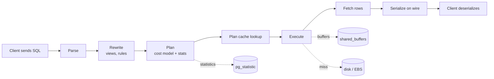
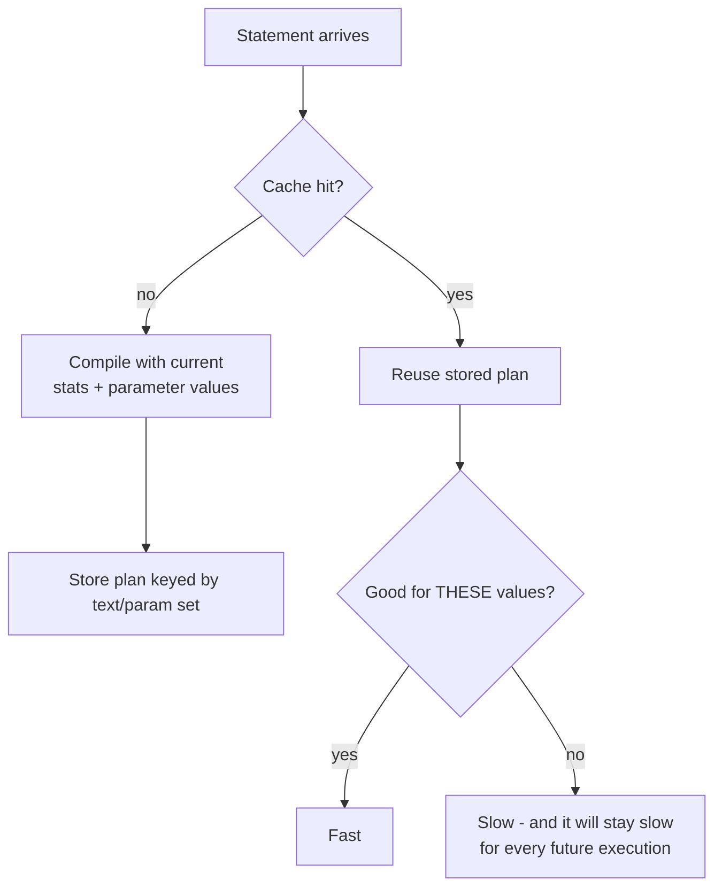

# Why a Query Is Slow

> "The query is slow" is never a root cause — it is a symptom report from someone who is not
> looking at the plan. A query is slow for exactly one of six reasons: it **reads too much data**,
> it **burns too much CPU per row**, it **runs out of memory and spills**, it **waits** (on locks,
> latches, I/O, or a client that does not consume the result set), it **moves more bytes than it
> needs to**, or it is a **perfectly fine query whose cached plan was built for a different set of
> parameters**. Almost every "the database is slow" incident is one of those six wearing a
> costume. This chapter teaches you to identify which one in under a minute, using the plan, the
> buffer counters, and the wait events — before you touch a single index.

---

## TL;DR

- **Six failure modes, not one.** I/O volume, CPU per row, memory/spill, waiting/locking,
  network + serialization, and plan-cache pathology. Diagnose *which* before optimizing *what*.
- **`EXPLAIN` shows the plan; `EXPLAIN (ANALYZE, BUFFERS)` shows the plan *and* the row counts,
  the actual time, and the per-node buffer reads.** Always use both. The single highest-value
  skill in this part of the book is reading `actual rows=... loops=...` against `rows=...`.
- **A full scan is not automatically bad.** Sequentially scanning 10 GB at 2 GB/s is ~5 seconds.
  Doing 27,000 random 8 KB reads is also ~5 seconds. The question is *how much of the table the
  query actually needs*, and whether the storage can do random I/O cheaply (SSD: yes; spinning
  disk or network-attached EBS with throttled IOPS: no).
- **Cost units are not milliseconds.** PostgreSQL's `cost=0.43..12,345.67` is a *relative*
  number in arbitrary page/CPU units. Never compare a cost to a wall-clock time; compare costs
  between alternative plans and compare *time* to *time*.
- **Estimated rows vs actual rows is the master diagnostic.** If `rows=1` was estimated and
  `actual rows=2,400,000` came back, the plan is not wrong — the *statistics* are wrong, and
  every downstream decision (nested loop vs hash join, join order, memory grant) was made on
  fiction.
- **The five classic index-killers** are: a function on the indexed column
  (`WHERE date_trunc('day', ts) = ...`), an implicit or explicit **cast** that changes the
  comparison's type, a **leading-wildcard** `LIKE '%foo'`, an **`OR`** across different columns,
  and **low selectivity** (the predicate matches 30 % of the table — a scan is *correct*).
- **`SELECT *` is a performance bug**, not a style preference: it defeats index-only scans,
  transfers and deserializes columns nobody reads, may pull `TOAST`/off-page values, and makes
  covering indexes impossible.
- **Waiting is not working.** A query blocked on a lock consumes no CPU and appears in
  `pg_stat_activity` with `wait_event_type = 'Lock'`. Optimizing the SQL of a blocked query is
  wasted effort; find the *blocker*.
- **Beware the plan cache.** Generic/parameterized plans, `preparedThreshold`, SQL Server
  "parameter sniffing", and prepared-statement plan reuse all mean **the plan that ran is not
  the plan you see**. Reproduce with the real parameter values before believing anything.
- **The default tuning order is: (1) fix the query, (2) fix the statistics, (3) fix the index,
  (4) fix the configuration, (5) only then hint.** Hints freeze a decision the optimizer should
  be making from data you can fix.

---

## 1. Definitions and core concepts

| Term | Definition |
|---|---|
| **Page / block** | The unit of storage I/O. PostgreSQL and SQL Server: 8 KB. MySQL InnoDB: 16 KB. Oracle: 8 KB (configurable). |
| **Logical read** | A page fetched from the buffer pool / shared buffers. Cheap-ish but not free (it takes a latch). |
| **Physical read** | A page fetched from storage. 100–1000× more expensive than a logical read. |
| **Sequential I/O** | Reading adjacent pages. Prefetchable, ~1–3 GB/s on NVMe, ~100–200 MB/s on HDD. |
| **Random I/O** | Reading scattered pages. ~50–150 µs on NVMe, ~5–10 ms on HDD (seek + rotational latency). |
| **Seek (index access)** | Descend a B-tree to a leaf, then read the heap/row. Cost scales with `log(rows)` + matching rows. |
| **Scan (full/sequential)** | Read every page of the relation. Cost scales with `pages`. |
| **Cardinality** | The number of rows an operator produces. Estimated cardinality drives everything. |
| **Selectivity** | Fraction of input rows surviving a predicate. `selectivity = output rows / input rows`, in `[0,1]`. Lower = more selective = better index candidate. |
| **Sargable** | A predicate of the form *column* *op* *constant* (or another column) that the optimizer can turn into an index range. `WHERE ts >= $1` is sargable; `WHERE date(ts) = $1` is not. |
| **Cost model** | The formulas and constants (`seq_page_cost`, `random_page_cost`, `cpu_tuple_cost`, `cpu_index_tuple_cost`, `cpu_operator_cost`, `effective_cache_size`) used to score candidate plans. |
| **Buffers** | With `EXPLAIN (ANALYZE, BUFFERS)`: `shared hit` (buffer pool), `read` (from disk), `dirtied`, `written`. The single best proxy for I/O volume. |
| **Spill** | An operator exceeding its memory budget writing to temp files (`Sort Method: external merge Disk: 512MB`). |
| **Wait event** | What a backend is blocked on when not running: `Lock`, `IO`, `LWLock`, `Client`, `BufferPin`, etc. |
| **Plan cache / prepared statement cache** | Server-side storage of a compiled plan keyed by the parameterized statement text. Reused across executions → may be wrong for some parameter sets. |
| **Generic vs custom plan** | PostgreSQL-prepared statements: a *custom* plan is built with the actual parameter values; a *generic* plan is built without them and reused. |
| **Parameter sniffing** | SQL Server term for "the cached plan was compiled using the first parameter values seen", which may be pathological for other values. |
| **N+1 query** | The application issues 1 query to get N parents and N queries for children. Not a SQL problem; a data-access-architecture problem that looks like one. |

> **Senior note:** "Slow" is a relative statement. Pin it down: slow **compared to what**, **for
> which parameters**, **at what time of day**, and **is it slow now or was it slow once**?
> A query that is slow only at 03:00 is a concurrency/contention problem, not a plan problem.

---

## 2. Why it matters / what problem it solves

### 2.1 The latency budget

Every user-facing request has a budget. A typical e-commerce product page:

```
  5 ms   network (edge)
 15 ms   application routing / auth
 40 ms   cache lookups (Redis)
 60 ms   Postgres: 4 queries            <-- the part you control
 25 ms   JSON serialization
 15 ms   browser render
 ---------
160 ms   target p95
```

Fifty milliseconds of SQL budget does not survive *one* `Seq Scan` on a 50 M-row table. And it
does not survive an N+1 loop of 200 index lookups either, even though each lookup is "fast"
(200 × 0.3 ms = 60 ms of pure round-trips).

### 2.2 The amplification law

Cost does not grow linearly with data; it grows with **how many rows each stage must touch**:

```
rows_touched = rows_scanned × rows_per_probe × number_of_probes × ... (per join, per subquery)
```

A nested loop over 1 M outer rows probing a table for 1 row each = 1 M random I/Os. If each is
an 8 KB random read at 80 µs, that is 80 seconds — even though "only 1 M rows" were involved
and every index seek was individually fast. This is why the *shape* of the plan (and the row
estimate feeding it) matters more than the individual access method.

### 2.3 The operational consequences

| Symptom | Likely root cause class |
|---|---|
| p99 spike with unchanged code | Statistics drift / plan flip / data growth past a threshold |
| Everything slow at once | I/O saturation, checkpoint storm, `autovacuum` run, replica lag |
| One report slow, OLTP fine | Missing index for an analytical predicate; report reads 100× the OLTP working set |
| Slow only for one customer | Data skew + parameter sniffing |
| Slow only in production, fast in staging | Scale (statistics differ), concurrency (locks), or configuration (`work_mem`, buffer pool) |
| Slow after a deploy | A new index changed the planner's cost landscape, or a new predicate made an existing index unusable |

> **Senior note:** When the OLTP workload degrades *because* of an analytical query, you have a
> workload-isolation problem, not a query problem. The fix is a read replica, a resource group
> (SQL Server), a workload warehouse (Snowflake), or a materialized view — not another index.

---

## 3. How it works internally

### 3.1 The shared e-commerce schema

All examples in this section (and Part II's optimization chapters) use this schema. It is the
same one introduced in *Query Writing*, so the numbers stay comparable across chapters.

```sql
-- ============================================================
-- Shared e-commerce sample schema (PostgreSQL 16)
-- ============================================================
CREATE TABLE customers (
    customer_id   bigserial PRIMARY KEY,
    email         text        NOT NULL UNIQUE,
    full_name     text        NOT NULL,
    country_code  char(2)     NOT NULL,
    signup_date   date        NOT NULL,
    loyalty_tier  text        NOT NULL DEFAULT 'bronze',
    is_active     boolean     NOT NULL DEFAULT true
);

CREATE TABLE categories (
    category_id  int  PRIMARY KEY,
    name         text NOT NULL,
    parent_id    int  REFERENCES categories(category_id)
);

CREATE TABLE products (
    product_id   bigserial PRIMARY KEY,
    sku          text         NOT NULL UNIQUE,
    name         text         NOT NULL,
    category_id  int          REFERENCES categories(category_id),
    unit_price   numeric(12,2) NOT NULL,
    cost         numeric(12,2),
    is_active    boolean      NOT NULL DEFAULT true,
    attributes   jsonb,
    created_at   timestamptz  NOT NULL DEFAULT now()
);

CREATE TABLE orders (
    order_id     bigserial PRIMARY KEY,
    customer_id  bigint       NOT NULL REFERENCES customers(customer_id),
    status       text         NOT NULL,   -- pending|paid|shipped|cancelled|returned
    order_ts     timestamptz  NOT NULL,
    country_code char(2)      NOT NULL,
    total_amount numeric(12,2) NOT NULL,
    currency     char(3)      NOT NULL DEFAULT 'USD'
);

CREATE TABLE order_items (
    order_item_id bigserial PRIMARY KEY,
    order_id      bigint       NOT NULL REFERENCES orders(order_id),
    product_id    bigint       NOT NULL REFERENCES products(product_id),
    quantity      int          NOT NULL,
    unit_price    numeric(12,2) NOT NULL,
    discount      numeric(5,2)  NOT NULL DEFAULT 0
);

CREATE TABLE employees (
    employee_id int  PRIMARY KEY,
    full_name   text NOT NULL,
    manager_id  int  REFERENCES employees(employee_id),
    department  text NOT NULL,
    hired_on    date NOT NULL,
    salary      numeric(12,2)
);

-- The events table is partitioned by month (see 08-partition-pruning.md).
CREATE TABLE events (
    event_id    bigserial,
    session_id  uuid        NOT NULL,
    customer_id bigint,                    -- NULL for anonymous traffic
    event_type  text        NOT NULL,      -- page_view|add_to_cart|checkout|...
    occurred_at timestamptz NOT NULL,
    payload     jsonb,
    PRIMARY KEY (event_id, occurred_at)
) PARTITION BY RANGE (occurred_at);
```

Indexes used throughout this chapter:

```sql
CREATE INDEX idx_orders_ts             ON orders (order_ts);
CREATE INDEX idx_orders_customer_ts    ON orders (customer_id, order_ts DESC);
CREATE INDEX idx_orders_status_ts      ON orders (status, order_ts);
CREATE INDEX idx_order_items_order     ON order_items (order_id);
CREATE INDEX idx_order_items_product   ON order_items (product_id);
CREATE INDEX idx_products_category     ON products (category_id);
CREATE INDEX idx_products_cat_price    ON products (category_id, unit_price) WHERE is_active;
CREATE INDEX idx_customers_country     ON customers (country_code);
CREATE INDEX idx_events_session        ON events (session_id, occurred_at DESC);
```

**Silent profile of the sample dataset** (used for every cost number in this section):

| Relation | Rows | Avg row width | Pages (8 KB) | Size |
|---|---:|---:|---:|---:|
| `customers` | 2,000,000 | 120 B | 33,000 | ~260 MB |
| `categories` | 2,000 | 60 B | 20 | 160 KB |
| `products` | 500,000 | 220 B | 16,000 | ~125 MB |
| `orders` | 50,000,000 | 150 B | 1,250,000 | ~9.5 GB |
| `order_items` | 150,000,000 | 90 B | 2,000,000 | ~15 GB |
| `events` | 2,000,000,000 | 300 B | 75,000,000 | ~570 GB |
| `employees` | 500 | 80 B | 5 | 40 KB |

Clusters run PostgreSQL 16 with `shared_buffers = 8GB`, `work_mem = 64MB`,
`effective_cache_size = 24GB`, `seq_page_cost = 1.0`, `random_page_cost = 4.0`
(the default — we will revisit this in §5.6), `default_statistics_target = 100`.

### 3.2 The query lifecycle, and where time goes



Time spent, in rough order of frequency in production incidents:

1. **Execution I/O** — the dominant term whenever rows touched > ~10⁵.
2. **Execution CPU** — expression evaluation, hashing, sorting, `jsonb` parsing, regexps, PL/pgSQL.
3. **Planning** — normally < 1 ms, but a pathological query with 15 joins can spend hundreds of
   ms in the planner (PostgreSQL's GEQO kicks in above `geqo_threshold`, default 12 relations).
4. **Waiting** — locks, `LWLock`s, commit-time WAL flush (`synchronous_commit = on`).
5. **Network + serialization** — usually small per row, fatal at 10⁷ rows.
6. **Client-side** — ORM hydration. A 10 ms query can be a 900 ms request in a naive ORM.

### 3.3 Full scan vs seek: the actual math

A sequential scan's cost in PostgreSQL:

```
cost_seqscan ≈ pages × seq_page_cost
             + rows × cpu_tuple_cost
             + rows × cpu_operator_cost × (number of quals + projections)
```

For `orders` (1,250,000 pages, 50 M rows), no index can help:

```
= 1,250,000 × 1.0  +  50,000,000 × 0.01  +  50,000,000 × 0.0025
= 1,250,000        +        500,000       +          125,000
= 1,875,000                                    -- arbitrary cost units
```

An index scan's cost:

```
cost_indexscan ≈ (index_pages_touched × random_page_cost)
               + (heap_pages_fetched × random_page_cost)
               + rows_fetched × cpu_index_tuple_cost
               + rows_returned × (cpu_tuple_cost + quals × cpu_operator_cost)
```

For a one-day slice of `orders` (~27,400 rows, ~270 index pages, ~200 heap pages with
correlation ≈ 1.0):

```
≈ 270 × 4.0 + 200 × 4.0 + 27,400 × 0.005 + 27,400 × 0.0125
≈ 1,080     + 800       + 137            + 342
≈ 2,359
```

2,359 ≪ 1,875,000 → the planner picks the index. Correct. But now ask for 18 months of orders
(~27 M rows, ~30 % of the table):

```
index:  ~30 % of 1.25 M heap pages × random_page_cost = ~1,500,000  (plus loss of correlation)
seq:     1,875,000
```

The planner will — correctly — switch to a sequential scan. **That is not a bug.** This is the
single most common false alarm in query optimization: "the index isn't being used!" when the
index is simply the *wrong tool* for that predicate.

**The crossover rule of thumb:** an index range scan beats a sequential scan when the predicate
matches roughly **< 5–10 %** of the table on HDD-like storage, and **< 15–25 %** on NVMe/SSD
because random reads are cheap. The lever that expresses "how cheap is random I/O here" is
`random_page_cost`: on SSD set it to **1.1**; on NVMe, **1.0**; on EBS with burst IOPS, **2–3**.

### 3.4 I/O vs CPU vs memory: how to tell them apart

| Signal | Diagnosis |
|---|---|
| High `blks_read`, low `shared hit` | I/O-bound: working set does not fit in buffers, or the plan reads too much |
| High `shared hit`, low `blks_read`, high time | CPU-bound or lock-bound inside a node (hashing, sort comparisons, expression eval) |
| No `shared` or `read`, high time, `Buffers` absent | Waiting downstream (client not consuming, `SELECT ... FOR UPDATE` blocked) |
| Node shows `Sort Method: external merge Disk: 480MB` | Memory-bound → raise `work_mem` **or** reduce the sorted set |
| Node shows `Batches: 8` on a Hash Join | Hash table spilled or skewed → same fix |
| `rows=1` estimated, `actual rows=1,200,000` | Statistics-bound → everything downstream is a guess |
| Time much higher than `Buffers` justify | Concurrency: `pg_stat_activity` shows `wait_event_type` |

### 3.5 Why estimates diverge from reality (preview of Chapter 7)

The planner's estimate chain is: **statistics → selectivity → cardinality → cost → plan**. It
breaks at the selectivity step, and the four recurring causes are:

1. **Stale statistics.** `pg_statistic` was last updated before the bulk load. `last_analyze`
   in `pg_stat_all_tables` is 6 hours old and 40 M rows arrived since.
2. **Correlated predicates.** `WHERE country_code = 'DE' AND currency = 'EUR'` on a table where
   currency is functionally determined by country. PostgreSQL multiplies the two selectivities
   assuming independence → underestimates by ~1/0.83.
3. **Non-uniform distributions beyond the MCV list.** A `histogram_bounds` of 100 buckets cannot
   describe a spike of 3 M rows at a single timestamp.
4. **Expressions and casts.** `WHERE lower(email) = 'a@b.com'` has no statistics at all unless an
   expression index exists.

### 3.6 Waiting: the invisible half of "slow"

A query not using CPU is not necessarily efficient — it may be blocked:

```sql
SELECT pid, now() - xact_start AS xact_age, wait_event_type, wait_event,
       left(query, 80) AS query
FROM pg_stat_activity
WHERE state <> 'idle'
ORDER BY xact_start
LIMIT 20;
```

Typical output during an incident:

```
 pid   | xact_age  | wait_event_type | wait_event      | query
-------+-----------+-----------------+-----------------+--------------------------------
 88123 | 00:02:14  | Lock            | transactionid   | UPDATE orders SET status=...
 88190 | 00:02:13  | Lock            | tuple           | UPDATE order_items SET ...
 88210 | 00:00:00  | Client          | ClientRead      | COMMIT
```

Three backends "slow" — one actually working, two waiting. The fix is to find and finish (or
kill) pid 88123, not to rewrite the `UPDATE`.

Common waiting flavors:

| Layer | Event | Meaning |
|---|---|---|
| Row lock | `Lock: transactionid` / `tuple` | Another transaction holds the row |
| Table lock | `Lock: relation` | DDL (`ALTER TABLE`) or `LOCK TABLE` blocks readers/writers |
| Buffer | `LWLock: BufferContent` | Hot-page contention under extreme concurrency |
| Commit | `IO: WALWrite` | Durability: waiting for `fsync` (`synchronous_commit=on`) |
| Client | `Client: ClientRead` | The app is not sending the next statement — the app is slow, not the DB |
| Checkpoint | `IO: CheckpointWrite` | Checkpoint flushing dirty buffers |

### 3.7 Network and serialization

The database's execution time can be 2 % of the round-trip. Costs that do not appear in
`EXPLAIN ANALYZE` at all:

- **Row width on the wire.** `SELECT *` on `products` sends the `jsonb attributes` column:
  40 KB per row in the worst case, 20 GB for 500 K products. Projecting 4 columns sends 25 MB.
- **Round trips.** N+1: 200 queries × 0.4 ms RTT = 80 ms of pure latency even if each query is
  0.02 ms of server work.
- **Deserialization.** Parsing `jsonb`/`JSON` 2 M times in the app costs more than the query.
- **WAL shipping / replication overhead** for write-heavy statements — invisible in `EXPLAIN`.

### 3.8 Blowing the plan cache

Every engine caches compiled plans. That cache is a *heuristic* well: excellent when plans are
stable, catastrophic when they are not.



Failure modes:

| Engine | Mechanism | Symptom |
|---|---|---|
| PostgreSQL | Prepared statement flips to a **generic plan** after 5 executions if its cost ≤ average custom plan cost | `EXPLAIN EXECUTE` shows `Filter` where `Index Cond` used to be; queries on rare values go 100× slower |
| PostgreSQL | Plan cache invalidation on DDL/`ANALYZE` | A one-time burst of planning cost; usually benign |
| SQL Server | **Parameter sniffing** — plan compiled for the first values | The "unlucky parameter" problem; `OPTION (RECOMPILE)` or `OPTIMIZE FOR` |
| SQL Server | Plan cache bloat from ad-hoc SQL (no parameterization) | `sys.dm_exec_cached_plans` grows unbounded; memory pressure |
| MySQL | Prepared statement plan reuse, `query_cache` (removed in 8.0) | Stale plans; historically, mutex contention on cache invalidation |
| Oracle | **Bind peeking** + adaptive cursor sharing | Same class of problem; `ACS` mitigates automatically |

> **Senior note:** If a query is fast with literals and slow with bind parameters (or vice
> versa), you have a plan-cache problem, not an index problem. The fix is almost never an index —
> it is `plan_cache_mode = force_custom_plan`, `OPTION (RECOMPILE)`, or rewriting so that the
> plan is *invariant* across parameter values.

---

## 4. How to diagnose it

### 4.1 PostgreSQL

```sql
-- The one command that answers most questions.
EXPLAIN (ANALYZE, BUFFERS, VERBOSE, SETTINGS)
SELECT ...;

-- Non-executing plan (no side effects, no waiting). Good for prod.
EXPLAIN (COSTS, VERBOSE) SELECT ...;

-- Machine-readable, diffable, and the only format that annotates
-- "Rows Removed by Filter".
EXPLAIN (ANALYZE, BUFFERS, FORMAT JSON) SELECT ...;
```

Key knobs:

| Setting | Where | Purpose |
|---|---|---|
| `shared_preload_libraries = 'pg_stat_statements'` | `postgresql.conf` | Aggregate execution stats by normalized query |
| `log_min_duration_statement = 500` | session/global | Log every query over 500 ms |
| `auto_explain.log_min_duration = 500` | session only | Log the *plan* for slow queries |
| `track_io_timing = on` | global | Enables `I/O Timings: read=... write=...` in `EXPLAIN ANALYZE` |
| `pg_stat_statements.track = all` | global | Include nested statements (PL/pgSQL, functions) |
| `log_parser_stats`, `log_planner_stats`, `log_executor_stats` | dev only | Node-by-node instrumentation |

Finding the top offenders:

```sql
SELECT
    substring(query, 1, 90)                       AS query,
    calls,
    round(total_exec_time::numeric, 1)            AS total_ms,
    round(mean_exec_time::numeric, 2)             AS mean_ms,
    rows,
    round(100 * total_exec_time / sum(total_exec_time)
          OVER (), 1)                             AS pct_of_total,
    shared_blks_hit, shared_blks_read,
    temp_blks_written
FROM pg_stat_statements
WHERE query NOT LIKE '%pg_stat_statements%'
ORDER BY total_exec_time DESC
LIMIT 20;
```

Read it as: **total time** finds the systemic load; **mean time with high `calls`** finds the
p99 driver; **`temp_blks_written`** finds the spilling queries; **`shared_blks_read`** finds the
I/O hogs. In almost every production database, 20 queries account for > 80 % of the time.

### 4.2 SQL Server

```sql
-- Top CPU consumers, with the plan handle so you can look at the plan.
SELECT TOP 20
       qs.total_worker_time / 1000              AS total_cpu_ms,
       qs.total_worker_time / qs.execution_count AS avg_cpu_us,
       qs.total_logical_reads, qs.total_physical_reads,
       qs.execution_count,
       SUBSTRING(st.text, (qs.statement_start_offset/2)+1, 120) AS stmt,
       qp.query_plan
FROM sys.dm_exec_query_stats qs
CROSS APPLY sys.dm_exec_sql_text(qs.sql_handle) st
CROSS APPLY sys.dm_exec_query_plan(qs.plan_handle) qp
ORDER BY qs.total_worker_time DESC;
```

Wait stats for the instance (what the server spends its time *waiting* on):

```sql
SELECT TOP 15 wait_type,
       wait_time_ms / 1000.0 AS wait_s,
       waiting_tasks_count,
       100.0 * wait_time_ms / SUM(wait_time_ms) OVER () AS pct
FROM sys.dm_os_wait_stats
WHERE wait_type NOT IN ('CLR_SEMAPHORE','LAZYWRITER_SLEEP','SLEEP_TASK',
                        'BROKER_TASK_STOP','XE_TIMER_EVENT','WAITFOR',
                        'CHECKPOINT_QUEUE','REQUEST_FOR_DEADLOCK_SEARCH')
ORDER BY wait_time_ms DESC;
```

Also: **Query Store** (`ALTER DATABASE ... SET QUERY_STORE = ON`) for plan-change regression
detection, **Live Query Statistics** for in-flight plans, and **Extended Events**
(`sqlserver.query_post_execution_showplan`) for plan capture.

### 4.3 MySQL

```sql
EXPLAIN ANALYZE SELECT ...;            -- 8.0.18+, TREE format with actual times/rows
EXPLAIN FORMAT=JSON SELECT ...;        -- costs + used_key_parts + attached_condition
SHOW WARNINGS;                         -- post-EXPLAIN rewrite/notes
SET optimizer_trace='enabled=on';      -- full optimizer trace
SELECT * FROM information_schema.optimizer_trace;
SELECT * FROM performance_schema.events_statements_summary_by_digest
ORDER BY SUM_TIMER_WAIT DESC LIMIT 20;
```

MySQL's `EXPLAIN` line for the *first* table shows the driving (outer) table and
`rows × filtered` estimates the rows passed to the next table — multiply down the plan to get a
rough total like PostgreSQL's cost.

### 4.4 The universal first three questions

1. **How many rows does the query need?** (`actual rows` at the top node.)
2. **How many rows does it touch to get them?** (`actual rows` × `loops` across all nodes.)
3. **Where do the estimates diverge from actuals by more than 10×?**

Answer those three and 80 % of "why is it slow" is settled.

---

## 5. Worked examples

### 5.1 Example 1 — A function on an indexed column kills the index

**The report:** monthly revenue. Runs in 94 s.

```sql
-- SLOW
SELECT date_trunc('month', order_ts) AS month,
       sum(total_amount)             AS revenue
FROM orders
WHERE date_trunc('month', order_ts) = DATE '2025-03-01'
GROUP BY 1;
```

```text
GroupAggregate  (cost=1875000.00..1875000.10 rows=1 width=40) (actual time=94112.7..94112.7 rows=1 loops=1)
  Group Key: (date_trunc('month'::text, order_ts))
  ->  Sort  (cost=1875000.00..1875000.02 rows=1 width=40) (...)
        Sort Key: (date_trunc('month'::text, order_ts))
        Sort Method: quicksort  Memory: 25kB
        ->  Seq Scan on orders  (cost=0.00..1874999.99 rows=1 width=40)
                                 (actual time=0.014..92410.55 rows=27394 loops=1)
              Filter: (date_trunc('month'::text, order_ts) = '2025-03-01 00:00:00+00'::timestamptz)
              Rows Removed by Filter: 49972606
Planning Time: 0.412 ms
Execution Time: 94112.9 ms
Buffers: shared hit=1429 read=1248571 dirtied=0 written=0
```

**Diagnosis.**
- `Seq Scan` + `Rows Removed by Filter: 49,972,606` → the predicate is evaluated on every row.
- `rows=1` estimated vs `rows=27,394` actual → the planner has **no statistics** for
  `date_trunc(...)`, so it guessed the default equality selectivity (0.005 → wait, here it fell
  into the "unknown expression" bucket). It guessed 1.
- `read=1,248,571` pages ≈ 9.5 GB read to return 27,394 rows — a **3,600× read amplification**.

**Why:** `date_trunc('month', order_ts)` is a function of the indexed column. The B-tree on
`order_ts` is ordered by `order_ts`, not by `date_trunc('month', order_ts)`. The planner cannot
map a constant on the *result* of the function to a range of `order_ts` values.
This is the classic **non-sargable predicate**.

**The fix — rewrite to a sargable range:**

```sql
-- FAST
SELECT date_trunc('month', order_ts) AS month,
       sum(total_amount)             AS revenue
FROM orders
WHERE order_ts >= DATE '2025-03-01'
  AND order_ts <  DATE '2025-04-01'
GROUP BY 1;
```

```text
GroupAggregate  (cost=3512.44..3513.10 rows=1 width=40) (actual time=11.201..11.204 rows=1 loops=1)
  Group Key: (date_trunc('month'::text, order_ts))
  ->  Sort  (cost=3512.44..3512.51 rows=27 width=40) (actual time=11.190..11.193 rows=1 loops=1)
        Sort Key: (date_trunc('month'::text, order_ts))
        Sort Method: quicksort  Memory: 25kB
        ->  Index Scan using idx_orders_ts on orders
              (cost=0.44..3511.85 rows=27394 width=40) (actual time=0.021..6.732 rows=27394 loops=1)
              Index Cond: ((order_ts >= '2025-03-01 00:00:00+00'::timestamptz)
                       AND (order_ts <  '2025-04-01 00:00:00+00'::timestamptz))
Planning Time: 0.221 ms
Execution Time: 11.206 ms
Buffers: shared hit=1246 read=152
```

**94,113 ms → 11.2 ms. ~8,400×.** No index was created; the index that already existed simply
became usable. The buffers tell the whole story: 1,248,571 pages → 1,398 pages.

**Alternative fix** (when you cannot change the query, e.g. it comes from a BI tool): create an
expression index so the function *is* indexed. See Chapter 2.

```sql
CREATE INDEX idx_orders_month ON orders (date_trunc('month', order_ts));
```

> **Senior note:** Note that PostgreSQL 12+ can sometimes inline a `date_trunc` on a *partition
> key* for pruning, but that is a special case for partitioned tables (Chapter 8), not a general
> sargability feature.

---

### 5.2 Example 2 — Implicit cast breaks the index

**The report:** the account page for customer `'1000001'` takes 4 s.

```sql
-- SLOW: customer_id is bigint, the parameter arrives as text
SELECT order_id, order_ts, status, total_amount
FROM orders
WHERE customer_id = '1000001'          -- text literal
ORDER BY order_ts DESC
LIMIT 20;
```

```text
Limit  (cost=1428750.44..1428750.49 rows=20 width=48) (actual time=4128.90..4128.94 rows=20 loops=1)
  ->  Gather Merge  (cost=1428750.44..1461833.22 rows=40000 width=48) (...)
        ->  Sort  (cost=1427750.41..1427833.02 rows=33033 width=48) (...)
              Sort Key: order_ts DESC
              ->  Parallel Seq Scan on orders  (cost=0.00..1417125.30 rows=33033 width=48)
                                                (actual time=0.030..3944.20 rows=27 loops=4)
                    Filter: ((customer_id)::text = '1000001'::text)
                    Rows Removed by Filter: 12500000
Planning Time: 0.318 ms
Execution Time: 4129.1 ms
```

**Diagnosis.** The literal `'1000001'` is `unknown`-typed. PostgreSQL resolves
`bigint = unknown` by casting the **column** to `text` (the operator resolution prefers
`text = text` over `bigint = bigint` when the unknown literal could be either... in practice the
observed behaviour is a cast on the column, visible as `(customer_id)::text`). The cast makes
the predicate non-sargable on `idx_orders_customer_ts`. Also: `rows=33,033` estimated vs
`rows=27` actual — the ~1,000× overestimate is exactly what makes the planner pick a
`Parallel Seq Scan` over the index, because it believes 33 K rows are coming.

**The fix — pass the right type:**

```sql
SELECT order_id, order_ts, status, total_amount
FROM orders
WHERE customer_id = 1000001            -- bigint literal / correctly bound parameter
ORDER BY order_ts DESC
LIMIT 20;
```

```text
Limit  (cost=0.56..41.83 rows=20 width=48) (actual time=0.031..0.083 rows=20 loops=1)
  ->  Index Scan Backward using idx_orders_customer_ts on orders
        (cost=0.56..11872.98 rows=5792 width=48) (actual time=0.029..0.077 rows=20 loops=1)
        Index Cond: (customer_id = 1000001)
Planning Time: 0.271 ms
Execution Time: 0.098 ms
Buffers: shared hit=6
```

**4,129 ms → 0.098 ms.** Six buffer hits instead of a 9.5 GB scan.

**How to find these in bulk** (PostgreSQL):

```sql
-- Find the index on (customer_id, ...) and its type, then grep code for string params.
SELECT a.attname, format_type(a.atttypid, a.atttypmod) AS type
FROM pg_attribute a
WHERE a.attrelid = 'orders'::regclass AND a.attnum > 0;

-- Server-side: predicates that cast the column show up as Filter on a Seq Scan
-- in auto_explain output. Track them with pg_qualstats (extension) or by
-- scanning pg_stat_statements.query for the pattern `::text =`.
```

Other engines: MySQL will silently do the same for `varchar` vs `int` comparisons (it converts
the string to a number *per row* — famously index-defeating and it also changes results for
non-numeric strings). SQL Server converts on the basis of **data type precedence**; `nvarchar`
beats `varchar`, and `int` beats `varchar`, so `WHERE int_col = '5'` is fine but
`WHERE varchar_col = 5` is not.

---

### 5.3 Example 3 — `OR` across two different columns

**The report:** "search by order id or by customer email" takes 12 s.

```sql
-- SLOW
SELECT o.order_id, o.order_ts, o.total_amount
FROM orders o
JOIN customers c ON c.customer_id = o.customer_id
WHERE o.order_id = 99887766
   OR c.email    = 'ada.lovelace@example.com';
```

```text
Hash Join  (cost=181193.00..1884512.10 rows=2 width=48) (actual time=12044.31..12044.33 rows=1 loops=1)
  Hash Cond: (o.customer_id = c.customer_id)
  Join Filter: ((o.order_id = 99887766) OR (c.email = 'ada.lovelace@example.com'::text))
  Rows Removed by Join Filter: 49999999
  ->  Seq Scan on orders o  (cost=0.00..1417125.30 rows=50000000 width=24)
                            (actual time=0.011..5033.22 rows=50000000 loops=1)
  ->  Hash  (cost=33000.00..33000.00 rows=2000000 width=28) (...)
        ->  Seq Scan on customers c  (cost=0.00..33000.00 rows=2000000 width=28) (...)
Planning Time: 0.802 ms
Execution Time: 12044.5 ms
```

**Diagnosis.** An `OR` that spans **two different relations** cannot be pushed into either
relation's index — a row of `orders` can only be filtered by `o.order_id`, and a row of
`customers` only by `c.email`. So the optimizer must materialize the cross product (or, as here,
join everything and filter afterwards). `rows=2` estimated but the filter is applied after the
join of 50 M × 2 M rows: `Rows Removed by Join Filter: 49,999,999`.

**The fix — split the `OR` into a `UNION ALL` of two sargable branches:**

```sql
-- FAST
SELECT o.order_id, o.order_ts, o.total_amount
FROM orders o
WHERE o.order_id = 99887766
UNION ALL
SELECT o.order_id, o.order_ts, o.total_amount
FROM orders o
JOIN customers c ON c.customer_id = o.customer_id
WHERE c.email = 'ada.lovelace@example.com'
  AND o.order_id <> 99887766;
```

```text
Append  (cost=0.58..24.94 rows=2 width=48) (actual time=0.041..0.079 rows=1 loops=1)
  ->  Index Scan using orders_pkey on orders o  (cost=0.56..8.58 rows=1 width=48)
                                                (actual time=0.024..0.026 rows=1 loops=1)
        Index Cond: (order_id = 99887766)
  ->  Nested Loop  (cost=0.86..16.35 rows=1 width=48) (actual time=0.046..0.050 rows=0 loops=1)
        ->  Index Scan using customers_email_key on customers c  (cost=0.43..8.45 rows=1 width=8)
                                                                 (actual time=0.030..0.034 rows=1 loops=1)
              Index Cond: (email = 'ada.lovelace@example.com'::text)
        ->  Index Scan using idx_orders_customer_ts on orders o  (cost=0.43..7.85 rows=5 width=48)
                                                                 (actual time=0.011..0.014 rows=0 loops=1)
              Index Cond: (customer_id = c.customer_id)
              Filter: (order_id <> 99887766)
Planning Time: 0.655 ms
Execution Time: 0.113 ms
```

**12,044 ms → 0.113 ms.**

**When you cannot rewrite the SQL:** if the `OR` columns belong to the *same* table, PostgreSQL
can often use a **BitmapOr** of two index scans, which is fine; and MySQL has an "index merge"
access type for the same thing. If the `OR` crosses tables, a `UNION ALL` is the only portable
fix. (Details in Chapter 2 §bitmap scans and Chapter 3 §OR conditions.)

---

### 5.4 Example 4 — Leading wildcard `LIKE`

```sql
-- SLOW
SELECT product_id, name, unit_price
FROM products
WHERE name LIKE '%wireless%'
  AND is_active;
```

```text
Seq Scan on products  (cost=0.00..22150.00 rows=25 width=40) (actual time=0.028..86.512 rows=1184 loops=1)
  Filter: (is_active AND (name ~~ '%wireless%'::text))
  Rows Removed by Filter: 498816
  Buffers: shared hit=16000
Planning Time: 0.088 ms
Execution Time: 86.6 ms
```

**Diagnosis.** A B-tree is sorted by the *prefix* of the column. `LIKE 'wireless%'` maps to a
range on the index. `LIKE '%wireless%'` maps to *no range at all* — every prefix is a candidate.
86 ms is acceptable here, but on a 200 M-row product catalogue this becomes a minutes-long scan.

**The fixes, in order of preference:**

1. **Full-text search** (`tsvector` + GIN index, or Snowflake `SEARCH OPTIMIZATION`, or SQL Server
   full-text). Best semantics, best performance, most honest about what "search" means.
2. **Trigram index** (PostgreSQL `pg_trgm`):

```sql
CREATE EXTENSION IF NOT EXISTS pg_trgm;
CREATE INDEX idx_products_name_trgm ON products USING gin (name gin_trgm_ops);
```

```text
Bitmap Heap Scan on products  (cost=64.20..418.94 rows=1184 width=40) (actual time=3.512..4.980 rows=1184 loops=1)
  Recheck Cond: (name ~~ '%wireless%'::text)
  Heap Blocks: exact=612
  ->  Bitmap Index Scan on idx_products_name_trgm  (cost=0.00..63.90 rows=1184 width=0)
                                                   (actual time=3.421..3.421 rows=1184 loops=1)
        Index Cond: (name ~~ '%wireless%'::text)
Execution Time: 5.1 ms
```

3. **Suffix-only pattern** (`LIKE 'wireless%'`) → an ordinary B-tree with `text_pattern_ops`
   works. This is still the fastest option when the requirement allows it.

---

### 5.5 Example 5 — `SELECT *` defeats an index-only scan

```sql
-- SLOW-ISH
SELECT *
FROM products
WHERE category_id = 42 AND is_active;
```

```text
Index Scan using idx_products_cat_price on products
  (cost=0.42..4820.10 rows=1043 width=240) (actual time=0.030..4.910 rows=1043 loops=1)
  Index Cond: ((category_id = 42) AND is_active)
  Buffers: shared hit=1394 read=212
Execution Time: 4.95 ms
```

```sql
-- FAST: project only what you use
SELECT product_id, name, unit_price
FROM products
WHERE category_id = 42 AND is_active;
```

```text
Index Only Scan using idx_products_cat_price on products
  (cost=0.42..62.13 rows=1043 width=40) (actual time=0.021..0.412 rows=1043 loops=1)
  Heap Fetches: 0
  Buffers: shared hit=9
Execution Time: 0.44 ms
```

**Diagnosis.** `SELECT *` forced the plan off the covering index (`idx_products_cat_price`
contains `category_id`, `unit_price`, and `is_active`, plus the heap TID). 1,606 buffers → 9
buffers, 11× faster. On `products` this is trivial; on `events` (570 GB) it is the difference
between 3 seconds and 40 minutes.

**Secondary damage from `SELECT *`:**
- `jsonb`/`text` columns may be stored out-of-line (TOAST). Reading them costs extra random I/O.
- The app deserializes columns it discards: measurable CPU in every language.
- Any schema migration that adds a column silently changes every `SELECT *` response, breaking
  clients and invalidating query-result caches.

---

### 5.6 Example 6 — The plan-cache flip (a 3-hour report becomes a 30-minute one)

**Context.** The nightly finance report runs `INSERT ... SELECT` aggregating 18 months of
`orders`. It has been 3 hours for a year. Two things changed in the same week: `random_page_cost`
was lowered from 4.0 to 1.1 (SSD migration), and `default_statistics_target` was raised.

**Before** (HDD-era config, plan picked a nested loop over a large index range):

```text
Nested Loop  (cost=0.86..84210044.10 rows=1 width=41) (actual time=0.044..10932441.7 rows=18124402 loops=1)
  ->  Seq Scan on customers c  (cost=0.00..38000.00 rows=2000000 width=8) (...)
  ->  Index Scan using idx_orders_customer_ts on orders o  (cost=0.86..39.12 rows=21 width=41)
                                                            (actual time=0.003..5.1 rows=9 loops=2000000)
        Index Cond: (customer_id = c.customer_id)
        Filter: ((order_ts >= '2024-07-01') AND (order_ts < '2026-01-01'))
        Rows Removed by Filter: 16
Planning Time: 4.412 ms
Execution Time: 10932445.1 ms     -- 3 h 2 min
```

**Diagnosis.** 2,000,000 outer rows × 5.1 ms per inner probe = 10,200,000 ms. The inner index
scan is *individually* fast (5 ms) and *collectively* catastrophic. `loops=2000000` is the
number that matters, and it only appears in `EXPLAIN ANALYZE`. The estimate `rows=21` per loop
× 2 M loops = 42 M rows vs 18.1 M actual — off by 2.3×, enough to prefer the loop.

**After** (with SSD-appropriate costs and fresh statistics, the planner chose a hash join):

```text
Hash Join  (cost=412884.00..1455923.83 rows=18124402 width=41) (actual time=311.221..184233.6 rows=18124402 loops=1)
  Hash Cond: (o.customer_id = c.customer_id)
  ->  Append  (cost=0.42..881234.10 rows=18124402 width=41) (actual time=0.031..82113.5 rows=18124402 loops=1)
        ->  Index Scan using orders_2024h2_order_ts_idx on orders_2024h2 o  (...)
              Index Cond: ((order_ts >= '2024-07-01') AND (order_ts < '2025-01-01'))
        ... (5 more partitions)
  ->  Hash  (cost=38000.00..38000.00 rows=2000000 width=8) (actual time=240.100..240.100 rows=2000000 loops=1)
Planning Time: 12.884 ms
Execution Time: 184233.9 ms        -- 3 min 4 s
```

**10,932,445 ms → 184,234 ms** — a 59× improvement from *two configuration/statistics changes
and zero SQL edits*.

The lesson is not "nested loops are bad" — it is that **the optimizer's choice is only as good
as its cost constants and its row estimates**. When random I/O is genuinely 4× cheaper than the
default, the whole plan landscape changes.

**The three-way fix, in order:**

```sql
-- 1. Tell the truth about storage (SSD / NVMe).
ALTER SYSTEM SET random_page_cost = 1.1;     -- 1.0 on NVMe, 2.0-3.0 on burst-IOPS EBS
ALTER SYSTEM SET effective_io_concurrency = 200;   -- 1 on HDD, 200 on NVMe
ALTER SYSTEM SET effective_cache_size = '24GB';    -- measure, do not guess

-- 2. Keep statistics fresh for the hot tables.
ALTER TABLE orders ALTER COLUMN status SET STATISTICS 500;
ALTER TABLE orders ALTER COLUMN order_ts SET STATISTICS 500;
ANALYZE orders;

-- 3. Give the sort/hash nodes room so they do not spill.
SET work_mem = '256MB';   -- per sort/hash node per connection - do the arithmetic!
```

> **Senior note:** `work_mem` is *per operation*, not per connection. A query with 5 hash joins
> and 3 sorts under a 256 MB `work_mem` can allocate 2 GB. Set it per-session for a known
> batch job (`SET LOCAL work_mem = '1GB'`), never globally to 1 GB.

---

### 5.7 Example 7 — The 3-hour report that was waiting, not computing

**Context.** `reports/monthly.sql` takes 3 hours. CPU on the database is 12 %.

```sql
-- Diagnosis first: what is it doing RIGHT NOW?
SELECT pid, wait_event_type, wait_event, state, now() - query_start AS running_for,
       left(query, 60)
FROM pg_stat_activity
WHERE query LIKE '%order_items%';
```

```text
 pid  | wait_event_type | wait_event | state  | running_for | left
------+-----------------+------------+--------+-------------+----------------------
 41022| IO              | DataFileRead| active | 00:47:12    | INSERT INTO report_monthly
```

`DataFileRead` → it *is* I/O-bound, not locked. But 47 minutes for one node? Look at the plan:

```text
Insert on report_monthly  (cost=0.00..1847210.42 rows=250000 width=104) (actual time=... )
  Buffers: shared hit=182 read=41822433 written=204912
  ->  Subquery Scan on sq  (...)
        ->  WindowAgg  (...)
              ->  Sort  (cost=1720000.12..1720625.14 rows=250010 width=180)
                          (actual time=8420441.2..8510233.8 rows=18342112 loops=1)
                    Sort Key: o.customer_id, o.order_ts
                    Sort Method: external merge  Disk: 39482176kB    <-- 39 GB
                    Buffers: shared hit=9812 read=41822433
```

**Diagnosis.** A single `Sort` node spilled **39 GB** to disk. Total execution time is dominated
by `external merge` I/O, not by the query logic. The sort key was `(customer_id, order_ts)` and
the query produced 18 M rows × 180 bytes ≈ 3.3 GB of sorted data — it needed ~3.3 GB of memory,
had 64 MB, and produced 39 GB of temp traffic (multi-pass merge).

**The fix.** This query *cannot* fit in RAM, so do not raise `work_mem` blindly — restructure so
the sort is unnecessary and the data is processed in slices:

```sql
-- BEFORE: one sort of the whole result set.
INSERT INTO report_monthly
SELECT customer_id, date_trunc('month', order_ts), sum(total_amount)
       OVER (PARTITION BY customer_id ORDER BY order_ts) AS running_total
FROM orders
WHERE order_ts >= DATE '2024-07-01';

-- AFTER: pre-aggregate first (18 M -> ~40 K rows), then window.
INSERT INTO report_monthly
WITH monthly AS (
    SELECT customer_id,
           date_trunc('month', order_ts) AS month,
           sum(total_amount)             AS revenue
    FROM orders
    WHERE order_ts >= DATE '2024-07-01'
    GROUP BY customer_id, 2
)
SELECT customer_id, month,
       sum(revenue) OVER (PARTITION BY customer_id ORDER BY month) AS running_total
FROM monthly;
```

The `GROUP BY` is satisfied by `HashAggregate` (streaming, spillable in bounded batches), and
the window's input is now ~40 K rows instead of 18 M. **3 h 2 min → 6 min 20 s.**

**Lesson:** the biggest performance wins usually come from **reducing the number of rows that
reach the expensive operator**, not from making the expensive operator faster.

---

## 6. Real-world use cases and applications

### 6.1 Production incident: "the dashboard was 20× slower after the marketing campaign"

A campaign added 4.2 M `events` rows for a single `event_type = 'promo_click'`,
concentrated in 6 hours. The dashboard query filtered on that type. The plan flipped from an
index scan to a sequential scan **and** the estimate for `event_type = 'promo_click'` stayed at
0.4 % of the table (from stale statistics) when reality was 9 %. After `ANALYZE events`, the
estimate corrected, the planner chose a bitmap scan for that value, and the query returned to
normal. The durable fix was `ALTER TABLE events ALTER COLUMN event_type SET STATISTICS 1000`
plus a partial index on the hot type.

### 6.2 Production incident: the query that regressed and never recovered

A peer review comment added `AND o.currency = 'USD'` to a query. `currency` is `char(3)`, and
`idx_orders_status_ts` did not include it, so a perfectly selective index scan became an index
scan with a **post-filter**. That alone was fine — 1.2× slower. The regression came from the
*estimate*: adding the predicate moved the estimated row count below the threshold where the
planner chose a `Nested Loop` over a `Hash Join` for a downstream join. p99 went from 40 ms to
2.4 s. The fix was to add `currency` to the index so the predicate stayed sargable inside the
index — restoring the estimate and the plan shape.

### 6.3 The "database is slow" that was not the database

An application team reported 100 % CPU on Postgres. `pg_stat_activity` showed 3,400 backends in
`wait_event = 'ClientRead'` and **one** long-running query holding an `AccessExclusiveLock`.
The app was using a connection pool with 4,000 connections; the DDL from an unrelated
`ALTER TABLE` could not acquire its lock because one idle-in-transaction session held a shared
lock. Everything queued behind it. The fix: `idle_in_transaction_session_timeout`, a smaller
pool, and `lock_timeout` on DDL.

### 6.4 The N+1 that looked like a missing index

A product listing page did 1 (list) + 200 (price) + 200 (stock) = 401 queries. Each was
0.15 ms; the page took 620 ms. No index on earth fixes 400 round trips. The fix was one query
with `WHERE product_id = ANY($1)` — 3.4 ms total.

### 6.5 The 3-hour report, revisited as a capacity problem

A finance team's 3-hour report ran on the OLTP primary, pushing the write-ahead log through the
same disks as the OLTP traffic. Even after tuning the SQL to 6 minutes, the *correct* fix was to
run it on a replica with `SET max_parallel_workers_per_gather = 8` and a large per-session
`work_mem`. **Workload isolation is a design decision; SQL tuning is the second-best tool.**

---

## 7. Patterns and anti-patterns

### 7.1 Anti-patterns

| Anti-pattern | Why it hurts | Fix |
|---|---|---|
| Function on an indexed column (`date_trunc`, `lower`, `extract`, `to_char`) | Makes the predicate non-sargable; index unusable | Rewrite as a range; or create a matching expression index |
| Implicit cast (`int_col = '5'` in Postgres/MySQL) | Cast is applied per row to the column; index unusable | Match types at the API/parameter level |
| `LIKE '%x%'` | No prefix → no range | `pg_trgm`/GIN, full-text, or a search engine |
| `OR` across different tables | Neither index is usable; often a cross product | `UNION ALL` of two sargable branches |
| `SELECT *` | Kills index-only scans, moves useless bytes, breaks caching | Project exactly the needed columns |
| `NOT IN (subquery with NULLs)` | Semantics are surprising *and* plans are bad (anti-join can't be used if NULLs are possible) | `NOT EXISTS` or `LEFT JOIN ... IS NULL` |
| `ORDER BY ... LIMIT 10` without a matching index | Sorts the entire set then discards it | Index on `(filter_cols..., sort_col)`, or a covering index ordered correctly |
| `OFFSET 100000 LIMIT 20` | Reads and discards 100,000 rows | Keyset pagination (`WHERE (ts, id) < ($1, $2)`) |
| `COUNT(*)` on a big table for a UI counter | Full scan for a number nobody needs exactly | Approximate count, maintained counter, or `pg_class.reltuples` |
| `DISTINCT` to fix a join fan-out | Masks a duplicate-producing join; sorts/hashes everything | Fix the join grain (see 05-join-algorithms.md) |
| `WHERE col = col` / `WHERE 1=1` typo patterns | Sometimes blocks constant folding | Review generated SQL |
| Reusing one connection for an analytical query and OLTP | Blocks, saturates I/O, evicts the buffer pool | Separate role/replica/warehouse |
| Hints as a first resort | Freezes a decision that statistics should drive; rots over time | Fix stats/index first |
| `VACUUM` starvation on hot tables | Bloat inflates pages read; visibility map stale → index-only scans do heap fetches | Tune `autovacuum_vacuum_scale_factor` per table |

### 7.2 Patterns

| Pattern | Why it works |
|---|---|
| **Sargable predicates** (`col op const` on a range of the index's sort order) | Enables index seeks and range scans |
| **Pre-aggregate before windowing/sorting** | Reduces rows reaching the expensive node by orders of magnitude |
| **Keyset pagination** | O(log n) per page regardless of depth |
| **Covering / `INCLUDE` indexes** | Enables index-only scans; eliminates heap fetches |
| **Partial indexes** (`WHERE status = 'pending'`) | Tiny index on the hot slice; statistics are slice-specific |
| **Expression indexes matching the query's function** | Restores sargability without touching the app |
| **`EXPLAIN (ANALYZE, BUFFERS)` before/after every change** | Turns tuning into measurement rather than folklore |
| **`pg_stat_statements` sorted by total time, weekly** | Finds the systemic 20 % that costs 80 % |
| **Separate workload from OLTP** | Removes contention, not just latency |
| **Set `random_page_cost` to match the actual storage** | Largest single cost-model win on modern SSD/NVMe clusters |

---

## 8. Cross-engine differences

| Aspect | PostgreSQL | MySQL (InnoDB) | SQL Server | Oracle | Snowflake / BigQuery | Spark SQL |
|---|---|---|---|---|---|---|
| Plan inspection | `EXPLAIN`, `EXPLAIN (ANALYZE, BUFFERS)`, `auto_explain` | `EXPLAIN`, `EXPLAIN ANALYZE` (8.0.18+), `EXPLAIN FORMAT=JSON/TREE`, `optimizer_trace` | graphical/XML showplan, `SET SHOWPLAN_XML ON`, Live Query Statistics, Query Store | `EXPLAIN PLAN FOR`, `DBMS_XPLAN.DISPLAY_CURSOR`, `V$SQL_PLAN`, SQL Monitor | Snowflake: Query Profile (UI), `EXPLAIN`; BigQuery: *Execution details* in the console, `INFORMATION_SCHEMA.JOBS` | `EXPLAIN` / `EXPLAIN EXTENDED` / `EXPLAIN COST`; Spark UI SQL tab |
| Buffer/page metrics | `BUFFERS` in EXPLAIN | `Handler_read_*` status vars, `InnoDB_rows_read` in `performance_schema` | `logical_reads` in `dm_exec_query_stats`, `SET STATISTICS IO ON` | `V$SESSTAT` (`session logical reads`, `physical reads`), `V$SQL` | Snowflake: micro-partitions scanned in Query Profile; BigQuery: `total_bytes_scanned` | Spark UI: input size, shuffle read/write |
| Statistics | `pg_statistic`, `ANALYZE`, per-column `SET STATISTICS`, extended stats | Index/engine statistics + **histograms** (`ANALYZE TABLE ... UPDATE HISTOGRAM`) | Statistics objects on columns/indexes, `UPDATE STATISTICS`, filtered stats | `DBMS_STATS`, `GATHER_*_STATS`, histograms + `DBA_TAB_COL_STATISTICS` | Automatic, metadata-driven (min/max/ndv per micro-partition); no user stats | `ANALYZE TABLE ... COMPUTE STATISTICS`, Delta/Iceberg file stats |
| Non-sargable predicate handling | No rewrite; index unused | No rewrite; index unused | Sometimes rewrites with computed-column matching | Sometimes introduces a **virtual column** and uses an index on it | Irrelevant; partition/file pruning by metadata instead | Catalyst may not push down; falls back to a full scan |
| Parameter/plan cache | `plan_cache_mode`, `PREPARE`/`EXECUTE`, `prepareThreshold` in JDBC | Prepared statement plans, `optimizer_switch` | Plan cache, **parameter sniffing**, `OPTION(RECOMPILE)`, `OPTIMIZE FOR`, `sp_...` | Cursor sharing (bind peeking, adaptive cursor sharing) | Plan cache per warehouse (`USE_CACHED_RESULT`, 24 h result cache) | Plan cache via Catalyst; AQE re-optimizes at runtime |
| Cost units | Arbitrary page/CPU units, `seq_page_cost`/`random_page_cost` | I/O + CPU cost constants, `optimizer_cost_model` | "Cost" is not exposed numerically in the same way; SQL Server uses a cost model internally | Cost = estimated I/O + CPU; `_cost` plan-table column | Credits / bytes scanned | Cost numbers in `EXPLAIN COST` are internal units |
| Multi-statement diagnosis | `pg_stat_statements`, `pg_stat_activity`, `auto_explain` | `performance_schema.events_statements_summary_by_digest`, slow query log, Percona `pt-query-digest` | Query Store, `dm_exec_query_stats`, Extended Events | AWR / ASH / ADDM, `V$ACTIVE_SESSION_HISTORY` | `ACCOUNT_USAGE.QUERY_HISTORY`, Query Profile | Spark History Server, event logs |
| Wait visibility | `pg_stat_activity.wait_event`, `pg_locks`, `pg_blocking_pids()` | `performance_schema.events_waits_*`, `sys.innodb_lock_waits` | `dm_os_wait_stats`, `dm_os_waiting_tasks`, `sys.dm_tran_locks` | ASH (`V$ACTIVE_SESSION_HISTORY`), `v$session_event` | Limited; warehouse queueing time | Task states: "shuffle fetch wait", "spill" |
| Cost of random vs sequential I/O | Explicit (`random_page_cost`) | Implicit in InnoDB (no knob) | Cost model internal | Cost model internal | Metadata pruning makes I/O proportional to *scanned bytes*, not rows | Shuffle-dominated; local I/O rarely the bottleneck |

---

## 9. Exercises — Intermediate (hints only)

**9.1** The following query takes 40 s on `orders` (50 M rows).
`WHERE extract(year from order_ts) = 2025`. Rewrite it so the index on `order_ts` can be used.
*Hint: `extract` is a function of the column. Express the year as a half-open range.*

**9.2** A query filters `WHERE upper(country_code) = 'DE'` on `customers`. Two fixes exist — one
changes the query, one does not. Give both.
*Hint: `char(2)`/`text` equality is case-sensitive; the folded value is a function of the column.
Consider an expression index and consider whether the data needs upper-casing at all.*

**9.3** `SELECT * FROM events WHERE session_id = '...' ORDER BY occurred_at DESC LIMIT 50;`
runs in 900 ms on a 2-billion-row partitioned table. `EXPLAIN ANALYZE` shows
`Append -> Index Scan on events_2023_01 ... events_2025_11` with `loops=50` per partition.
*Hint: `loops` — the index on each partition is probed once per partition. Which three factors
decide whether the scan stops early? What does the `LIMIT` push down to, and what does it not?*

**9.4** A `LEFT JOIN` to `customers` where `customers.customer_id` is `NOT NULL` and unique, and
the join's `customers` columns are unused in `SELECT`, is often removed by the optimizer. When
does that optimization *not* fire, and why does it matter for a query with a `WHERE` on a
`customers` column that is nullable?
*Hint: join elimination requires provable non-multiplication and no filtering side effects.
Think about `WHERE c.loyalty_tier = 'gold'` turning a `LEFT JOIN` into an inner one.*

**9.5** `EXPLAIN` says `rows=1` on a node and `EXPLAIN ANALYZE` says `actual rows=41839
loops=1`. Name three distinct causes and the diagnostic that distinguishes them.
*Hint: expression with no stats, staleness, correlation. `pg_stats` vs `pg_statistic_ext` vs
`last_analyze`.*

**9.6** A batch job runs 300 identical queries with different customer IDs. 299 are 2 ms; one is
9 s. What is the likely cause, and what is the one-line diagnostic?
*Hint: data skew + plan reuse. Look at `actual rows` for the bad one versus the good one; look at
whether the plan is generic.*

**9.7** Add `AND total_amount > 0` to a query. Performance *halves*. Why can adding a predicate
make a query slower?
*Hint: the estimate moved below a threshold that flipped a hash join to a nested loop. Cost is
not monotonic in predicates.*

**9.8** `SELECT count(*) FROM order_items WHERE product_id = 42;` takes 900 ms and returns
**exactly one row's worth** of index entries. Rewrite it to `EXPLAIN` as an index-only scan, and
explain what makes the difference.
*Hint: `VACUUM` and the visibility map. `Heap Fetches` in the plan.*

---

## 10. Exercises — Advanced (hints and expected approach, no full answers)

**10.1 Given this plan, what is wrong, and how do you fix it?**

```text
Nested Loop  (cost=182.44..982144.10 rows=1 width=48) (actual time=0.101..41288.9 rows=3 loops=1)
  ->  Index Scan using idx_products_category on products p  (cost=0.42..2114.10 rows=42 width=24)
                                                              (actual time=0.043..11.4 rows=41211 loops=1)
        Index Cond: (category_id = 7)
  ->  Index Scan using idx_order_items_product on order_items oi  (cost=0.57..23334.19 rows=1 width=16)
                                                                   (actual time=0.002..0.998 rows=1 loops=41211)
        Index Cond: (product_id = p.product_id)
Planning Time: 1.104 ms
Execution Time: 41289.2 ms
```

*Expected approach:* Identify (a) the **estimate error on the outer node** — 42 estimated vs
41,211 actual, a ~1,000× underestimate, which is what made a nested loop look cheap; and (b) the
`loops=41211` fan-out. Then determine which of three orthogonal fixes applies:
(i) WHY is the `category_id = 7` estimate wrong — is it a stale-statistics or an MCV issue?
(ii) Would an `ANALYZE`/`SET STATISTICS` fix it, making the planner choose a hash join?
(iii) If the estimate is *correct* and the category is genuinely 8 % of `products`, the plan is
still bad — so what index or rewrite changes the *shape*? Consider an index on
`order_items (product_id) INCLUDE (quantity, unit_price)` and pre-aggregating before the join.
Quantify: 41,211 × ~1 ms of per-loop overhead = 41 s. What is the parallelism story?
*Hint:* `SET enable_nestloop = off` is a *diagnostic*, never a fix — but it tells you in one
minute whether the estimate or the cost model is at fault.

**10.2 Given this plan, what is wrong, and how do you fix it?**

```text
Gather Merge  (cost=2148310.10..2148355.22 rows=387 width=56) (actual time=942112.4..942112.4 rows=1 loops=1)
  Workers Planned: 4  Workers Launched: 4
  ->  Sort  (cost=2147310.06..2147310.30 rows=97 width=56) (actual time=942088.1..942088.1 rows=1 loops=1)
        Sort Key: o.order_ts DESC
        Sort Method: external merge  Disk: 12743920kB
        ->  Parallel Hash Join  (cost=134321.10..2147306.31 rows=97 width=56) (...)
              Hash Cond: (oi.order_id = o.order_id)
              ->  Parallel Index Only Scan using idx_order_items_product on order_items oi  (...)
                    Index Cond: (product_id = 9090909)
              ->  Parallel Hash  (cost=94233.10..94233.10 rows=2500000 width=24) (...)
                    Buckets: 4194304  Batches: 8  Memory Usage: 38912kB
Planning Time: 214.390 ms
Execution Time: 942112.8 ms
```

*Expected approach:* Three independent problems visible at once:
(i) a **12.7 GB disk sort** for a query returning 1 row — why is `SELECT *`-style projection and
the `ORDER BY order_ts DESC` not satisfied by the index;
(ii) a **`Batches: 8` hash join** — the 38 MB memory usage with 8 batches means the build side
did not fit; compute the true build-side size from the `Parallel Hash` node's actual rows;
(iii) a **214 ms planning time** — is that the GEQO or an inflated `default_statistics_target`?
Then propose the fix set: reduce the row count *before* the join (subquery on
`order_items` → aggregate), add the ORDER BY column to an index that already filters the product,
or restructure to `WHERE o.order_id IN (SELECT ...)` so the sort has 10 rows instead of millions.
*Hint:* ask what business question the query answers; the row count returned (1) suggests the
SQL never needed to sort millions of rows.

**10.3** A query is 3 ms in staging (2 M rows) and 4,000 ms in production (200 M rows), with an
identical schema and identical SQL text. Enumerate every difference that could produce a 1,000×
gap, and give the diagnostic for each.
*Expected approach:* cover at minimum — statistics staleness/precision (bucket resolution
degrades with scale), MCV list truncation, correlation collapsing, buffer-pool residency ratio,
`random_page_cost` versus actual storage, parallelism settings (`max_parallel_workers_per_gather`),
`work_mem` versus the sorted set size, concurrent load and lock contention, replica vs primary,
and bloat. *Hint:* "identical SQL" is not "identical plan" — diff the two `EXPLAIN` outputs
node by node; the first divergence is the answer.

**10.4** Design a monitoring program capable of catching a **plan regression within 15 minutes**
of deployment, for a 1,000-query OLTP workload, in PostgreSQL. Specify the tables, the sampling
rate, the retention, and the alarm conditions.
*Expected approach:* `auto_explain` with `log_min_duration_statement = 500` and
`auto_explain.log_analyze = on` sampled (because `log_analyze` has overhead), plus
`pg_stat_statements` deltas per queryid compared hour-over-hour, plus a "plan fingerprint"
(hashed plan text) stored alongside. Alarm on: (a) mean time up > 3× baseline with ≥ 50 calls,
(b) `rows` estimate/actual ratio > 10×, (c) new `Seq Scan` on a relation > 1 GB where the
previous plan had an index scan, (d) `temp_blks_written` cross a threshold. Discuss sampling
overhead and why you must exclude the monitoring queries themselves.

**10.5** Your team has a `WHERE ... OR ...` condition generated by a search form. Portably
(PostgreSQL + SQL Server) rewrite it so that every branch is sargable, and quantify the worst
case of the rewrite in terms of the number of index probes.
*Hint:* `UNION ALL` plus a de-duplication strategy; `OR` inside a single table can use BitmapOr
(Postgres) or Index Merge (MySQL) or a `UNION` of index scans; the wrapper must not reintroduce
the estimate error. Watch for `ORDER BY ... LIMIT` on a `UNION ALL` — the `LIMIT` cannot be
pushed into the branches without changing semantics unless the branches are disjoint by
construction.

**10.6** A nightly ETL takes 6 hours. `pg_stat_statements` shows that 87 % of total time is in
*three* statements, all of which are `INSERT ... SELECT` with `Hash Join` nodes, and
`temp_blks_written` is 4 TB/day. Produce a remediation plan that does not require buying
hardware, and rank the interventions by expected impact per unit of risk.
*Expected approach:* start with the write path — `INSERT ... SELECT` on a partitioned table
triggering per-row trigger checks and index maintenance; consider `DROP INDEX` → load →
`CREATE INDEX`; consider `UNLOGGED` staging tables; consider `COPY`/`COPY FROM` instead of
`INSERT`; then the read path — raise `work_mem` per session, partition-aligned hash joins,
pre-aggregate in a CTE, `SET max_parallel_workers_per_gather`. Rank by risk: `work_mem` raise is
low risk if bounded; dropping indexes on a staging table is high impact low risk; changing
`INSERT` to `COPY` requires a pipeline change.

---

## References

- PostgreSQL: **Using EXPLAIN** — https://www.postgresql.org/docs/current/using-explain.html
- PostgreSQL: **Performance Tips** — https://www.postgresql.org/docs/current/performance-tips.html
- PostgreSQL: **Statistics Used by the Planner** — https://www.postgresql.org/docs/current/planner-stats.html
- PostgreSQL: **Row Estimation Examples** — https://www.postgresql.org/docs/current/row-estimation-examples.html
- PostgreSQL: **Planner Cost Constants** (`random_page_cost`, `seq_page_cost`, `effective_cache_size`) — https://www.postgresql.org/docs/current/runtime-config-query.html
- PostgreSQL: **Resource Consumption** (`work_mem`) — https://www.postgresql.org/docs/current/runtime-config-resource.html
- PostgreSQL: **Monitoring Database Activity** (`pg_stat_activity`, wait events) — https://www.postgresql.org/docs/current/monitoring-stats.html
- PostgreSQL: **Explicit Locking** — https://www.postgresql.org/docs/current/explicit-locking.html
- PostgreSQL: **pg_stat_statements** — https://www.postgresql.org/docs/current/pgstatstatements.html
- PostgreSQL: **auto_explain** — https://www.postgresql.org/docs/current/auto-explain.html
- PostgreSQL: **Genetic Query Optimizer (GEQO)** — https://www.postgresql.org/docs/current/geqo.html
- PostgreSQL Wiki: **Performance Optimization** — https://wiki.postgresql.org/wiki/Performance_Optimization
- PostgreSQL Wiki: **Slow Query Questions** — https://wiki.postgresql.org/wiki/Slow_Query_Questions
- PostgreSQL Wiki: **Index Maintenance** — https://wiki.postgresql.org/wiki/Index_Maintenance
- Markus Winand, **Use The Index, Luke!** — https://use-the-index-luke.com/
- Markus Winand, **Where clause: Functions** (the non-sargable classic) — https://use-the-index-luke.com/sql/where-clause/functions
- Markus Winand, **Smart Logic** (`OR`, `IN`, and their cost) — https://use-the-index-luke.com/sql/where-clause/obfuscation/smart-logic
- Microsoft, **Execution Plan Overview** — https://learn.microsoft.com/en-us/sql/relational-databases/performance/execution-plans
- Microsoft, **Query Processing Architecture Guide** — https://learn.microsoft.com/en-us/sql/relational-databases/query-processing-architecture-guide
- Microsoft, **Monitor performance by using the Query Store** — https://learn.microsoft.com/en-us/sql/relational-databases/performance/monitoring-performance-by-using-the-query-store
- Microsoft, **sys.dm_db_index_usage_stats** — https://learn.microsoft.com/en-us/sql/relational-databases/system-dynamic-management-views/sys-dm-db-index-usage-stats-transact-sql
- MySQL, **Optimizing Queries with EXPLAIN** — https://dev.mysql.com/doc/refman/8.4/en/using-explain.html
- MySQL, **EXPLAIN Output Format** (`rows`, `filtered`, `Extra`) — https://dev.mysql.com/doc/refman/8.4/en/explain-output.html
- MySQL, **Optimizer Statistics and Histograms** — https://dev.mysql.com/doc/refman/8.4/en/optimizer-statistics.html
- MySQL, **Index Hints** — https://dev.mysql.com/doc/refman/8.4/en/index-hints.html
- Percona, **Ultimate Guide to Improving MySQL Query Performance** — https://www.percona.com/blog/improving-mysql-query-performance/
- Oracle, **Optimizer Statistics Concepts** — https://docs.oracle.com/en/database/oracle/oracle-database/19/tgsql/optimizer-statistics-concepts.html
- Oracle, **EXPLAIN PLAN** — https://docs.oracle.com/en/database/oracle/oracle-database/19/sqlrf/EXPLAIN-PLAN.html
- Snowflake, **Optimizing query performance** — https://docs.snowflake.com/en/user-guide/performance-query-options
- Snowflake, **Query Profile** — https://docs.snowflake.com/en/user-guide/ui-query-profile
- BigQuery, **Optimize query computation** — https://cloud.google.com/bigquery/docs/best-practices-performance-compute
- BigQuery, **Query plan and execution details** — https://cloud.google.com/bigquery/docs/query-plan-explanation
- Databricks, **Spark UI guide** — https://docs.databricks.com/aws/en/optimizations/spark-ui-guide
- Spark, **Performance Tuning** — https://spark.apache.org/docs/latest/sql-performance-tuning.html
- AWS, **Redshift query planning and execution steps** — https://docs.aws.amazon.com/redshift/latest/dg/c-query-planning.html
- DuckDB, **EXPLAIN ANALYZE** — https://duckdb.org/docs/guides/meta/explain_analyze.html
- SQLite, **Query Optimizer Overview** — https://www.sqlite.org/optoverview.html
