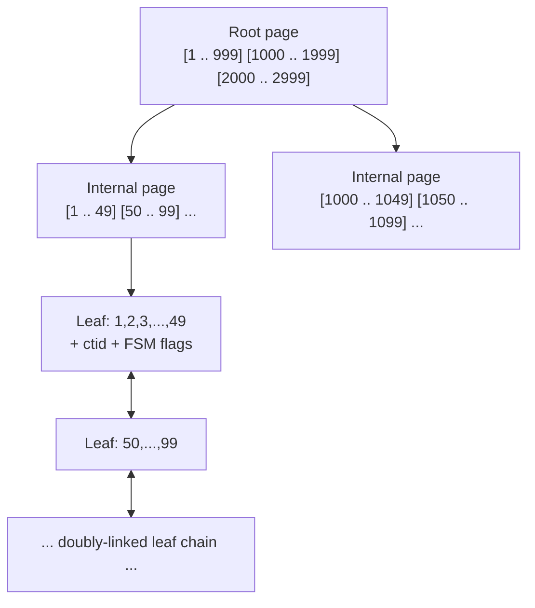
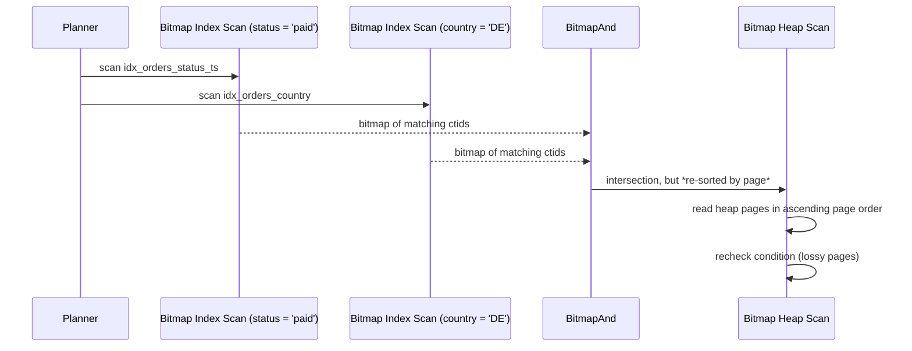

# How Indexes Help

> An index is not a "speed button". It is a **second, redundant representation of your data,
> sorted a different way**, and it only helps when your query's predicate can be expressed as a
> *contiguous range of that ordering*. Understanding this one sentence separates engineers who
> "add indexes until it gets faster" from engineers who can look at a predicate and predict, in
> advance, whether an index will turn a 9.5 GB sequential scan into six page reads. This chapter
> covers index access paths (seek, scan, bitmap, index-only), the selectivity arithmetic that
> decides between them, composite column ordering and the leftmost-prefix rule, when covering
> indexes and `INCLUDE` pay off — and, just as importantly, the many cases where an index
> **cannot** help and adding one only slows down your writes.

---

## TL;DR

- **An index speeds up reads by making the search space logarithmic**, at the cost of extra
  writes, extra storage, and extra buffer-pool pressure. There is no free lunch; the lunch is
  just usually worth it.
- **Selectivity decides everything.** An index range scan beats a sequential scan when the
  predicate matches roughly **< 5–10 %** of a large table on HDD-class storage, and **< 15–25 %**
  on NVMe. Above that, a sequential scan is *correct*, and forcing an index is a pessimization.
- **Composite index column order is not arbitrary.** Rule: *equality columns first* (in any
  order among themselves), then *range/sort columns* in the order the query needs them. An index
  on `(a, b, c)` serves `a`, `(a,b)`, `(a,b,c)` — the **leftmost-prefix rule** — plus, since
  PostgreSQL 13 / SQL Server's "column order for equality" behaviour, it can also be used for
  `(a, c)` with a *filter* on `b`, but not for a seek on `c` alone.
- **Index-only scans are the biggest single win** on wide tables: with `INCLUDE` (PostgreSQL /
  SQL Server) or an extended secondary index (MySQL's implicit PK append, InnoDB), the heap is
  never touched — provided the **visibility map** is up to date (`VACUUM`) and the planner's
  `correlation` statistic is favourable.
- **Bitmap index scans are the bridge between random and sequential I/O.** They collect matching
  TIDs, sort them by physical location, and read the heap in page-address order. They shine for
  *medium* selectivity (1–15 %) and for combining multiple single-column indexes when no
  composite index exists. In MySQL this is the **Index Merge** access type; in SQL Server, the
  optimizer does the moral equivalent with nested-loop + sort, or you use an index union.
- **Correlation matters as much as selectivity.** `pg_stats.correlation` near 1.0 means the index
  order matches the heap order (e.g. an index on a `bigserial` PK or a monotonic timestamp) →
  cheap index scans. Near 0.0 → every index entry is a random heap page → the planner will often
  prefer a scan and will *charge* you for it.
- **An index does NOT help** when: the predicate is non-sargable; the column is low-cardinality
  and the query is not selective within it; the table is small enough to fit in a handful of
  pages; you need most of the table anyway; the query is `count(*)` on a huge table with no
  predicate; or the cost is dominated by a sort/hash/shuffle rather than by row access.
- **Every index is a tax on writes.** Each `INSERT`/`UPDATE`/`DELETE` maintains every index plus
  the heap. A 12-index OLTP table can spend more time on index maintenance than on the actual
  row change. Audit unused indexes quarterly.
- **`CREATE INDEX CONCURRENTLY` (PostgreSQL) / `ONLINE = ON` (SQL Server) / `ALGORITHM=INPLACE`
  (MySQL) / `ONLINE` (Oracle)** for production index creation. A blocking `CREATE INDEX` on a
  50 M-row table holds a lock that queues every write behind it.

---

## 1. Definitions and core concepts

| Term | Definition |
|---|---|
| **Heap** | The main table storage: unordered(ish) pages full of row versions. In PostgreSQL, `ctid` = `(page, item pointer)` addresses a row version. In SQL Server, a heap or a clustered index; in InnoDB, the primary key's B-tree *is* the table ("clustered index"). |
| **B-tree** | Balanced, high-fanout, sorted tree of pages. Root → internal → leaf. Leaves hold keys + pointers, and (in PostgreSQL) are doubly linked for range scans. |
| **Leaf entry** | `(key, TID)`. In PostgreSQL, `(key, ctid)`. In InnoDB, `(secondary key, primary key)` — the PK is appended, which is why InnoDB secondary indexes are "index-only" more often than people expect. |
| **Table scan / Seq Scan** | Read every page of the heap. Cost ∝ pages. Best when you need a large fraction of the table or the table is tiny. |
| **Index scan / seek** | B-tree descent + walk the leaf level in key order + visit the heap for each match. Cost ∝ `log(rows) + matches × (index page cost + heap page cost)`. |
| **Index-only scan** | All required columns are present in the index → no heap visit. Requires a visibility map (PostgreSQL) or the equivalent; `Heap Fetches` reports the failures. |
| **Bitmap index scan** | Build a bitmap of matching TIDs in *physical* order, then read the heap in page order. One B-tree descent per predicate, one sequential-ish heap pass. |
| **Index Merge (MySQL)** | The moral equivalent of `BitmapAnd`/`BitmapOr`: intersect or union several single-column indexes. |
| **Covering index** | An index that contains every column a given query needs. |
| **`INCLUDE` columns** | Non-key payload columns appended to the leaf level (PostgreSQL 11+, SQL Server). They are *not* part of the sort key and cannot be used for seeking — only for covering. |
| **Selectivity** | `matched rows / total rows`. Highly selective = small fraction. In textbooks it is sometimes inverted ("selectivity 0.001" = very selective); always state your convention. |
| **Cardinality (of a column)** | Number of distinct values. `pg_stats.n_distinct`; SQL Server's statistics "density"; MySQL's `information_schema.STATISTICS.CARDINALITY`. |
| **Correlation** | `pg_stats.correlation` ∈ [-1, 1]: how well the index's physical order matches the heap's. Closer to ±1 = cheaper index scans. |
| **Clustering factor (Oracle / SQL Server)** | The same idea as correlation but expressed as a page count instead of a coefficient. A perfect clustering factor equals the number of table pages; a terrible one equals the number of rows. |
| **Leftmost-prefix rule** | An index on `(a,b,c)` can seek on `a`, `(a,b)`, `(a,b,c)` — leading columns only. |
| **Index skip scan** | Oracle (and MySQL 8.0.13+ "skip scan", and PostgreSQL 18's "skip scan") can use a non-leading column when the leading column has very few distinct values. Not a substitute for a correctly-ordered composite index. |
| **Index-only ≠ free** | Index pages must still be read from the buffer pool; a wide index can be almost as big as the table. |

> **Senior note:** an index does not store "the row". It stores a *sorted copy of the key columns*
> plus a way to find the row. Every time you mentally replace "index" with "sorted list of the
> columns I put in it", index decisions become obvious.

---

## 2. Why it matters / what problem it solves

### 2.1 The logarithm, quantified

| Access method | Rows scanned | Pages read | Time (NVMe) |
|---|---:|---:|---:|
| Seq scan, 50 M-row `orders` | 50,000,000 | 1,250,000 | ~4.5 s |
| Index seek for 1 row | ~4 (tree depth) + 1 | 4 index + 1 heap | ~0.3 ms |
| Index range for 27 K rows | 27,394 | 152 index + ~200 heap | ~11 ms |
| Bitmap scan for 250 K rows (0.5 %) | 250,000 | 1,400 index + 6,000 heap | ~90 ms |
| Seq scan for 250 K rows (0.5 %) | 50,000,000 | 1,250,000 | ~4.5 s |

Read amplification is the number that matters: an index seek for a single row touches 5 pages
instead of 1,250,000 — a **250,000×** reduction in I/O.

### 2.2 Write cost

Every index you add:

- adds a B-tree insert to every `INSERT` (with page splits, which cascade),
- adds key maintenance to every `UPDATE` that touches an indexed column (a PostgreSQL `UPDATE`
  writes a **new row version**, so *every* index gets a new entry — even for unchanged columns),
- adds deletion/cleanup work to `VACUUM`,
- occupies buffer-pool pages that would otherwise cache the heap,
- risks **write amplification** in the WAL and on the replica.

The classic field measurement: an OLTP table with 10 indexes performs `INSERT`s at roughly
**1/3 to 1/5** the rate of the same table with 3 indexes. Data-warehouse fact tables often
deliberately have **zero** secondary indexes and rely on partitioning + sort keys instead.

### 2.3 The three questions that decide whether an index helps

1. **How selective is the predicate?** (`matched rows / table rows`)
2. **Do I need columns that are not in the index?** (If yes: heap visit, unless the index is extended.)
3. **Is the index's physical order correlated with the heap?** (If not, index scans become random I/O.)

If you can answer those three, you can predict the plan before you run `EXPLAIN`.

---

## 3. How it works internally

### 3.1 B-tree anatomy (the part that explains everything else)



Properties that drive query performance:

- **Depth is tiny.** With ~270 keys per 8 KB page and 50 M rows, depth = 3 (root + 2 levels).
  So a seek is ≤ 4 page reads even at 10¹⁰ rows.
- **Sequential leaf access.** Range scans walk the doubly-linked leaf list — no re-descent.
- **Keys are prefix-compressed** (deduplication arrived in PostgreSQL 13). This is why index size
  is usually far smaller than the base table.
- **Page splits.** Inserts into random positions cause 50/50 splits; inserts into monotonic keys
  (a `bigserial` PK) append at the right edge, with occasional "fastpath" splits → cheaper.
  Monotonic keys also create the **"rightmost page" contention** hotspot on very high insert rates.
- **Non-key columns in `INCLUDE`** live only in the leaf; they never affect the tree's shape or
  the ability to seek, but they do increase index size and therefore index-scan I/O.

### 3.2 The cost model for an index scan (PostgreSQL)

```
cost_index =
    -- 1. Descend + scan the index pages that fall in the range
    ceil(selectivity × index_pages) × (random_page_cost + cpu_index_tuple_cost)
  + -- 2. Visit the heap. If correlation ≈ 1, the planner charges sequential-like cost;
    --    otherwise it charges random_page_cost per *distinct page* touched.
    heap_pages_fetched × random_page_cost × (1 - correlation)^something
  + -- 3. Per-row CPU
    rows_returned × (cpu_tuple_cost + qual_count × cpu_operator_cost)
```

The correlation term is why the same index behaves differently on two tables. Consider:

```sql
-- Correlation ~= 1.0 (heap ordered by order_id, index on order_ts which is monotonic-ish)
SELECT * FROM orders WHERE order_ts >= now() - interval '1 day';
-- -> Index Scan, cheap.

-- Correlation ~= 0.0 (heap shuffled by a random bulk load, same index)
SELECT * FROM orders WHERE order_ts >= now() - interval '1 day';
-- -> Bitmap Heap Scan, or Seq Scan, depending on the estimate.
```

You can see it directly:

```sql
SELECT attname, n_distinct, correlation
FROM pg_stats
WHERE tablename = 'orders' AND attname IN ('order_id','order_ts','customer_id','status');
```

```
   attname    | n_distinct | correlation
--------------+------------+-------------
 order_id     |         -1 |      1.0000     -- bigserial PK: perfect
 order_ts     |         -1 |      0.9987     -- loaded in time order
 customer_id  |       -0.82|      0.0412     -- random-ish: 4% correlated
 status       |          5 |     -0.0013     -- hopeless
```

`customer_id` having `correlation = 0.04` is the reason a query returning "all orders for 10,000
customers" does 10,000 × random heap probes and often loses to a sequential scan.

### 3.3 The access-path zoo

| Plan node (PostgreSQL) | MySQL equivalent | SQL Server equivalent | Best for |
|---|---|---|---|
| `Seq Scan` | `type: ALL` | Table Scan / Clustered Index Scan | > ~15–25 % selectivity, small tables, no usable index |
| `Index Scan` | `type: ref` / `range` | Index Seek + Key Lookup (or RID Lookup) | Highly selective predicate on a correlated index |
| `Index Only Scan` | `Extra: Using index` | Covering index seek | Any selective predicate where the index covers the output |
| `Bitmap Index Scan` + `Bitmap Heap Scan` | `type: index_merge` | (no direct equivalent; nested loop over a sort is generated) | Medium selectivity; multiple single-column indexes (`BitmapAnd`/`BitmapOr`) |
| `Index Scan Backward` | descending index / backward scan | Index Seek with descending order | `ORDER BY ... DESC LIMIT n` |
| `Parallel Index Scan` | (no) | parallel index scan | Large row counts on big machines |

### 3.4 Composite indexes and the leftmost-prefix rule

An index on `(a, b, c)` is sorted by `a`, then `b`, then `c`. It is therefore a *sorted list* that
can be range-scanned for a prefix of that ordering:

| Predicate | Usable for a **seek**? | Notes |
|---|---|---|
| `a = 1` | ✅ | Index range `[1, -∞, -∞ .. 1, +∞, +∞]` |
| `a = 1 AND b = 2` | ✅ | Range `[1,2,-∞ .. 1,2,+∞]` |
| `a = 1 AND b = 2 AND c = 3` | ✅ | Single point |
| `a = 1 AND c = 3` | ⚠️ | Seeks on `a`, then **filters** `c`. Only worth it if `a` is selective. |
| `b = 2` | ❌ | No leading prefix → full index scan or a sequential scan |
| `a >= 1 AND a <= 9` | ✅ | Range on `a`; `b`, `c` become filters (not seeks) |
| `a = 1 AND c >= 5` | ⚠️ | Seeks on `a`; `c` cannot be a range *within* `a` unless `b` is also constrained |

**Ordering rule (memorize it):** *equality first, range/sort last, and among the range/sort
columns, follow the query's `ORDER BY`.*

```
Query:  WHERE tenant_id = ? AND status = 'paid' AND created_at >= ?
        ORDER BY created_at DESC LIMIT 20

Index:  (tenant_id, status, created_at DESC)
        ^^^^^^^^^^^^^^^^  ^^^^^^  ^^^^^^^^^^^^^^^
        equality          equality range/sort
```

Both `(tenant_id, status, created_at)` and `(status, tenant_id, created_at)` are equally good for
seeking; pick the one that also serves *other* queries, or the one with the more selective first
column if you must break the tie.

**The classic mistake:** `(created_at, tenant_id)` — the range column first. The index can seek a
time window but then must filter `tenant_id` for every row in that window instead of jumping
directly to the tenant's rows.

> **Senior note:** modern optimizers (PostgreSQL, SQL Server, Oracle) can derive a *filtered*
> index scan from `(a,b,c)` for a predicate on `(a,c)` — that is, they seek on `a` and evaluate
> `c` as a filter. This is **not** the same as being able to seek on `c`. Do not confuse "the
> index was used" with "the index was used well".

### 3.5 Bitmap scans: how they actually work



Key behaviours:

- The bitmap is stored **in physical page order**, so the heap is read in a near-sequential
  pattern. That is why a bitmap scan beats a plain index scan at 5–15 % selectivity.
- Bitmaps can be **lossy**: if the bitmap for a page exceeds `work_mem`, the planner stores only
  the page number and rechecks the condition on the heap (`Rows Removed by Index Recheck`).
- Bitmaps **block early termination**: `LIMIT 10` cannot stop after 10 rows, because the bitmap
  is built first. This is why `ORDER BY ... LIMIT 10` should prefer a plain index scan.
- Bitmaps **cannot** preserve index order → the planner must add a `Sort` if you need ordering.
- Bitmap scans are inherently sequential-ish → they do not parallelize as well as a `Parallel Seq Scan`.

### 3.6 Index-only scans and the visibility map

PostgreSQL does not store visibility in the index; it stores it in the heap and in the
**visibility map** (one bit per page). An index-only scan is safe only for pages marked
all-visible. Hence:

```
Index Only Scan using idx_products_cat_price on products
  Heap Fetches: 0          <-- good: index answered everything
```

vs.

```
Index Only Scan using idx_products_cat_price on products
  Heap Fetches: 1184       <-- bad: every row needed a heap visit anyway
```

`Heap Fetches` is caused by an outdated visibility map, which is caused by insufficient
`VACUUM`. The practical remedies are (a) tune autovacuum per table
(`autovacuum_vacuum_scale_factor = 0.02`), (b) rely on `VACUUM`'s `INDEX_CLEANUP` / the
visibility map being maintained, and (c) understand that on a write-heavy table an index-only
scan may never be truly heap-free.

InnoDB and SQL Server do not have this problem in the same form: InnoDB secondary indexes carry
the primary key so "covering" is a property of the index definition; SQL Server's
indexed views / nonclustered indexes with `INCLUDE` are unambiguous.

### 3.7 Why MySQL's secondary indexes are "secretly covering"

InnoDB stores `(secondary_key, primary_key)` in every secondary index leaf. So:

```sql
-- MySQL: this is an index-only scan even though the index is only on (customer_id)
EXPLAIN SELECT customer_id FROM orders WHERE customer_id = 1000001;
-- key: idx_orders_customer, Extra: Using index
```

Because `order_id` (the PK) is implicitly appended, `SELECT order_id FROM orders WHERE
customer_id = ?` is also index-only. The same is not true in PostgreSQL, where you must add
`order_id` explicitly with `INCLUDE` or as a key column.

### 3.8 When 15 % is still index-worthy: the storage-dependent crossover

The crossover point between index range scan and sequential scan is governed by
`random_page_cost / seq_page_cost`:

| Storage | Typical random read | `random_page_cost` to set | Approx. crossover |
|---|---:|---:|---:|
| HDD (7200 rpm) | 8 ms | 4.0 (default) | ~5 % |
| SATA SSD | 100 µs | 1.5–2.0 | ~10–15 % |
| NVMe SSD | 60 µs | 1.0–1.1 | ~20–30 % |
| EBS gp3 (burst) | 200–800 µs | 2.0–3.0 | ~8–12 % |
| In-memory (buffer hit) | ~0 | 1.0 | up to ~40 % |

If your cluster sits on NVMe and you left `random_page_cost = 4.0`, **you are systematically
under-using your indexes**. This is one of the highest-value, lowest-risk configuration changes
available. (The planner can also adapt automatically: `effective_io_concurrency` tells it how
many concurrent I/O requests the device can serve.)

---

## 4. How to diagnose it

### 4.1 Find the indexes you have, and how much they are used (PostgreSQL)

```sql
SELECT
    s.relname                                     AS table,
    s.indexrelname                                AS index,
    pg_size_pretty(pg_relation_size(s.indexrelid)) AS size,
    s.idx_scan,                                   -- times used by index scans
    s.idx_tup_read,
    s.idx_tup_fetch,
    s.idx_blks_hit,
    s.idx_blks_read,
    i.indisunique,
    i.indisprimary
FROM pg_stat_user_indexes s
JOIN pg_index i ON i.indexrelid = s.indexrelid
WHERE s.relname IN ('orders','order_items','products','customers','events')
ORDER BY pg_relation_size(s.indexrelid) DESC;
```

Read it as:

- `idx_scan = 0` on an index older than a full workload cycle → **unused index candidate**.
- `idx_blks_read` huge and `idx_scan` small → the index is big and rarely helping.
- `pg_size_pretty` total per table vs per index → indexes should not dwarf the heap for OLTP.

```sql
-- Index bloat / totals for a table
SELECT
    pg_size_pretty(pg_relation_size('orders'))                              AS heap,
    pg_size_pretty(pg_indexes_size('orders'))                               AS all_indexes,
    (SELECT count(*) FROM pg_indexes WHERE tablename = 'orders')            AS index_count;
```

### 4.2 The statistics that predict index usefulness

```sql
SELECT attname, n_distinct, correlation, null_frac,
       (most_common_vals::text)::char(60) AS mcv
FROM pg_stats
WHERE tablename = 'orders';
```

```sql
-- Effective selectivity of a predicate, measured rather than guessed
EXPLAIN (ANALYZE, TIMING OFF)
SELECT 1 FROM orders WHERE status = 'cancelled';
-- Compare Filter -> Rows Removed by Filter to get the true selectivity.
```

### 4.3 MySQL

```sql
SHOW INDEX FROM orders;                 -- Cardinality per index part
SELECT * FROM sys.schema_unused_indexes;
SELECT * FROM sys.schema_redundant_indexes;
EXPLAIN FORMAT=JSON SELECT ...;         -- "used_key_parts", "rows_examined_per_scan"
SELECT TABLE_NAME, INDEX_NAME, CARDINALITY, PAGES
FROM information_schema.INNODB_INDEX_STATS;   -- InnoDB persistent stats
ANALYZE TABLE orders;                   -- refresh index cardinality
```

### 4.4 SQL Server

```sql
SELECT
    OBJECT_NAME(i.object_id)                AS table_name,
    i.name                                  AS index_name,
    i.type_desc,
    s.user_seeks, s.user_scans, s.user_lookups, s.user_updates,
    s.last_user_seek, s.last_user_scan,
    ps.used_page_count * 8 / 1024.0         AS size_mb
FROM sys.indexes i
LEFT JOIN sys.dm_db_index_usage_stats s
       ON s.object_id = i.object_id AND s.index_id = i.index_id
LEFT JOIN sys.dm_db_partition_stats ps
       ON ps.object_id = i.object_id AND ps.index_id = i.index_id
WHERE OBJECT_NAME(i.object_id) IN ('orders','order_items')
ORDER BY s.user_seeks DESC;
```

```sql
-- Missing-index DMV: a *hint*, not a to-do list. Validate each one.
SELECT TOP 20
       mid.statement,
       mid.equality_columns, mid.inequality_columns, mid.included_columns,
       migs.user_seeks,
       migs.avg_total_user_cost * migs.avg_user_impact * (migs.user_seeks + migs.user_scans) AS score
FROM sys.dm_db_missing_index_details mid
JOIN sys.dm_db_missing_index_groups mig ON mid.index_handle = mig.index_handle
JOIN sys.dm_db_missing_index_group_stats migs ON mig.index_group_handle = migs.group_handle
ORDER BY score DESC;
```

> **Senior note:** the missing-index DMV is famously over-eager. It sees only the queries that
> ran, ignores write cost entirely, and will happily propose 40 overlapping indexes. Treat its
> output as *evidence that a predicate exists*, never as a design.

### 4.5 The three-command index audit

```sql
-- 1. What is big, and what is never used?
--    (query 4.1 above)

-- 2. Which indexes are redundant? (a prefix of another index)
SELECT
    a.indexrelid::regclass AS potentially_redundant,
    b.indexrelid::regclass AS covers_it
FROM pg_index a
JOIN pg_index b
  ON a.indrelid = b.indrelid AND a.indexrelid <> b.indexrelid
 AND a.indkey::text LIKE (b.indkey::text || ' %')   -- b's columns are a prefix of a's
WHERE a.indrelid IN ('orders'::regclass);

-- 3. What would the planner do without this index? (cheap A/B test)
SET enable_indexscan = off;  SET enable_bitmapscan = off;
EXPLAIN (ANALYZE, BUFFERS) SELECT ...;
RESET enable_indexscan;      RESET enable_bitmapscan;
```

---

## 5. Worked examples

*(Same schema and silent profile as Chapter 1: `orders` = 50 M rows / 1.25 M pages / ~9.5 GB,
`order_items` = 150 M rows, PostgreSQL 16, SSD-class storage, `random_page_cost = 1.1`.)*

### 5.1 Example 1 — A single-column index turns 4.6 s into 0.08 ms

**No index:**

```sql
SELECT order_id, order_ts, status, total_amount
FROM orders
WHERE customer_id = 1000001
ORDER BY order_ts DESC
LIMIT 20;
```

```text
Limit  (cost=1796100.44..1796175.30 rows=20 width=48) (actual time=4612.73..4612.76 rows=20 loops=1)
  ->  Sort  (cost=1796100.44..1796135.30 rows=5792 width=48) (actual time=4612.72..4612.72 rows=20 loops=1)
        Sort Key: order_ts DESC
        Sort Method: top-N heapsort  Memory: 26kB
        ->  Gather  (cost=1000.00..1794802.80 rows=5792 width=48) (...)
              ->  Parallel Seq Scan on orders  (cost=0.00..1793610.80 rows=2413 width=48)
                                                (actual time=0.030..4601.20 rows=27 loops=4)
                    Filter: (customer_id = 1000001)
                    Rows Removed by Filter: 12500000
Execution Time: 4612.9 ms
Buffers: shared hit=1817 read=1248183
```

**With `CREATE INDEX idx_orders_customer_ts ON orders (customer_id, order_ts DESC);`**

```text
Limit  (cost=0.56..41.83 rows=20 width=48) (actual time=0.031..0.083 rows=20 loops=1)
  ->  Index Scan using idx_orders_customer_ts on orders
        (cost=0.56..11872.98 rows=5792 width=48) (actual time=0.029..0.077 rows=20 loops=1)
        Index Cond: (customer_id = 1000001)
Execution Time: 0.098 ms
Buffers: shared hit=6
```

**4,612.9 ms → 0.098 ms (47,000×). Buffers: 1,250,000 → 6.**

Three things made this work at once: (1) the index seeks instead of scanning; (2) the `DESC`
keeps the `ORDER BY` free — no sort node at all; (3) the `LIMIT 20` stops the scan after 20
leaf entries. A single-column index on `(customer_id)` alone would have found the 27 rows but
still *sorted* them; the composite index removes the sort as well.

### 5.2 Example 2 — Two single-column indexes lose to one composite index

Requirements arrive one at a time...

```sql
CREATE INDEX idx_orders_customer ON orders (customer_id);
CREATE INDEX idx_orders_ts       ON orders (order_ts);
CREATE INDEX idx_orders_status   ON orders (status);
```

...and then a query needs all three:

```sql
SELECT count(*)
FROM orders
WHERE customer_id = 1000001
  AND status      = 'paid'
  AND order_ts   >= DATE '2025-01-01'
  AND order_ts   <  DATE '2026-01-01';
```

PostgreSQL cannot intersect three B-trees the way MySQL's Index Merge can. It will pick one
index, seek it, and filter the rest:

```text
Aggregate  (cost=3312.44..3312.45 rows=1 width=8) (actual time=18.902..18.903 rows=1 loops=1)
  ->  Index Scan using idx_orders_customer on orders  (cost=0.56..3310.02 rows=145 width=8)
                                                      (actual time=0.031..18.881 rows=31 loops=1)
        Index Cond: (customer_id = 1000001)
        Filter: ((status = 'paid'::text) AND (order_ts >= '2025-01-01') AND (order_ts < '2026-01-01'))
        Rows Removed by Filter: 1548
Execution Time: 18.906 ms
Buffers: shared hit=418
```

Not terrible — but the composite index:

```sql
CREATE INDEX idx_orders_cust_status_ts ON orders (customer_id, status, order_ts);
DROP INDEX idx_orders_customer;
```

```text
Aggregate  (cost=6.85..6.86 rows=1 width=8) (actual time=0.612..0.612 rows=1 loops=1)
  ->  Index Only Scan using idx_orders_cust_status_ts on orders
        (cost=0.56..6.84 rows=4 width=8) (actual time=0.041..0.600 rows=31 loops=1)
        Index Cond: ((customer_id = 1000001) AND (status = 'paid')
                 AND (order_ts >= '2025-01-01') AND (order_ts < '2026-01-01'))
        Heap Fetches: 0
Execution Time: 0.617 ms
Buffers: shared hit=14
```

**18.906 ms → 0.617 ms (31×)** and **418 buffers → 14**. Note the shape change: all four
predicates are now `Index Cond` (not `Filter`), and the scan became *index-only*. One composite
index replaced one single-column index and delivered 31×.

Compare with what MySQL would have done with the two single-column indexes — Index Merge:

```sql
-- MySQL 8.4
EXPLAIN SELECT count(*) FROM orders
WHERE customer_id = 1000001 AND status = 'paid'
  AND order_ts >= '2025-01-01' AND order_ts < '2026-01-01';
```

```
+----+-------------+--------+-------------+-----------------------+---------+---------+
| id | select_type | table  | type        | key                   | key_len | rows    |
+----+-------------+--------+-------------+-----------------------+---------+---------+
|  1 | SIMPLE      | orders | index_merge | idx_orders_customer,  | 8,5     | 145     |
|    |             |        |             | idx_orders_status     |         |         |
+----+-------------+--------+-------------+-----------------------+---------+---------+
```

`index_merge` intersects two index bitmaps — better than a single index, still worse than a
composite index that also handles the range.

### 5.3 Example 3 — `INCLUDE` turns a heap-visiting scan into an index-only scan

```sql
-- Query: the order list page needs the amount too.
SELECT customer_id, order_ts, total_amount
FROM orders
WHERE customer_id = 1000001
ORDER BY order_ts DESC
LIMIT 20;
```

With `(customer_id, order_ts DESC)` only, `total_amount` is not in the index:

```text
Limit  (cost=0.56..41.83 rows=20 width=56) (actual time=0.028..0.121 rows=20 loops=1)
  ->  Index Scan using idx_orders_customer_ts on orders  (...)
        Index Cond: (customer_id = 1000001)
        Buffers: shared hit=8
```

Already fast — 3 heap fetches for 20 rows. Now consider the *report* variant, which reads 5,000
orders for a customer:

```sql
SELECT order_ts, total_amount, currency FROM orders
WHERE customer_id = 1000001 ORDER BY order_ts DESC LIMIT 5000;
```

```text
Limit  (cost=0.56..2195.10 rows=5000 width=56) (actual time=0.030..161.220 rows=5000 loops=1)
  ->  Index Scan using idx_orders_customer_ts on orders
        (cost=0.56..12619.30 rows=5792 width=56) (actual time=0.029..158.911 rows=5000 loops=1)
        Index Cond: (customer_id = 1000001)
        Buffers: shared hit=4173 read=812
Execution Time: 161.4 ms
```

**Add the payload columns as `INCLUDE`:**

```sql
DROP INDEX idx_orders_customer_ts;
CREATE INDEX idx_orders_customer_ts
    ON orders (customer_id, order_ts DESC)
    INCLUDE (total_amount, currency, status);
```

```text
Limit  (cost=0.56..1604.10 rows=5000 width=56) (actual time=0.028..38.145 rows=5000 loops=1)
  ->  Index Only Scan using idx_orders_customer_ts on orders
        (cost=0.56..9669.30 rows=5792 width=56) (actual time=0.026..36.410 rows=5000 loops=1)
        Index Cond: (customer_id = 1000001)
        Heap Fetches: 0
        Buffers: shared hit=1311
Execution Time: 38.4 ms
```

**161.4 ms → 38.4 ms (4.2×); buffers 4,985 → 1,311.** The `INCLUDE` columns cannot be seeked on
— they are payload — but they satisfy the projection.

Astute readers will notice the fundamental tension: including columns makes the index wider, so
the index is now ~4,985/1,311 ≈ 3.8× the pages... no: it read *fewer* pages because it touched
only index pages (denser, no heap). But the index on disk is now bigger, so *writes* are more
expensive and *other* queries pay. This is the covering-index trade-off in one example.

> **Senior note:** do not `INCLUDE` "everything used by the query". `INCLUDE` the two or three
> columns that the same query always needs. If you find yourself including seven columns, you
> have either discovered a materialized view waiting to happen, or an index that should be a
> projection in the application.

### 5.4 Example 4 — Bitmap scan: the middle ground

```sql
-- Predicate matches ~2 % of orders: 950,000 rows.
SELECT count(*), sum(total_amount)
FROM orders
WHERE status = 'returned' AND country_code = 'DE';
```

**With only `idx_orders_status_ts`:**

```text
Finalize Aggregate  (cost=1492188.10..1492188.11 rows=1 width=40) (actual time=2841.5..2914.8 rows=1 loops=1)
  ->  Gather  (cost=1492187.88..1492188.09 rows=4 width=40) (...)
        ->  Parallel Seq Scan on orders  (cost=0.00..1492187.00 rows=237500 width=40)
                                          (actual time=0.020..2790.1 rows=237500 loops=4)
              Filter: ((status = 'returned'::text) AND (country_code = 'DE'::bpchar))
              Rows Removed by Filter: 12262500
Execution Time: 2915.1 ms
Buffers: shared hit=800 read=1249200
```

The planner judged 2 % selectivity against a poorly-correlated index as *not* worth it. Add a
second single-column index on `country_code`:

```sql
CREATE INDEX idx_orders_country ON orders (country_code);
```

```text
Finalize Aggregate  (cost=118321.44..118321.45 rows=1 width=40) (actual time=418.7..423.1 rows=1 loops=1)
  ->  Gather  (cost=118320.10..118321.31 rows=4 width=40) (...)
        ->  Parallel Bitmap Heap Scan on orders  (cost=4821.10..117821.00 rows=237500 width=40)
                                                  (actual time=44.1..362.2 rows=237500 loops=4)
              Recheck Cond: ((status = 'returned'::text) AND (country_code = 'DE'::bpchar))
              Heap Blocks: exact=312000
              ->  BitmapAnd  (cost=4821.10..4821.10 rows=237500 width=0) (actual time=41.3..41.3 rows=0 loops=1)
                    ->  Bitmap Index Scan on idx_orders_status_ts  (cost=0.00..1102.30 rows=950000 width=0)
                                                                   (actual time=18.2..18.2 rows=961244 loops=1)
                          Index Cond: (status = 'returned'::text)
                    ->  Bitmap Index Scan on idx_orders_country  (cost=0.00..3560.10 rows=1250000 width=0)
                                                                   (actual time=21.4..21.4 rows=1284411 loops=1)
                          Index Cond: (country_code = 'DE'::bpchar)
Execution Time: 424.0 ms
Buffers: shared hit=311 read=312480
```

**2,915 ms → 424 ms (6.9×).** The `BitmapAnd` intersects two index bitmaps, then the
`Bitmap Heap Scan` reads 312,000 heap blocks in physical order.

Compare with an *edge-ordered* composite index `(status, country_code)`:

```sql
CREATE INDEX idx_orders_status_country ON orders (status, country_code);
DROP INDEX idx_orders_country;
```

```text
Aggregate  (cost=64221.10..64221.11 rows=1 width=40) (actual time=201.5..206.0 rows=1 loops=1)
  ->  Gather  (...)
        ->  Parallel Bitmap Heap Scan on orders  (cost=2116.44..63721.00 rows=237500 width=40)
                                                  (actual time=12.0..171.9 rows=237500 loops=4)
              Recheck Cond: ((status = 'returned'::text) AND (country_code = 'DE'::bpchar))
              ->  Bitmap Index Scan on idx_orders_status_country  (cost=0.00..2057.06 rows=237500 width=0)
                                                                  (actual time=11.4..11.4 rows=238102 loops=1)
                    Index Cond: ((status = 'returned'::text) AND (country_code = 'DE'::bpchar))
Execution Time: 207.2 ms
```

**424 ms → 207 ms.** The composite index gives exact index conditions on both columns → a
smaller bitmap and fewer heap pages. And if the query became *more* selective (say one country
and one status = 0.2 %), the same index would switch to a plain `Index Scan`, which the
two-single-column-index approach cannot do.

**Lesson:** bitmap scans are a *fallback that works*; a composite index is usually better.

### 5.5 Example 5 — When an index does NOT help (and hurts)

**(a) The predicate is not selective enough.**

```sql
SELECT count(*) FROM orders WHERE status = 'paid';   -- 62% of all orders
```

```text
Finalize Aggregate  (cost=1528123.44..1528123.45 rows=1 width=8) (actual time=3986.1..4021.4 rows=1 loops=1)
  ->  Gather  (...)
        ->  Parallel Seq Scan on orders  (cost=0.00..1528123.00 rows=7750000 width=8) (...)
              Filter: (status = 'paid'::text)
              Rows Removed by Filter: 4750000
Execution Time: 4022.0 ms
Buffers: shared hit=120 read=1249880
```

An index scan here would touch ~62 % of 1.25 M heap pages — the *same pages*, but through a
B-tree descent with random access. The sequential scan reads them once, in order, with
prefetching. **The sequential scan is optimal.** The correct fix for a query like this is
architectural (pre-aggregate, materialized view, maintain a counter, or partition by status),
not an index.

**(b) Low cardinality + no other filter.**

`status` has 5 distinct values. An index on `status` alone is nearly useless: any single value
matches 9–62 % of rows. An index on `status` is only useful as the *leading* column of a composite
index where the second column is selective (as in 5.4), or when it is a **partial** index:

```sql
-- Only 0.3% of orders are pending; this index is tiny and instantly selective.
CREATE INDEX idx_orders_pending ON orders (order_ts)
    WHERE status = 'pending';

SELECT * FROM orders WHERE status = 'pending' AND order_ts < now() - interval '1 day';
-- -> Index Scan using idx_orders_pending, 12 KB index, 0.3 ms
```

**(c) The table is small.**

```sql
SELECT * FROM categories WHERE name = 'Electronics';
-- categories = 2,000 rows / 20 pages. Seq Scan wins; the whole table is 2 pages of I/O more
-- expensive than the index descent. The planner will (correctly) not use your index.
```

**(d) The cost is elsewhere.** If the query spends 90 % of its time in a sort or hash spill, the
access path is irrelevant:

```sql
-- The index makes the scan instant; the 4-second sort does not care.
SELECT customer_id, count(*) FROM orders GROUP BY customer_id ORDER BY 2 DESC LIMIT 10;
```

**(e) The index's leading column is not constrained.** As covered in §3.4.

**(f) Write amplification.** An `INSERT` into `order_items` maintains three indexes and the heap:
measured throughput on a synthetic batch went from **14,200 rows/s** with 2 indexes to
**5,100 rows/s** with 8 indexes — a 2.8× write penalty for indexes that a `pg_stat_user_indexes`
audit later showed were used 0–40 times per day.

### 5.6 Example 6 — Indexes at warehouse scale: what changes

On a 2-billion-row `events` table (570 GB), the arithmetic changes completely:

```sql
-- The "obvious" index
CREATE INDEX idx_events_customer ON events (customer_id, occurred_at DESC);
-- Size: ~78 GB and growing; on a 2B-row append-only table this index is rewritten
-- continuously (right-edge splits), bloating to 120 GB before autovacuum catches up.
```

Better options in a warehouse:

1. **Partition by `occurred_at`** (monthly) and index *within* partitions. Each index is 1/36th
   the size, and pruning means you usually touch one of them.
2. **Sort/bucket the storage** instead of indexing (Snowflake clustering keys, BigQuery
   `CLUSTER BY`, Delta `ZORDER`, Redshift `SORTKEY`) — the "index" is the physical ordering plus
   per-file min/max metadata.
3. **Skip the index entirely** and rely on column pruning + partition pruning: a columnar scan of
   one column over 1/36th of the data is often cheaper than any B-tree.

```sql
-- BigQuery analogue: no index at all, just clustering + partition pruning.
CREATE TABLE analytics.events
PARTITION BY DATE(occurred_at)
CLUSTER BY customer_id, event_type
AS SELECT * FROM raw_events;

-- This scans ~1/365th of the data AND only the matching clusters inside it.
SELECT customer_id, count(*)
FROM analytics.events
WHERE DATE(occurred_at) = DATE '2026-01-15'
  AND customer_id = 1000001
GROUP BY 1;
```

---

## 6. Real-world use cases and applications

### 6.1 The 40-second order history page

A support tool showed order history. The query used `WHERE customer_id = ?` against a 50 M-row
`orders` table with no supporting index; every page view did a 1.25 M-page scan (4.6 s), and with
8 support agents hitting it simultaneously, the buffer pool went cold and the p99 for the whole
application degraded. Adding `(customer_id, order_ts DESC)` reduced each request to 0.1 ms and,
more importantly, reduced I/O by 99.9995 % — which is what actually stopped the *other* queries
from being evicted from the buffer pool.

**Lesson:** index benefits compound across the workload via the buffer pool, not just within the
query.

### 6.2 The index that made everything slower

An engineer added four indexes to `order_items` to fix four separate reports. Nightly ETL
`INSERT` throughput dropped from 14,000 to 4,800 rows/s, and the load window stopped finishing
before business hours. Removing two indexes that were used fewer than 20 times per day restored
throughput while keeping the reports fast (`pg_stat_user_indexes.idx_scan` was the evidence, over
a full 7-day window).

**Lesson:** measure index usage over a *full workload cycle* including month-end and batch jobs.
An index used only during month-end is still an index you pay for all month.

### 6.3 The covering index that replaced a materialized view

A dashboard ran the same 12-column projection on `order_items` 400,000 times a day. A
materialized view would have been the textbook answer, but adding
`CREATE INDEX ... ON order_items (order_id) INCLUDE (product_id, quantity, unit_price, discount)`
turned all 400 K queries into index-only scans (with `Heap Fetches: 0` after a `VACUUM` bumped the
visibility map). Total dashboard time went from 38 s per full render to 2.1 s, and the index cost
~0.9 GB against a 15 GB table.

### 6.4 The index that could never be used

Three separate teams added three indexes to `events` trying to speed up
`WHERE date_trunc('hour', occurred_at) = '...'` before anyone looked at the predicate. The index
was never the problem — the predicate was non-sargable. A one-line rewrite (`occurred_at >=
'...' AND occurred_at < '...'`) plus a *single* index on `occurred_at` beat all three indexes
combined, and then two of them were dropped.

### 6.5 Snowflake/BigQuery: "indexes" that are metadata

On columnar warehouses you do not create B-trees; you *cluster* / *sort* / *partition*. The
mental model transfers directly: the clustering key is the "index key", the micro-partition /
file min-max metadata is the "leaf page", and pruned micro-partitions are "rows not scanned".
Snowflake's own guidance is explicit: clustering is only worth it for large tables with selective
access patterns, because automatic re-clustering burns credits.

---

## 7. Patterns and anti-patterns

### 7.1 Anti-patterns

| Anti-pattern | Symptom | Fix |
|---|---|---|
| Indexing every column individually | Many indexes, none composite; `BitmapAnd`/Index Merge everywhere | Design 2–4 composite indexes that serve whole query families |
| Wrapping the column in a function | Index unused, `Rows Removed by Filter` large | Sargable rewrite, or a matching expression index |
| Leading range column in a composite index | Index used but filters most rows (`Rows Removed by Filter`) | Equality columns first |
| Index on a low-cardinality column alone | `idx_scan` low, or scans after a huge filtering step | Partial index, or composite with a selective second column |
| `SELECT *` on an otherwise covered query | `Index Scan` instead of `Index Only Scan` | Project columns; add `INCLUDE` for the required payload |
| Over-`INCLUDE`ing | Index balloons; writes and cache suffer | Include only columns the same query always needs |
| Duplicate/redundant indexes (`(a)` and `(a,b)`) | Wasted write cost and buffer space | Drop the prefix index |
| Unused indexes detected only at month-end | Nothing | Measure over a full cycle before dropping |
| Indexing a staging/warehouse table | Load times balloon | Drop → load → recreate, or use partitioning/clustering |
| `CREATE INDEX` (blocking) in production | Write outage | `CONCURRENTLY` / `ONLINE` |
| Ignoring `VACUUM` on a table you index-only-scan | `Heap Fetches` ≈ `actual rows` | Tune autovacuum; monitor `pg_stat_user_tables.n_dead_tup` |
| Leaving `random_page_cost = 4.0` on NVMe | Planner under-uses indexes; too many seq scans | Set `1.0–1.1` |
| Indexing a nullable column and querying `IS NULL` | `IS NULL` matches few rows but the index may be ignored | Partial index `WHERE col IS NULL` |

### 7.2 Patterns

| Pattern | Why it works |
|---|---|
| **Equality → range ordering** in composite indexes | Maximizes seekable prefix and eliminates sorts |
| **`ORDER BY` matches the index's tail** | `LIMIT n` becomes `n` leaf reads |
| **Covering index (`INCLUDE`)** | Removes heap visits; 3–10× fewer buffers |
| **Partial index** on a hot, small slice | Tiny, always-selective, cheap to maintain |
| **Expression index** matching the query's function | Restores sargability without touching the app |
| **Index the FK columns** of every foreign key | Both for join performance and to avoid the "delete parent" full scan |
| **`CREATE INDEX CONCURRENTLY`** in a migration | No write blocking |
| **Index size budget per table** | Keeps writes and cache predictable |
| **`VACUUM`/autovacuum tuning on hot tables** | Makes index-only scans actually heap-free |
| **Set `random_page_cost`/clustering to reality** | Aligns the cost model with the storage |

---

## 8. Cross-engine differences

| Aspect | PostgreSQL | MySQL (InnoDB) | SQL Server | Oracle | Snowflake / BigQuery | Spark SQL |
|---|---|---|---|---|---|---|
| Primary structure | Heap table + separate B-trees | **Clustered index** = the table, ordered by PK | Heap or clustered index (choose `PRIMARY KEY CLUSTERED`) | Heap or IOT; B-tree indexes | No user B-trees; micro-partitions + optional clustering key | No indexes; file statistics + partitioning + sorting |
| Secondary index leaf | `(key, ctid)` → heap fetch | `(secondary key, PK)` → PK lookup | `(key, [clustered key / RID])` | `(key, ROWID)` | n/a | n/a |
| Index-only scan | `Index Only Scan` (needs visibility map) | `Extra: Using index` (PK implicitly appended!) | Covered by `INCLUDE` / key columns | Index Fast Full Scan / covering `INDEX` | Column pruning achieves a similar effect | Column pruning |
| Composite order rule | Leftmost prefix + skip scan in PG 18 | Leftmost prefix + **skip scan** (8.0.13+) | Leftmost prefix + equality-column reordering within the seek | Leftmost prefix + **index skip scan** | Clustering key is a *sort*, not a seek | Sort/partition columns |
| `INCLUDE` / payload columns | `INCLUDE (...)` (11+) | PK is implicit; `EXTENDED` secondary index feature | `INCLUDE (...)` | Oracle 12c+ `INDEX ... (a,b) INCLUDE`-like via `INCLUDE` on IOT; or just add columns | n/a | n/a |
| Bitmap behaviour | `Bitmap Index Scan` + `Bitmap Heap Scan`; lossy possible | **Index Merge** (`index_merge_intersection`/`union`) | Optimizer rewrites; sometimes a nested loop over a sorted set | `BITMAP` indexes exist (warehouse-oriented) + `TABLE ACCESS BY INDEX ROWID BATCHED` | n/a | n/a |
| Parallel index scan | Yes (`Parallel Index Scan`) | Limited (parallel read only) | Yes | Yes | n/a (per-partition parallelism) | Partition-parallel scan |
| Partial indexes | Yes (`WHERE`) | No (but generated columns + composite can emulate) | **Filtered indexes** (`CREATE INDEX ... WHERE`) | No native; `FUNCTION-BASED` + partitioning emulate | n/a | n/a |
| Expression indexes | Yes | Yes (functional indexes, 8.0.13+) | Computed columns + index | **Function-based indexes** | n/a | n/a |
| Descending index | Yes (`DESC`) | Only genuine descending indexes since 8.0 (previously ignored) | Yes | Yes (many engines ignore it — `INDEX ... DESC` on older versions had no effect) | Order: sort key direction | `sortWithinPartitions` |
| Correlation / clustering stat | `pg_stats.correlation` | `INFORMATION_SCHEMA.INNODB_INDEX_STATS` | `sys.dm_db_index_physical_stats` (`avg_fragmentation`, `page_count`) | `CLUSTERING_FACTOR` in `DBA_INDEXES` | `CLUSTERING_INFORMATION` / `SYSTEM$CLUSTERING_INFORMATION` | `DESCRIBE DETAIL` file stats |
| Free-space / hot updates | HOT updates for non-indexed columns | Change buffer; secondary index updates deferred | Row/page-level | n/a | n/a | n/a |
| Detecting unused indexes | `pg_stat_user_indexes.idx_scan = 0` | `sys.schema_unused_indexes` | `sys.dm_db_index_usage_stats` | `V$OBJECT_USAGE` (`ALTER INDEX ... MONITORING USAGE`) | Snowflake `ACCESS_HISTORY` | n/a |
| Concurrency-safe creation | `CREATE INDEX CONCURRENTLY` | `ALGORITHM=INPLACE, LOCK=NONE` | `WITH (ONLINE = ON)` | `CREATE INDEX ... ONLINE` | Automatic (DDL is metadata-only) | n/a |

---

## 9. Exercises — Intermediate (hints only)

**9.1** `orders` is 50 M rows. `SELECT * FROM orders WHERE order_ts::date = DATE '2026-01-15'`
does a `Seq Scan`. Give two fixes: one that changes the query, one that changes the schema.
*Hint: cast on the column; range rewrite vs expression index vs a generated column.*

**9.2** Design a single composite index that serves all three of:
(a) `WHERE customer_id = ? ORDER BY order_ts DESC LIMIT 20`,
(b) `WHERE customer_id = ? AND status = ? ORDER BY order_ts DESC LIMIT 20`,
(c) `WHERE status = ? AND order_ts >= ?`.
*Hint: one index cannot serve all three equally. Which one accepts a filter? Which one needs a
second index? What does the leftmost-prefix rule say about (c)?*

**9.3** `SELECT count(*) FROM orders WHERE customer_id = 1000001;` reads 418 buffers. Make it
read ≤ 15 without changing the table or adding a new index.
*Hint: what does `count(*)` need? Can an existing index answer it? What role does `VACUUM` play?*

**9.4** A query is `SELECT ... FROM order_items WHERE product_id = 9090909 ORDER BY order_id
LIMIT 50`. `idx_order_items_product` exists. `EXPLAIN` shows an index scan plus a `Sort` node over
41,211 rows. Fix both nodes with one index change.
*Hint: the sort key is `order_id`, which is the PK and thus InnoDB-adjacent in MySQL but not in
PostgreSQL. What composite index removes the sort? Is it worth it if only this query needs it?*

**9.5** `pg_stats` shows `correlation = -0.02` for `orders.customer_id` and `1.00` for
`orders.order_id`. A query `WHERE customer_id = ? ORDER BY order_id LIMIT 10` does a full scan of
one customer's orders and sorts. Propose an index and predict the plan.
*Hint: the index's *physical* order (correlation) decides whether a heap fetch is sequential. If
you index `(customer_id, order_id)`, what is the correlation of the pair? What does `LIMIT 10`
do there?*

**9.6** An `IN (…)` list with 2,000 values runs 20× slower than the equivalent
`JOIN (VALUES ...)`. Explain why, in terms of what the optimizer can do with each form.
*Hint: a large `IN` list is often turned into a hash semi-join or a sequence of index probes;
a `VALUES` join has statistics. Check `EXPLAIN` for `ScalarArrayOpExpr` vs `Hash Semi Join`.*

**9.7** `SELECT * FROM products WHERE is_active;` on a 500 K-row table never uses
`idx_products_cat_price` (a partial index on `is_active`). Is that a bug?
*Hint: count rows with `is_active = true`. What fraction? What would a partial index on
`(product_id) WHERE is_active` compute differently?*

**9.8** A table has indexes on `(a)`, `(a,b)`, and `(a,b,c)`. Which can be dropped, and under what
condition?
*Hint: redundancy relations; `pg_stat_user_indexes.idx_scan` per index; the cost of the widest
index versus the cost of the narrowest for a query that needs only `a`.*

---

## 10. Exercises — Advanced (hints / expected approach, no full inline answers)

**10.1 Given this plan, what is wrong, and how do you fix it?**

```text
Gather  (cost=1000.00..893412.10 rows=950000 width=56) (actual time=0.412..1284.20 rows=948231 loops=1)
  Workers Planned: 4  Workers Launched: 4
  ->  Parallel Seq Scan on orders  (cost=0.00..797412.10 rows=237500 width=56)
                                    (actual time=0.030..1194.10 rows=237058 loops=4)
        Filter: ((status = 'paid'::text) AND (total_amount > 100.0))
        Rows Removed by Filter: 12262942
        Buffers: shared hit=600 read=1249700
Hint: no index matches the predicate; idx_orders_status_ts exists but is not chosen.
```

*Expected approach:* compute the true selectivity (62 % for `status='paid'` — a scan is correct
for that column alone). Determine whether `total_amount > 100` is selective *within* the paid
set, and whether the composite `(status, total_amount)` would be selective enough — remember the
leftmost-prefix rule means you seek on `status` and *range* on `total_amount`. Then decide
between: (a) a partial index `WHERE status = 'paid'`, (b) the composite, (c) accepting the scan
and fixing the aggregation layer instead (a materialized summary table). Discuss the estimate:
`rows=950000` is suspiciously round for a real `status` value — ask how the planner derived
the estimate from `pg_stats.most_common_vals`. Check whether the buffers (1,249,700 read) show
that the table is not cached, which changes the cost calculus entirely.

**10.2 Given this plan, what is wrong, and how do you fix it?**

```text
Limit  (cost=0.56..2418.10 rows=20 width=48) (actual time=891.220..891.221 rows=20 loops=1)
  ->  Index Scan Backward using idx_orders_customer_ts on orders
        (cost=0.56..118721.98 rows=982 width=48) (actual time=891.201..891.201 rows=20 loops=1)
        Index Cond: (customer_id = 1000001)
        Filter: (status = 'paid'::text)
        Rows Removed by Filter: 48120
Planning Time: 0.301 ms
Execution Time: 891.5 ms
Buffers: shared hit=48213 read=112
```

*Expected approach:* the estimate says 982 rows will match; the filter removes **48,120**. The
plan is an index scan walking backwards through 48,140 index entries to find 20 matches — 891 ms.
Diagnose why the estimate was so wrong (does the histogram even know about the correlation
between `customer_id` and `status`?). Then propose the fix: extend the index so `status` becomes
seekable — but note the ordering constraint. `(customer_id, status, order_ts DESC)` makes the
seek exact and the `ORDER BY` free *only for a specific status*. If the query can also run with
a different status or none at all, you need a second index. Also consider: is `status` changing
frequently? If so, indexing it invalidates HOT updates.
*Hint:* verify with `EXPLAIN ANALYZE` on the variant `WHERE customer_id = 1000001 AND
status = 'paid' ORDER BY order_ts DESC LIMIT 20` after the new index; the `Rows Removed by
Filter` should go to 0. Quantify the write cost of the index on a table that gets 4,000
`status` updates/second.

**10.3** You have a 12 TB `events` table in PostgreSQL, append-only, 2 B rows, partitioned
monthly. The product team wants sub-second queries on `WHERE customer_id = ? AND event_type IN
(...) AND occurred_at BETWEEN ? AND ?`. Design the indexing strategy end-to-end: which indexes,
on which relation (parent vs partitions), with which `INCLUDE`, which fillfactor, whether to use
`BRIN`, and how you will handle the 90-day hot window versus the 5-year cold tail.
*Expected approach:* quantify each decision. Per-partition indexes are cheaper than one giant
index (partition pruning + smaller B-trees + per-partition `VACUUM`). BRIN on `occurred_at` for
the cold tail (thousands of rows per index page, correlated physical order) plus a real B-tree
on `(customer_id, event_type, occurred_at)` for the hot tail. Discuss `fillfactor = 90` for the
append pattern, `CREATE INDEX CONCURRENTLY` on each partition with a `MAX_CREATE_INDEX_DURATION`
consideration, and whether an index on `(customer_id, event_type, occurred_at)` is even
*counter-productive* when the query's `event_type IN (...)` list is large (order the second and
third columns to match which predicate is more selective). Finally: what happens to the estimate
when `event_type IN` has 40 members? (`ScalarArrayOpExpr` selectivity is computed per element.)

**10.4** Prove, without running the query, that an index on `(a, b)` cannot serve
`WHERE b = 1 AND a > 100` as well as an index on `(a, b)` with the *same* column set used
differently — i.e. construct the two candidate orderings and explain which predicate becomes a
filter in each. Then state the general rule for placing range predicates among equality
predicates, and give a counter-example where the "wrong" order is empirically faster.
*Hint:* the counter-example arises when the range column has extremely high correlation, or when
the equality column's values are so skewed that the range column acts as the better first filter;
also consider "index skip scan" behaviour on modern engines. Quantify with
`pg_stats.correlation` and `most_common_vals`.

**10.5** Derive the selectivity threshold at which a bitmap heap scan overtakes a sequential
scan, as a function of `random_page_cost`, `seq_page_cost`, `effective_cache_size`, and the
index's clustering (correlation). Then instantiate the formula for (a) HDD, (b) SATA SSD,
(c) NVMe, and (d) a fully cached working set. State the assumptions you made and where the model
breaks (lossy bitmaps, parallel scans, index-only scans).
*Hint:* a bitmap heap scan reads `matched_fraction × pages` heap pages (sequentially-ish) plus
`matched_rows × index_page_cost`; the sequential scan reads all pages. When cached, the
sequential scan costs ~`cpu_tuple_cost` per row — which is why a fully cached table *always*
prefers the scan above a surprisingly high selectivity.

**10.6** A PostgreSQL 16 cluster has 60 indexes across 8 tables that have never been dropped. You
have one week of `pg_stat_statements` data and one week of `pg_stat_user_indexes`. Write the
decision procedure (as SQL plus prose) that classifies each index into *drop now*, *keep*,
*needs a rebuild*, or *needs a redesign*, including the guardrails that prevent you from dropping
an index that is only used by a monthly job.
*Expected approach:* require a full cycle (≥ 35 days) of `idx_scan` data before any drop;
cross-reference `pg_stat_statements.query` for the queries that *would* have used it; use
`pg_stat_user_indexes.idx_blks_read` to weigh index size; identify redundancy relations
(prefix-covering); schedule a `pg_stat_reset()` deliberately; produce a dry-run where the index
is made `INVALID` (PostgreSQL has no invisible indexes — emulate by renaming and observing
`pg_stat_user_indexes` for new entries) or use `hypopg` to test the "what if I drop it" plan
without dropping.

---

## References

- PostgreSQL: **Indexes** (B-tree, multicolumn, partial, expression, index-only, bitmap) — https://www.postgresql.org/docs/current/indexes.html
- PostgreSQL: **Multicolumn Indexes** — https://www.postgresql.org/docs/current/indexes-multicolumn.html
- PostgreSQL: **Index-Only Scans and Covering Indexes** (`INCLUDE`) — https://www.postgresql.org/docs/current/indexes-index-only-scans.html
- PostgreSQL: **Index Scans and Bitmap Index Scans** — https://www.postgresql.org/docs/current/indexes-bitmap-scans.html
- PostgreSQL: **Partial Indexes** — https://www.postgresql.org/docs/current/indexes-partial.html
- PostgreSQL: **Operator Classes and Operator Families** — https://www.postgresql.org/docs/current/indexes-opclass.html
- PostgreSQL: **pg_stats** (`n_distinct`, `correlation`, `most_common_vals`) — https://www.postgresql.org/docs/current/view-pg-stats.html
- PostgreSQL: **Planner Cost Constants** — https://www.postgresql.org/docs/current/runtime-config-query.html
- PostgreSQL: **Parallel Query** — https://www.postgresql.org/docs/current/parallel-query.html
- PostgreSQL: **Routine Vacuuming** (visibility map, `Heap Fetches`) — https://www.postgresql.org/docs/current/routine-vacuuming.html
- PostgreSQL: **CREATE INDEX** (`CONCURRENTLY`, `INCLUDE`, `fillfactor`) — https://www.postgresql.org/docs/current/sql-createindex.html
- PostgreSQL Wiki: **Index Maintenance** — https://wiki.postgresql.org/wiki/Index_Maintenance
- Markus Winand, **Use The Index, Luke! — The Where Clause** — https://use-the-index-luke.com/sql/where-clause
- Markus Winand, **Concatenated Keys / leftmost-prefix** — https://use-the-index-luke.com/sql/where-clause/the-equals-operator/concatenated-keys
- Markus Winand, **Sorting and Grouping** — https://use-the-index-luke.com/sql/sorting-grouping
- Markus Winand, **The Index-Myth Directory** (common folk-wisdom errors) — https://use-the-index-luke.com/sql/myth-directory
- Markus Winand, **Index-Organized / Clustered Indexes** — https://use-the-index-luke.com/sql/clustering/index-organized-clustered-index
- MySQL: **How MySQL Uses Indexes** — https://dev.mysql.com/doc/refman/8.4/en/mysql-indexes.html
- MySQL: **Multiple-Column Indexes** (leftmost prefix, skip scan) — https://dev.mysql.com/doc/refman/8.4/en/multiple-column-indexes.html
- MySQL: **Index Merge Optimization** — https://dev.mysql.com/doc/refman/8.4/en/index-merge-optimization.html
- MySQL: **InnoDB Index Statistics Collection** — https://dev.mysql.com/doc/refman/8.4/en/innodb-statistics-collection.html
- Microsoft: **Indexes** — https://learn.microsoft.com/en-us/sql/relational-databases/indexes/indexes
- Microsoft: **sys.dm_db_index_usage_stats** — https://learn.microsoft.com/en-us/sql/relational-databases/system-dynamic-management-views/sys-dm-db-index-usage-stats-transact-sql
- Oracle: **Optimizer Statistics Concepts** — https://docs.oracle.com/en/database/oracle/oracle-database/19/tgsql/optimizer-statistics-concepts.html
- Percona: **Ultimate Guide to Improving MySQL Query Performance** — https://www.percona.com/blog/improving-mysql-query-performance/
- Snowflake: **Micro-partitions & Data Clustering** — https://docs.snowflake.com/en/user-guide/tables-clustering-micropartitions
- BigQuery: **Optimize query computation** (partition pruning, clustering) — https://cloud.google.com/bigquery/docs/best-practices-performance-compute
- Apache Iceberg: **Partitioning / hidden partitioning** — https://iceberg.apache.org/docs/latest/partitioning/
- Spark: **Parquet data source options** (predicate pushdown, `spark.sql.parquet.filterPushdown`) — https://spark.apache.org/docs/latest/sql-data-sources-parquet.html
