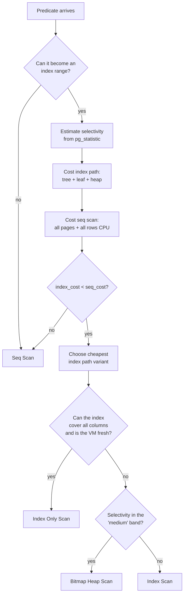
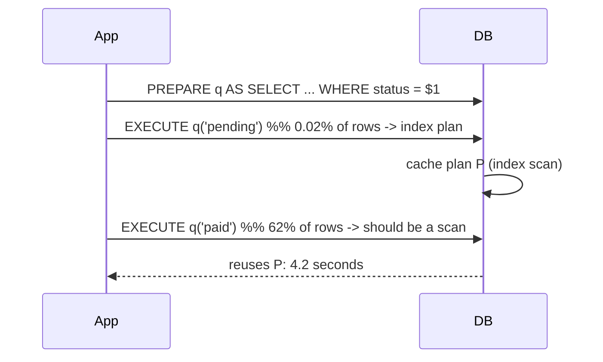

# Why an Index Is Ignored

> "I created the index and it still doesn't use it." This sentence is the most common support
> ticket in the history of relational databases, and it is almost always answerable in under a
> minute — because there are only about ten reasons. Some are the optimizer being *right* (the
> scan really is cheaper, and forcing the index would make things slower). Some are the optimizer
> being *starved* (statistics that do not describe the data). And some are queries that were
> written so that they cannot be indexed at all. This chapter gives you a decision tree: for any
> ignored index, work through the ten causes in order, and you will land on the fix without
> guessing.

---

## TL;DR

- **Ten causes, in the order you should check them:**
  1. The predicate is **non-sargable** (a function, an expression, or a cast on the column).
  2. There is a **type mismatch** between the column and the literal/parameter.
  3. **Leading wildcard** `LIKE '%x'` (no prefix → no range).
  4. **Low selectivity** — the predicate matches a large fraction; a scan is *correct*.
  5. **Stale or missing statistics** — the estimate is wrong, so the cost comparison is wrong.
  6. **`OR` across columns/relations** that cannot be decomposed into index conditions.
  7. **Collation / locale mismatch** — the index sorts under a different collation than the
     comparison uses.
  8. **Parameter sniffing / generic plans** — the cached plan was compiled for different values.
  9. **Cost-model configuration** — `random_page_cost`, `effective_cache_size`,
     `enable_indexscan`/`enable_seqscan`, parallel worker settings, or a cardinality estimate
     under the "cheap index" threshold.
  10. **The index does not cover the predicate** — wrong column order, a missing leading column,
     a nullable column, or an index that only exists on a *different* relation (a view/CTE).
- **`EXPLAIN` tells you which one it is if you know where to look.** A `Filter` line where you
  expected `Index Cond` means non-sargable. `Rows Removed by Filter` means the index (or scan)
  touched more than it needed. `rows=` estimate far from actual means statistics. `Hash Join` with
  a `Join Filter` means the predicate was not pushed down.
- **Do not "force" the index until you understand why it was rejected.** `SET enable_seqscan =
  off` is a *diagnostic*: if the plan does not change, the index is genuinely unusable; if it
  flips and gets faster, you have an estimate or cost-model problem; if it flips and gets
  *slower*, the optimizer was right and your real problem is elsewhere.
- **The optimizer is almost never "stupid".** It is computing a cost from statistics it has, a
  model you configured, and a predicate you wrote. All three are your responsibility.

---

## 1. Definitions and core concepts

| Term | Definition |
|---|---|
| **Sargable** | "Search ARGument ABLE" — a predicate the optimizer can convert into an index range: `column op constant`, `column op other_column`, `column BETWEEN c1 AND c2`, `column IN (list)`, `column LIKE 'prefix%'`. |
| **Non-sargable** | The column is wrapped in a function/expression so the index ordering is not directly usable: `date(ts) = '2026-01-01'`, `col + 1 = 5`, `CAST(col AS text) = '5'`. |
| **Index cond** (PostgreSQL) | Part of the predicate evaluated *inside* the index — the seekable part. |
| **Filter** (PostgreSQL) | Part of the predicate evaluated *after* the row is fetched from the heap/index. Large `Rows Removed by Filter` is the signature of an under-used index. |
| **Estimate vs actual** | `rows=N` (estimated) versus `actual rows=N loops=M` (measured). A ratio > 10× is a red flag; > 100× is a smoking gun. |
| **Selectivity threshold** | The point where the planner switches from index to scan. Governed by `random_page_cost / seq_page_cost` and how much of the table is needed. |
| **Index-only scan viability** | Requires every referenced column in the index, plus an up-to-date visibility map. |
| **Collation** | The locale-specific sort/comparison rules. `'DE'` sorts/compares differently in `C`, `en_US.UTF-8`, and `de_DE.UTF-8` (e.g. case- and accent-insensitivity in ICU collations). |
| **Parameter sniffing** | SQL Server: a cached plan compiled using the first parameter values, optimal for them and possibly terrible for others. |
| **Generic plan** | PostgreSQL: a cached plan for a prepared statement that ignores parameter values (used after 5 executions if it is not more expensive on average). |
| **Cardinality estimate error** | `|estimated - actual| / actual`. Underestimates are usually more damaging than overestimates: they cause nested loops on huge inputs and undersized memory grants. |
| **Cost model constants** | The knobs that decide index vs scan: `seq_page_cost` (1.0), `random_page_cost` (4.0 default), `cpu_index_tuple_cost`, `cpu_tuple_cost`, `effective_cache_size`. |
| **Index unusable vs index ignored** | *Unusable*: the predicate cannot be expressed as a range at all. *Ignored*: the index is usable but the planner judged it more expensive. Different problems, different fixes. |

> **Senior note:** in PostgreSQL, "the index is `Invalid`" is a third state: `CREATE INDEX
> CONCURRENTLY` that failed leaves an invalid index that `EXPLAIN` will never use but that
> still costs you writes. Check `pg_index.indisvalid`.

---

## 2. Why it matters / what problem it solves

### 2.1 The economics

A full sequential scan of 50 M rows (~9.5 GB) takes ~4.5 seconds from disk. With 200 such queries
per minute, that is 15 GB/s of I/O demand. The database has maybe 1–3 GB/s. The result is not
"slow queries" — it is **I/O saturation**, which manifests as *every* query being slow, including
the ones with perfect indexes, because the buffer pool is being thrashed.

This is why "the index is ignored" is not a cosmetic issue. The blast radius is the entire
instance.

### 2.2 The two failure directions

| Direction | Signature | Consequence | Fix |
|---|---|---|---|
| **Optimizer ignores a good index** | Plan is a `Seq Scan`; forcing the index makes it 10× faster | Latency proportional to table size; I/O saturation | Fix the estimate / cost model / the query |
| **Optimizer is right** | Plan is a `Seq Scan`; forcing the index makes it *slower* | None — you were about to make it worse | Accept the scan; fix the *query shape* (pre-aggregate, partition, materialize) |

Being able to tell these two apart in 60 seconds is the core skill of this chapter.

### 2.3 How to tell them apart in one command

```sql
-- PostgreSQL: temporarily make index scans infinitely attractive.
SET LOCAL enable_seqscan = off;
EXPLAIN (ANALYZE, BUFFERS) <your query>;
RESET enable_seqscan;
```

Three outcomes:

- **Plan unchanged** → the index is *unusable* for this predicate (cause 1, 2, 3, 6, or 7).
- **Plan changed and much faster** → the index is usable but the *estimate/cost* was wrong
  (cause 4, 5, 8, or 9).
- **Plan changed and much slower** → the optimizer was right (cause 4, and your real problem is
  elsewhere: query shape, partitioning, or workload design).

---

## 3. How it works internally

### 3.1 The decision the optimizer is actually making



Four places this chain breaks, and they map one-to-one onto the ten causes:

1. **`B` fails** → non-sargable predicates (causes 1, 2, 3, 6, 7).
2. **`C` is wrong** → statistics problems (cause 5), and the knock-on effect on every cost.
3. **`D`/`E` constants are wrong** → cost-model configuration (cause 9) and physical-order
   effects (correlation, cause 4's cousin).
4. **`G`/`J` chose a different variant** → not a bug, just a different access path (cause 4).

### 3.2 Sargability, formally

An index on `col` supports a seek iff the predicate can be rewritten as a disjunction of intervals
in the index's sort order. The optimizer's *index condition* machinery knows how to do this for
**operators belonging to the index's operator class**:

| Predicate | Index usable? | Why |
|---|---|---|
| `col = 5` | ✅ | Point interval |
| `col > 5` | ✅ | Half-open interval |
| `col BETWEEN 5 AND 9` | ✅ | Interval |
| `col IN (1,2,3)` | ✅ | Union of points |
| `col LIKE 'abc%'` | ✅ (with `text_pattern_ops` for non-`C` collations) | Prefix interval |
| `col LIKE '%abc'` | ❌ | No interval |
| `lower(col) = 'abc'` | ❌ unless an index on `lower(col)` exists | Function, not the column |
| `col::text = '5'` | ❌ (unless a cast index exists) | Cast changes the key |
| `col + 1 = 6` | ❌ | Expression; note `col = 5` would be usable (the planner does *not* do that algebra for you) |
| `abs(col) = 5` | ❌ | Non-monotonic function; cannot be inverted in general |
| `date_trunc('day', ts) = $1` | ❌ | Function of the column |
| `ts::date = $1` | ❌ unless an index on `(ts::date)` exists | Cast of the column |
| `col IS NULL` | ✅ | `NULLS LAST`/first interval on the index |
| `col = ANY($1)` | ✅ | Array → union of intervals |
| `col != 5`, `NOT IN (...)` | ⚠️ | Can *sometimes* be a full index scan; rarely wins over a seq scan |
| `col1 = col2` | ✅ in PostgreSQL (index on `col1`) | Column-to-column equality can drive a nested loop |
| `col OP subquery` | ⚠️ | Depends on the plan shape (semi-join vs subplan) |

### 3.3 Casts: the operator-resolution trap

PostgreSQL resolves `bigint = unknown` by picking an operator, and the resolution rules can put
the cast on the **column** rather than the literal. This is visible in the plan as
`(customer_id)::text = '1000001'::text` or `Filter: ((customer_id)::text = ...)`.

The three cast traps you will actually meet:

```sql
-- TRAP 1: string literal against a numeric column
WHERE customer_id = '1000001'          -- PostgreSQL may cast the column to text
WHERE customer_id = 1000001            -- casts the literal; index usable

-- TRAP 2: varchar vs nvarchar (SQL Server): data type precedence converts the varchar side
--         (or vice versa) depending on direction
WHERE varchar_col = N'some value'      -- converts the column's side to nvarchar -> scan

-- TRAP 3: MySQL converts the *string* to a double when comparing a string column to a number
WHERE varchar_col = 12345              -- full scan + surprising matches ('12345abc' matches!)
```

MySQL's TRAP 3 is worth pausing on: `WHERE varchar_col = 12345` does not just defeat the index —
it changes the *result set*, because MySQL coerces `varchar_col` to a number, and `'12345abc'`
casts to `12345`. This is a correctness bug masquerading as a performance bug.

**Diagnosis:** `EXPLAIN` shows `Filter: ((col)::type = ...)` (PostgreSQL) or a `func` in the `ref`
column (MySQL) or a `CONVERT_IMPLICIT` warning (SQL Server `SHOWPLAN_XML`).

### 3.4 Collation and locale mismatch

A B-tree's ordering is defined by the **collation** of the key. If your comparison uses a
different collation, the index's ordering does not describe the comparison's ordering, and the
optimizer cannot build an interval.

```sql
-- Index created under the database default collation (say, en_US.UTF-8)
CREATE INDEX idx_customers_email ON customers (email);

-- Query forces a different collation:
SELECT * FROM customers WHERE email COLLATE "C" = 'ada@example.com';
-- -> Seq Scan, because the index's order is not "C" order.
```

Three real-world variations:

1. **Case-insensitive search.** The classic bug: `WHERE lower(email) = lower($1)`. If the column
   is `citext` or the database uses an ICU collation with `caseLevel=off`, equality is already
   case-insensitive and `lower()` is pure overhead that also breaks the index.
2. **`LIKE` with a non-`C` collation.** `LIKE 'abc%'` is only directly indexable when the
   collation's ordering is "prefix-preserving". Under `en_US.UTF-8`, PostgreSQL requires an index
   with `text_pattern_ops` (`varchar_pattern_ops` for `varchar`) for `LIKE 'prefix%'` to use a
   B-tree.
3. **`ILIKE`.** Never indexable by a plain B-tree. Use `CREATE INDEX ... (lower(col))` and rewrite
   as `lower(col) = lower($1)`, or use a trigram index, or a collation that folds case.

**Diagnosis:** `EXPLAIN` shows a `Filter` and no `Index Cond`; check
`SELECT collname, collprovider FROM pg_collation WHERE oid = (SELECT attcollation FROM
pg_attribute WHERE attrelid='customers'::regclass AND attname='email');`

### 3.5 The statistics chain (why the estimate is the root cause of most "ignored index" reports)

```
pg_statistic
   ├── null_frac          -> selectivity of IS NULL
   ├── n_distinct         -> selectivity of equality on non-MCV values (1/n_distinct)
   ├── most_common_vals   -> exact selectivity for common values
   ├── most_common_freqs  -> their frequencies
   ├── histogram_bounds   -> ~100 equi-depth buckets for range predicates
   └── correlation        -> heap/index physical-order match

selectivity(pred, stats) -> estimated rows -> cost(index) vs cost(scan) -> plan
```

Break any of the first five and the last decision is wrong. The three most common breaks:

- **`default_statistics_target` too low.** With 100 histogram buckets, a spike of 3 M rows at one
  value cannot be represented unless it makes the MCV list. Raise it *per column*
  (`ALTER TABLE ... ALTER COLUMN ... SET STATISTICS 500`) for skewed columns only — a global raise
  slows every `ANALYZE`.
- **Stale stats.** `pg_stat_all_tables.last_analyze` is old and the table grew 40 %.
- **Correlation between predicates.** PostgreSQL multiplies selectivities assuming independence.
  `WHERE country_code='DE' AND currency='EUR'` where currency is functionally determined by
  country → underestimate by 1/0.83. Fixed by `CREATE STATISTICS ... (dependencies)`.

### 3.6 Why the planner sometimes *rightly* rejects a perfect index

Even a highly selective effect can lose to a scan when:

- The table is small (a handful of pages) — the tree descent plus heap fetch is more I/O than the
  whole table.
- The query needs **most** of the rows.
- The query needs a **large ordered output**, and the index scan would produce random heap I/O
  that costs more than a scan + sort.
- The predicate is on a column with `correlation ≈ 0`, so the index path becomes
  `random_page_cost`-heavy.
- The plan is parallel: a `Parallel Seq Scan` with 4 workers can beat a serial index scan even at
  10 % selectivity on a wide table.

### 3.7 Parameter sniffing and generic plans: the plan-cache cause



Both PostgreSQL and SQL Server will do this, with different names and different escape hatches:

| Engine | Mechanism | Fix |
|---|---|---|
| PostgreSQL | After 5 executions, a *generic* plan is chosen if its cost ≤ the average custom cost | `SET plan_cache_mode = force_custom_plan`; or `EXECUTE` with literals; or make the plan invariant |
| SQL Server | Parameter sniffing; plan compiled on first values | `OPTION (RECOMPILE)`, `OPTIMIZE FOR (col = value)`, `OPTIMIZE FOR UNKNOWN`, or a plan guide |
| Oracle | Bind peeking | Adaptive cursor sharing (automatic), `V$SQL_CS_*` views |
| MySQL | Prepared statement plan reuse | `ANALYZE TABLE`, `SET SESSION optimizer_switch`, or use non-prepared values |

**Symptom:** identical query text, wildly different runtimes for different parameter values, and
`EXPLAIN` (with literals) looks great while the production query is a scan.

### 3.8 Predicates that are never pushed down

An index can only be used for a predicate if the predicate is evaluated *at the right place in the
plan*. Predicates get "stuck" when:

| Situation | Effect |
|---|---|
| `WHERE` on an outer-joined (nullable) table, written as `LEFT JOIN ... WHERE t.col = x` | Not a bug, but it silently converts the join to an inner join; if it *is* meant to be an outer join, the predicate placement matters |
| Predicate inside a CTE that PostgreSQL 11 materialized | The filter runs after materialization; the inner scan reads everything |
| Predicate on a `UNION ALL` branch applied outside the `UNION` | Filter cannot be pushed into branches by older planners |
| Predicate on a column of a **view with `OFFSET`/`LIMIT`** | Blocks legal pushdown |
| Predicate referencing a **volatile function** (`random()`, `now()` in some contexts) | Blocks pushdown because evaluation timing matters |
| Predicate over a **`SELECT DISTINCT`/`GROUP BY`/`HAVING`** | Cannot be applied before the aggregate |
| Predicate on the *result* of a `CASE` | Not indexable; expression index may help |
| Predicate inside a **window function's partition** | Not a filter at all |
| Predicate on a **join key with a type mismatch** | Forces a conversion node in the middle of the join → hash join over everything |

---

## 4. How to diagnose it

### 4.1 PostgreSQL: the five-minute triage

```sql
-- STEP 1: Get the plan with estimates, without executing.
EXPLAIN (VERBOSE, COSTS, SETTINGS)
SELECT ...;

-- STEP 2: Compare estimates to reality at every node.
EXPLAIN (ANALYZE, BUFFERS, TIMING OFF, SUMMARY)
SELECT ...;

-- STEP 3: Which part of the predicate became an index condition?
--         Look for `Index Cond:` (seekable) vs `Filter:` (post-fetch).

-- STEP 4: Is the index simply not usable?
SET LOCAL enable_seqscan = off;   -- then re-run step 2

-- STEP 5: Is the estimate wrong?
SELECT attname, n_distinct, correlation, null_frac, most_common_vals, histogram_bounds
FROM pg_stats WHERE tablename = 'orders' AND attname = 'status';
SELECT last_analyze, last_autoanalyze, n_mod_since_analyze, n_live_tup
FROM pg_stat_all_tables WHERE relname = 'orders';
```

**Reading `Rows Removed by Filter`:**

```
Seq Scan on orders  (cost=...) (actual time=0.014..92410.55 rows=27394 loops=1)
  Filter: (date_trunc('month'::text, order_ts) = '2025-03-01 00:00:00+00'::timestamptz)
  Rows Removed by Filter: 49972606
```

50 M rows removed → the filter is doing all the work. Compare to:

```
Index Scan using idx_orders_ts on orders  (cost=...) (actual time=0.021..6.732 rows=27394 loops=1)
  Index Cond: ((order_ts >= ...) AND (order_ts < ...))
  Filter: (status <> 'cancelled'::text)
  Rows Removed by Filter: 1204
```

1,204 removed out of 28,598 → the index is doing the work and the filter is a cheap refinement.
**The ratio is the diagnostic.**

### 4.2 Checking whether the estimate, not the index, is the problem

```sql
-- True selectivity, measured.
SELECT
    count(*) FILTER (WHERE status = 'cancelled') AS matched,
    count(*)                                     AS total,
    round(100.0 * count(*) FILTER (WHERE status = 'cancelled') / count(*), 4) AS pct
FROM orders;
```

```
 matched |  total   |   pct
---------+----------+---------
  148213 | 50000000 |  0.2964
```

If `EXPLAIN` estimated 950,000 for that predicate, the estimate is off by 6.4× and you have found
cause 5.

```sql
-- Is the value even in the MCV list?
SELECT elem, freq
FROM pg_stats, unnest(most_common_vals::text::text[]) WITH ORDINALITY AS t(elem, ord)
JOIN unnest(most_common_freqs) WITH ORDINALITY AS f(freq, ord2) ON ord = ord2
WHERE tablename = 'orders' AND attname = 'status';
```

### 4.3 The specific-cause lookup table

| Plan symptom | Cause | Go to |
|---|---|---|
| `Filter: (func(col) = ...)`, no `Index Cond` | Non-sargable / function | §5.1 |
| `Filter: ((col)::type = ...)` | Cast on the column | §5.2 |
| `Filter: (col ~~ '%x%')`, `Seq Scan on` | Leading wildcard | §5.3 |
| `Seq Scan` with tiny `Rows Removed by Filter` | Index not selective enough (correct behaviour) | §5.4 |
| `rows=1` estimated, `actual rows=500000` | Statistics stale/missing | §5.5 |
| `Hash Join` with `Join Filter` | `OR` across relations / un-pushable predicate | §5.6 |
| `Filter` present, index exists on the right column, `COLLATE` in the query | Collation mismatch | §5.7 |
| Same query fast with literals, slow with binds | Parameter sniffing / generic plan | §5.8 |
| Index exists, is valid, predicate is sargable, estimate looks right, still a scan | Cost model (cause 9) | §5.9 |
| `Index Only Scan` with `Heap Fetches ≈ actual rows` | Visibility map / `VACUUM` | §5.10 |

---

## 5. Worked examples

*(Same schema, silent profile and cluster settings as Chapters 1–2. PostgreSQL 16, `orders` =
50 M rows / 1.25 M pages, `random_page_cost = 1.1`, SSD-class storage.)*

### 5.1 Cause 1 — A function on the indexed column

**Symptom:**

```sql
SELECT count(*) FROM orders WHERE to_char(order_ts, 'YYYY-MM') = '2025-06';
```

```text
Finalize Aggregate  (cost=1528123.44..1528123.45 rows=1 width=8) (actual time=4421.4..4421.5 rows=1 loops=1)
  ->  Gather  (...)
        ->  Parallel Seq Scan on orders  (cost=0.00..1528123.00 rows=2500 width=0)
                                          (actual time=0.021..4380.2 rows=0 loops=4)
              Filter: (to_char(order_ts, 'YYYY-MM'::text) = '2025-06'::text)
              Rows Removed by Filter: 12500000
Execution Time: 4421.6 ms
```

**Why the index is ignored:** `idx_orders_ts` is sorted by `order_ts`. `to_char(order_ts, ...)` is
a different value space entirely, and `to_char` is not invertible by the planner (nor is it
strictly monotonic across locales). Also — the estimate of `rows=2500` for an equality on an
expression is a pure guess (default equality selectivity).

**Fix A — rewrite sargable (preferred):**

```sql
SELECT count(*) FROM orders
WHERE order_ts >= DATE '2025-06-01' AND order_ts < DATE '2025-07-01';
-- -> Index Only Scan using idx_orders_ts, ~4 ms
```

**Fix B — expression index (when the query text is out of your control):**

```sql
CREATE INDEX idx_orders_ts_month ON orders (to_char(order_ts, 'YYYY-MM'));
ANALYZE orders;
```

But note the subtlety: an expression index works, yet it is *56 months × 12 buckets* of
correlation with the heap. It will be used, but a range rewrite will usually still beat it —
because the composite expression is a string that maps to non-contiguous heap regions in a
low-correlation way.

**Diagnostic you can automate:** grep `pg_stat_statements` for queries with a function call on the
left-hand side of a comparison:

```sql
SELECT queryid, calls, round(mean_exec_time::numeric,1) AS mean_ms, left(query, 100)
FROM pg_stat_statements
WHERE query ~ '(date_trunc|to_char|to_date|extract|lower|upper|substring|substr|::date|::text)\s*\('
  AND query ~* 'where'
ORDER BY total_exec_time DESC
LIMIT 25;
```

### 5.2 Cause 2 — Type mismatch / cast on the column

**Symptom** (the API sends everything as a string):

```sql
SELECT order_id, total_amount FROM orders WHERE customer_id = '1000001';
```

```text
Gather  (cost=1000.00..1444210.00 rows=500000 width=24) (actual time=0.412..4198.2 rows=27 loops=1)
  Workers Planned: 4  Workers Launched: 4
  ->  Parallel Seq Scan on orders  (cost=0.00..1343210.00 rows=125000 width=24) (...)
        Filter: ((customer_id)::text = '1000001'::text)
        Rows Removed by Filter: 12500000
Buffers: shared hit=1814 read=1259986
```

Three things went wrong simultaneously:

1. `(customer_id)::text` — the cast is on the **column**, so no index on `customer_id` can apply.
2. The estimate `rows=500,000` comes from the default selectivity for a cast expression — not from
   statistics. That bad estimate is what makes the planner pick a parallel scan.
3. The 4-worker parallel scan reads 1.26 M pages to return 27 rows.

**Fix:** bind correctly at the driver level.

```sql
-- PostgreSQL JDBC / psycopg: send a bigint, not a text
PreparedStatement ps = conn.prepareStatement(
    "SELECT order_id, total_amount FROM orders WHERE customer_id = ?");
ps.setLong(1, 1000001L);          -- NOT setString(...)
```

```text
Index Scan using idx_orders_customer_ts on orders  (cost=0.56..11872.98 rows=5792 width=24)
                                                   (actual time=0.029..0.081 rows=27 loops=1)
  Index Cond: (customer_id = 1000001)
Execution Time: 0.09 ms
```

**Detecting cast bugs across the codebase (PostgreSQL):** log the plans and grep for `::`.

```sql
-- auto_explain with log_analyze finds them automatically; then:
--   log_line_prefix = '%m [%p] %q%u@%d '
--   auto_explain.log_min_duration = 200
--   auto_explain.log_analyze = on
-- and grep the log for 'Filter: (('
```

**SQL Server variant.** Data type precedence makes `int` beat `varchar`, so `WHERE int_col = '5'`
is fine (the literal converts). But `WHERE nvarchar_col = 'x'` where the column is `varchar` will
convert the **column** to `nvarchar` — because `nvarchar > varchar` in precedence. The plan shows
`CONVERT_IMPLICIT(nvarchar(50), [col], 0)` in the `Seek Predicates`/`Predicate` and the seek
becomes a scan. The fix is to make the parameter type match (or add `OPTION (RECOMPILE)` and
accept the conversion-free predicate).

**MySQL variant.** `WHERE varchar_col = 12345` converts the *column* to a double. Beyond losing
the index, it matches `'12345abc'`. Tools like Percona's `pt-query-digest` and the
`Warning 1292 Truncated incorrect DOUBLE value` in the error log are the tells.

### 5.3 Cause 3 — Leading wildcard

```sql
SELECT product_id, name FROM products WHERE name LIKE '%pro%';
```

```text
Seq Scan on products  (cost=0.00..22150.00 rows=1000 width=40) (actual time=0.028..91.4 rows=8421 loops=1)
  Filter: (name ~~ '%pro%'::text)
  Rows Removed by Filter: 491579
  Buffers: shared hit=16000
```

`idx_products_name` (if it existed) would be sorted by `name`; `'%pro%'` has no prefix, so there is
no interval. **The index is not "ignored" — it is unusable. This is not an optimizer problem.**

**Fixes:**

```sql
-- (a) pg_trgm GIN index: supports arbitrary substring/regex search
CREATE EXTENSION pg_trgm;
CREATE INDEX idx_products_name_trgm ON products USING gin (name gin_trgm_ops);
-- -> Bitmap Index Scan, ~5 ms for the same query

-- (b) Full-text search (best semantics for "search")
ALTER TABLE products ADD COLUMN search_tsv tsvector
    GENERATED ALWAYS AS (to_tsvector('english', name)) STORED;
CREATE INDEX idx_products_search ON products USING gin (search_tsv);
SELECT product_id, name FROM products WHERE search_tsv @@ to_tsquery('english', 'pro:*');

-- (c) Prefix-only pattern (fastest - plain B-tree with text_pattern_ops under non-C collation)
CREATE INDEX idx_products_name_prefix ON products (name text_pattern_ops);
SELECT product_id, name FROM products WHERE name LIKE 'pro%';
```

**Cross-engine note:** MySQL's `FULLTEXT` index and SQL Server's full-text catalogs solve the same
problem; Snowflake has **Search Optimization Service**; BigQuery has `SEARCH()` over
`TOKENIZE`d columns; Spark has no native substring index — you precompute n-grams or use a search
engine.

### 5.4 Cause 4 — The index is genuinely not selective enough

```sql
SELECT customer_id, count(*) FROM orders WHERE status = 'paid' GROUP BY 1;
```

The `status` column has 5 values; `'paid'` is 62 % of 50 M rows = 31 M rows. An index scan would
touch ~62 % of 1.25 M heap pages — the same pages a sequential scan reads, but one at a time
through a B-tree, with no prefetching.

```text
Finalize Aggregate  (cost=1528123.44..1528123.45 rows=1 width=16) (actual time=3986.1..4021.4 rows=1 loops=1)
  ->  Gather  (...)
        ->  Parallel Seq Scan on orders  (cost=0.00..1528123.00 rows=7750000 width=16) (...)
              Filter: (status = 'paid'::text)
              Rows Removed by Filter: 4750000
Execution Time: 4022.0 ms
```

**Confirm the planner is right:**

```sql
SET LOCAL enable_seqscan = off;
-- forces a bitmap/index scan; measure
SET LOCAL enable_indexscan = on;
RESET enable_seqscan;
```

```
Index Scan using idx_orders_status_country on orders  (... actual time=11.2..8912.4 rows=31024118 ...)
Execution Time: 8912.4 ms      -- 2.2x SLOWER than the scan
```

The optimizer was right. **The real fix is a query-shape change:**

```sql
-- Maintain the aggregate instead of computing it.
CREATE MATERIALIZED VIEW order_counts_by_status AS
SELECT status, count(*) AS n, sum(total_amount) AS revenue
FROM orders GROUP BY status;
CREATE UNIQUE INDEX ON order_counts_by_status (status);

-- Or pre-aggregate by day (usually the actual business question):
CREATE MATERIALIZED VIEW orders_daily AS
SELECT order_ts::date AS d, status, customer_id, count(*) n, sum(total_amount) revenue
FROM orders GROUP BY 1, 2, 3;
CREATE INDEX ON orders_daily (d, status);
```

### 5.5 Cause 5 — Stale statistics

**The incident:** after a bulk backfill inserted 12 M historical orders, a query that had run in
90 ms for a year started taking 40 s.

```sql
SELECT attname, n_distinct, correlation, null_frac,
       left(most_common_vals::text, 60) AS mcv
FROM pg_stats WHERE tablename = 'orders';

SELECT relname, n_live_tup, last_analyze, last_autoanalyze, n_mod_since_analyze
FROM pg_stat_all_tables WHERE relname = 'orders';
```

```
 relname | n_live_tup |         last_analyze         | last_autoanalyze | n_mod_since_analyze
---------+------------+------------------------------+------------------+---------------------
 orders  |   50000000 | 2026-01-12 03:00:11.418+00   | 2026-01-12 03:00:11.418+00 | 12000000
```

`n_mod_since_analyze = 12,000,000` — the table changed by 24 % since the last `ANALYZE`, and the
histogram's `order_ts` buckets still ended at the pre-backfill date. Every range predicate on
`order_ts` was estimated as if the table ended six months earlier.

```sql
ANALYZE orders;    -- or: VACUUM (ANALYZE) orders;
```

**Before / after estimates for the same query:**

```text
-- BEFORE:  rows=982  -> Nested Loop chosen, 41 s
-- AFTER :  rows=241884 -> Hash Join chosen, 1.2 s
```

**The systemic fix (autovacuum tuning, per table):**

```sql
ALTER TABLE orders SET (
    autovacuum_analyze_scale_factor = 0.02,   -- ANALYZE after 2% change, not 10%
    autovacuum_analyze_threshold    = 50000,
    autovacuum_vacuum_scale_factor  = 0.02,   -- VACUUM after 2% dead tuples
    autovacuum_vacuum_threshold     = 50000,
    autovacuum_vacuum_cost_limit    = 2000    -- let it finish on big tables
);
ALTER TABLE orders ALTER COLUMN status SET STATISTICS 500;   -- skewed column
ALTER TABLE orders ALTER COLUMN order_ts SET STATISTICS 500;
```

**The pipeline fix:** call `ANALYZE` **explicitly at the end of every bulk load** rather than
waiting for autovacuum:

```sql
-- at the end of the ETL transaction
ANALYZE orders;
ANALYZE order_items;
```

> **Senior note:** after a *large deletion* you also need `VACUUM`, not just `ANALYZE` — the pages
> are still there and the visibility map still lies. `ANALYZE` fixes the estimates; `VACUUM` fixes
> the I/O.

### 5.6 Cause 6 — `OR` across relations (recap with a new angle)

Full treatment is in Chapter 1 §5.3; the index-ignored angle is what to look for:

```text
Hash Join  (cost=...) (actual time=12044.31..12044.33 rows=1 loops=1)
  Join Filter: ((o.order_id = 99887766) OR (c.email = 'ada.lovelace@example.com'::text))
  Rows Removed by Join Filter: 49999999
```

**`Join Filter`** (as opposed to `Index Cond` or even a plain `Filter` on a base scan) is the
signature of a predicate that could not be attached to any single base relation's access path.
The **fix** is always to decompose the `OR` into predicates that each reference one relation, then
`UNION ALL` them.

**Special case — `OR` within one table.** PostgreSQL can build a `BitmapOr` of two index scans on
the same relation:

```sql
SELECT * FROM orders WHERE customer_id = 1000001 OR status = 'cancelled';
```

```text
Bitmap Heap Scan on orders  (cost=4214.10..128441.20 rows=29931 width=48) (...)
  Recheck Cond: ((customer_id = 1000001) OR (status = 'cancelled'::text))
  ->  BitmapOr  (...)
        ->  Bitmap Index Scan on idx_orders_customer_ts  (cost=...) (actual rows=27)
        ->  Bitmap Index Scan on idx_orders_status       (cost=...) (actual rows=148213)
```

This works — but note that the `status = 'cancelled'` branch forces a full index scan of 148 K
entries even though it is 0.3 % of the table, because the two branches must be unioned. If the
`OR` is *actually* an "either/or with a fallback" pattern (a search form), the rewrite to
`UNION ALL` plus a de-dup key is usually faster and always more predictable.

### 5.7 Cause 7 — Collation mismatch

**Symptom:** an index on `email` exists, the predicate is `email = $1`, and the plan is a scan
*with* an `Index Cond`... no — the plan is a scan with a `Filter`:

```text
Seq Scan on customers c  (cost=0.00..38000.00 rows=1 width=60) (actual time=0.014..320.4 rows=1 loops=1)
  Filter: ((email)::text = 'ada@example.com'::text COLLATE "de_DE")
  Rows Removed by Filter: 1999999
```

The `COLLATE` clause on the comparison changes the operator (`texteq` vs a collation-specific
variant), and no index on `email` (created with the database's default collation) can serve it.

Three real scenarios and their fixes:

```sql
-- (a) Index/collation mismatch: create the index with the collation used by the query.
CREATE INDEX idx_customers_email_de ON customers (email COLLATE "de_DE");

-- (b) Case-insensitive search done the slow way:
WHERE lower(email) = lower($1)                       -- broken
CREATE INDEX idx_customers_email_lower ON customers (lower(email));
-- Then the query MUST keep lower(...) on both sides for the index to match.

-- (c) Pseudo-locale prefix search with LIKE:
CREATE INDEX idx_customers_email_pat ON customers (email varchar_pattern_ops);
WHERE email LIKE 'ada%'                              -- now seekable
```

**Diagnosis:**

```sql
SELECT c.collname, c.collprovider
FROM pg_attribute a
JOIN pg_collation c ON c.oid = a.attcollation
WHERE a.attrelid = 'customers'::regclass AND a.attname = 'email';
```

**Cross-engine:** SQL Server collation mismatches produce the same class of problem and the plan
shows `CONVERT_IMPLICIT`. MySQL's per-column `COLLATE` and the `utf8mb4_general_ci` vs
`utf8mb4_0900_ai_ci` distinction can make a join between two tables unusable-index-wise if the
collations differ — MySQL will warn, but the plan degrades silently. Oracle has `NLS_SORT` /
`NLS_COMP` which can change index usability session-by-session — a classic "works in my session,
not in production" bug.

### 5.8 Cause 8 — Parameter sniffing / generic plan

**The incident:** the "customer search" endpoint is 8 ms for 99 % of users and 6 seconds for one
enterprise customer. The SQL is identical.

```sql
-- Reproduce: literals
EXPLAIN (ANALYZE, BUFFERS)
SELECT * FROM orders WHERE customer_id = 1000001 ORDER BY order_ts DESC LIMIT 50;
-- -> Index Scan, 0.2 ms

-- The enterprise customer has 480,000 orders:
EXPLAIN (ANALYZE, BUFFERS)
SELECT * FROM orders WHERE customer_id = 4420000 ORDER BY order_ts DESC LIMIT 50;
-- -> still Index Scan, 0.3 ms. Fine.

-- Now the prepared-statement version, six executions in (generic plan):
PREPARE q(bigint) AS
  SELECT * FROM orders WHERE customer_id = $1 ORDER BY order_ts DESC LIMIT 50;
EXPLAIN (ANALYZE, BUFFERS, COSTS) EXECUTE q(1000001);   -- exec 1-5: custom plans
EXPLAIN (ANALYZE, BUFFERS, COSTS) EXECUTE q(1000001);   -- ... exec 6: generic plan?
```

A common generic-plan failure looks like this:

```text
Limit  (cost=118721.98..118721.99 rows=50 width=160) (actual time=6120.4..6120.4 rows=50 loops=1)
  ->  Sort  (cost=118721.98..121201.10 rows=991811 width=160) (actual time=6120.4..6120.4 rows=50 loops=1)
        Sort Key: order_ts DESC
        Sort Method: top-N heapsort  Memory: 28kB
        ->  Bitmap Heap Scan on orders  (cost=11024.10..94912.20 rows=991811 width=160)
                                          (actual time=114.2..5812.0 rows=991811 loops=1)
              Recheck Cond: (customer_id = $1)
              ->  Bitmap Index Scan on idx_orders_customer  (...)
                    Index Cond: (customer_id = $1)
```

The generic plan uses `rows=991811` (the table's average customer, 50 M / 50.4 K customers ≈ 992),
decides a bitmap scan is safer, and loses the `LIMIT` pushdown: it reads **991,811 rows** to
return 50. The custom plan would have used the estimate for the *actual* customer (27 rows) and
used the index scan.

**Three fixes, in order of preference:**

```sql
-- (a) Per-session: force custom plans (PostgreSQL 12+).
SET plan_cache_mode = force_custom_plan;

-- (b) Engine-level default (careful: planning cost) - in postgresql.conf
--     plan_cache_mode = force_custom_plan

-- (c) Make the plan invariant: rewrite so the plan is good for both shapes.
--     For this query, the (customer_id, order_ts DESC) index makes the plan
--     good for every selectivity, because the ORDER BY is free and the LIMIT
--     is pushed into the index scan.
SELECT order_id, order_ts, status, total_amount     -- project, don't SELECT *
FROM orders WHERE customer_id = $1
ORDER BY order_ts DESC LIMIT 50;
```

`(c)` is the real fix. Note the difference: the generic plan chose a bitmap scan because `SELECT *`
made the index non-covering and because the estimate was "average customer". With a covering
index and a projection, the index scan is *always* cheaper than the bitmap scan, for every value.

**SQL Server equivalents:**

```sql
-- Force a fresh plan every time (cost: compilation, but often worth it for skewed data)
SELECT ... FROM orders WHERE customer_id = @cid OPTION (RECOMPILE);

-- Accept the average, and be stable
SELECT ... FROM orders WHERE customer_id = @cid OPTION (OPTIMIZE FOR UNKNOWN);

-- Pin the plan to a known-good value
SELECT ... FROM orders WHERE customer_id = @cid OPTION (OPTIMIZE FOR (@cid = 4420000));
```

Diagnostic DMV queries:

```sql
SELECT TOP 20
    qs.plan_generation_num, qs.execution_count,
    qs.total_worker_time / qs.execution_count  AS avg_cpu_us,
    qs.total_logical_reads / qs.execution_count AS avg_reads,
    qs.total_worker_time / 1000                AS total_cpu_ms,
    st.text
FROM sys.dm_exec_query_stats qs
CROSS APPLY sys.dm_exec_sql_text(qs.sql_handle) st
WHERE qs.plan_generation_num > 1          -- plan recompiled -> sniffing candidate
ORDER BY qs.total_worker_time DESC;
```

`plan_generation_num > 1` is the smoke signal: SQL Server already had recompile it, which happens
when the plan was bad enough to trip `recompile_threshold`.

### 5.9 Cause 9 — Cost-model configuration

**Scenario:** a perfectly selective query on NVMe storage does a seq scan. The predicate matches
0.4 % of rows. The index is valid, the predicate is sargable, the statistics are fresh.
Diagnostic:

```sql
SHOW random_page_cost;      -- 4.0 (the default!)
SHOW seq_page_cost;         -- 1.0
SHOW effective_cache_size;  -- 4GB  (set years ago for a smaller machine)
```

The planner believes a random page read costs 4× a sequential one. On NVMe it costs ~1×.
It therefore overestimates every index-path heap fetch by 4×, and picks scans.

```sql
ALTER SYSTEM SET random_page_cost      = 1.1;      -- SSD-class
ALTER SYSTEM SET effective_io_concurrency = 200;   -- NVMe; 1 on HDD
ALTER SYSTEM SET effective_cache_size  = '48GB';   -- measure shared_buffers + OS cache
SELECT pg_reload_conf();
```

Re-plan the same query:

```text
-- BEFORE: Seq Scan, 4,120 ms, buffers read=1249700
-- AFTER : Index Scan using idx_orders_customer_ts, 41 ms, buffers read=312
```

**Other cost-model "ignored index" causes:**

```sql
-- A leftover debugging switch, still set in production:
SHOW enable_indexscan;      -- off  (!)   -- usually set via ALTER ROLE/DATABASE SET
SHOW enable_bitmapscan;     -- off  (!)
SHOW enable_indexonlyscan;  -- off  (!)

-- Wrong pg_settings source: role/database-level settings override postgresql.conf
SELECT name, setting, source, sourcefile
FROM pg_settings
WHERE name IN ('enable_indexscan','enable_bitmapscan','enable_indexonlyscan',
               'random_page_cost','seq_page_cost','effective_cache_size',
               'default_statistics_target','max_parallel_workers_per_gather');
```

That `source` column is worth a habit: `ALTER DATABASE ... SET enable_indexscan = off` from a
2021 debugging session is a real and recurring production incident.

**Parallelism can also hide indexes:** with `max_parallel_workers_per_gather = 4`, a
`Parallel Seq Scan` costs roughly 1/4 of a serial scan, so it wins at selectivities where a serial
index scan used to win. That is often *fine*. It stops being fine when the parallel scan's
buffers evict the working set for every other query. In that case, cap parallelism for the
offending role:

```sql
ALTER ROLE reporting SET max_parallel_workers_per_gather = 0;
```

### 5.10 Cause 10 — The index *is* used, but as an index-only scan that keeps fetching the heap

```sql
EXPLAIN (ANALYZE, BUFFERS)
SELECT category_id, unit_price FROM products WHERE category_id = 42 AND is_active;
```

```text
Index Only Scan using idx_products_cat_price on products
  (cost=0.42..62.13 rows=1043 width=40) (actual time=0.421..8.912 rows=1043 loops=1)
  Index Cond: ((category_id = 42) AND is_active)
  Heap Fetches: 1043            <-- every row needed a heap visit!
  Buffers: shared hit=1288 read=412
```

`Heap Fetches: 1043` out of `actual rows=1043` means the index-only scan degenerated into an index
scan with extra steps. Cause: the visibility map is stale because dead tuples were never vacuumed.

```sql
SELECT relname, n_live_tup, n_dead_tup,
       last_vacuum, last_autovacuum,
       round(100.0 * n_dead_tup / NULLIF(n_live_tup + n_dead_tup, 0), 1) AS dead_pct
FROM pg_stat_user_tables WHERE relname = 'products';
```

```
 relname  | n_live_tup | n_dead_tup |      last_autovacuum
----------+------------+------------+---------------------------
 products |     500000 |      86211 | 2026-01-09 04:12:44
```

17 % dead tuples → the visibility map has not been updated for 17 % of pages. Fix:

```sql
VACUUM (ANALYZE) products;
-- or make it stick:
ALTER TABLE products SET (autovacuum_vacuum_scale_factor = 0.05);
```

```text
Index Only Scan using idx_products_cat_price on products
  (cost=0.42..62.13 rows=1043 width=40) (actual time=0.212..1.104 rows=1043 loops=1)
  Heap Fetches: 0
  Buffers: shared hit=9
Execution Time: 1.2 ms         -- 8.9 ms -> 1.2 ms
```

### 5.11 The complete triage, as one script

```sql
-- /tmp/index_triage.sql - run this before asking anyone for help.
\set qry 'SELECT ... <<YOUR QUERY>> ...'

-- 1. Plan with estimates and settings
EXPLAIN (VERBOSE, COSTS, SETTINGS) :qry;

-- 2. Plan with actuals
EXPLAIN (ANALYZE, BUFFERS, TIMING OFF) :qry;

-- 3. Does forcing the index change anything?
BEGIN;
SET LOCAL enable_seqscan = off;
EXPLAIN (ANALYZE, BUFFERS, TIMING OFF) :qry;
ROLLBACK;

-- 4. Relevant statistics
SELECT attname, n_distinct, correlation, null_frac
FROM pg_stats
WHERE tablename IN ('orders','order_items') ORDER BY tablename, attname;

-- 5. Freshness
SELECT relname, n_live_tup, n_dead_tup, last_analyze, last_autoanalyze, n_mod_since_analyze
FROM pg_stat_all_tables WHERE relname IN ('orders','order_items');

-- 6. Are the cost knobs sane?
SELECT name, setting, source FROM pg_settings
WHERE name IN ('random_page_cost','seq_page_cost','effective_cache_size',
               'enable_seqscan','enable_indexscan','enable_bitmapscan',
               'enable_indexonlyscan','default_statistics_target');

-- 7. Is the index valid and used?
SELECT indexrelid::regclass, indisvalid, indisready, idx_scan
FROM pg_index i JOIN pg_stat_user_indexes s USING (indexrelid)
WHERE i.indrelid = 'orders'::regclass;
```

---

## 6. Real-world use cases and applications

### 6.1 The index that "did not work" and the answer was `VACUUM`

A team added an index for a nightly report; the plan still showed a seq scan. They added three
more indexes. The fourth request finally landed with an `EXPLAIN` attached, which showed:

```
Seq Scan on ledger  (cost=0.00..412.10 rows=1 width=48) (actual time=0.033..91.2 rows=1 loops=1)
  Filter: (account_id = 'A-9931'::text)
  Rows Removed by Filter: 41204
  Buffers: shared hit=412
```

Four hundred and twelve pages for 41,205 rows — the table was **2.5 KB per row** because of
bloat: 41 M dead tuples in a 41 K-row table (a hot-updated counter). The index was used; the
table was simply 400× larger than it should have been. `VACUUM FULL` (or `pg_repack`, online)
finished in 12 seconds and the query went from 91 ms to 0.2 ms. **No index changes at all.**

### 6.2 The index that was ignored because of a role-level setting

A regression appeared after a routine migration. `pg_settings.source` revealed:

```
enable_indexscan | off | database
```

An engineer had run `ALTER DATABASE staging SET enable_indexscan = off;` to reproduce a customer's
reported issue 14 months earlier, and the change had been promoted through environments as part
of a "database configuration" baseline. The fix was to remove the setting and add a CI check that
greps the config for `enable_* = off`.

### 6.3 The join that could not use any index because of a type mismatch

Two teams owned two tables. `orders.customer_id` was `bigint`; `customers.id` was `text` (from an
old import). The join `o.customer_id = c.id` required a cast on one side; the planner cast
`orders.customer_id` to `text`, which made the index unusable **and** made the hash join's build
side 50 M rows wide. The fix was a migration: `ALTER TABLE customers ALTER COLUMN id TYPE bigint
USING id::bigint`, plus a new index. Query time went from 4 minutes to 300 ms.

**Lesson:** a type mismatch on a *join key* is not just an index problem — it destroys the join's
ability to use hash partitioning, parallelism, and statistics.

### 6.4 The stored procedure that was fine and the parameter that was not

A payment provider's settlement procedure took 2 s for most merchants and 40 minutes for one
large merchant. The plan cache held a plan compiled for a small merchant. `OPTION (RECOMPILE)`
made every execution fast but added 40 ms of compilation; the final fix was a **plan guide** that
forced a `HASH JOIN` + `MAXDOP 4` for that procedure, plus splitting the merchant set into two
code paths based on order volume. That is what parameter sniffing looks like in practice:
"rewrite so that the plan is right for every parameter" beats "hint so the plan is right for
some".

### 6.5 The collation that cost a company $40k in BigQuery

Not an ignored index, but the same failure mode at warehouse scale: a query cast the partitioning
column (`CAST(event_date AS STRING) = '2026-01-15'`), which defeated **partition pruning**.
BigQuery scanned 4 PB instead of 12 GB and billed accordingly. The fix was a sargable comparison
on the native `DATE` type. **Every "index ignored" cause in this chapter has a warehouse
analogue**, where the cost is not latency but dollars.

### 6.6 The `OR` that was actually a security bug

A tenant-scoped query `WHERE tenant_id = $1 OR is_public` was converted to `UNION ALL` for
performance. During the rewrite, someone dropped the tenant predicate from the `is_public` branch.
The performance work exposed a data-leak path that had been masked by the seq scan. **When you
rewrite `OR` predicates for performance, you are rewriting security-relevant logic; add a test.**

---

## 7. Patterns and anti-patterns

### 7.1 Anti-patterns

| Anti-pattern | Why the index is ignored | Fix |
|---|---|---|
| `WHERE f(col) = x` | Function of the column has no index ordering | Sargable rewrite, or an expression index |
| `WHERE col::text = '5'` | Cast on the column | Bind the correct type |
| `WHERE col = 123` (col is text, MySQL) | Column coerced to double; also a **correctness** bug | Quote the literal / bind a string |
| `WHERE name LIKE '%x%'` | No prefix interval exists | trigram/GIN, FTS, or a search service |
| `WHERE col COLLATE "X" = y` with a mismatched index | Different collation ordering | Index with the matching collation, or normalize the collation |
| `WHERE lower(col) = ...` without a matching expression index | Same as above | Expression index on `lower(col)` |
| `WHERE status = 'paid'` (62 % of rows) | Correctly rejected; scan is cheaper | Materialized summary / partition / pre-aggregate |
| Stale `pg_statistic` after bulk load | Wrong estimate → wrong cost comparison | `ANALYZE` at the end of every load; tune autovacuum |
| `WHERE a = 1 OR b = 2` across two tables | Predicate cannot attach to a base scan | `UNION ALL` decomposition |
| One prepared statement for a skewed parameter | Cached plan optimal for other values | `plan_cache_mode`, table splitting, plan guides |
| `random_page_cost = 4.0` on NVMe | Random reads are over-priced 4× | Set 1.0–1.1 |
| `ALTER DATABASE ... SET enable_indexscan = off` left behind | Planner is forbidden from using indexes | Audit `pg_settings.source` |
| `CREATE INDEX CONCURRENTLY` that failed | Index exists but `indisvalid = false` | Drop and recreate |
| Not vacuuming a table you index-only-scan | `Heap Fetches` ≈ rows | Tune autovacuum, `VACUUM` |
| Index on a column with a different type than the join key | Join conversion forces a scan | Migrate the type |
| Assuming the optimizer is broken | Wasted days | Run the 6-step triage first |

### 7.2 Patterns

| Pattern | Why it works |
|---|---|
| **Compare `Index Cond` vs `Filter` before anything else** | One line tells you if the index is *unusable* or merely *unused* |
| **`SET enable_seqscan = off` as a diagnostic** | Three outcomes classify the cause instantly |
| **Check `pg_settings.source` for planner switches** | Finds environment drift that no `EXPLAIN` reveals |
| **`ANALYZE` at the end of every bulk load** | Removes the most common cause entirely |
| **Per-column `SET STATISTICS` on skewed columns only** | Cheap accuracy without global `ANALYZE` cost |
| **Expression indexes matching the *actual* query text** | Fixes non-sargability without touching the app |
| **Type discipline at the API boundary** | Prevents casts at the source; enforceable with typed DAOs |
| **CI lint against `WHERE f(col) =` patterns** | Catches the regression before it ships |
| **`random_page_cost` matching the storage class** | Corrects a systematic bias in hundreds of plans at once |
| **Measure true selectivity with `count(*) FILTER`** | Turns a debate into a number |

---

## 8. Cross-engine differences

| Cause | PostgreSQL | MySQL (InnoDB) | SQL Server | Oracle | Snowflake / BigQuery | Spark SQL |
|---|---|---|---|---|---|---|
| Function on column | No rewrite; index unused; expression index fixes it | Functional index (8.0.13+) or generated column | Computed column + index; `SCAN` in the plan | **Function-based index**; also automatic "virtual column" adoption | Pruning defeated; no index fallback | Catalyst may still scan; no index |
| Implicit cast | `(col)::text = …` in `Filter` | Column coerced to number/string; `Warning 1292`; **changes results** | `CONVERT_IMPLICIT`; data-type precedence decides which side converts | Implicit conversion documented in the plan (`V$SQL_PLAN` `ACCESS_PREDICATES`) | Type coercion breaks pruning | Cast blocks pushdown to Parquet (`spark.sql.parquet.filterPushdown`) |
| Leading wildcard | No index; recommend `pg_trgm`/GIN/tsvector | No index; `FULLTEXT` or `LIKE 'x%'` | No index; full-text index | No index; Oracle Text (`CTXCAT`, `CONTEXT`) | Search Optimization Service | No; precompute n-grams |
| Low selectivity | Scan chosen; use `ANALYZE`/materialized view/partition | Same; `type: ALL` | Same; table scan; consider filtered index | Same; consider partitioning + local index | n/a — scan is the model | n/a — scan is the model |
| Stale statistics | `pg_statistic`, `ANALYZE`, autovacuum thresholds | `ANALYZE TABLE`, `innodb_stats_persistent`, `information_schema.STATISTICS` | Auto-update on threshold; `UPDATE STATISTICS`, `sp_updatestats`; stale stats are the #1 cause | `DBMS_STATS` + `STALE_STATS`/`STALE_PERCENT`; auto stats job unless disabled | Always fresh (metadata); staleness is not a concept | `ANALYZE TABLE ... COMPUTE STATISTICS`; Delta stats |
| `OR` handling | `BitmapOr` within one relation; no cross-relation pushdown | **Index Merge** (intersection/union) | Sometimes rewrites to a nested loop + union; otherwise `Filter` | `CONCATENATION`/`OR` expansion, `TABLE ACCESS BY INDEX ROWID BATCHED` | Irrelevant | No |
| Collation | `COLLATE` in the query must match the index collation; `text_pattern_ops` for `LIKE 'x%'` | Per-column `COLLATE`; join between different collations degrades | Server/db/column collations; `CONVERT_IMPLICIT` in the plan | `NLS_SORT`/`NLS_COMP` can change index usability per session | n/a | `spark.sql.collation` (4.0+) |
| Parameter sniffing | Generic plans after 5 executions; `plan_cache_mode` | Cached prepared-statement plans | **Named problem**; `OPTION (RECOMPILE)`/`OPTIMIZE FOR`; plan guides; `plan_generation_num > 1` in DMVs | Bind peeking; **adaptive cursor sharing** mostly automates the fix | Plan caching per warehouse | Catalyst plan cache; AQE re-optimizes |
| Cost-model knobs | `random_page_cost`, `effective_cache_size`, `seq_page_cost`, `cpu_*` | `optimizer_cost_model` (fixed), no random/seq distinction exposed | Internal cost model; `LEGACY_CARDINALITY_ESTIMATION`; trace flags 9481/2312 | `OPTIMIZER_*` parameters, `SYSTEM_STATISTICS` (I/O vs CPU cost) | Credits / bytes; warehouse size is the main knob | `spark.sql.cbo.*`, `spark.sql.adaptive.*` |
| Index unusable-but-present | `pg_index.indisvalid = false` after a failed `CONCURRENTLY` | Index marked invisible (`INVISIBLE`) or corrupt | `sys.indexes.is_disabled = 1`; index rebuilt by DDL | `UNUSABLE` state after a partition maintenance op | n/a | n/a |
| Diagnosing "why not used" | `EXPLAIN` `Filter` vs `Index Cond`; `enable_seqscan` toggle | `EXPLAIN` `key`/`possible_keys`/`filtered`; `optimizer_trace` | Showplan XML warnings; `dm_db_missing_index_details`; Query Store plan comparison | `V$SQL_PLAN`, `DBMS_XPLAN.DISPLAY_CURSOR`, `DBMS_SQLTUNE` | Query Profile: partitions scanned / pruned | `EXPLAIN EXTENDED` logical plan; Spark UI |

---

## 9. Exercises — Intermediate (hints only)

**9.1** `EXPLAIN` for a query on `orders` shows:
`Seq Scan on orders ... Filter: ((order_ts)::date = '2026-01-15'::date) ... Rows Removed by Filter: 49981000`.
Name the cause, give two fixes (one query-only), and predict the plan after each.
*Hint: cast on the column. Range rewrite; expression index; generated column.*

**9.2** A query with `WHERE lower(email) = $1` ignores an index on `email`. You cannot change the
application. Give three fixes and explain what each one costs on writes.
*Hint: expression index vs a case-insensitive type (`citext`, ICU collation) vs a generated
column. Consider index size and per-`INSERT` cost.*

**9.3** `WHERE customer_id = $1 OR status = 'cancelled'` produces a `BitmapOr` plan that is 4×
slower than the `customer_id`-only query. Explain why, and give the rewrite that avoids the
`status` branch's full index scan when the `customer_id` branch already returned rows.
*Hint: `UNION ALL` with a guard; or `EXISTS`; or application-level short-circuit. Think about
which branch is the "fallback".*

**9.4** `pg_stat_all_tables.n_mod_since_analyze = 8,400,000` on a 20 M-row table. Write the
minimal fix and the systemic fix, and explain why `VACUUM` alone is not enough here.
*Hint: `n_mod_since_analyze` counts modifications since the last `ANALYZE`; *which* of the two
jobs — autovacuum (for dead tuples) or autoanalyze (for statistics) — is behind? Look at both
`last_analyze` and `last_autovacuum` separately.*

**9.5** You create `idx_orders_status_ts ON orders (status, order_ts)` and
`WHERE order_ts >= '2026-01-01'` still scans. Why? What single-column index would fix *just* that
predicate?
*Hint: leftmost prefix. Now compare the total index cost of maintaining both.*

**9.6** A query joins `orders` (bigint `customer_id`) to `customers` (`varchar` id). It takes 90 s
and both tables have indexes. Explain what the plan shows and why neither index helps the join.
*Hint: the join predicate's operator; the conversion node; the effect on the hash join's build
side and on statistics.*

**9.7** `EXPLAIN` on a valid index shows `Retrieve from index, filter afterwards` (MySQL's
`Using where` with a `range` access type and `filtered = 8.33`). Is the index working? How do you
tell, and what single number quantifies the wasted work?
*Hint: `rows × filtered`; the difference between `Using index condition` (ICP) and `Using where`.*

**9.8** After `CREATE INDEX CONCURRENTLY` a query still scans. `pg_index.indisvalid` is `false`.
What happened, what are the consequences for writes, and what is the remediation?
*Hint: concurrent index builds can fail silently (deadlock, lock timeout, unique violation) and
leave an invalid index. It costs writes but is never used. Check `pg_stat_progress_create_index`
and the server log.*

---

## 10. Exercises — Advanced (hints / expected approach, no full inline answers)

**10.1 Given this plan, what is wrong, and how do you fix it?**

```text
Hash Join  (cost=412884.00..3811442.11 rows=1 width=48) (actual time=612.441..91204.8 rows=1 loops=1)
  Hash Cond: ((o.customer_id)::text = c.id)
  Rows Removed by Join Filter: 1
  ->  Parallel Seq Scan on orders o  (cost=0.00..1528123.00 rows=50000000 width=32)
                                      (actual time=0.041..41221.1 rows=12500000 loops=4)
        Filter: (order_ts >= '2026-01-01'::timestamptz)
        Rows Removed by Filter: 189471
  ->  Hash  (cost=38000.00..38000.00 rows=2000000 width=36) (actual time=248.1..248.1 rows=2000000 loops=1)
        ->  Seq Scan on customers c  (cost=0.00..38000.00 rows=2000000 width=36) (...)
Planning Time: 0.911 ms
Execution Time: 91205.1 ms
```

*Expected approach:* two independent faults. (a) The **join condition casts the column**
(`(o.customer_id)::text = c.id`), which (i) makes any index on `orders.customer_id` unusable,
(ii) forces the hash join to build a 50 M-entry hash keyed by text, and (iii) destroys the
planner's ability to estimate — note `rows=1` estimated vs `actual rows=1` but `Hash Cond` on a
text-cast column produces a *terrible* estimate because the statistics for
`(customer_id)::text` do not exist. (b) The `order_ts >= '2026-01-01'` predicate removes only
189 K rows per worker, so the scan is doing 12.5 M rows of work per worker to produce a tiny
result. Then propose: migrate `customers.id` to `bigint` (or add a `bigint` surrogate), add an
index on `orders (order_ts, customer_id)`, and verify the estimate for the range predicate
against `pg_stats` for `order_ts`. Quantify the migration's risk: the FK constraint, the
application's reads, and the fact that `'1000001'` and `'1000001 '` (trailing space) would both
have matched under `text`. *Hint:* check whether the cast is on the *column* or the *literal* by
looking at the parentheses; `(col)::text` is the column, `col = '5'::text` on a `text` column is
fine.

**10.2 Given this plan, what is wrong, and how do you fix it?**

```text
Limit  (cost=0.56..9.21 rows=1 width=160) (actual time=321.10..3204.82 rows=50 loops=1)
  ->  Index Scan using idx_orders_customer_ts on orders
        (cost=0.56..15944812.10 rows=1800000 width=160) (actual time=0.512..3204.71 rows=50 loops=1)
        Index Cond: (customer_id = $1)
        Filter: ((status = ANY ('{paid,shipped}'::text[])) AND (total_amount > 0))
        Rows Removed by Filter: 1849211
Planning Time: 0.211 ms
Execution Time: 3205.1 ms
Buffers: shared hit=1849294 read=12
```

*Expected approach:* the estimate (`rows=1800000`) matches reality almost exactly, so this is
**not** a statistics problem — it is a *plan-shape* problem. The index provides
`customer_id = $1` and the `ORDER BY ... LIMIT 50` is pushed into the index scan, so the planner
believes it will stop after ~50 leaf entries. But 1,849,211 index entries were scanned and
filtered: the customer is an outlier with ~1.85 M orders and the first 50 matching
`status IN ('paid','shipped') AND total_amount > 0` are 1.85 M entries deep — the data is
effectively 0 % selective at the *front* of the index. Then propose the fix:
`CREATE INDEX ... ON orders (customer_id, status, order_ts DESC) INCLUDE (total_amount)` — but
note that with `status IN (...)` the ordering is not free for the second value, so the plan
becomes a bitmap. Discuss: is the correct answer a *partial* index on the two statuses, a
different ordering, or accepting the filter? Quantify: what is the probability that the first 50
matches are within the first N entries, given the customer's status distribution? This is a
distribution-aware argument, not a rule-of-thumb one. Also identify the `Buffers: shared hit =
1,849,294` as the real cost — this query is burning buffer-pool pages that everything else needs.
*Hint:* `status IN ('paid','shipped')` with `order_ts DESC` ordering is a classic case where
PostgreSQL 18's skip scan helps and PostgreSQL 16's does not.

**10.3** A developer reports: "the index doesn't work, but when I use a literal it does." They are
using an ORM that sends every value as a string. Produce (a) the minimal one-line reproduction,
(b) the exact `EXPLAIN` output difference, (c) the systemic fix, and (d) the CI check that
prevents recurrence.
*Expected approach:* (a) side-by-side `EXPLAIN` with `'1000001'` vs `1000001`; (b) `Filter:
((customer_id)::text = ...)` + `Seq Scan` versus `Index Cond: (customer_id = ...)` + `Index Scan`;
(c) typed parameter binding plus a Postgres `CAST` in the DAO, or a driver setting that infers
types; (d) `pg_stat_statements` regex over `::text =`, or an `auto_explain` log parser, wired into
a CI job that runs the integration suite with `log_min_duration_statement = 0` and fails on any
plan containing a cast in a `Filter` on a large relation. Discuss the trade-off between
"fail the build" noise and true positives.

**10.4** Design an experiment to determine, for a specific table and storage class, the exact
selectivity at which the planner should (and does) switch from index scan to sequential scan.
Then explain how you would detect a *disagreement* between the empirical crossover and the
planner's behaviour.
*Expected approach:* create a table with a `WHERE` predicate whose selectivity you can tune
(a column in `[0,1]`), query at 1 %, 2 %, 5 %, 10 %, … with `EXPLAIN (ANALYZE, BUFFERS)`, and
record buffers and time per selectivity. Then vary `random_page_cost` and repeat — the crossover
should move. A disagreement (the planner changes strategy at 3 % when the empirical optimum is
12 %) indicates either a correlation/estimate problem or a cost-constant problem; distinguish
them by reading `pg_stats.correlation` and by re-running with `SET enable_seqscan = off` to see
the counterfactual. *Hint:* make the experiment honest — fix `shared_buffers` residency (warm vs
cold cache), disable parallelism for the comparison, and run each point 5 times taking the
minimum, because buffer-pool state, not the planner, will dominate the noise otherwise.

**10.5** A `WHERE col_a = ? AND col_b = ?` predicate on two functionally dependent columns causes
a 1000× underestimate and a nested-loop plan. Walk through the diagnosis, the two available fixes
(`CREATE STATISTICS ... (dependencies)` and a manual selectivity correction), and the two ways to
prove the fix worked (estimate accuracy and plan change).
*Expected approach:* establish the dependency empirically
(`SELECT count(DISTINCT col_a, col_b) FROM t;` equals `SELECT count(DISTINCT col_a) FROM t;`),
then `CREATE STATISTICS st_dep (dependencies, ndistinct, mcv) ON col_a, col_b FROM t;` +
`ANALYZE`. Compare `rows=` before and after. Prove the plan changed by examining the join node
(loops go from millions to thousands). Discuss the residual cases where even multivariate
statistics fail: dependencies beyond two columns, expressions, and predicates that mix
`OR` with `AND`. *Hint:* PostgreSQL's `mcv` statistics kind for the *tuple* is the most powerful
of the three and the most expensive.

**10.6** For a query whose plan is a `Parallel Seq Scan` that reads 1.25 M pages to return 27
rows, enumerate **seven** independent reasons the planner could make this choice — including at
least two where the planner is right — and, for each, give the one `EXPLAIN`/catalog artifact
that identifies it.
*Expected approach:* (1) non-sargable predicate → `Filter` with a function; (2) cast on the column
→ `(col)::type`; (3) no index at all → absence from `pg_index`; (4) stale stats → `rows=` far
from actual plus `n_mod_since_analyze`; (5) cost constants → `pg_settings.random_page_cost`;
(6) a disabled planner switch → `pg_settings.source`; (7) the predicate is genuinely
low-selectivity → planner is right, and the fix is a materialized view or partitioning. Then
rank them by frequency and by the cost of being wrong.

---

## References

- PostgreSQL: **Using EXPLAIN** (`Index Cond`, `Filter`, `Rows Removed by Filter`) — https://www.postgresql.org/docs/current/using-explain.html
- PostgreSQL: **Statistics Used by the Planner** — https://www.postgresql.org/docs/current/planner-stats.html
- PostgreSQL: **Row Estimation Examples** — https://www.postgresql.org/docs/current/row-estimation-examples.html
- PostgreSQL: **Multivariate Statistics Examples** — https://www.postgresql.org/docs/current/multivariate-statistics-examples.html
- PostgreSQL: **CREATE STATISTICS** (`dependencies`, `ndistinct`, `mcv`) — https://www.postgresql.org/docs/current/sql-createstatistics.html
- PostgreSQL: **pg_stats** (`correlation`, `n_distinct`, `most_common_vals`) — https://www.postgresql.org/docs/current/view-pg-stats.html
- PostgreSQL: **ANALYZE** — https://www.postgresql.org/docs/current/sql-analyze.html
- PostgreSQL: **Collation** — https://www.postgresql.org/docs/current/collation.html
- PostgreSQL: **Operator Classes** (`text_pattern_ops`, `gin_trgm_ops`) — https://www.postgresql.org/docs/current/indexes-opclass.html
- PostgreSQL: **Index Types** (GIN, GiST, BRIN) — https://www.postgresql.org/docs/current/indexes-types.html
- PostgreSQL: **Planner Cost Constants** — https://www.postgresql.org/docs/current/runtime-config-query.html
- PostgreSQL: **PREPARE** and generic plans — https://www.postgresql.org/docs/current/sql-prepare.html
- PostgreSQL: **Type Conversion / Operator Type Resolution** — https://www.postgresql.org/docs/current/typeconv-oper.html
- PostgreSQL: **pg_index** (`indisvalid`) — https://www.postgresql.org/docs/current/catalog-pg-index.html
- PostgreSQL Wiki: **Slow Query Questions** — https://wiki.postgresql.org/wiki/Slow_Query_Questions
- Markus Winand, **Use The Index, Luke! — Functions in Where Clauses** — https://use-the-index-luke.com/sql/where-clause/functions
- Markus Winand, **Case-Insensitive Search** — https://use-the-index-luke.com/sql/where-clause/functions/case-insensitive-search
- Markus Winand, **LIKE Performance Tuning** (leading wildcards) — https://use-the-index-luke.com/sql/where-clause/searching-for-ranges/like-performance-tuning
- Markus Winand, **Bind Parameters and Plan Stability** — https://use-the-index-luke.com/sql/where-clause/bind-parameters
- MySQL: **Optimizer and Index Hints** (`FORCE INDEX`, `USE INDEX`) — https://dev.mysql.com/doc/refman/8.4/en/index-hints.html
- MySQL: **Optimizer Hints** — https://dev.mysql.com/doc/refman/8.4/en/optimizer-hints.html
- MySQL: **Optimizer Statistics and Histograms** — https://dev.mysql.com/doc/refman/8.4/en/optimizer-statistics.html
- MySQL: **EXPLAIN Output Format** (`filtered`, `using index condition`) — https://dev.mysql.com/doc/refman/8.4/en/explain-output.html
- Microsoft: **Cardinality Estimation (SQL Server)** — https://learn.microsoft.com/en-us/sql/relational-databases/performance/cardinality-estimation-sql-server
- Microsoft: **Cardinality Estimation Feedback** (automatic correction of bad estimates) — https://learn.microsoft.com/en-us/sql/relational-databases/performance/intelligent-query-processing-cardinality-estimation-feedback
- Microsoft: **Query hints** (`RECOMPILE`, `OPTIMIZE FOR`) — https://learn.microsoft.com/en-us/sql/t-sql/queries/hints-transact-sql-query
- Microsoft: **Statistics** — https://learn.microsoft.com/en-us/sql/relational-databases/statistics/statistics
- Microsoft: **CREATE STATISTICS** — https://learn.microsoft.com/en-us/sql/t-sql/statements/create-statistics-transact-sql
- Microsoft: **Query Store usage scenarios** (plan regressions) — https://learn.microsoft.com/en-us/sql/relational-databases/performance/query-store-usage-scenarios
- Oracle: **Optimizer Statistics Concepts** — https://docs.oracle.com/en/database/oracle/oracle-database/19/tgsql/optimizer-statistics-concepts.html
- Oracle: **EXPLAIN PLAN** — https://docs.oracle.com/en/database/oracle/oracle-database/19/sqlrf/EXPLAIN-PLAN.html
- Snowflake: **Search optimization service** — https://docs.snowflake.com/en/user-guide/query-options-search-optimization (see also *Optimizing query performance*) — https://docs.snowflake.com/en/user-guide/performance-query-options
- BigQuery: **Optimize query computation** (partition pruning defeated by casts) — https://cloud.google.com/bigquery/docs/best-practices-performance-compute
- BigQuery: **Query partitioned tables** — https://cloud.google.com/bigquery/docs/querying-partitioned-tables
- Spark: **Parquet filter pushdown** (`spark.sql.parquet.filterPushdown`) — https://spark.apache.org/docs/latest/sql-data-sources-parquet.html
- Databricks: **Hints** (join hints, skew hints) — https://docs.databricks.com/aws/en/sql/language-manual/sql-ref-syntax-qry-select-hints
- Percona: **Ultimate Guide to Improving MySQL Query Performance** — https://www.percona.com/blog/improving-mysql-query-performance/
