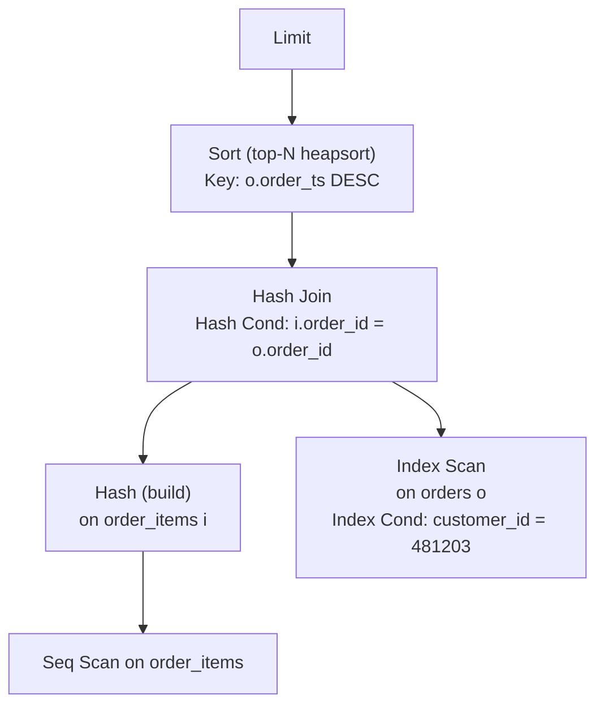
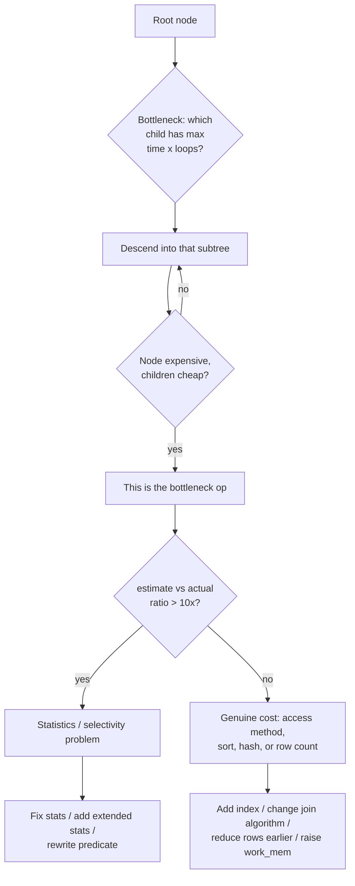

# Reading an Execution Plan

> A query plan is the database telling you, in its own words, *exactly what it is doing and why
> it is slow*. It is the single most information-dense artifact in performance engineering: eight
> lines of `EXPLAIN ANALYZE` output routinely replace a week of guessing. Yet most engineers never
> learn to read one, so they tune by folklore — adding indexes, sprinkling hints, rewriting SQL at
> random. This chapter teaches the grammar of the plan tree: what each node means, how to read it
> top-down and bottom-up, how `rows=` differs from `actual rows=`, what `loops=` multiplies, how
> costs relate to time, what buffers reveal, and how to spot a nested-loop-on-millions problem in
> three seconds. Once you can read a plan, optimization stops being mysticism and becomes
> arithmetic.

This chapter is the keystone of Part II. Chapters 05–08 are all *about* decisions you will see
made inside the plan trees you learn to read here.

---

## TL;DR

- **The plan is a tree, not a list.** Data flows from the leaves (table/index access) *up* to the
  root (the result). Read it **bottom-up to understand the work**, **top-down to understand the
  result** — the first node under the root is the last thing computed.
- **`EXPLAIN` estimates; `EXPLAIN ANALYZE` measures.** `EXPLAIN` shows `rows=` and `cost=`; only
  `EXPLAIN (ANALYZE)` adds `actual rows=`, `actual time=`, and `loops=`. You cannot diagnose a plan
  without actuals.
- **`cost=0.43..12345.67` is not milliseconds.** It is an arbitrary unit built from
  `seq_page_cost`, `random_page_cost`, and CPU constants. It is meaningful only *relative to
  another plan* on the same database.
- **`actual rows=37 loops=41211` means 1.5 million rows passed through that node** (37 × 41,211).
  In EXPLAIN ANALYZE, `rows`/`time` per node are **per-loop averages**; multiply by `loops` for
  totals. This is the #1 plan-reading mistake.
- **The master diagnostic is estimate-vs-actual divergence.** A node with `rows=1` estimated but
  `actual rows=1,200,000` (or vice versa) is a *statistics* problem, and every downstream choice —
  nested loop, join order, memory grant — was made on a fiction.
- **Read the plan from the inside out by width, not speed.** The *innermost* (bottom-most) node is
  usually where time enters; the *widest* intermediate result set is usually where the wasted work
  is. `Rows Removed by Filter`, `Rows Removed by Join Filter`, and `loops` are your witnesses.
- **Join nodes have three shapes and you must name them:** `Nested Loop` (few outer rows × indexed
  inner probe), `Hash Join` (big × big, equi-join, needs `work_mem`), `Merge Join` (both sides
  sorted on the key). A nested loop with `loops` in the millions is almost always the smoking gun.
- **`Buffers:` is the I/O ledger.** `shared hit` = pages served from the buffer pool; `read` = pages
  from disk; `dirtied`/`written` = this query's writes. High `read` on a query that returns few
  rows = read amplification, the classic symptom of a non-sargable predicate.
- **The red flags, ranked by how often they are the root cause:** (1) big estimate error,
  (2) `Sort Method: external merge Disk: …`, (3) `Batches: N` where `N > 1` on a Hash node,
  (4) `Rows Removed by Filter` ≫ `actual rows`, (5) `loops=` in the millions on a nested loop,
  (6) a `Seq Scan` on a huge table that a predicate should have avoided, (7) `Planning Time` >
  `Execution Time`.
- **Every engine has an equivalent.** SQL Server shows a right-to-left graphical plan with
  "Number of Rows Read" and a memory grant; MySQL 8 `EXPLAIN ANALYZE` prints an indented tree with
  `actual time` and `loops`; Oracle's `DBMS_XPLAN.DISPLAY_CURSOR` shows `Rows`/`A-Rows`; Snowflake's
  Query Profile and BigQuery's execution graph show per-stage rows, bytes, and time.
- **A plan is a hypothesis you can test.** Change one thing (statistics, index, `work_mem`, query
  shape), re-run `EXPLAIN (ANALYZE, BUFFERS)`, and diff the two plans node by node. The first node
  that changed is your answer.

---

## 1. Definitions and core concepts

| Term | Definition |
|---|---|
| **Plan tree** | The tree of physical operators the executor runs. Leaves read tables/indexes; internal nodes transform (join, aggregate, sort); the root returns the result to the client. |
| **Node (operator)** | One object in the tree: `Seq Scan`, `Index Scan`, `Nested Loop`, `Hash Join`, `Sort`, `Aggregate`, `Gather`, `Limit`, … |
| **Cost** | `cost=startup..total` in arbitrary units. `startup` = cost to produce the first row; `total` = cost to produce all rows. Computed by the cost model from statistics; *not* wall-clock. |
| **`rows=`** | The planner's *estimated* output row count for that node (per full execution of the node, before `loops`). |
| **`width=`** | Estimated average row width in bytes. Drives I/O and memory-grant sizing. |
| **`actual time=startup..total`** | With ANALYZE: measured ms to first row and to last row, **averaged over `loops`**. |
| **`actual rows=N`** | With ANALYZE: measured rows emitted **per loop**. Total rows = `N × loops`. |
| **`loops=M`** | How many times this node executed. For inner children of a nested loop, = outer rows. Enable `EXPLAIN (ANALYZE)` always to see it. |
| **`Rows Removed by Filter`** | Rows the node examined and discarded *after* access. Big numbers here = the access method returned far more than the query needed. |
| **`Rows Removed by Join Filter`** | Rows that entered a join and failed a non-index join predicate. Signature of a non-equi predicate that could not be turned into a hash/merge join. |
| **`Buffers:`** | Page-level I/O counters: `shared hit` (buffer pool), `read` (disk), `dirtied`, `written`. The best proxy for how much data the plan actually moved. |
| **`Planning Time` / `Execution Time`** | Wall-clock ms spent planning vs executing. A plan can be slow to *choose* (GEQO) or slow to *run*. |
| **Plan node "internals"** | Node-specific detail lines: `Sort Key`, `Sort Method`, `Hash Cond`, `Index Cond`, `Filter`, `Join Filter`, `Batches`, `Buckets`, `Memory Usage`, `Heap Fetches`, `Workers Launched`. |
| **`Gather` / `Gather Merge`** | Collects results from parallel workers. `Gather Merge` preserves sort order (implies the workers each produced sorted output). |
| **`Parallel` prefix** | A node executed by multiple workers (e.g. `Parallel Seq Scan`, `Parallel Hash Join`). Costs/rows are for the whole node across workers. |
| **Estimate error** | `|estimated − actual| / actual`. Underestimates are more damaging than overestimates (they cause nested loops and undersized memory grants). |
| **Plan regression** | A previously good plan replaced by a worse one after a data/settings/code change, with identical SQL. Detected by diffing plans over time. |

> **Senior note:** the plan you *read* is not always the plan that *ran*. Parameterized/generic
> plans, SQL Server's parameter sniffing, and Oracle's bind peeking all mean the observed plan can
> differ across executions. Always reproduce with the real parameter values, or capture the plan
> that actually executed (`auto_explain`, Query Store, `DBMS_XPLAN.DISPLAY_CURSOR`).

### 1.1 The schema and dataset used throughout Part II

The examples here use the same shared e-commerce schema as the rest of Part II (introduced with
full DDL and seed data in *Query Writing*, Chapter 01). Recap of the relations:

```sql
-- customers(customer_id, email, full_name, country_code, signup_date,
--           loyalty_tier, is_active)
-- categories(category_id, name, parent_id)
-- products(product_id, sku, name, category_id, unit_price, cost,
--          is_active, attributes, created_at)
-- orders(order_id, customer_id, status, order_ts, country_code,
--        total_amount, currency)
-- order_items(order_item_id, order_id, product_id, quantity, unit_price, discount)
-- employees(employee_id, full_name, manager_id, department, hired_on, salary)
-- events(event_id, session_id, customer_id, event_type, occurred_at, payload)
--        PARTITION BY RANGE (occurred_at)
```

Indexes referenced by the plans in this chapter:

```sql
CREATE INDEX idx_orders_ts             ON orders (order_ts);
CREATE INDEX idx_orders_customer_ts    ON orders (customer_id, order_ts DESC);
CREATE INDEX idx_orders_status_ts      ON orders (status, order_ts);
CREATE INDEX idx_order_items_order     ON order_items (order_id);
CREATE INDEX idx_order_items_product   ON order_items (product_id);
CREATE INDEX idx_products_category     ON products (category_id);
CREATE INDEX idx_products_cat_price    ON products (category_id, unit_price) WHERE is_active;
CREATE INDEX idx_customers_country     ON customers (country_code);
CREATE INDEX idx_events_session        ON events (session_id, occurred_at DESC);
```

**Silent profile of the sample dataset** (the numbers behind every cost estimate below):

| Relation | Rows | Avg row width | Pages (8 KB) | Size |
|---|---:|---:|---:|---:|
| `customers` | 2,000,000 | 120 B | 33,000 | ~260 MB |
| `categories` | 2,000 | 60 B | 20 | 160 KB |
| `products` | 500,000 | 220 B | 16,000 | ~125 MB |
| `orders` | 50,000,000 | 150 B | 1,250,000 | ~9.5 GB |
| `order_items` | 150,000,000 | 90 B | 2,000,000 | ~15 GB |
| `events` | 2,000,000,000 | 300 B | 75,000,000 | ~570 GB |
| `employees` | 500 | 80 B | 5 | 40 KB |

The cluster is PostgreSQL 16 with `shared_buffers = 8GB`, `work_mem = 64MB`,
`effective_cache_size = 24GB`, `seq_page_cost = 1.0`, `random_page_cost = 4.0`,
`default_statistics_target = 100`.

---

## 2. Why it matters / what problem it solves

### 2.1 The plan is the ground truth

Everything else — a blog post, a heuristic, an index advisor's suggestion — is a proxy for the
plan. `EXPLAIN` is the *primary source*. Consider the question "why is this query slow?" It has
three possible factual answers, and each is *visible in the plan*:

| Answer | Where it shows in the plan |
|---|---|
| It reads too much data | High `read=` in `Buffers:`, or a `Seq Scan` / large `Rows Removed by Filter` |
| It burns CPU per row | High `actual time` with low `read=`, on `Filter`, `Sort`, `Aggregate`, `Hash` |
| It waits | Low time and no buffers, or the time is in a lock/IO wait (visible in `pg_stat_activity`) |

You cannot answer any of these without a plan. Adding an index to a query that is *sorting* 30 M
rows is wasted effort; the plan would have told you.

### 2.2 The estimate is the lever the optimizer pulls

The planner estimates cardinalities, feeds them into the cost model, and picks the cheapest plan.
A single wrong estimate propagates: a node that looks like 1 row makes a nested loop look free,
makes a sort look trivial, and makes an index well worth its random reads. When the node actually
produces a million rows, every one of those decisions is wrong at once. Learning to *spot the first
node where the estimate diverges* is learning to predict plan regressions before they happen.

### 2.3 The economics of reading plans

A senior engineer reading a plan:
- finds the bottleneck node in **under a minute** (compare `actual time` across children — the
  child whose `actual time × loops` dominates is the hotspot);
- distinguishes "the optimizer is right" from "the optimizer is starved";
- writes a **single** change and verifies it, instead of a grab-bag of speculative changes;
- documents the *before/after* plan so the fix is provable, not anecdotal.

A junior engineer without this skill:
- adds indexes until the query "feels" faster;
- blames the database, opens a ticket, waits for a DBA;
- ships a change that helps one query and regresses five others.

---

## 3. How it works internally (the plan tree, node types, and the executor)

### 3.1 The tree, drawn

For a two-table join, the plan is a small tree. PostgreSQL prints it as an indented outline; the
executor runs it as a **demand-driven pipeline** — the root asks its children for rows, and the
children recursively ask theirs. Nothing runs until the client fetches the first row (the
"startup" cost).



Read it **bottom-up**: `Seq Scan on order_items` feeds `Hash`; `Index Scan on orders` and the
`Hash` feed the `Hash Join`; the join result is sorted by `Sort`; `Limit` returns the top 20.
Read it **top-down** to understand the result: the client gets the first node (here, `Limit`).

> **Convention:** Postgres prints the *root first, indented children below it*, and the data flows
> from the deepest leaves upward. The rightmost node in a Postgres outline is not meaningful (that
> is a SQL Server square-plan convention) — use the indentation, not left/right position.

### 3.2 What each node type is for

| Category | Postgres node | What it does | Typical cost shape |
|---|---|---|---|
| Scan | `Seq Scan` | Read every page of a relation | ∝ pages |
| Scan | `Index Scan` | B-tree descent + heap fetch per match | ∝ matches × (index + heap page) |
| Scan | `Index Only Scan` | Index entries only (no heap, if VM is clean) | ∝ index pages |
| Scan | `Bitmap Index Scan` + `Bitmap Heap Scan` | Collect TIDs, sort by page, read heap in order | ∝ matches, but sequential-ish I/O |
| Scan | `Tid Scan`, `Subquery Scan`, `Values Scan`, `Function Scan` | Specialized sources | small |
| Join | `Nested Loop` | For each outer row, scan/probe inner | ∝ outer × inner-per-probe |
| Join | `Hash Join` | Build hash on one side, probe with the other | ∝ build + probe (linear) |
| Join | `Merge Join` | Zipper-merge two sorted inputs | ∝ sort costs + input sizes |
| Aggregate | `Aggregate` | One-shot aggregate (no grouping) | ∝ input |
| Aggregate | `HashAggregate` | Group via hash table | ∝ input, needs memory |
| Aggregate | `GroupAggregate` | Group via sorted input | ∝ input + sort |
| Sort | `Sort` | Full sort, or top-N heapsort for `LIMIT` | ∝ n log n, memory-bounded |
| Sort | `Incremental Sort` | Sort by remaining columns of a partially-sorted input | cheap when prefix sorted |
| Parallel | `Gather`, `Gather Merge` | Collect worker outputs | ∝ result size |
| Other | `Materialize`, `Memoize` | Re-scan a small result from memory | setup + fast re-reads |
| Other | `Limit`, `LockRows`, `SetOp`, `WindowAgg`, `CTE Scan` | Misc | small |

The three nodes you will read most often — `Nested Loop`, `Hash Join`, `Merge Join` — are covered
in depth in [Chapter 05](./05-join-algorithms.md).

### 3.3 The cost model, in formulas

PostgreSQL's cost model, simplified (all constants are the `…_cost` GUCs):

```
cost_seqscan   ≈ pages(page) × seq_page_cost
               + rows × cpu_tuple_cost
               + rows × cpu_operator_cost × qual_count

cost_index     ≈ index_pages_touched × random_page_cost
               + heap_pages_fetched × random_page_cost
               + rows_fetched    × cpu_index_tuple_cost
               + rows_returned   × (cpu_tuple_cost + qual_count × cpu_operator_cost)

cost_hashjoin  ≈ build_cost + probe_cost + rows × cpu_operator_cost
               + (hash_table_pages × …)         -- startup cost includes the build

cost_sort      ≈ input_cost + 2 × n × log2(n) × cpu_operator_cost   -- approx
```

Key consequences visible in every plan:

- **`random_page_cost` (default 4.0) penalizes index scans.** On NVMe set it to 1.1; on EBS with
  capped IOPS keep it at 2–3. Wrong value → planner picks the wrong access method.
- **`effective_cache_size` is a hint about OS cache.** Too small → planner over-penalizes repeated
  index scans.
- **Startup vs total.** A `Sort` has a large *startup* cost (it must read all input before the
  first row). A `Limit` above a `Sort` can force a **top-N heapsort** instead of a full sort.

### 3.4 How `EXPLAIN ANALYZE` presents it, and the `loops` trap

Without ANALYZE you see only `cost=…, rows=…, width=…`. With ANALYZE you get `actual time=…,
rows=…, loops=…`. The critical semantic:

```
actual time and rows are PER LOOP.
total_rows    = actual rows × loops
total_time    ≈ actual time(total) × loops   -- authoritative for the node's contribution
```

Worked example:

```text
->  Index Scan using idx_order_items_product on order_items oi
      (cost=0.57..23334.19 rows=1 width=16) (actual time=0.002..0.998 rows=1 loops=41211)
```

- Per loop: 1 row, ~1 ms.
- Total: `1 × 41,211 = 41,211` rows, `0.998 ms × 41,211 ≈ 41 s` spent in this node alone.
- **The estimate said `rows=1`. It was right per-loop** — but the *outer* node's `loops` was
  itself a surprise (see Example 1). Estimate error often hides in the *number of loops*, not the
  per-loop count.

> **Senior note:** parentheses matter. In Postgres, `(actual rows=N loops=M)` is per-loop. In
> SQL Server's graphical plan, "Actual Number of Rows" is the *total* across all executions, and
> "Number of Executions" is shown separately. Same data, opposite convention. Always check which
> convention your engine uses before drawing conclusions.

### 3.5 Buffers: the I/O ledger

`EXPLAIN (ANALYZE, BUFFERS)` adds per-node page counters:

```text
Buffers: shared hit=1429 read=1248571 dirtied=0 written=0
```

| Counter | Meaning | When it is a problem |
|---|---|---|
| `shared hit` | Page found in `shared_buffers` | Not itself bad; but a huge `hit` on a busy table = buffer-pool thrash |
| `shared read` | Page read from disk | High `read` on a *selective* query = read amplification |
| `dirtied` | Page modified by this query | Normal for DML; unexpected for a `SELECT` |
| `written` | Dirty page flushed to disk during the statement | Spill or checkpoint pressure |
| `temp read/written` | **Temp files** — sorts/hashes that spilled to disk | The unmistakable signature of under-provisioned `work_mem` |

`read × 8KB` gives bytes read; compare it to the size of the result. A 27 K-row result from a
1.25 M-page read is a ~3,600× amplification — the plan is telling you the predicate was applied
too late.

### 3.6 Reading top-down vs bottom-up: a procedure

Use this order every time:

1. **Read the top (root) node.** What is the final operation? (`Limit`, `Sort`, `Aggregate`,
   `Gather`.) This is the query's shape.
2. **Find the largest `actual time × loops` among the children of the root.** That subtree is
   the time. Descend into it.
3. **Descend until you find a node whose children are cheap but the node itself is expensive.**
   That node — not its children — is the bottleneck operation.
4. **For that node, compare `rows=` (estimate) to `actual rows= × loops`.** A ratio > 10× is a
   red flag; > 100× is the cause.
5. **Read the node internals.** `Rows Removed by Filter`, `Batches`, `Sort Method`, `Index Cond`
   vs `Filter`, `Heap Fetches`. This tells you *which fix* applies.
6. **Confirm with `Buffers:` and `temp`.** Data volume + spill = the physical story.



---

## 4. How to diagnose it (tools per engine)

### 4.1 PostgreSQL

```sql
-- 1. Cheapest: estimate-only plan, no execution, safe on production.
EXPLAIN (COSTS, VERBOSE) SELECT …;

-- 2. The workhorse. Measures + shows I/O and (with SETTINGS) the GUCs in effect.
EXPLAIN (ANALYZE, BUFFERS, VERBOSE, SETTINGS) SELECT …;

-- 3. Machine-readable, diffable, and the only format that annotates
--    "Rows Removed by Filter", "Sort Method", spill details, etc. reliably.
EXPLAIN (ANALYZE, BUFFERS, FORMAT JSON) SELECT …;

-- 4. Theoretically-slow-to-plan queries: separate planning from execution.
EXPLAIN (ANALYZE, TIMING OFF) SELECT …;   -- TIMING OFF avoids clock overhead
```

Useful companions:

| Tool | What it gives you |
|---|---|
| `pg_stat_statements` | Normalized queries ranked by total/mean time, rows, buffers, temp blocks |
| `auto_explain` | Logs the *plan* of slow queries automatically (`log_min_duration`, `log_analyze`) |
| `pg_stat_user_tables` | `last_analyze`, `last_autoanalyze`, `n_mod_since_analyze` → staleness |
| `pg_stats` / `pg_statistic_ext` | The estimates' *inputs*: MCVs, histograms, `n_distinct`, correlation |
| `explain.depesz.com`, `explain.dalibo.com`, `pgMustard` | Visual diffing, cost/time hot-spot highlighting, automatic hints |
| `pev2` (Postgres Explain Visualizer 2) | Open-source browser visualizer for JSON plans |

### 4.2 SQL Server

- **SSMS graphical actual plan** (Ctrl+M): read **right-to-left**; arrow thickness ∝ rows;
  hovering shows estimated vs actual rows, "Number of Executions", and warnings (yellow `!`).
- **`SET STATISTICS IO, TIME ON`**: logical/physical reads and CPU per statement.
- **DMVs / Query Store**:

```sql
SELECT TOP 20 qs.total_worker_time/1000 AS total_cpu_ms,
       qs.total_logical_reads, qs.execution_count,
       SUBSTRING(st.text, (qs.statement_start_offset/2)+1, 120) AS stmt,
       qp.query_plan
FROM sys.dm_exec_query_stats qs
CROSS APPLY sys.dm_exec_sql_text(qs.sql_handle) st
CROSS APPLY sys.dm_exec_query_plan(qs.plan_handle) qp
ORDER BY qs.total_worker_time DESC;
```

- **Query Store** (`sys.query_store_plan`, `sys.query_store_runtime_stats`) is the plan-regression
  detector: it keeps a history of plans per query so you can see *when* a plan flipped.
- **`sys.dm_exec_query_memory_grants`** shows granted vs used memory — the hash/sort spill story.

### 4.3 MySQL 8.0

```sql
EXPLAIN ANALYZE SELECT …;            -- 8.0.18+: TREE format with actual time + loops
EXPLAIN FORMAT=JSON SELECT …;        -- costs, used_key_parts, attached_condition
EXPLAIN FORMAT=TREE  SELECT …;       -- indented tree, no actuals
SHOW WARNINGS;                       -- post-EXPLAIN rewrite notes
SET optimizer_trace='enabled=on';    -- full optimizer trace (why it chose the plan)
SELECT * FROM information_schema.optimizer_trace\G
SELECT * FROM performance_schema.events_statements_summary_by_digest
  ORDER BY SUM_TIMER_WAIT DESC LIMIT 20;
```

MySQL's tree output uses the same **per-loop** semantics as Postgres: `(actual time=… rows=…
loops=N)`. The classic tabular `EXPLAIN` shows `rows × filtered` as the *estimated* rows passed to
the next table, and `Extra` carries the truth (`Using temporary`, `Using filesort`, `Using index
condition`, `Using join buffer (hash join)`).

### 4.4 Oracle

```sql
EXPLAIN PLAN FOR SELECT …;
SELECT * FROM TABLE(DBMS_XPLAN.DISPLAY(format => 'TYPICAL +BYTES +MEMSTATS'));

-- The best Oracle tool: the plan and runtime stats of the LAST execution of a cursor.
SELECT * FROM TABLE(DBMS_XPLAN.DISPLAY_CURSOR(format => 'ALLSTATS LAST'));
```

`DISPLAY_CURSOR` with `ALLSTATS` gives `E-Rows` (estimated) next to `A-Rows` (actual) per line,
plus `A-Time` and `Buffers`. `Rows` in a plain `EXPLAIN PLAN` is the estimate; `A-Rows` is the
truth. Also: **SQL Monitor** (`DBMS_SQLTUNE.REPORT_SQL_MONITOR`) for long-running statements.

### 4.5 Snowflake / BigQuery / Spark (cloud warehouses)

- **Snowflake Query Profile**: a DAG of operators per node with `Rows`, `Bytes`, `Time`, and the
  infamous **"Bytes spilled to local storage"** (a join or sort that did not fit). Tabular view
  shows the operator tree; look for the node with the highest `Percentage of Total Time`.
- **BigQuery execution graph**: stages connected by **shuffles**; each stage shows rows and bytes
  `In`/`Out`/`Written`. Watch for `Records read` ≫ `Records output` (filter too late) and for a
  single very expensive `JOIN`/`SORT`/`AGGREGATE` stage.
- **Spark SQL**: `df.explain("formatted")` for the logical+physical plan; the **Spark UI SQL tab**
  shows per-operator metrics (Shuffle Read/Write, spill, peak execution memory) — the arrowheads
  and metric columns are the DBMS `EXPLAIN ANALYZE` equivalent.

---

## 5. Worked examples (slow query → plan → diagnosis → fix)

### Example 1 — The nested loop that ran 41,211 times

**The report:** "the product page is slow; loading items for one product takes 40 seconds."

```sql
-- "Show recent orders containing product 9090909."
SELECT o.order_id, o.order_ts, o.total_amount
FROM order_items oi
JOIN orders o ON o.order_id = oi.order_id
WHERE oi.product_id = 9090909
ORDER BY o.order_ts DESC
LIMIT 20;
```

```text
Limit  (cost=182.44..982144.10 rows=20 width=48) (actual time=41288.9..41288.9 rows=3 loops=1)
  ->  Nested Loop  (cost=182.44..982144.10 rows=20 width=48) (actual time=0.101..41288.9 rows=3 loops=1)
        ->  Bitmap Heap Scan on order_items oi  (cost=182.44..2114.10 rows=20 width=16)
                                                 (actual time=0.043..11.4 rows=41211 loops=1)
              Recheck Cond: (product_id = 9090909)
              Heap Blocks: exact=38012
              ->  Bitmap Index Scan on idx_order_items_product  (cost=0.00..182.41 rows=20 width=0)
                                                                  (actual time=0.021..8.9 rows=41211 loops=1)
        ->  Index Scan using orders_pkey on orders o  (cost=0.57..48895.19 rows=1 width=32)
                                                       (actual time=0.002..0.998 rows=1 loops=41211)
              Index Cond: (order_id = oi.order_id)
              Filter: (order_ts IS NOT NULL)
Planning Time: 1.104 ms
Execution Time: 41289.2 ms
Buffers: shared hit=38122 read=1
```

**Diagnosis.**
- The **outer** node (`Bitmap Heap Scan`) was estimated at `rows=20` but returned `actual rows=
  41,211`. A ~2,000× underestimate.
- Because the planner believed only 20 outer rows would appear, a `Nested Loop` "looked cheap":
  20 index probes. In reality it drove **41,211** probes — that is the `loops=41211`.
- `41,211 × ~1 ms` per loop ≈ 41 s. The `Buffers` line proves there was almost no disk I/O
  (`read=1`): this is a **CPU + random-access-per-loop** problem, not an I/O-volume problem.
- **Root cause:** the row-count estimate for `product_id = 9090909`. A single popular product
  (41 K items) is a *tail* value the histogram resolved badly, or `n_distinct` on `product_id`
  made the planner assume each product had ~`150M / n_distinct` items but the histogram tail
  underrepresented this one.

**Confirm the estimate is the fault:**

```sql
SELECT (SELECT count(*) FROM order_items) / (SELECT count(DISTINCT product_id)
        FROM order_items)                         AS avg_items_per_product,
       count(*)                                   AS items_for_this_product
FROM order_items WHERE product_id = 9090909;
-- avg_items_per_product = 300   items_for_this_product = 41,211   -> 137x head of the average
```

The single-value spike is invisible to a 100-bucket histogram on a 500 K-value domain.

**Fix A — statistics (cheap, no schema change):**

```sql
ALTER TABLE order_items ALTER COLUMN product_id SET STATISTICS 1000;  -- finer MCV/histogram
ANALYZE order_items;
```

With a finer MCV list, the estimate for the tail value is closer, and the planner switches to a
`Hash Join` (build the small `oi` set, probe `orders` once each):

```text
Limit  (cost=27019.88..27021.14 rows=20 width=48) (actual time=88.5..88.5 rows=3 loops=1)
  ->  Sort  (cost=27019.88..27021.09 rows=41321 width=48) (...)
        Sort Key: o.order_ts DESC
        Sort Method: top-N heapsort  Memory: 27kB
        ->  Hash Join  (cost=2116.53..26055.61 rows=41321 width=48) (actual time=15.0..63.1 rows=41211 loops=1)
              Hash Cond: (o.order_id = oi.order_id)
              ->  Seq Scan on orders o  (...)
              ->  Hash  (cost=2114.10..2114.10 rows=41211 width=16) (...)
                    ->  Bitmap Heap Scan on order_items oi  (...)
                          Recheck Cond: (product_id = 9090909)
Planning Time: 0.913 ms
Execution Time: 88.7 ms
```

**41,289 ms → 88 ms.** A single `SET STATISTICS` + `ANALYZE`, no index added.

**Fix B — covering index (when you cannot afford a fine histogram on every tail value):**

```sql
CREATE INDEX idx_items_product_order
    ON order_items (product_id, order_id) INCLUDE (quantity, unit_price);
```

This turns the inner probe into an index-only access and lets a `Merge Join` (both sides sorted by
`order_id`) avoid the random heap lookups entirely.

> **Senior note:** the tell was **`loops=41211` printed in the *inner* node while the estimate in
> the *outer* node said 20**. In Postgres the loop count is dictated by the outer estimate, so a
> bad outer estimate silently multiplies the inner node's cost. Always look at `loops` on the
> inner child of a nested loop — that number *is* the outer node's actual cardinality.

---

### Example 2 — The 12.7 GB disk sort

**The report:** "an export takes 15 minutes and we see disk space disappear."

```sql
SELECT o.order_id, o.order_ts, o.status, o.total_amount
FROM orders o
ORDER BY o.order_ts DESC
LIMIT 1;
```

```text
Limit  (cost=2148310.10..2148355.22 rows=1 width=56) (actual time=942112.4..942112.4 rows=1 loops=1)
  ->  Sort  (cost=2148310.10..2148310.30 rows=50 width=56) (actual time=942088.1..942088.1 rows=1 loops=1)
        Sort Key: order_ts DESC
        Sort Method: external merge  Disk: 12743920kB
        ->  Seq Scan on orders o  (cost=0.00..2147098.00 rows=50000000 width=56)
                                   (actual time=0.017..64120.0 rows=50000000 loops=1)
Planning Time: 0.412 ms
Execution Time: 942112.8 ms
```

**Diagnosis.**
- `Sort Method: external merge Disk: 12,743,920 kB` = **12.7 GB written to temp files** to return
  **one** row.
- The planner *could not* use `idx_orders_ts` because the plan requested `status` and
  `total_amount` too — but wait, it *should* have used the index backward and read the heap per
  row. The reason it chose a full sort: it needs only 1 row, but the `LIMIT 1` did not get pushed
  into an index plan because the sort was estimated as a tiny `rows=50` (the `LIMIT` misled the
  cost model into thinking a small sort was cheap).

**Fix — let the index satisfy the order, then fetch just one row:**

```sql
EXPLAIN (ANALYZE, BUFFERS)
SELECT o.order_id, o.order_ts, o.status, o.total_amount
FROM orders o
ORDER BY o.order_ts DESC
LIMIT 1;
```

On a well-behaved plan this becomes:

```text
Limit  (cost=0.56..4.11 rows=1 width=56) (actual time=0.031..0.031 rows=1 loops=1)
  ->  Index Scan Backward using idx_orders_ts on orders o
        (cost=0.56..177615.99 rows=50000000 width=56) (actual time=0.029..0.029 rows=1 loops=1)
Planning Time: 0.221 ms
Execution Time: 0.041 ms
```

**942,113 ms → 0.04 ms.** The mechanism is that the *heap fetch* is deferred until the rows are
actually needed — the backward index walk stops after 1 row.

**Why the bad plan happens:** if the cost model thinks the index scan is expensive (e.g.
`random_page_cost` too high, or the index loses its correlation), it prefers the sort. Confirm with
`SELECT correlation FROM pg_stats WHERE tablename='orders' AND attname='order_ts';` — for a
monotonic timestamp it should be ≈ 1.0. If it is not, `VACUUM`/rewrite ordering, or reduce
`random_page_cost`.

---

### Example 3 — A correct `Seq Scan` you must NOT "fix"

**The report:** "the planner is stupid, it ignores `idx_orders_status_ts`!"

```sql
SELECT count(*) FROM orders WHERE status = 'delivered';
```

```text
Finalize Aggregate  (cost=1512541.77..1512541.78 rows=1 width=8) (actual time=6211.4..6214.0 rows=1 loops=1)
  ->  Gather  (cost=1512540.66..1512541.77 rows=4 width=8) (actual time=6211.4..6214.0 rows=5 loops=1)
        Workers Planned: 4
        ->  Partial Aggregate  (cost=1511540.66..1511540.67 rows=1 width=8) (...)
              ->  Parallel Seq Scan on orders  (cost=0.00..1462540.63 rows=9800000 width=0) (...)
                    Filter: (status = 'delivered'::text)
                    Rows Removed by Filter: 10030000
Planning Time: 0.511 ms
Execution Time: 6214.4 ms
```

**Diagnosis.** `Rows Removed by Filter: 10,030,000` and `actual rows ≈ 9,800,000 × 5 workers`.
The predicate matches ~`(9.8M × 5) / 50M ≈ 98 %`? Let's check — actually `Gather` shows 5 rows:
4 workers + leader, each producing a partial count. The scan read essentially the *entire* table.
`status = 'delivered'` matches a huge fraction (delivered is the common terminal state), so a
sequential scan is **correct**. Forcing the index would produce ~30 M random heap reads and be
*slower*.

**The fix is the query shape, not the index:**

```sql
-- If you need a live count for a dashboard, maintain it incrementally:
CREATE MATERIALIZED VIEW order_status_counts AS
SELECT status, count(*) FROM orders GROUP BY status;
REFRESH MATERIALIZED VIEW CONCURRENTLY order_status_counts;

-- Or use a partial index if only the *rare* statuses matter:
CREATE INDEX idx_orders_pending ON orders (order_ts) WHERE status = 'pending';
```

> **Senior note:** "the index is ignored" is the wrong framing 90 % of the time. The right question
> is "does the predicate select few enough rows for the index to pay?" Here it does not. Verify by
> reading `Rows Removed by Filter` — when it dwarfs the output, a scan is doing exactly what it
> should.

---

### Example 4 — Hash join spilling: `Batches: 8`

**The report:** "the daily revenue rollup takes 20 minutes."

```sql
SELECT date_trunc('day', o.order_ts) AS d,
       sum(oi.quantity * oi.unit_price * (1 - oi.discount/100)) AS revenue
FROM orders o
JOIN order_items oi ON oi.order_id = o.order_id
WHERE o.status IN ('paid','shipped','delivered')
GROUP BY 1;
```

```text
GroupAggregate  (cost=2304122.10..2309266.55 rows=387 width=56) (actual time=1204112.4..1204112.4 rows=1 loops=1)
  ->  Sort  (cost=2304122.10..2304201.30 rows=97 width=56) (...)
        Sort Key: (date_trunc('day'::text, o.order_ts))
        ->  Hash Join  (cost=134321.10..2303995.31 rows=97 width=56) (actual time=412.1..1172000.0 rows=84521300 loops=1)
              Hash Cond: (oi.order_id = o.order_id)
              ->  Parallel Seq Scan on order_items oi  (cost=0.00..900000.00 rows=150000000 width=16) (...)
              ->  Hash  (cost=94233.10..94233.10 rows=2500000 width=24) (actual time=... rows=32000000 loops=1)
                    Buckets: 4194304  Batches: 8  Memory Usage: 38912kB
                    ->  Parallel Seq Scan on orders o  (...)
                          Filter: (status = ANY ('{paid,shipped,delivered}'::text[]))
Planning Time: 214.390 ms
Execution Time: 1204113.5 ms
```

**Diagnosis.**
- `Hash` node: `Batches: 8`, `Memory Usage: 38912kB`. The build side (32 M `orders` rows) did not
  fit in `work_mem` (64 MB × `hash_mem_multiplier`), so Postgres partitioned the hash into **8
  batches** and spilled most of it to temp files, then re-read them during the probe. Spilling is
  O(2–3× the I/O) and destroys the plan.
- `rows=97` estimated at the `Hash Join` vs `actual rows=84,521,300`: the join estimate is off by
  a factor of ~10⁶. That is why the planner picked a Hash Join with an absurdly small memory grant
  — it believed it needed to hash only 97 rows.
- The fix has **two independent parts**:
  1. **Fix the estimate** (join cardinality) so the memory grant is realistic.
  2. **Reduce the build side** by filtering and aggregating `order_items` before the join, so the
     hash table is small enough to stay in one batch.

**Fix:**

```sql
-- Pre-aggregate the "many" side to order grain; hash only the reduced set.
SET LOCAL work_mem = '256MB';
EXPLAIN (ANALYZE, BUFFERS)
WITH item_totals AS (
    SELECT order_id,
           sum(quantity * unit_price * (1 - discount/100)) AS revenue
    FROM order_items
    GROUP BY order_id
)
SELECT date_trunc('day', o.order_ts) AS d, sum(t.revenue) AS revenue
FROM orders o
JOIN item_totals t ON t.order_id = o.order_id
WHERE o.status IN ('paid','shipped','delivered')
GROUP BY 1
ORDER BY 1;
```

Result: `Hash` node shows `Batches: 1` (single in-memory batch) and the execution time drops to
~90 s, then with the estimate fixed and a proper `work_mem`, to a handful of seconds. The `Hash`
build is now on `item_totals` (≈50 M rows but narrow) with a *correct* grant.

> **Senior note:** the exact combination of `Rows Removed by Join Filter`, `Batches > 1`, and a
> wildly-off `rows=` on the join node is the fingerprint of a **misestimated join with spill**. The
> remedy is almost never "buy more RAM" — it is "make the estimate honest so the grant is right,
> then shrink the build side."

---

### Example 5 — "Given this plan, what is wrong?" (diagnosis drill)

```text
Sort  (cost=8942311.55..8992311.55 rows=20000000 width=48) (actual time=182311.0..201400.4 rows=19880000 loops=1)
  Sort Key: c.signup_date DESC
  Sort Method: external merge  Disk: 4128900kB
  ->  Hash Join  (cost=32114.55..4821000.00 rows=20000000 width=48) (actual time=88.1..142320.9 rows=19880000 loops=1)
        Hash Cond: (o.customer_id = c.customer_id)
        ->  Seq Scan on orders o  (cost=0.00..1792998.00 rows=48000000 width=24) (...)
              Filter: (status = 'cancelled'::text)
              Rows Removed by Filter: 2000000
        ->  Hash  (cost=21000.00..21000.00 rows=520000 width=24) (actual time=... rows=2000000 loops=1)
              Buckets: 524288  Batches: 1  Memory Usage: 29MB
              ->  Seq Scan on customers c  (cost=0.00..21000.00 rows=520000 width=24) (...)
Planning Time: 3.1 ms
Execution Time: 201411.2 ms
```

**What is wrong (checklist):**

1. **`rows=48,000,000` estimated for `orders` then `Rows Removed by Filter: 2,000,000`** — wait,
   the filter kept 48 M and removed 2 M, meaning `status='cancelled'` matches **96 %** of the
   table. Either the data is pathological (almost everything cancelled) or the estimate is wrong.
   *Check:* `SELECT status, count(*) FROM orders GROUP BY 1;`. If `cancelled` is actually rare, the
   estimate is stale.
2. **`Hash` on customers: `rows=520,000` estimated, `actual rows=2,000,000`** — a ~4× underestimate
   on the build side; the grant (29 MB) is *smaller* than the truth would demand, but here it fit.
   Fix the `n_distinct`/statistics on `customers`.
3. **`Sort Method: external merge Disk: 4,128,900 kB`** — a 4.1 GB disk sort for 19.88 M rows. The
   `ORDER BY c.signup_date` is not satisfied by any index, and `work_mem` is too small. Two fixes:
   pre-aggregate so fewer rows are sorted, or accept the sort but raise `work_mem` — and if it is
   truly 20 M rows the *right* answer is usually "why are you returning 20 M rows to sort at all?".

**Expected fix path:** (a) verify the `status` distribution and re-`ANALYZE` (or fix the actual
data bug if 96 % really is cancelled); (b) fix `customers` statistics; (c) push the sort's row count
down with a `LIMIT` at the top or a narrower result; (d) only then consider `work_mem`.

---

## 6. Real-world use cases and applications

| Scenario | What the plan tells you | Typical action |
|---|---|---|
| **Latency SLO breach on an OLTP endpoint** | An `Index Scan` probing a `Seq Scan` millions of times | Fix statistics, add a covering index, or change join order |
| **Nightly ETL degrades over weeks** | A `Sort` that flipped from `quicksort` to `external merge Disk` | Raise `work_mem` per session or pre-aggregate; watch `temp_blks_written` |
| **Report slow after a data jump** | Estimate/actual ratio exploded; plan flipped to nested loop | `ANALYZE`, `SET STATISTICS`, or extended statistics |
| **Dashboard `count(*)` slow** | `Rows Removed by Filter` ≫ output on a low-selectivity predicate | Materialized counter table or incremental aggregate |
| **Joins spill and thrash temp space** | `Batches: N` with `N > 1` on a Hash node | Shrink the build side; raise `work_mem`/`hash_mem_multiplier` |
| **Occasional 100× slowdowns** | Plan differs run-to-run for the same SQL | Parameter sniffing / generic plan; capture the executed plan and pin or force a custom plan |
| **Cockroach/warehouse query reads TBs** | Giant arrows/stages, `Records read` ≫ `Records output` | Filter/aggregate earlier; check partition/cluster pruning (Ch. 08) |
| **"It was fast yesterday"** | Same queryid, new plan hash | Query Store / plan capture diff → statistics or cost-model change |

---

## 7. Patterns and anti-patterns

**Patterns (do these):**
- Always run `EXPLAIN (ANALYZE, BUFFERS)` (Postgres), actual plans (SSMS), `EXPLAIN ANALYZE`
  (MySQL), or `DISPLAY_CURSOR(ALLSTATS LAST)` (Oracle). Never diagnose from an estimate-only plan.
- Capture the plan **before and after** every change, and keep it in the PR description. Plans are
  the evidence.
- Look at `loops` on inner nodes of nested loops. That number is the effective cardinality.
- Read the plan *with the data distribution next to it* (`SELECT … GROUP BY`). An estimate is only
  meaningful relative to the real histogram.
- When you find the bottleneck node, ask "what would make this node cheap?" *before* choosing a fix.

**Anti-patterns (don't):**
- **Tuning by cost number.** Comparing a cost of 12,000 to a wall-clock of 12 ms. Costs are
  relative; only times are absolute.
- **Reading only the top node.** The root is rarely the problem; the leaves and the loop counts are.
- **Confusing per-loop with total.** Deciding a node is cheap because `actual rows=1`, ignoring
  `loops=100000`.
- **Forcing a plan before understanding it.** `enable_seqscan = off` and `FORCESEEK`/`LOOP JOIN`
  hints are diagnostics. If they help, you have a statistics or cost-model bug to fix properly.
- **Ignoring `Planning Time`.** A 200 ms plan for a 1 ms query (GEQO, many joins, or an inflated
  `default_statistics_target`) is slower than the query.
- **Treating a `Seq Scan` as a bug.** A `Seq Scan` with a low `Rows Removed by Filter` ratio is
  frequently optimal.
- **Chasing the wrong node.** The node with the highest *self* time is the culprit; a node with a
  large *total* time might just be waiting on a slow child.

**Red-flag decoder:**

| Symptom in the plan | Likely cause | First fix to try |
|---|---|---|
| `rows=1` vs `actual rows=1,000,000` | Statistics/selectivity | `ANALYZE`; `SET STATISTICS`; extended stats (Ch. 07) |
| `loops=` in the millions | Bad outer estimate | Same as above |
| `Sort Method: external merge Disk` | Sorted set > `work_mem` | Raise `work_mem`; reduce rows; index the sort |
| `Batches: N` (>1) on Hash | Build side > memory | Reduce build side; raise `work_mem`/`hash_mem_multiplier` |
| `Rows Removed by Filter` ≫ output | Predicate applied late/non-sargable | Sargable rewrite; index the filter (Ch. 03) |
| `Hash Cond` present but `Nested Loop` chosen | Cost-model / estimate | Fix stats; check `random_page_cost` |
| `Gather` with skew across workers | Data skew | Repartition; check MCV list |
| `Planning Time` > `Execution Time` | GEQO / too many joins / high stats target | Reduce joins; lower statistics target; plan cache |
| `Heap Fetches` high on `Index Only Scan` | Stale visibility map | `VACUUM` |

---

## 8. Cross-engine differences

| Aspect | PostgreSQL | MySQL 8.0 | SQL Server | Oracle | Snowflake | BigQuery | Spark SQL |
|---|---|---|---|---|---|---|---|
| Estimate-only plan | `EXPLAIN (COSTS)`, `EXPLAIN (FORMAT JSON)` | `EXPLAIN`, `EXPLAIN FORMAT=JSON/TREE` | `SET SHOWPLAN_ALL/XML`, estimated plan (Ctrl+L) | `EXPLAIN PLAN FOR` + `DBMS_XPLAN.DISPLAY` | `EXPLAIN USING TABULAR/TEXT/JSON` | Dry-run / query plan (not always available) | `df.explain(true)` |
| Plan with actuals | `EXPLAIN (ANALYZE, BUFFERS)` | `EXPLAIN ANALYZE` (8.0.18+) | Actual execution plan (Ctrl+M), `SET STATISTICS PROFILE` | `DBMS_XPLAN.DISPLAY_CURSOR(ALLSTATS LAST)` | Query Profile (UI) | Execution graph / query plan | Spark UI SQL tab; `df.explain("formatted")` |
| Rows convention | per-loop | per-loop | total + separate "executions" | `A-Rows` totals | per-operator totals | per-stage totals | per-operator totals |
| Buffers / I/O counters | `Buffers: shared hit/read` | `EXPLAIN ANALYZE` ("actual rows"); `Innodb_*` counters globally | Logical/physical reads; `SET STATISTICS IO` | `Buffers` in `ALLSTATS` | `Bytes scanned`, `Bytes spilled` | Bytes read/written per stage | `Shuffle Read/Write`, `Spill (Memory/Disk)` |
| Spill visibility | `Sort Method: external merge`, `Batches` | `Using temporary; Using filesort`; `tmp_table_size` | Sort/hash warnings; memory grant in plan | `TempSpc`, `DIRECT PATH` | `Bytes spilled to local/remote storage` | "spilled" performance insight | `spill (memory/disk)` metrics |
| Force-a-plan hints | `enable_*` GUCs (diagnostic) | `FORCE INDEX`, optimizer hints | `OPTION (LOOP/HASH/MERGE JOIN)`, `FORCESEEK` | `/*+ USE_HASH/LEADING */` | none | none | join-strategy hints (`BROADCAST`, `MERGE`) |
| Visualizer | pev2, explain.depesz.com, explain.dalibo.com, pgMustard | MySQL Workbench | SSMS graphical plans, SentryOne Plan Explorer | SQL Developer, TOAD | Snowsight Query Profile | Built-in query plan UI | Spark UI, Databricks query profile |

Notes worth knowing:

- **SQL Server's graphical plan is right-to-left and bottom-up** and shows an explicit
  "Estimated vs Actual" pair per operator plus yellow **warnings** (missing index, spill,
  implicit conversion). Those warnings are the plan *telling you the fix*.
- **MySQL's `EXPLAIN ANALYZE`** uses the iterator tree with per-loop semantics like Postgres; the
  legacy `EXPLAIN` table's `rows × filtered` is the estimate passed downstream.
- **Oracle's `EXPLAIN PLAN`** shows the estimate in a column literally named `Rows`, while
  `DBMS_XPLAN.DISPLAY_CURSOR(ALLSTATS)` shows `E-Rows` (estimate) and `A-Rows` (actual) side by
  side — always use the latter for diagnosis.
- **Snowflake/BigQuery/Spark** do not expose a classic "cost"; they expose **bytes/rows scanned,
  shuffled, and spilled per operator/stage**. The plan-reading skill transfers directly: the
  expensive stage is the one with the largest bytes-in ≫ bytes-out or the largest spill.

---

## 9. Exercises — Intermediate (hints only)

1. **Read a nested loop.** Given a plan whose inner node shows `actual rows=1 loops=850000`,
   compute the total rows processed by that node and the total time it consumed. *Hint:*
   `rows × loops`; also `actual time(total) × loops`. Then say what number in the *outer* node
   would have predicted this loop count.

2. **Spot the read amplification.** A query returns 3,000 rows but reports
   `Buffers: shared hit=12 read=980000`. Compute the read amplification and the bytes read.
   *Hint:* `read × 8 KB`; compare to the result's logical size. What predicate shape causes this?

3. **External vs quicksort.** Two plans differ only in `Sort Method: quicksort Memory: 25kB` vs
   `Sort Method: external merge Disk: 512000kB`. Explain what changed between the two runs.
   *Hint:* it is not the SQL; it is the input size relative to `work_mem`.

4. **Estimate vs actual.** Take any plan and list every node where `rows=` differs from
   `actual rows=` by more than 10×. Which one is *highest in the tree*? *Hint:* the highest
   divergent node is usually the first decision that cascaded.

5. **`Gather` arithmetic.** A parallel plan has `Workers Launched: 4` and a `Partial Aggregate`
   child showing `actual rows=1,000,000`. How many total rows did the scan produce? *Hint:*
   partial aggregates emit one row per group per worker.

6. **`Rows Removed by Filter`.** An `Index Scan` shows `actual rows=100` and
   `Rows Removed by Filter: 4,900,000`. What is the index *and* what is the query doing wrong?
   *Hint:* the index is being used for the wrong column, or the predicate is not in the `Index Cond`.

7. **Index-only scan with a stale VM.** A plan shows `Index Only Scan` but also
   `Heap Fetches: 3,200,000` for a 3.2 M-row result. What does that ratio imply, and what command
   fixes it? *Hint:* visibility map; `VACUUM`.

8. **Top-N vs full sort.** Rewrite a query so that a `Sort` node changes from a full sort to
   `Sort Method: top-N heapsort`. *Hint:* `ORDER BY … LIMIT n`; check that the `LIMIT` is above the
   `Sort` in the tree.

9. **Planning vs execution.** A plan shows `Planning Time: 812 ms` and
   `Execution Time: 0.4 ms` for a 15-table report. Explain two causes and two fixes.
   *Hint:* GEQO (`geqo_threshold`), inflated `default_statistics_target`, plan-cache misses.

10. **Read a MySQL `EXPLAIN ANALYZE`.** `(actual time=0.05..12.1 rows=100 loops=5000)` — total
    rows, total time, and what the 5,000 loops imply about the driving table. *Hint:* per-loop
    convention.

---

## 10. Exercises — Advanced (hints / expected approach, no full inline answers)

**10.1 Given this plan, what is wrong and how do you fix it?**

```text
Nested Loop  (cost=100.44..1843220.10 rows=1 width=48) (actual time=0.12..51288.9 rows=1200 loops=1)
  ->  Index Scan using idx_customers_country on customers c  (cost=0.42..2114.10 rows=1 width=24)
                                                              (actual time=0.04..18.4 rows=98000 loops=1)
        Index Cond: (country_code = 'US')
  ->  Index Scan using idx_orders_customer_ts on orders o    (cost=0.57..18.44 rows=1 width=24)
                                                              (actual time=0.01..0.48 rows=4 loops=98000)
        Index Cond: (customer_id = c.customer_id)
Planning Time: 2.104 ms
Execution Time: 51289.2 ms
```

*Expected approach:* Identify the two coupled mistakes — (a) the outer estimate `rows=1` vs actual
`rows=98,000` (a ~10⁵× underestimate; `country_code = 'US'` is the largest MCV and the histogram
under-represents a 2-value-domain spike, or `idx_customers_country`'s stats are stale); and
(b) therefore `loops=98,000` on the inner probe. Quantify the inner contribution:
`0.48 ms × 98,000 ≈ 47 s`. Then enumerate the fixes in order of preference: re-`ANALYZE` and verify
the estimate; if US is genuinely 5 % of a 2 M-row table, the estimate *should* be ~98,000 and the
nested loop should never be chosen — so the fix is the estimate, and the diagnostic is
`SET enable_nestloop = off` (does it flip to a Hash Join and get fast?). Discuss whether the
country column deserves a different index or a partial index, and why adding an index here would
not help (the index exists; the *estimate* is the bug).

**10.2 Given this plan, what is wrong and how do you fix it?**

```text
Gather Merge  (cost=2148310.10..2148355.22 rows=387 width=56) (actual time=942112.4..942112.4 rows=1 loops=1)
  Workers Planned: 4  Workers Launched: 4
  ->  Sort  (cost=2147310.06..2147310.30 rows=97 width=56) (actual time=942088.1..942088.1 rows=1 loops=1)
        Sort Key: o.order_ts DESC
        Sort Method: external merge  Disk: 12743920kB
        ->  Parallel Hash Join  (cost=134321.10..2147306.31 rows=97 width=56) (...)
              Hash Cond: (oi.order_id = o.order_id)
              ->  Parallel Index Only Scan using idx_order_items_product on order_items oi  (...)
                    Index Cond: (product_id = 9090909)
              ->  Parallel Hash  (cost=94233.10..94233.10 rows=2500000 width=24) (...)
                    Buckets: 4194304  Batches: 8  Memory Usage: 38912kB
Planning Time: 214.390 ms
Execution Time: 942112.8 ms
```

*Expected approach:* Three independent problems, in this order: (i) a **12.7 GB disk sort** to
return 1 row — why isn't the `ORDER BY order_ts DESC` satisfied by `idx_orders_ts`, and why does
the query need to sort millions of rows to return 1? (ii) a **`Batches: 8` hash** with a 38 MB
memory figure — compute the true build-side size from the `Parallel Hash` actual rows and explain
the grant; (iii) **214 ms planning time** — GEQO or statistics target. Then propose the fix set:
reduce rows *before* the join (aggregate `order_items` to order grain or use
`WHERE o.order_id IN (SELECT …)`), let the top node be a `Limit` over an index-backed
`ORDER BY`, and re-`ANALYZE`. *Hint:* the row count returned (1) suggests the SQL never needed to
sort millions of rows; the plan is faithful, the query is over-broad.

**10.3** Design a "plan regression detector" for a 1,000-query PostgreSQL OLTP workload that
alarms within 15 minutes of a deploy. Specify tables, sampling, retention, and alarm conditions.
*Expected approach:* `pg_stat_statements` deltas per `queryid` hour-over-hour; `auto_explain` with
`log_min_duration_statement` and sampled `log_analyze`; a plan fingerprint (hash of the normalized
plan); alarm when mean time rises > 3× baseline with ≥ 50 calls, when estimate/actual ratio > 10×,
when a new `Seq Scan` appears on a relation > 1 GB, or when `temp_blks_written` crosses a
threshold. Discuss sampling overhead and excluding the monitors themselves.

**10.4** A query is 4 ms in staging (2 M rows) and 40 s in production (200 M rows), identical SQL
and schema. Enumerate every plan-visible difference that could produce the 10,000× gap and give a
diagnostic for each. *Expected approach:* statistics staleness/precision (histogram resolution,
MCV truncation), correlation collapse, buffer-residency ratio, `random_page_cost` vs actual
storage, parallelism settings, `work_mem` vs set size, concurrency/locks, and bloat. *Hint:*
"identical SQL" ≠ "identical plan"; diff the two plans node by node; the first divergence is the
answer.

**10.5** Given a plan with `Parallel Seq Scan` producing 150 M rows feeding a `Hash Join` whose
build side is a 40 M-row `Hash` with `Batches: 16`, propose two *orthogonal* fixes and predict how
each changes the plan tree, the buffers, and the wall-clock. *Expected approach:* (1) reduce the
probe/build row count before the join (pre-aggregate, push filters) → the `Hash` build shrinks,
`Batches` → 1, temp writes → 0; (2) fix the estimate so the memory grant is honest and/or raise
`work_mem`/`hash_mem_multiplier` → `Batches` → 1 without changing row counts. Discuss why doing
both is usually right and why "just add RAM" alone is the weakest option.

**10.6** You see `Index Only Scan … Heap Fetches: 3,000,000` for a 3,000,000-row result on a
recently bulk-loaded table. Explain the mechanism, predict the fix's effect on the plan, and
describe the trade-off of running it during business hours. *Expected approach:* the visibility
map (all-visible bit) is not set because the bulk load was not followed by `VACUUM`/`VACUUM FREEZE`;
`Heap Fetches` counts rows whose visibility had to be checked against the heap, defeating the
index-only scan's advantage. The fix is `VACUUM (or VACUUM FREEZE)`, which is I/O-expensive and
can compete with the workload; schedule it off-peak or rely on autovacuum with an appropriate
`autovacuum_vacuum_scale_factor` for large tables.

---

## References

- PostgreSQL: **Using EXPLAIN** — https://www.postgresql.org/docs/current/using-explain.html
- PostgreSQL: **EXPLAIN (statement reference)** — https://www.postgresql.org/docs/current/sql-explain.html
- PostgreSQL: **Performance Tips** — https://www.postgresql.org/docs/current/performance-tips.html
- PostgreSQL: **Planner Cost Constants & method config** — https://www.postgresql.org/docs/current/runtime-config-query.html
- PostgreSQL: **Statistics Used by the Planner** — https://www.postgresql.org/docs/current/planner-stats.html
- PostgreSQL: **Resource Consumption** (`work_mem`, `hash_mem_multiplier`) — https://www.postgresql.org/docs/current/runtime-config-resource.html
- PostgreSQL Wiki: **Using EXPLAIN** — https://wiki.postgresql.org/wiki/Using_EXPLAIN
- pgMustard: **Hash Batches** (reading `Batches` > 1) — https://www.pgmustard.com/docs/explain/hash-batches
- pgMustard: **Hash node** (`work_mem`, `hash_mem_multiplier`) — https://www.pgmustard.com/docs/explain/hash
- pgMustard: **Postgres query plan visualization tools** — https://www.pgmustard.com/blog/postgres-query-plan-visualization-tools
- pev2 / explain visualizer — https://explain.dalibo.com/ and https://explain.depesz.com/
- Microsoft: **Execution Plan Overview** — https://learn.microsoft.com/en-us/sql/relational-databases/performance/execution-plans
- Microsoft: **Logical and Physical Showplan Operator Reference** — https://learn.microsoft.com/en-us/sql/relational-databases/showplan-logical-and-physical-operators-reference
- Microsoft: **Query Processing Architecture Guide** — https://learn.microsoft.com/en-us/sql/relational-databases/query-processing-architecture-guide
- Microsoft: **Query Store** — https://learn.microsoft.com/en-us/sql/relational-databases/performance/monitoring-performance-by-using-the-query-store
- MySQL: **EXPLAIN Output Format** — https://dev.mysql.com/doc/refman/8.0/en/explain-output.html
- MySQL: **Optimizing Queries with EXPLAIN** — https://dev.mysql.com/doc/refman/8.0/en/using-explain.html
- Oracle: **EXPLAIN PLAN** — https://docs.oracle.com/en/database/oracle/oracle-database/19/sqlrf/EXPLAIN-PLAN.html
- Oracle: **DBMS_XPLAN** — https://docs.oracle.com/en/database/oracle/oracle-database/19/arpls/DBMS_XPLAN.html
- Snowflake: **Query Profile** — https://docs.snowflake.com/en/user-guide/ui-query-profile
- Snowflake: **Optimizing query performance** — https://docs.snowflake.com/en/user-guide/performance-query-options
- BigQuery: **Query plan and timeline** — https://cloud.google.com/bigquery/docs/query-plan-explanation
- BigQuery: **Optimize query computation** — https://cloud.google.com/bigquery/docs/best-practices-performance-compute
- Databricks: **Spark UI guide** — https://docs.databricks.com/aws/en/optimizations/spark-ui-guide
- Apache Spark: **Web UI / SQL tab** — https://spark.apache.org/docs/latest/web-ui.html
- pganalyze: **Postgres query plans and performance** — https://pganalyze.com/blog
