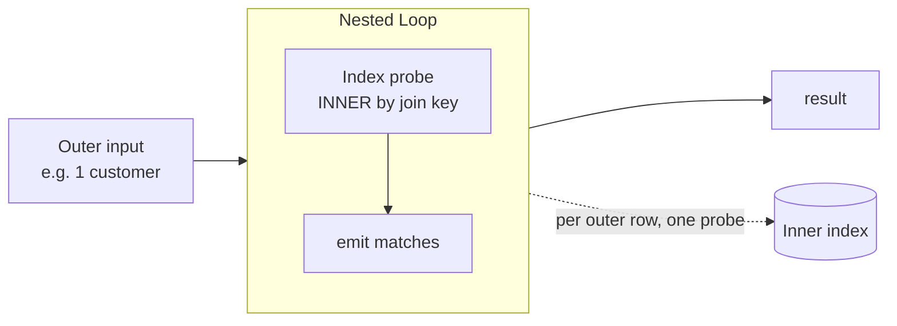
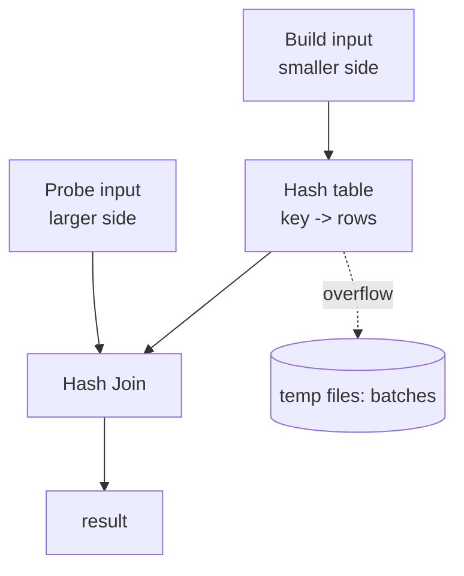
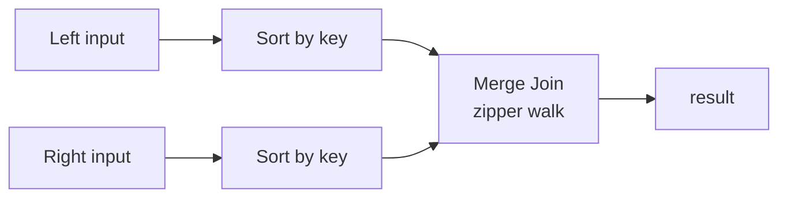

# Join Algorithms

> The same SQL join can run in 40 milliseconds or 40 minutes depending on *which physical
> algorithm* the optimizer picks to execute the logical join you wrote. There are only three
> fundamental algorithms — **nested loop**, **hash join**, and **merge join** (plus their
> distributed cousins: broadcast and shuffle hash joins) — but the consequences of choosing the
> wrong one are catastrophic and, crucially, *predictable*. This chapter teaches you the internals,
> the exact cost math, the memory (`work_mem`) behavior, when each algorithm wins, how the
> optimizer picks, and how to recognize and repair the three classic join catastrophes: a nested
> loop over millions of rows, a hash join that spills into batches, and a merge join that sorts two
> huge inputs because nobody indexed the join key.

This chapter is the "why" behind the join nodes you learned to read in
[Chapter 04](./04-reading-an-execution-plan.md). Join *order* is a separate lever, covered here;
join *cardinality estimation* (why the optimizer picks wrong) is
[Chapter 07](./07-cardinality-estimation.md).

---

## TL;DR

- **Three core algorithms.** *Nested loop* = for each outer row, probe the inner side (`O(L × R)`
  without an index, `O(L × log R)` with one). *Hash join* = build a hash table on the smaller side,
  probe with the larger (`O(L + R)`, equi-join only, needs memory). *Merge join* = sort both sides
  on the key and zipper-merge (`O(L log L + R log R)` unless already sorted by an index).
- **The optimizer picks by *cost*, which is driven by *cardinality estimates*.** A nested loop wins
  when the outer side is small (tens to thousands of rows) and the inner side has a unique/selective
  index. A hash join wins when both sides are large. A merge join wins when both sides are already
  sorted (or the plan needs sorted output for `ORDER BY`/`GROUP BY`).
- **The classic catastrophe is a nested loop chosen because of an *underestimated* outer row
  count.** The nested loop's own cost formula is fine; the problem is the input it was promised.
  `rows=1 … actual rows=100000 loops=1` on the outer node is the tell.
- **Hash joins need memory.** PostgreSQL gives a Hash node `work_mem × hash_mem_multiplier` (default
  ×2). If the build side exceeds it, Postgres increases `Batches` and spills to temp files:
  `Batches: 8`, `Memory Usage: 38MB`. `Batches = 1` = all in memory. `> 1` = disk.
- **`work_mem` is per node, per operation — not per query.** A 5-join hash plan uses 5 ×
  `work_mem`. Raising it globally multiplies memory by concurrency; raise it **per session** for
  known-heavy reports (`SET LOCAL work_mem = '256MB'`), never blindly.
- **A hash join requires an equi-join (`=`).** Range predicates (`BETWEEN`, `<`, `<>`) cannot be
  hashed and force a nested loop or merge join — a common cause of accidental quadratic plans.
- **Join order is `n!` permutations; the optimizer searches a subset.** Postgres uses dynamic
  programming for ≤ ~11 relations and GEQO (genetic) above `geqo_threshold` (default 12). Outer
  joins constrain reordering; inner joins do not.
- **Semi joins and anti joins are first-class physical operators.** `EXISTS`/`IN` become
  `Hash Semi Join`; `NOT EXISTS` becomes `Hash Anti Join`. These are strictly better than
  `JOIN … DISTINCT` because they stop at the first match and never fan out.
- **Partition-wise joins** let a join between two tables partitioned on the *same* key run
  partition-by-partition (a "streamed" join), avoiding a global shuffle/repartition. In Postgres
  set `enable_partitionwise_join = on`; in Oracle/Snowflake/Spark this is often automatic.
- **The distributed twist:** a *broadcast* hash join replicates the small side to every worker
  (fast, but only for small sides); a *shuffle* hash join repartitions both sides by the key (needed
  for large × large). In Spark the 10 MB `autoBroadcastJoinThreshold` decides which you get.
- **Cost math in one line:** `nested_loop ≈ outer_rows × inner_cost_per_probe`; the planner *wants*
  the inner probe to be a unique index lookup, so a change that makes `inner_cost_per_probe` small
  (a covering index) can rescue a nested loop — but a change that reduces `outer_rows` (a filter, a
  better estimate) is almost always better.

---

## 1. Definitions and core concepts

| Term | Definition |
|---|---|
| **Outer (driving) input** | The left child in a nested loop; scanned once. Each of its rows triggers a pass over the inner input. |
| **Inner input** | The right child in a nested loop; probed once per outer row. |
| **Build side** | In a hash join, the input that is hashed into memory (the smaller/estimated-smaller side). |
| **Probe side** | In a hash join, the input that is streamed against the hash table. |
| **Equi-join** | Join predicate is `l.k = r.k`. The precondition for hash and (efficient) merge joins. |
| **Theta / non-equi join** | Predicate uses `<`, `>`, `BETWEEN`, `<>`, or a function. Cannot hash; nested loop or merge. |
| **Block/Batched nested loop** | Nested loop that buffers several outer rows to amortize inner-index seeks (MySQL BKA/BKA; classic "block nested loop"). |
| **Grace hash join** | Hash join that partitions both inputs into buckets so a build side larger than memory still completes with bounded passes. |
| **Hash batch** | In PostgreSQL, one partition of the hashed build side. `Batches > 1` ⇒ the build spilled. |
| **Sort-merge join** | Sort both inputs on the join key, then walk them in lockstep. |
| **Semi join** | Emit left rows that have ≥ 1 match; never duplicate the left row. Physical: `Hash Semi Join`, `Nested Loop Semi Join`. |
| **Anti join** | Emit left rows that have **no** match. Physical: `Hash Anti Join`, `Nested Loop Anti Join`. |
| **Join order** | The sequence of pairwise joins. `n!` possible for `n` relations; outer joins restrict it. |
| **Left-deep / bushy tree** | Join tree shapes. Left-deep = `((A⋈B)⋈C)⋈D`; bushy = `(A⋈B)⋈(C⋈D)`. |
| **Partition-wise join** | A join performed independently per matching pair of partitions, when both tables are partitioned on the join key. |
| **Broadcast join** | Distributed join where the small side is replicated to every worker/partition. |
| **Shuffle (repartition) join** | Distributed join where both sides are repartitioned by the join key so matching keys co-locate. |
| **Co-partitioned / co-located** | Two distributed datasets partitioned identically by the join key, so the join needs no shuffle. |
| **Skew** | One join key value owns a disproportionate share of rows, overloading one worker/batch. |

> **Senior note:** a "hash join" in Postgres is sometimes written as two nodes: a `Hash` node
> (the build) whose output feeds a `Hash Join` node (the probe). The `Hash` node's `rows=` and
> `Memory Usage`/`Batches` describe the build side; the `Hash Join` node's actuals describe the
> output. Read both.

### 1.1 Schema and dataset (Part II's shared schema)

```sql
-- customers(customer_id, email, full_name, country_code, signup_date, loyalty_tier, is_active)
-- categories(category_id, name, parent_id)
-- products(product_id, sku, name, category_id, unit_price, cost, is_active, attributes, created_at)
-- orders(order_id, customer_id, status, order_ts, country_code, total_amount, currency)
-- order_items(order_item_id, order_id, product_id, quantity, unit_price, discount)
-- employees(employee_id, full_name, manager_id, department, hired_on, salary)
```

Indexes referenced below:

```sql
CREATE INDEX idx_orders_customer_ts   ON orders (customer_id, order_ts DESC);
CREATE INDEX idx_orders_status_ts     ON orders (status, order_ts);
CREATE INDEX idx_order_items_order    ON order_items (order_id);
CREATE INDEX idx_order_items_product  ON order_items (product_id);
CREATE INDEX idx_products_category    ON products (category_id);
CREATE INDEX idx_products_cat_price   ON products (category_id, unit_price) WHERE is_active;
```

Volume profile: `customers` 2 M, `products` 500 K, `orders` 50 M, `order_items` 150 M.
Cluster: PostgreSQL 16, `work_mem = 64MB`, `hash_mem_multiplier = 2.0`,
`shared_buffers = 8GB`, `random_page_cost = 4.0`, `seq_page_cost = 1.0`.

---

## 2. Why it matters / what problem it solves

### 2.1 The three algorithms, and why choosing wrong is 1,000×

Take `orders ⋈ order_items` (50 M × 150 M rows). The result is ~150 M rows. Three algorithms:

| Algorithm | Cost model | At this size |
|---|---|---|
| Nested loop, no index | `50M × 150M` tuple comparisons | ~7.5 × 10¹⁵ ops — *days* |
| Nested loop, indexed inner | `50M × log(150M)` ≈ `50M × 28` index descents | minutes–hours; random I/O |
| Hash join | build (150 M) + probe (50 M) | ~1–3 minutes, memory-bounded |
| Merge join, pre-sorted | `50M + 150M` merge steps | ~1–2 minutes |

The three differ by **orders of magnitude**, and the optimizer is choosing among them from
cardinality estimates. When the estimates are right, it chooses well. When they are wrong — the
commonset failure — it chooses a nested loop that runs 41,000 times when it should have run 20.

### 2.2 The cost of a hash join that spills

A hash join that fits in memory is linear and fast. A hash join that spills:

- partitions the build side into N batches, writing each to temp files (I/O),
- re-reads batches during the probe (more I/O),
- potentially repeats the partitioning if recursion is needed,
- and crucially, the *memory grant* was sized from the (bad) estimate, so spill is often
  accompanied by a second issue: an under-estimated plan.

`Batches: 8` roughly triples the I/O of the build. On a 40 GB build side, that is 40+ GB written
and re-read to temp storage. If `temp_blks_written` is climbing in `pg_stat_statements`, this is
why.

### 2.3 Why join *order* matters as much as algorithm

For inner joins the result is order-independent, so the optimizer may reorder freely. The cost is
not: joining the two *already-filtered* small sets first leaves less data for the rest. In a
star schema, joining the most selective dimension to the fact table first, then the others, can
shrink intermediates by 10–100×. Distributed engines make this even starker because a bad order
can force an extra shuffle (network) per join.

---

## 3. How it works internally

### 3.1 Nested loop join

```
for each row l in OUTER:
    for each row r in match(INNER, l):        -- index probe, or scan
        if predicate(l, r): emit(l, r)
```



- **Without an index on the inner join key**, the inner is re-scanned per outer row → `O(L × R)`.
- **With an index**, each inner probe is `O(log R)` → `O(L × log R)`.
- **Block/batched** variants buffer k outer rows to turn k random inner seeks into one sorted
  batch of seeks (MySQL's *Batched Key Access*; Oracle's *table access by index* batching).
- **Excellent when:** the outer side is small and the inner lookup is unique or highly selective.
  This is the physical shape of the "N+1 query" that an ORM issues from the client — except the
  database does it inside one plan, saving round-trips.
- **Catastrophic when:** the outer side is secretly large (bad estimate) or the inner probe is
  non-unique and returns many rows. `loops=` in the millions is the red flag.

### 3.2 Hash join

```
BUILD phase:  for each row b in BUILD: insert hash(b.key) -> b      -- in memory
PROBE phase:  for each row p in PROBE: for each b in hash(p.key): emit(p, b)
```



- **Equi-join only.** The predicate must be `=`. This is the single most important constraint.
- **Memory:** the build side lives in `work_mem × hash_mem_multiplier`. Exceeding it forces
  *batching* (grace hash): partition the build into N buckets by `hash(key) % N`, write N−1 to temp
  files, then process probe rows bucket-by-bucket. `Batches = 1` means in-memory.
- **NULL keys never match** (SQL semantics), so hashing skips them.
- **Outer joins:** a hash join can produce `LEFT`/`RIGHT`/`FULL` results by tracking which build
  rows were never matched and null-extending them (Postgres keeps a "matched" bitmap).
- **Distributed:** becomes a **broadcast** hash join (small side replicated) or a **shuffle** hash
  join (both sides repartitioned by key) in Snowflake/Spark/BigQuery/Redshift.

### 3.3 Merge (sort-merge) join

```
sort L on key; sort R on key
i = 0; j = 0
while i < |L| and j < |R|:
    if L[i].k < R[j].k: i++
    elif L[i].k > R[j].k: j++
    else: emit(L[i], R[j]); advance to consume the equal-key group
```



- **Wins when both inputs are already sorted** by the join key (e.g. both read via an index on that
  key, or a sort was needed anyway for `ORDER BY`/`GROUP BY`). Then it is near-linear: `O(L + R)`.
- **Loses when you must sort two huge unsorted inputs first:** you pay two full external sorts
  (disk). A hash join usually beats it for *unsorted* large × large.
- **Handles `FULL` joins naturally** (both streams are ordered, so unmatched runs are easy to spot)
  and **non-equi range predicates** (merge on the range endpoints).
- **Distributed:** becomes a *sort-merge join* after a **range-partitioning shuffle**; Spark's
  classic default is `SortMergeJoin`.

### 3.4 When the optimizer picks what

The planner estimates cardinalities, then costs each algorithm. Simplified Postgres logic:

```
nested_loop_cost  ≈ outer_cost
                  + outer_rows × inner_startup_per_probe
                  + outer_rows × inner_rows_per_probe × inner_total_per_row

hash_cost         ≈ probe_cost + build_cost
                  + (build_rows + probe_rows) × cpu_operator_cost
                  + (estimated hash-table pages)          -- spill penalty if it doesn't fit

merge_cost        ≈ left_sort_cost + right_sort_cost
                  + (left_rows + right_rows) × cpu_operator_cost

choose min(cost)
```

Rules of thumb that fall out of this:

| Situation | Likely choice |
|---|---|
| Small outer × uniquely-indexed inner | **Nested loop** |
| Large × large, equi-join, unsorted | **Hash join** |
| Both sides already sorted on key (index scan) | **Merge join** |
| Inner is huge and *not* indexed, outer small | Hash join (build the small side) |
| Non-equi predicate | Nested loop / merge (never hash) |
| Sorted output needed downstream (`ORDER BY`) | Merge join (reuses the sort) |
| `EXISTS`/`NOT EXISTS` | Semi/anti hash join |

**Knobs to test the optimizer's reasoning (diagnostic only):** `enable_nestloop`,
`enable_hashjoin`, `enable_mergejoin` (Postgres); `INNER LOOP/HASH/MERGE JOIN` hints (SQL Server);
`/*+ USE_HASH/USE_NL/LEADING */` (Oracle); `STRAIGHT_JOIN`, `NO_BNL`, optimizer hints (MySQL);
`BROADCAST`/`MERGE`/`SHUFFLE_HASH` hints (Spark). Never leave a forced hint in production; fix the
estimate or the index.

### 3.5 Join order and trees

```mermaid
flowchart TD
    subgraph LeftDeep[Left-deep: ((A B) C) D]
      A1[A] --- J1[Join]
      B1[B] --- J1
      J1 --- J2[Join]
      C1[C] --- J2
      J2 --- J3[Join]
      D1[D] --- J3
    end
    subgraph Bushy[Bushy: (A B) (C D)]
      A2[A] --- K1[Join]
      B2[B] --- K1
      C2[C] --- K2[Join]
      D2[D] --- K2
      K1 --- K3[Join]
      K2 --- K3
    end
```

- **Inner joins: order-free, so the planner searches.** Exhaustive DP for small `n`, GEQO
  (genetic) above `geqo_threshold` (12). Join order is the largest single lever on cost for
  multi-way queries.
- **Outer joins constrain reordering.** A table cannot be reordered across the preserved side of an
  outer join without changing semantics. Minimize outer joins; prefer `WHERE EXISTS` (semi join)
  where you can.
- **Equivalence classes:** the planner groups columns known to be equal through join predicates,
  which is how it can push a predicate on `A.x` into `B` after `A.x = B.y`.

### 3.6 Semi joins, anti joins, and partition-wise joins

- **Semi join (`EXISTS`/`IN`):** the engine builds a hash set from the *other* side and stops at the
  first match; the left row appears at most once. Plans: `Hash Semi Join`, `Nested Loop Semi Join`.
- **Anti join (`NOT EXISTS`/`LEFT JOIN … IS NULL`):** `Hash Anti Join`, `Nested Loop Anti Join`.
  `NOT IN` is *not* an anti join when the right side can be NULL (returns zero rows).
- **Partition-wise join:** when both tables are partitioned identically on the join key, the join
  runs per partition pair, avoiding a global shuffle/sort. Postgres:
  `SET enable_partitionwise_join = on`. Oracle/Redshift/Snowflake commonly do this automatically;
  Spark relies on co-partitioning or bucketing (`bucketBy`, or DataSource V2 bucketing).

---

## 4. How to diagnose it

### 4.1 PostgreSQL

```sql
-- See the join node, its algorithm, condition, and (with ANALYZE) loops/actuals.
EXPLAIN (ANALYZE, BUFFERS, VERBOSE) SELECT …;

-- Diagnostic: does the alternative algorithm win? (session-only, never production)
SET enable_nestloop = off;   -- force the planner away from nested loops
SET enable_hashjoin = off;   -- …
RESET ALL;

-- Memory behavior of the hash build:
--   look for  "Batches: N"  and  "Memory Usage: …kB"  on the Hash node.
--   look for  "Rows Removed by Join Filter" on the join node.

-- Aggregate view of spilling and join-heavy statements:
SELECT query, calls, mean_exec_time, shared_blks_read, temp_blks_written
FROM pg_stat_statements ORDER BY temp_blks_written DESC LIMIT 20;
```

Key settings: `work_mem` (per node), `hash_mem_multiplier` (Postgres 13+, ×2 default),
`enable_partitionwise_join` (off by default), `join_collapse_limit` / `from_collapse_limit`
(controls how aggressively the planner flattens subqueries and searches join orders).

### 4.2 SQL Server

The plan shows `Nested Loops`, `Hash Match`, or `Merge Join` operators. Hovering shows the join
predicate and estimated vs actual rows. Warnings (yellow `!`) flag **spills to tempdb** and the
memory grant. Force with `OPTION (LOOP JOIN)`, `(HASH JOIN)`, `(MERGE JOIN)` — diagnostic only.
`sys.dm_exec_query_memory_grants` shows granted vs used bytes (the spill story).

### 4.3 MySQL

```sql
EXPLAIN ANALYZE SELECT …;         -- shows "hash join" vs "nested loop" in the TREE output
EXPLAIN FORMAT=JSON SELECT …;     -- shows "using_join_buffer", "join_algorithm"
```

MySQL 8.0.18+ uses **hash join** when there is no usable index on the inner table
(`Using join buffer (hash join)`). `block_nested_loop` / `NO_BNL` toggles it. Batched Key Access
(`batched_key_access=on`) uses join buffers with index lookups (MRR).

### 4.4 Oracle

`DBMS_XPLAN.DISPLAY_CURSOR(format => 'ALLSTATS LAST')` shows `HASH JOIN`, `NESTED LOOPS`,
`MERGE JOIN`; `E-Rows` vs `A-Rows` reveals estimate errors that drove the choice. Hints:
`/*+ USE_HASH(t1 t2) LEADING(t1 t2) */`. `parallel_degree_policy` and PX distribution method
(`HASH`/`BROADCAST`/`PARTITION`) appear as `PX SEND`/`PX RECEIVE` lines.

### 4.5 Snowflake / BigQuery / Spark

- **Snowflake Query Profile**: expand the join node; look at `rows` and **bytes spilled to local
  storage** (a spilled hash join) and the *build vs probe* split.
- **BigQuery**: the execution graph marks `JOIN` stages; the arrow labels are bytes shuffled. A
  "broadcast" join has one input tiny; a "repartition"/shuffle join moves gigabytes.
- **Spark**: `df.explain("formatted")` shows `BroadcastHashJoin` vs `SortMergeJoin` vs
  `ShuffledHashJoin`; the Spark UI SQL tab shows Shuffle Read/Write, spill, and per-task duration
  (skew shows as a few slow tasks).

---

## 5. Worked examples (slow query → plan → diagnosis → fix)

### Example 1 — Nested loop chosen on a bad estimate (the 41-second product page)

```sql
SELECT o.order_id, o.order_ts, o.total_amount
FROM order_items oi
JOIN orders o ON o.order_id = oi.order_id
WHERE oi.product_id = 9090909
ORDER BY o.order_ts DESC
LIMIT 20;
```

```text
Limit  (cost=182.44..982144.10 rows=20 width=48) (actual time=41288.9..41288.9 rows=3 loops=1)
  ->  Nested Loop  (cost=182.44..982144.10 rows=20 width=48) (actual time=0.101..41288.9 rows=3 loops=1)
        ->  Bitmap Heap Scan on order_items oi  (cost=182.44..2114.10 rows=20 width=16)
                                                 (actual time=0.043..11.4 rows=41211 loops=1)
              Recheck Cond: (product_id = 9090909)
              ->  Bitmap Index Scan on idx_order_items_product  (cost=0.00..182.41 rows=20 width=0)
        ->  Index Scan using orders_pkey on orders o  (cost=0.57..18.44 rows=1 width=32)
                                                       (actual time=0.002..0.998 rows=1 loops=41211)
              Index Cond: (order_id = oi.order_id)
Planning Time: 1.104 ms
Execution Time: 41289.2 ms
```

**Cost math.** The planner computed:
`nested_loop ≈ 20 outer × (inner index descent + 1 heap fetch) ≈ 20 × ~50 = ~1,000` — apparently
the cheapest. It was cheap *for 20 rows*. The real cost was `41,211 × ~1 ms ≈ 41 s`.

**Diagnosis.** The outer node was estimated at `rows=20`, actual `rows=41,211` — a ~2,000×
underestimate for the tail value `product_id = 9090909`. Because the flag was a single float, the
planner believed a nested loop "touched" only 20 rows.

**Fix (estimate → algorithm flip):**

```sql
ALTER TABLE order_items ALTER COLUMN product_id SET STATISTICS 1000;
ANALYZE order_items;
```

```text
Limit  (cost=27019.88..27021.14 rows=20 width=48) (actual time=88.5..88.5 rows=3 loops=1)
  ->  Sort  (cost=27019.88..27021.09 rows=41321 width=48) (...)
        Sort Method: top-N heapsort  Memory: 27kB
        ->  Hash Join  (cost=2116.53..26055.61 rows=41321 width=48) (actual time=15.0..63.1 rows=41211 loops=1)
              Hash Cond: (o.order_id = oi.order_id)
              ->  Seq Scan on orders o  (...)
              ->  Hash  (cost=2114.10..2114.10 rows=41321 width=16) (...)
                    ->  Bitmap Heap Scan on order_items oi  (...)
                          Recheck Cond: (product_id = 9090909)
```

**41,289 ms → 88 ms.** The estimate fix flipped the algorithm to a hash join, which is linear.

**Alternative fix (covering index, when you cannot afford fine stats on every tail value):**

```sql
CREATE INDEX idx_items_product_order
    ON order_items (product_id, order_id) INCLUDE (quantity, unit_price);
```

This lets a **merge join** walk both sides in `order_id` order (the inner index is sorted by
`(product_id, order_id)`), turning 41,211 random probes into one sequential scan of the relevant
index range.

> **Senior note:** the nested loop itself was never "wrong" — the *estimate feeding it* was. A
> nested loop over 20 rows probing a unique index is exactly what you want. The skill is to
> recognize that `loops=` on the inner node equals the outer node's *actual* cardinality, which the
> estimate hid.

---

### Example 2 — Hash join that spills: `Batches: 16`

**The report:** "the monthly revenue mart takes 45 minutes and fills temp."

```sql
SELECT c.country_code,
       date_trunc('month', o.order_ts) AS m,
       sum(oi.quantity * oi.unit_price * (1 - oi.discount/100)) AS revenue
FROM orders o
JOIN order_items oi ON oi.order_id = o.order_id
JOIN customers  c ON c.customer_id = o.customer_id
WHERE o.order_ts >= '2025-01-01' AND o.order_ts < '2026-01-01'
GROUP BY 1, 2;
```

```text
GroupAggregate  (cost=6120440.10..6120441.20 rows=200 width=56) (actual time=2712000.0..2712000.0 rows=612 loops=1)
  ->  Sort  (cost=6120440.10..6120440.60 rows=200 width=56) (...)
        ->  Hash Join  (cost=2110044.10..6120433.20 rows=200 width=56) (actual time=88.1..2690000.0 rows=22500000 loops=1)
              Hash Cond: (o.customer_id = c.customer_id)
              ->  Hash Join  (cost=134321.10..2310044.31 rows=150000 width=48) (actual time=41.0..2340000.0 rows=22500000 loops=1)
                    Hash Cond: (oi.order_id = o.order_id)
                    ->  Seq Scan on order_items oi  (... rows=150000000 width=16)
                    ->  Hash  (cost=94233.10..94233.10 rows=2500000 width=24) (actual time=... rows=32000000 loops=1)
                          Buckets: 8388608  Batches: 16  Memory Usage: 65536kB
                          ->  Index Scan using idx_orders_ts on orders o  (...)
                                Index Cond: (order_ts >= '2025-01-01' AND order_ts < '2026-01-01')
              ->  Hash  (cost=21000.00..21000.00 rows=2000 width=16) (...)
                    Buckets: 4096  Batches: 1  Memory Usage: 512kB
                    ->  Seq Scan on customers c (...)
Planning Time: 12.1 ms
Execution Time: 2712014.5 ms
```

**Diagnosis.**
- The inner `Hash` (orders filtered to a year, ~32 M rows) shows **`Batches: 16`**, `Memory Usage:
  65536kB`. The build side did not fit in `work_mem × hash_mem_multiplier` (64 MB × 2 = 128 MB),
  so Postgres partitioned it into 16 batches and spilled ~15 batches to temp files.
- The join estimate `rows=200` on the `Hash Join` is wildly wrong (`actual rows=22,500,000`):
  the planner's cardinality for the join and the group-by were built from a bad estimate, so the
  *plan shape* (build on `orders` instead of on a reduced set) is also suboptimal.

**Fix — reduce the build side and give the hash honest memory:**

```sql
SET LOCAL work_mem = '512MB';
EXPLAIN (ANALYZE, BUFFERS)
WITH item_totals AS (              -- pre-aggregate the 150 M-row side to order grain (~50 M)
    SELECT order_id, sum(quantity * unit_price * (1 - discount/100)) AS revenue
    FROM order_items GROUP BY order_id
), year_orders AS (                -- filter orders to the year FIRST (32 M rows)
    SELECT order_id, customer_id, order_ts
    FROM orders
    WHERE order_ts >= '2025-01-01' AND order_ts < '2026-01-01'
)
SELECT c.country_code, date_trunc('month', yo.order_ts) AS m, sum(t.revenue) AS revenue
FROM year_orders yo
JOIN item_totals t ON t.order_id = yo.order_id
JOIN customers   c ON c.customer_id = yo.customer_id
GROUP BY 1, 2;
```

The result: the first `Hash` builds on `year_orders` (~32 M, narrower) with `Batches: 1` after the
`work_mem` raise; the pre-aggregation halves the intermediate row count. Execution drops to
~90 s, and with a materialized monthly aggregate it becomes seconds.

> **Senior note:** spilling has *two* causes — an oversized build side and an *undersized* memory
> grant caused by a bad estimate. Raising `work_mem` treats the symptom; fixing the estimate and
> shrinking the build side treats the disease. A hash join that "needs" 40 GB of memory is usually
> a hash join that should have pre-aggregated.

---

### Example 3 — Merge join vs hash join: when sorting is free

**Query:** "top spenders by month" — needs sorted output anyway.

```sql
SELECT o.customer_id, count(*) AS orders
FROM orders o
WHERE o.order_ts >= '2025-01-01' AND o.order_ts < '2026-01-01'
GROUP BY o.customer_id
ORDER BY o.customer_id;
```

Because `idx_orders_customer_ts` is on `(customer_id, order_ts DESC)`, the index provides
`customer_id` in order. Postgres can do a **GroupAggregate** (not HashAggregate) with no sort, and
if a downstream join also needs `customer_id` order, a **merge join** avoids the sort entirely. The
plan:

```text
GroupAggregate  (cost=0.56..1820093.20 rows=2000000 width=16) (actual time=0.031..88120.0 rows=1988000 loops=1)
  Group Key: o.customer_id
  ->  Index Only Scan using idx_orders_customer_ts on orders o  (...)
        Index Cond: (order_ts >= … AND order_ts < …)
        Heap Fetches: 0
```

**Lesson.** Merge joins and index-ordered scans are "free sorts": the order that a merge join
requires is exactly the order the index already provides. When you have a choice between an index
that satisfies a `WHERE` range and one that also satisfies an `ORDER BY`/join-order, the latter can
eliminate an entire sort node.

---

### Example 4 — Semi join instead of `JOIN DISTINCT`

**Slow (fan-out then dedupe):**

```sql
SELECT DISTINCT c.customer_id
FROM customers c
JOIN orders o ON o.customer_id = c.customer_id
WHERE o.status = 'delivered';
```

```text
HashAggregate  (cost=4820114.10..4820116.20 rows=480000 width=8) (actual time=42188.0..42300.4 rows=1904000 loops=1)
  Group Key: c.customer_id
  ->  Hash Join  (cost=21000.00..4810044.00 rows=4020000 width=8) (actual time=21.0..41200.0 rows=19800000 loops=1)
        Hash Cond: (o.customer_id = c.customer_id)
        ->  Seq Scan on orders o  (actual rows=19800000 loops=1)
              Filter: (status = 'delivered')
        ->  Hash  (... rows=2000000 ...)
              ->  Seq Scan on customers c (...)
```

**Fast (semi join — no fan-out, early exit):**

```sql
SELECT c.customer_id
FROM customers c
WHERE EXISTS (SELECT 1 FROM orders o
              WHERE o.customer_id = c.customer_id AND o.status = 'delivered');
```

```text
Hash Semi Join  (cost=33001.10..84211.20 rows=1200000 width=8) (actual time=18.0..3120.0 rows=1904000 loops=1)
  Hash Cond: (c.customer_id = o.customer_id)
  ->  Seq Scan on customers c  (...)
  ->  Hash  (... rows=19800000 ...)
        ->  Seq Scan on orders o  (...)
              Filter: (status = 'delivered')
```

**42,300 ms → 3,120 ms.** The semi join builds a hash set of matching customers and emits each
customer once — no `DISTINCT`, no fan-out, and it can stop as soon as the first match per left row
is found (especially true for the `Nested Loop Semi Join` variant when the left side is small).

> **Senior note:** prefer `EXISTS`/`NOT EXISTS` over `JOIN … DISTINCT` / `LEFT JOIN … IS NULL`
> *for readability and certainty of intent*, and let the optimizer produce a semi/anti join. Both
> forms usually produce the same plan, but the `EXISTS` form makes the "no fan-out" intent
> explicit and unbreakable by a future `SELECT` change.

---

### Example 5 — Partition-wise join eliminates a shuffle

Two tables partitioned by month on the same key:

```sql
CREATE TABLE orders_2025 PARTITION OF orders
    FOR VALUES FROM ('2025-01-01') TO ('2026-01-01');
CREATE TABLE items_2025  PARTITION OF order_items
    FOR VALUES FROM ('2025-01-01') TO ('2026-01-01');   -- (illustrative)
```

With `SET enable_partitionwise_join = on`, a join on the partition key runs partition-by-partition.

```text
Append  (… loops=1)
  ->  Hash Join  (… )        -- orders_2025 ⋈ items_2025
        Hash Cond: (items_2025.order_id = orders_2025.order_id)
        …
  ->  Hash Join  (… )        -- orders_2026 ⋈ items_2026
        …
```

**Lesson.** Partition-wise joins are the relational analog of co-partitioning in Spark/Snowflake:
if matching keys live in matching partitions, no global shuffle/sort is needed. They only apply when
the join key includes the partition key *and* both tables are partitioned compatibly.

---

## 6. Real-world use cases and applications

| Scenario | Recommended algorithm | Why |
|---|---|---|
| **OLTP: fetch one customer's recent orders** | Nested loop on `(customer_id, order_ts)` | Tiny outer set, unique index inner |
| **OLAP: join 50 M facts to 2 M dimension** | Hash join (build the dimension) | Linear, dimension fits in memory |
| **Star-schema reporting engine** | Hash join + partition-wise where possible | Avoids repeated sorts |
| **"Which customers never ordered" (churn)** | Hash anti join (`NOT EXISTS`) | No fan-out, set-based |
| **Funnel attribution (events → purchases)** | Semi join, then aggregate | Existence, not multiplication |
| **SCD2 as-of join (ranges)** | Merge join on range endpoints | Non-equi; sorted inputs |
| **Distributed fact ⋈ small dim** | Broadcast hash join | Avoid shuffling the fact |
| **Distributed fact ⋈ fact** | Shuffle/sort-merge hash join | Both sides large |
| **Incremental ETL** | Merge join on a surrogate key already sorted | Reuses sort from upstream |
| **Co-partitioned streams** | Partition-wise / co-located join | Zero shuffle |

---

## 7. Patterns and anti-patterns

**Patterns:**
- Make the inner side of a nested loop a **unique or highly selective index** access; put the
  equality column first in the index.
- For large × large equi-joins, **aim for a hash join that fits in one batch** (`Batches = 1`):
  pre-aggregate or filter the build side first.
- When you need sorted output, **let an index provide the sort** so a merge join / `GroupAggregate`
  is free.
- Use **semi/anti joins** for existence tests; never fan out and dedupe.
- **Filter and aggregate early.** Reducing rows before a join is the single most reliable
  optimizer-independent win.
- For partitioned tables joined on the partition key, enable **partition-wise joins**.
- In distributed engines, **broadcast the small side** and co-partition the large × large cases.

**Anti-patterns:**
- **Joining on an expression** (`ON lower(a.email) = b.email`) — no hash, no index; forces a nested
  loop or a re-hash. Normalize the key, or add an expression index.
- **`OR` across join keys** (`ON a.x = b.x OR a.y = b.y`) — kills hash/merge; rewrite as two joins
  `UNION ALL`ed.
- **`NOT IN (subquery)` with a nullable column** — not an anti join; can return zero rows and
  cannot be optimized as one.
- **Raising `work_mem` globally** to "fix" spill — multiplies memory by concurrency and can
  OOM the box. Use `SET LOCAL` for known-heavy statements.
- **Forcing `HASH JOIN`/`LOOP JOIN` hints** because they were faster once — they freeze a decision
  the optimizer should make from fresh statistics.
- **Ignoring skew** — a hash join on a skewed key loads one worker/batch; salt or pre-aggregate.
- **Sorting both inputs for a merge join when a hash join would be cheaper** — check whether the
  sort was needed anyway.

**Decoder: which fix for which symptom?**

| Symptom | Most likely root cause | Fix |
|---|---|---|
| `Nested Loop` with `loops` in the millions | Bad outer estimate | Fix statistics (Ch. 07) |
| `Hash` with `Batches > 1` | Build side > memory grant | Shrink build side; raise `work_mem` |
| `Merge Join` with two big `Sort` nodes | Join keys unsorted by an index | Index the keys, or let it hash |
| `Rows Removed by Join Filter` large | Non-equi predicate | Rewrite as equi-join; semi join |
| One worker/task much slower | Skew | Salt the key; pre-aggregate |
| Extra `Shuffle`/`PX SEND` per join | Not co-partitioned | Repartition/bucket on the key |
| `Hash Join` building the *wrong* side | Bad estimate | Fix stats; check `join_collapse_limit` |

---

## 8. Cross-engine differences

| Aspect | PostgreSQL | MySQL 8.0 | SQL Server | Oracle | Snowflake | BigQuery | Spark SQL |
|---|---|---|---|---|---|---|---|
| Nested loop | `Nested Loop` | nested loop (default) | `Nested Loops` | `NESTED LOOPS` | via `JOIN` | via `JOIN` | `BroadcastNestedLoopJoin` (fallback) |
| Hash join | `Hash Join` | hash join (8.0.18+) | `Hash Match` | `HASH JOIN` | automatic | automatic | `ShuffledHashJoin`, `BroadcastHashJoin` |
| Merge join | `Merge Join` | limited (no explicit merge join; sort+NL) | `Merge Join` | `SORT MERGE JOIN` | automatic | automatic | `SortMergeJoin` |
| Non-equi join | nested loop / merge | nested loop | loops/merge | NL/merge | supported but shuffle-heavy | inner equi fast; outer non-equi limited | loops or sort-merge |
| Force algorithm | `enable_*` GUCs (diagnostic) | `NO_BNL`, hints | `OPTION (LOOP/HASH/MERGE JOIN)` | `/*+ USE_HASH/USE_NL/USE_MERGE */` | none | none | `BROADCAST`, `MERGE`, `SHUFFLE_HASH` hints |
| Broadcast join | n/a (single node) | n/a | n/a | PX `BROADCAST` | small-side replication | small-side replication | `BroadcastHashJoin`; `autoBroadcastJoinThreshold` (10 MB) |
| Memory knob | `work_mem`, `hash_mem_multiplier` | `join_buffer_size`, `tmp_table_size` | memory grant (auto) | PGA/`WORKAREA_SIZE_POLICY` | warehouse size | slots | `spark.sql.shuffle.partitions`, executor memory |
| Partition-wise join | `enable_partitionwise_join` | partitioning-aware | partition elimination in plans | automatic | micro-partition pruning | partition pruning | `bucketBy`/DPP; co-partitioned joins |
| Semi/anti operators | `Hash/Nested Loop Semi/Anti Join` | `semi join`/`antijoin` in TREE | `Left Semi/Anti Semi Join` | `HASH JOIN SEMI/ANTI` | `JOIN` with hint | semi/anti in graph | `BroadcastHashJoin` with `LeftSemi`/`LeftAnti` |
| Spill visibility | `Batches`, `Sort Method` | `Using temporary` | plan warnings, memory grant | `TempSpc` | `Bytes spilled to local storage` | "spilled" insight | `spill (memory/disk)` in UI |

Notes worth knowing:

- **MySQL has no true sort-merge join operator.** It executes joins as nested loops (with or
  without a join buffer / hash join). So "merge join" tuning advice from Postgres/SQL Server does
  not transfer.
- **SQL Server "Hash Match"** is the hash join; it also implements `Merge Join` for pre-sorted
  inputs and `Nested Loops` for indexed probes. Watch the memory-grant warnings.
- **Oracle** exposes the most knobs (`USE_HASH`, `LEADING`, `PX` distribution) and is where hints
  are most commonly justified — but bind peeking + adaptive cursor sharing reduce the need.
- **Distributed engines** trade a single-node algorithm choice for a *distribution* choice:
  broadcast vs shuffle. The 10 MB `autoBroadcastJoinThreshold` in Spark is a common source of
  OOM (broadcasting too big) or slowness (shuffling when you could broadcast).

---

## 9. Exercises — Intermediate (hints only)

1. **Name the algorithm.** Given a plan with `Hash Cond: (o.customer_id = c.customer_id)` and a
   `Hash` child showing `Batches: 1`, name the algorithm and say whether it is in-memory.
   *Hint:* `Batches = 1` means one bucket = fully in memory.

2. **Compute a nested-loop cost.** Outer = 5,000 rows; inner = unique index scan, 0.3 ms per probe.
   Total inner time? At what outer row count does a hash join (build = 150 M rows at ~0.1 µs/row
   + probe) become cheaper? *Hint:* linearize both and solve.

3. **Spot the loop count.** A nested loop's inner node shows `actual rows=1 loops=3,000,000`.
   Total rows processed and (with 0.5 ms per loop) total time? Which estimate caused it?
   *Hint:* `loops` = outer actual rows.

4. **Non-equi join.** Rewrite `ON o.ordered_total >= b.low AND o.ordered_total < b.high` so the
   engine can use a hash join where possible, and explain where it must remain a merge/range join.
   *Hint:* equality on a bucket key + a residual range predicate.

5. **Semi vs inner.** Convert `SELECT c.* FROM customers c JOIN orders o ON … WHERE o.status='paid'`
   into a semi join that cannot fan out. *Hint:* `EXISTS`.

6. **Anti join.** Write the anti join for "products never ordered". Then explain why
   `NOT IN (SELECT product_id FROM order_items)` is unsafe if `product_id` were nullable.
   *Hint:* `NOT EXISTS`; NULL → `UNKNOWN`.

7. **Memory grant.** A Hash node shows `Memory Usage: 262144kB` and `Batches: 4`. Roughly how much
   did the build side need, and what knob would let it fit in one batch? *Hint:* `work_mem ×
   hash_mem_multiplier`; SQL Server's equivalent is the memory grant.

8. **Merge-join reuse.** A query joins on `order_id` and also has `ORDER BY order_id`. Explain why
   a merge join can be free here. *Hint:* one sort serves both.

9. **Partition-wise.** Two tables partitioned by month on `order_ts`; a join on `(order_id)` cannot
   be partition-wise. Why? What key would enable it? *Hint:* the partition key must be part of the
   join key.

10. **Broadcast or shuffle.** In Spark, a 200 GB fact joining a 4 MB dimension: which join does the
    planner pick, and why? What if the dimension were 4 GB? *Hint:* `autoBroadcastJoinThreshold`.

---

## 10. Exercises — Advanced (hints / expected approach, no full inline answers)

**10.1 Given this plan, what is wrong and how do you fix it?**

```text
Hash Join  (cost=134321.10..2310044.31 rows=150000 width=48) (actual time=41.0..2340000.0 rows=22500000 loops=1)
  Hash Cond: (oi.order_id = o.order_id)
  ->  Seq Scan on order_items oi  (... rows=150000000 width=16)
  ->  Hash  (cost=94233.10..94233.10 rows=2500000 width=24) (actual rows=32000000 loops=1)
        Buckets: 8388608  Batches: 16  Memory Usage: 65536kB
        ->  Index Scan using idx_orders_ts on orders o (...)
              Index Cond: (order_ts >= '2025-01-01' AND order_ts < '2026-01-01')
```

*Expected approach:* identify (a) the build side (`Hash`) estimated `rows=2,500,000` but actually
`32,000,000` — a ~13× underestimate; (b) `Batches: 16` from a 64 MB memory usage, meaning the
build overflowed the grant; (c) the join estimate `rows=150,000` vs `rows=22,500,000` actual, which
is why the memory grant was tiny. Then propose fixes in order: (i) fix the estimate for the year's
`orders` (statistics/MCV, or a partial predicate issue), (ii) shrink the build side by
pre-aggregating `order_items` to order grain, (iii) as a last resort `SET LOCAL work_mem` for the
session. Quantify: 16 batches ≈ 3× the build I/O; what is the expected time drop? Discuss why
"buy more RAM" is the weakest option.

**10.2 Given this plan, what is wrong and how do you fix it?**

```text
Nested Loop  (cost=182.44..982144.10 rows=20 width=48) (actual time=0.101..41288.9 rows=3 loops=1)
  ->  Bitmap Heap Scan on order_items oi  (cost=182.44..2114.10 rows=20 width=16) (actual rows=41211 loops=1)
        Recheck Cond: (product_id = 9090909)
  ->  Index Scan using orders_pkey on orders o  (cost=0.57..18.44 rows=1 width=32) (actual rows=1 loops=41211)
```

*Expected approach:* the outer estimate (`rows=20`) is the bug (tail MCV on `product_id`); the
`loops=41211` is the consequence. Verify with a `GROUP BY product_id … ORDER BY count(*) DESC`
against `pg_stats` MCV list. Then evaluate three orthogonal fixes — (i) `SET STATISTICS` +
`ANALYZE`, (ii) a covering index `(product_id, order_id) INCLUDE (…)` enabling a merge join,
(iii) rewrite to force an intermediate `LIMIT`/pre-aggregate — and predict how each changes the
chosen algorithm. *Hint:* `SET enable_nestloop = off` is diagnostic: if it flips to a hash join
*and* gets 100× faster, the estimate is the fault.

**10.3** A distributed fact ⋈ fact join (both 1 TB) is 8× slower than the same join run as
fact ⋈ dim. Enumerate every difference in *algorithm and distribution*, not just rows.
*Expected approach:* fact ⋈ dim can be a **broadcast hash join** (dim is small, replicated once);
fact ⋈ fact requires a **shuffle/sort-merge join** (both repartitioned by key = TBs over the
network) or a **co-partitioned/bucketed join** if the data is already bucketed identically. Discuss
salting for skew, `autoBroadcastJoinThreshold`, and why co-partitioning (`bucketBy`) is the real
fix. *Hint:* measure `Shuffle Read/Write` per stage.

**10.4** You have a 6-table star-schema report. The optimizer currently joins dim → fact → dim →
dim … Propose a join order and justify it, then explain how you would *verify* the reorder helped
without a hint. *Expected approach:* order dimensions by selectivity, join the most selective dim
to the fact first to shrink the fact, then add the rest; the fact table should be filtered early
and remain the "small" intermediate. Verify by nesting subqueries with `MATERIALIZED` (Postgres) or
by comparing `explain` before/after, without forcing the optimizer (fix estimates/statistics instead
of hinting). Discuss why outer joins block reordering and how semi joins help.

**10.5** A hash join spills consistently for one tenant but not others (multi-tenant table, skewed
`tenant_id`). Diagnose and fix. *Expected approach:* the skew makes the build/probe side
disproportionate for the large tenant → one batch/worker does most of the work; the fix is to
pre-filter on `tenant_id` so the large tenant's join has a dedicated, correctly-granted plan, or to
salt the key so work spreads across batches/partitions. Connect to `pg_stats` MCV and to Spark's
"optimizing skew join." *Hint:* `Hash` `Memory Usage` vs the large tenant's true build size.

**10.6** A merge join inserts two large `Sort` nodes over 40 M-row inputs even though the join key
is indexed on both tables. Explain every reason the index order might not be usable, and the fix.
*Expected approach:* the index may be unusable because (i) the query orders by a *different*
column or direction, (ii) the scan is a bitmap scan (unordered), (iii) the join key is a *second*
column of the index (not the leading column), (iv) collation/type mismatch breaks the index, or
(v) the planner chose a `Seq Scan` because the predicate is non-selective. *Hint:* compare `Index
Cond` vs `Filter` and check the index's leading column.

---

## References

- PostgreSQL: **Using EXPLAIN** — https://www.postgresql.org/docs/current/using-explain.html
- PostgreSQL: **Planner Cost Constants & method config** (`enable_hashjoin`, `join_collapse_limit`) — https://www.postgresql.org/docs/current/runtime-config-query.html
- PostgreSQL: **Resource Consumption** (`work_mem`, `hash_mem_multiplier`) — https://www.postgresql.org/docs/current/runtime-config-resource.html
- PostgreSQL: **Table Partitioning** (`enable_partitionwise_join`) — https://www.postgresql.org/docs/current/ddl-partitioning.html
- pgMustard: **Hash node** — https://www.pgmustard.com/docs/explain/hash
- pgMustard: **Hash Batches** — https://www.pgmustard.com/docs/explain/hash-batches
- Markus Winand, **The Join Operation** (Use The Index, Luke!) — https://use-the-index-luke.com/sql/join
- Markus Winand, **Nested loops / the N+1 selects problem** — https://use-the-index-luke.com/sql/join/nested-loops-join-n1-problem
- MySQL: **Hash Join Optimization** (8.0.18+) — https://dev.mysql.com/doc/refman/8.0/en/hash-joins.html
- MySQL: **Block Nested-Loop and Batched Key Access Joins** — https://dev.mysql.com/doc/refman/8.0/en/bnl-bka-optimization.html
- MySQL Blog: **Hash join in MySQL 8** — https://dev.mysql.com/blog-archive/hash-join-in-mysql-8/
- Microsoft: **Logical and Physical Showplan Operator Reference** — https://learn.microsoft.com/en-us/sql/relational-databases/showplan-logical-and-physical-operators-reference
- Microsoft: **Understanding SQL Server Physical Joins** — https://www.mssqltips.com/sqlservertip/2115/understanding-sql-server-physical-joins/
- Oracle: **Joins** (optimizer join methods) — https://docs.oracle.com/en/database/oracle/oracle-database/19/tgsql/joins.html
- Oracle: **Optimization of Joins** — https://docs.oracle.com/cd/F49540_01/DOC/server.815/a67781/c20c_joi.htm
- Apache Spark: **Performance Tuning — Join Strategy Hints, AQE** — https://spark.apache.org/docs/latest/sql-performance-tuning.html
- Databricks: **Adaptive Query Execution** — https://docs.databricks.com/aws/en/optimizations/aqe
- Snowflake: **Joins** — https://docs.snowflake.com/en/sql-reference/constructs/join
- BigQuery: **Optimize query computation** — https://cloud.google.com/bigquery/docs/best-practices-performance-compute
- AWS Redshift: **Choosing join types** — https://docs.aws.amazon.com/redshift/latest/dg/c_join_PG.html
- PostgreSQL Wiki: **Slow Query Questions** — https://wiki.postgresql.org/wiki/Slow_Query_Questions
