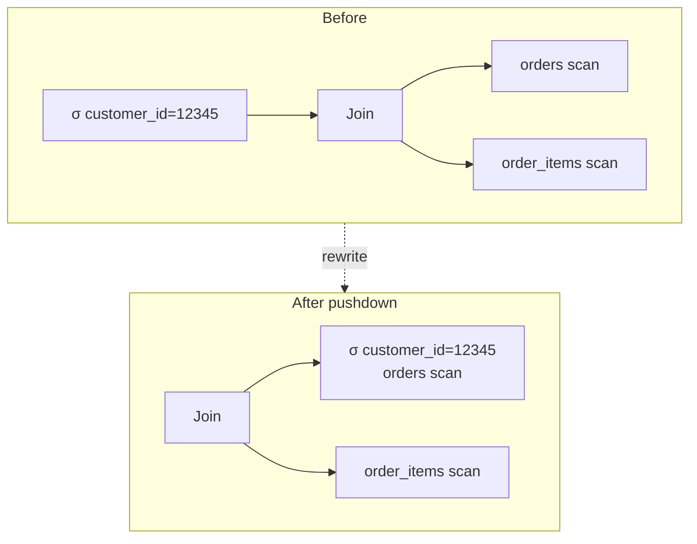
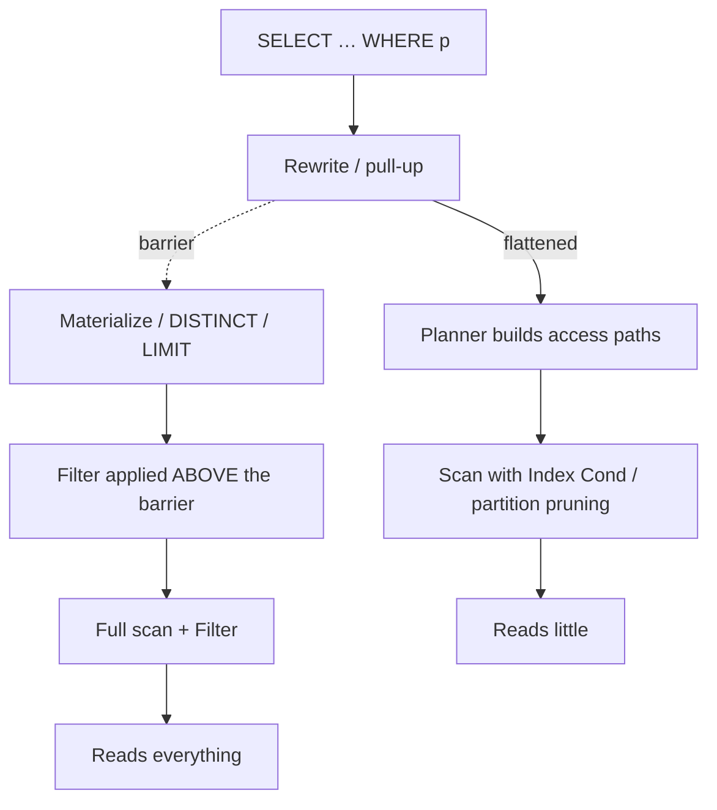

# Predicate Pushdown

> Predicate pushdown is the optimizer's most valuable and most invisible rewrite: it moves a filter
> from where you wrote it to where the data is smallest, so the database reads less. When it works,
> it is free performance you never see; when it fails, you scan terabytes to return a hundred rows.
> The reason it is worth an entire chapter is that pushdown can be **blocked by your own SQL** — a
> `DISTINCT`, an `ORDER BY ... LIMIT` inside a CTE, an outer join, a window function, a non-sargable
> cast — and blocked pushdown is one of the top causes of "the query is slow and nobody knows why."
> This chapter teaches the rewrite rules the optimizer applies, the exact shapes that prevent them
> from firing, how to read a plan to prove pushdown happened (or did not), and how pushdown manifests
> across PostgreSQL, MySQL, SQL Server, Oracle, Snowflake, BigQuery, and Spark.

Pushdown is also the mechanism *behind* partition pruning ([Chapter 08](./08-partition-pruning.md))
and largely explains why cardinality estimates ([Chapter 07](./07-cardinality-estimation.md)) matter:
a predicate the optimizer could not push leaves a node estimated far too large.

---

## TL;DR

- **Predicate pushdown = moving a `WHERE`/`ON` condition as close to the storage as possible**, so
  filtering happens before rows are joined, aggregated, or sorted. It is a *logical* rewrite: the
  result is identical, the plan is dramatically cheaper.
- **Pushdown through joins is legal for inner joins** (a filter on `A` can be applied before the
  join) and **illegal for the preserved side of an outer join** (a filter on the null-extended side
  would delete rows the outer join promised to keep). This is why `LEFT JOIN … WHERE right.col = x`
  is both a correctness bug *and* a pushdown barrier.
- **Subquery/CTE flattening ("pull-up") is what enables pushdown.** The optimizer merges a
  subquery's `WHERE` into the parent so the filter can descend to the base table. A subquery that
  is *not* flattened (`SELECT DISTINCT`, `GROUP BY`, window functions, `OFFSET`, recursive CTEs,
  `MATERIALIZED` CTEs) is a **pushdown barrier**: the outer filter cannot cross it.
- **PostgreSQL 12+ inlines non-recursive, single-reference CTEs**, which restored pushdown that
  pre-12 versions blocked. `WITH x AS MATERIALIZED (...)` forces materialization and *deliberately
  re-blocks* pushdown — the escape hatch when the estimate is bad.
- **Join elimination**: an `INNER JOIN` on a **unique** key whose columns are not referenced is
  removed entirely. A foreign key (or a unique index) lets the optimizer prove this. Missing
  metadata (no FK constraint, no unique index) prevents it.
- **Predicate pushdown into the scan is what makes indexes and partition pruning usable.** If the
  filter stays above the scan (a `Filter` instead of an `Index Cond`, or an `Append` that reads every
  partition), you have lost both the index and the pruning.
- **Warehouses push filters down into the storage layer.** Snowflake prunes micro-partitions via
  min/max metadata; BigQuery prunes partitions and columnar blocks; Spark pushes predicates into
  Parquet (row-group `min/max` statistics) and, since 3.0, does **dynamic partition pruning** with
  filter values discovered at runtime.
- **Where pushdown fails, in order of frequency:** an outer join's preserved side; a `DISTINCT`,
  `GROUP BY`, `LIMIT`, or window function between the filter and the table; a `MATERIALIZED` CTE; a
  non-sargable expression (`CAST`, function) on the *storage* side; a correlated subquery the engine
  chose not to decorrelate; a volatile function (`now()`, `random()`); and a type/collation mismatch.
- **You prove pushdown happened by reading the plan.** Look for the predicate in `Index Cond` /
  `Recheck Cond` / the scan's `Filter` (Postgres), in `attached_condition` (MySQL), in the
  `Seek Predicate` vs `Predicate` split (SQL Server), in `access` vs `filter` predicates (Oracle), and
  in the `Partitions scanned` count (Snowflake/BigQuery).

---

## 1. Definitions and core concepts

| Term | Definition |
|---|---|
| **Predicate pushdown** | Rewriting a query so a filter is evaluated as early (close to storage) as possible. |
| **Selection pushdown** | Pushing a `WHERE`/`ON` filter below a join, aggregate, or sort. |
| **Projection pushdown** | Reading only the columns needed (matters in columnar stores: fewer columns = less I/O). |
| **Subquery flattening / pull-up** | Merging a subquery into the parent query so its predicates can be pushed. |
| **Decorrelation** | Rewriting a correlated subquery (or `EXISTS`) into a join so it can be optimized as a set. |
| **Predicate pushdown barrier** | A node/operator that a predicate cannot cross: `DISTINCT`, `GROUP BY`, `LIMIT`, window, `MATERIALIZED` CTE, recursive CTE, `UNION ALL` with `LIMIT` above, volatile functions. |
| **Join elimination** | Removing a join whose rows cannot affect the result (unique key not referenced, FK-referenced table unused). |
| **Constant folding** | Evaluating expressions over constants at plan time so the predicate is available for pushdown. |
| **Equivalence class** | A set of columns the planner knows are equal (via `a.id = b.id`), enabling a filter on one to be applied to all. |
| **Join predicate / join clause** | The `ON` condition. A `WHERE` predicate that references only one side of a join is a *filter* and can be pushed; one referencing both is a *join predicate* and cannot. |
| **Heterogeneous pushdown** | Pushing filters into a *remote* source (FDW, data federation, external tables) — may be limited by the remote's capabilities. |
| **Predicate transfer / partition-key pushdown** | Propagating a predicate on a partitioned column into the partition scan (see Ch. 08). |
| **Row-group / micro-partition pruning** | Skipping storage chunks whose min/max statistics cannot satisfy the predicate (Parquet, Snowflake, BigQuery). |
| **Dynamic partition pruning (DPP)** | Spark 3.0+: prunes the fact-side partitions using filter values produced by the dimension side *at runtime*. |

> **Senior note:** "pushdown" is not a single feature. There are at least four: (1) filter
> *through a join* to a base table, (2) filter *through a derived table/CTE/subquery*, (3) filter
> *into the index/partition* at the scan, and (4) filter *into an external/columnar store*. A
> query can succeed at one and fail at another, and the fixes differ.

### 1.1 Schema, indexes, and dataset

```sql
-- customers(customer_id, email, full_name, country_code, signup_date, loyalty_tier, is_active)
-- categories(category_id, name, parent_id)
-- products(product_id, sku, name, category_id, unit_price, cost, is_active, attributes, created_at)
-- orders(order_id, customer_id, status, order_ts, country_code, total_amount, currency)
-- order_items(order_item_id, order_id, product_id, quantity, unit_price, discount)
-- events(event_id, session_id, customer_id, event_type, occurred_at, payload)
--        PARTITION BY RANGE (occurred_at)
```

```sql
CREATE INDEX idx_orders_ts             ON orders (order_ts);
CREATE INDEX idx_orders_customer_ts    ON orders (customer_id, order_ts DESC);
CREATE INDEX idx_orders_status_ts      ON orders (status, order_ts);
CREATE INDEX idx_order_items_order     ON order_items (order_id);
CREATE INDEX idx_order_items_product   ON order_items (product_id);
CREATE INDEX idx_products_category     ON products (category_id);
CREATE INDEX idx_products_cat_price    ON products (category_id, unit_price) WHERE is_active;
CREATE INDEX idx_events_session        ON events (session_id, occurred_at DESC);
```

Volumes: `customers` 2 M, `products` 500 K, `orders` 50 M, `order_items` 150 M, `events` 2 B
(partitioned by month). Cluster: PostgreSQL 16, `work_mem = 64MB`, `random_page_cost = 4.0`.

---

## 2. Why it matters / what problem it solves

### 2.1 Pushdown is the difference between scanning 570 GB and 4 GB

The `events` table is 2 billion rows partitioned by month. Query: "how many purchase events did
customer 12345 have in March 2025?"

```sql
SELECT count(*) FROM events
WHERE customer_id = 12345
  AND occurred_at >= '2025-03-01' AND occurred_at < '2025-04-01';
```

- With **full pushdown**: the partition key (`occurred_at`) prunes to the March partition; the
  `customer_id` predicate is applied there; you read the March partition's rows for one customer —
  tens of thousands out of 2 billion. Seconds.
- With **no pushdown**: you read all 570 GB, then filter. Hours, or a query that never finishes
  before the deadline.

The SQL is the same. The optimizer's ability to push the predicate determines whether the query is
trivial or impossible. This is why pushdown is not an optimization detail — it is the difference
between a query that works at scale and one that does not.

### 2.2 Pushdown determines whether indexes and pruning can be used at all

An index can only help a predicate that reaches the index. If the filter is evaluated *above* the
scan (as a `Filter`), the scan already read everything. If a partition filter never reaches the
partitioned table, every partition is scanned. Pushdown and index/pruning use are two faces of the
same coin:

```
filter pushed into scan  →  Index Cond / partition pruning  →  read little
filter stuck above scan  →  Filter over full scan           →  read everything
```

### 2.3 Pushdown is the reason subqueries can be fast

A correlated subquery (`SELECT … WHERE EXISTS (...)`) is, naively, a for-each loop. The optimizer's
ability to **decorrelate** it into a semi/anti join (and then push the filter) is what makes it
fast. When decorrelation fails (complex correlation, non-equi correlation, aggregate in the
subquery), the query stays a nested loop and can be quadratic.

---

## 3. How it works internally (the rewrite rules)

### 3.1 The relational algebra, in pictures

Pushdown is selection (σ) moving down the tree. Two laws drive everything:

```
σ_p (A ⋈ B)   =   σ_p(A) ⋈ B       if p references only A        (inner join)
σ_p (A ⋈ B)   ≠   σ_p(A) ⋈ B       for the PRESERVED side of an outer join
σ_p (∏_{list}(A))  — cannot push p below the projection if p uses a dropped column
σ_p (γ_{group}(A)) — cannot push p below the aggregate if p uses an aggregated column
σ_p (LIMIT_n(A))   — cannot push p below the limit (it changes which rows are limited)
```



After the rewrite, the `orders` scan reads only that customer's rows (ideally via
`idx_orders_customer_ts`), and the join is between a small set and `order_items`.

### 3.2 The rules the optimizer applies (and when they are blocked)

| Rewrite | Applies when | Blocked by |
|---|---|---|
| **Filter through inner join** | Predicate references one side only | Outer join preserved side; `OR` mixing sides |
| **Subquery pull-up / flattening** | Derived table is a simple `SELECT … FROM … WHERE` | `DISTINCT`, `GROUP BY`, `LIMIT`/`OFFSET`, window fn, `UNION`, `SET` ops |
| **CTE inlining** | Non-recursive, referenced once, no side effects | `MATERIALIZED`; referenced multiple times; recursive; volatile |
| **Join elimination** | Join on a unique/primary key, its columns unused | No unique key/FK; columns referenced; not provably unique |
| **Predicate into index/scan** | Sargable predicate on an indexed column | Function/cast on column; leading wildcard; type mismatch |
| **Partition pruning** | Predicate on partition key, constant or runtime-known | Function on partition key; pruned only if the filter reaches the scan |
| **Decorrelate `EXISTS`/`IN`** | Correlated predicate is equality/`EXISTS` | Non-equi correlation; aggregates inside; `LIMIT` in subquery |
| **Predicate into external store** | Source supports the predicate | Source can't evaluate it; type/collation mismatch; driver limitation |

### 3.3 Outer joins: the correctness-and-performance trap

For `A LEFT JOIN B ON a.k = b.k`, the preserved side is `A`. A predicate `b.col = x` in the `WHERE`
clause:

1. **Changes semantics** — it eliminates `A` rows with no `B` match (null-extension gives `NULL`,
   and `NULL = x` is `UNKNOWN`), silently turning the `LEFT JOIN` into an `INNER JOIN`.
2. **Blocks pushdown** — the optimizer cannot push `b.col = x` below the join (it would break the
   outer-join contract), so the filter waits until after null-extension.

The fix for both is the same: **move the predicate into the `ON` clause** (if you mean "match only
if") or accept the inner join.

```sql
-- Buggy: implicitly inner, no pushdown of the B-side predicate
SELECT a.*, b.col
FROM a LEFT JOIN b ON a.k = b.k
WHERE b.col = 42;

-- Correct "match only if": predicate participates in the match test
SELECT a.*, b.col
FROM a LEFT JOIN b ON a.k = b.k AND b.col = 42;
```

### 3.4 Subquery and CTE flattening (pull-up)

The planner "pulls up" a derived table into the parent when it is a simple projection/filter, so the
outer predicate can descend:

```sql
-- Blocked: DISTINCT is a barrier; the outer predicate cannot be pushed down
SELECT * FROM (SELECT DISTINCT customer_id FROM orders) d WHERE d.customer_id = 12345;

-- Flattenable: the outer predicate pushes into the base scan
SELECT * FROM (SELECT customer_id FROM orders) d WHERE d.customer_id = 12345;
```

PostgreSQL 12+ inlines non-recursive, single-use CTEs, so this now pushes:

```sql
WITH recent AS (SELECT * FROM orders WHERE order_ts >= '2025-01-01')
SELECT * FROM recent WHERE customer_id = 12345;   -- both predicates reach the orders scan
```

`MATERIALIZED` deliberately blocks it — a tool to *force* a specific materialization when the
optimizer's estimate is bad:

```sql
WITH recent AS MATERIALIZED (SELECT * FROM orders WHERE order_ts >= '2025-01-01')
SELECT * FROM recent WHERE customer_id = 12345;   -- the CTE is computed, then filtered
```

### 3.5 Join elimination

Given a foreign key (`orders.customer_id → customers.customer_id`) and no reference to `customers`
columns:

```sql
SELECT o.order_id, o.total_amount
FROM orders o
JOIN customers c ON c.customer_id = o.customer_id;   -- c is not referenced
```

Because `customer_id` is unique in `customers`, the join cannot add or remove rows, so the optimizer
removes it:

```text
Seq Scan on orders o  (cost=0.00..1792998.00 rows=50000000 width=24)
```

**Join elimination requires metadata**: a *unique* constraint/index on the join key. Without it, the
optimizer cannot prove 1: no:many, keeps the join, and may multiply rows. This is a concrete reason
foreign keys and `UNIQUE` constraints pay for themselves at query time.

### 3.6 Where the predicate ends up, mechanically



---

## 4. How to diagnose it

### 4.1 PostgreSQL

```sql
EXPLAIN (ANALYZE, BUFFERS, VERBOSE) SELECT …;
```

Prove-or-disprove checklist:

- **Predicate in `Index Cond` / `Recheck Cond`** → pushed *into the index*. Good.
- **Predicate in `Filter` under a `Seq Scan`** → evaluated at the scan, but the scan read
  everything. This is pushdown *to the scan* but no index benefit.
- **Predicate in `Filter` on a join/aggregate node** (with `Rows Removed by Join Filter`, or a
  `SubPlan`/`SubPlan` under `Filter`) → pushdown blocked; the filter sits above the barrier.
- **`Rows Removed by Filter` ≫ output rows** → the predicate was applied late.
- **`Append` reading every partition** → partition pruning failed (Ch. 08).
- **`CTE Scan` on a materialized CTE** → pushdown blocked by `MATERIALIZED` (or multi-reference).
- **`SubPlan`/`SubPlan` with high `loops`** → a correlated subquery survived (not decorrelated).

```sql
-- Did the planner inline my CTE? A "CTE Scan" node means no; the base plans mean yes.
EXPLAIN (COSTS, VERBOSE) WITH recent AS (SELECT …) SELECT …;

-- Join elimination sanity: this should show only a scans on orders.
EXPLAIN (COSTS) SELECT o.* FROM orders o JOIN customers c ON c.customer_id = o.customer_id;

-- Are statistics available for the predicate? (drives whether the estimate is trustworthy)
SELECT attname, n_distinct, most_common_vals FROM pg_stats
WHERE tablename = 'orders' AND attname IN ('status','customer_id');
```

### 4.2 MySQL

```sql
EXPLAIN FORMAT=JSON SELECT …;   -- look at "attached_condition" vs "table_condition"
EXPLAIN ANALYZE  SELECT …;      -- the TREE shows "Filter:" per iterator
SHOW WARNINGS;                  -- "Note: ... will be materialized" / "cannot be pushed"
```

- A predicate in `attached_condition` is pushed into the storage engine (good). A predicate on a
  higher iterator's `Filter` is applied after that iterator.
- `Extra: Using where` on the *first* table in a legacy `EXPLAIN` means the filter is applied after
  the access, not in the index.
- MySQL 8 has no `MATERIALIZED` CTE hint, but `WITH … AS` CTEs *are* materialized by default in
  some cases; derived-table merge (`derived_merge=on`) is the analog of pull-up.

### 4.3 SQL Server

The graphical plan distinguishes:

- **Seek Predicates** (pushdown into the index — good),
- **Predicate** (a residual filter applied by the same operator),
- **Join Predicate** (can't be pushed to either side).

`SET STATISTICS IO, TIME ON` shows logical reads — a scan with millions of logical reads and few
output rows means the predicate was not pushed to a seek. Also check the `!` warnings and the
"Actual Number of Rows" on the filter's input vs output.

### 4.4 Oracle

`DBMS_XPLAN` shows the predicate placement:

- **`access(...)`** — used by the access path (pushed, index-usable),
- **`filter(...)`** — applied after the access (no index benefit).

Any `filter(...)` where you wanted `access(...)` (or a `TABLE ACCESS FULL` where you wanted an index
range) is a pushdown failure. `predicate_creation`, `query_rewrite_enabled`, and
`star_transformation_enabled` control various rewrite rules.

### 4.5 Snowflake / BigQuery / Spark

- **Snowflake Query Profile**: the **`Partitions scanned` vs `Partitions total`** ratio is the
  pushdown/pruning evidence. A join node shows how many rows each side contributed *before* the
  join; a high `Rows` in the build with a selective filter on the probe means the filter was not
  pushed. Look at **`Bytes scanned`** vs `Bytes output`.
- **BigQuery**: the query plan stages show `Records read` / `Bytes read` / `Records output`. Real
  pushdown shows as `Number of partitions scanned` << `total`, and a `READ` step reading a small
  number of rows. `require_partition_filter` forces a partition predicate to exist.
- **Spark**: `df.explain("formatted")` — look for **`PushedFilters`** on a `FileScan` (Parquet
  row-group pushdown) and **`PartitionFilters`** (partition pruning) and
  **`DynamicPruningExpression`** (DPP). Filter not in `PushedFilters` = it is applied after the scan.

---

## 5. Worked examples (slow query → plan → diagnosis → fix)

### Example 1 — Outer join blocks pushdown (and silently changes the answer)

**The report:** "the win-back segment query is slow and the count looks wrong."

```sql
-- Intended: customers and their most recent delivered order (nulls allowed)
SELECT c.customer_id, o.order_id, o.order_ts
FROM customers c
LEFT JOIN orders o
       ON o.customer_id = c.customer_id
WHERE o.status = 'delivered';      -- <-- predicate on the nullable side
```

```text
Hash Join  (cost=233001.10..3080044.31 rows=990000 width=32) (actual time=... rows=19880000 loops=1)
  Hash Cond: (o.customer_id = c.customer_id)
  ->  Seq Scan on orders o  (cost=0.00..1792998.00 rows=19880000 width=24) (...)
        Filter: (status = 'delivered'::text)
        Rows Removed by Filter: 30200000
  ->  Hash  (cost=21000.00..21000.00 rows=2000000 width=16) (...)
        ->  Seq Scan on customers c  (...)
```

**Diagnosis.**
- The `WHERE o.status = 'delivered'` is applied as a **`Filter` on the `orders` scan**, *above*
  which the `LEFT JOIN` no longer preserves unmatched `customers`. So the query is silently an
  **inner join** — a correctness bug.
- Pushdown of a `customers`-side predicate would have been possible, but there isn't one, and the
  left-side filter on `orders` cannot move below the `LEFT JOIN` (it would delete the null-extended
  rows the join promised).

**Fix — move the predicate into `ON` (if "match only if" is intended):**

```sql
SELECT c.customer_id, o.order_id, o.order_ts
FROM customers c
LEFT JOIN orders o
       ON o.customer_id = c.customer_id
      AND o.status = 'delivered';
```

Now `o.status = 'delivered'` is a **join predicate** evaluated during matching, and the outer join
correctly preserves customers with no delivered orders. The optimizer can push the predicate into
the `orders` scan's `Index Cond` (via `idx_orders_status_ts`) and no longer has to materialize the
filter above the join.

**If you truly wanted the inner join**, write it as one and let the optimizer push the filter:

```sql
SELECT c.customer_id, o.order_id, o.order_ts
FROM customers c
JOIN orders o ON o.customer_id = c.customer_id
WHERE o.status = 'delivered';       -- now pushable to the orders scan
```

> **Senior note:** "predicate on the nullable side in `WHERE`" is the intersection of the two most
> common SQL mistakes — a silent semantic change *and* a pushdown barrier. It is always wrong; the
> only question is which correction you meant.

---

### Example 2 — `DISTINCT` in a subquery blocks pushdown

**The report:** "the retention cohort query takes 90 seconds."

```sql
-- SLOW: DISTINCT is a barrier; the outer filter cannot be pushed
SELECT d.customer_id
FROM (SELECT DISTINCT customer_id FROM orders) d
WHERE d.customer_id = 12345;
```

```text
HashAggregate  (cost=4820114.10..4820116.20 rows=480000 width=8) (actual time=42188.0..42300.4 rows=1 loops=1)
  Group Key: orders.customer_id
  ->  Seq Scan on orders  (cost=0.00..1792998.00 rows=50000000 width=8) (actual time=... rows=50000000 loops=1)
Planning Time: 2.1 ms
Execution Time: 42300.4 ms
```

**Diagnosis.** The `Distinct`/`HashAggregate` is a **pushdown barrier**: the outer
`d.customer_id = 12345` cannot cross it (removing rows before the distinct would change which rows
are distinct — well, not in this trivial case, but the optimizer does not prove that in general).
So the `Seq Scan` reads all 50 M `orders` rows and the aggregate groups them, *then* filters.

**Fix — push the predicate to the base table (use `EXISTS`, no barrier):**

```sql
SELECT c.customer_id
FROM customers c
WHERE EXISTS (SELECT 1 FROM orders o WHERE o.customer_id = c.customer_id)
  AND c.customer_id = 12345;
```

```text
Nested Loop Semi Join  (cost=0.99..7812.40 rows=1 width=8) (actual time=0.031..0.041 rows=1 loops=1)
  ->  Index Scan using customers_pkey on customers c  (cost=0.42..8.44 rows=1 width=8) (...)
        Index Cond: (customer_id = 12345)
  ->  Index Only Scan using idx_orders_customer_ts on orders o  (cost=0.57..7.80 rows=1 width=0) (...)
        Index Cond: (customer_id = 12345)
        Heap Fetches: 0
Planning Time: 0.312 ms
Execution Time: 0.051 ms
```

**42,300 ms → 0.05 ms.** The `EXISTS` decorrelates into a semi join, the filter reaches the index on
both sides, and the whole thing becomes two index seeks.

> **Senior note:** `DISTINCT` is the most common accidental pushdown barrier. Whenever you write
> `SELECT DISTINCT … FROM (…) WHERE …`, ask whether `EXISTS`/`IN` (a semi join) expresses the same
> intent without the barrier.

---

### Example 3 — `LIMIT` inside a subquery blocks pushdown

**The report:** "top-10 customers by spend, then join to their profile — it is slow."

```sql
-- SLOW: LIMIT above the aggregate is a barrier; the join runs over all customers
SELECT c.full_name, t.total
FROM (SELECT customer_id, sum(total_amount) AS total
      FROM orders GROUP BY customer_id
      ORDER BY total DESC
      LIMIT 10) t
JOIN customers c ON c.customer_id = t.customer_id;
```

```text
Nested Loop  (cost=… ) (actual time=… )
  ->  Subquery Scan on t  (...)
        ->  Limit  (...)
              ->  Sort  (... Sort Method: external merge Disk: 2,140,000kB ...)
                    ->  GroupAggregate  (...)
                          ->  Index Only Scan using idx_orders_customer_ts on orders  (...)
  ->  Index Scan using customers_pkey on customers c  (...)
```

**Diagnosis.** The `GROUP BY … ORDER BY … LIMIT` required aggregating and sorting *all* 2 M customers
(~2 GB disk sort) before keeping 10. The `JOIN customers` then probes 10 times — that part is fine.
The expensive part is the *full* aggregation/sort that the `LIMIT` cannot shrink, because the filter
(`t.total` top 10) is a property of the aggregate itself (a barrier).

**Fix A — push the filter to a business-meaningful predicate when possible.** If "top customers"
can be approximated or if there is a pre-aggregate, use it.

**Fix B — reduce the aggregation domain first.** If you only care about customers in a country:

```sql
SELECT c.full_name, t.total
FROM customers c
JOIN LATERAL (
    SELECT sum(o.total_amount) AS total
    FROM orders o
    WHERE o.customer_id = c.customer_id
) t ON true
WHERE c.country_code = 'US'          -- filter pushes into the customers scan
ORDER BY t.total DESC
LIMIT 10;
```

Now the `customers` scan is filtered by country *before* the lateral aggregate runs, so the
expensive per-customer aggregation happens for far fewer customers. (This trades a global sort for
N index-backed aggregates over a reduced set — a win when the reduced set is small.)

**Fix C — accept the top-N heapsort.** Adding an index on `customers(country_code)` and, crucially,
letting the `LIMIT 10` sit directly above a `Sort` that uses a **top-N heapsort** (bounded to 10
rows) avoids the full sort if the aggregation is index-driven.

> **Senior note:** `LIMIT` above an *aggregate* does not bound the aggregate's work; `LIMIT` above a
> *sort/scan* does (top-N heapsort). A "top-10" query is only cheap when the expensive part is the
> sort/scan, not a full aggregation.

---

### Example 4 — Join elimination: the FK that pays for itself

**Query:**

```sql
SELECT o.order_id, o.total_amount
FROM orders o
JOIN customers c ON c.customer_id = o.customer_id;
```

PostgreSQL 16 (with the FK/unique key on `customers.customer_id`) eliminates the join:

```text
Seq Scan on orders o  (cost=0.00..1792998.00 rows=50000000 width=24) (actual time=…)
```

**But** if `customers` had *no* unique constraint on `customer_id` (say `customer_id` were not
declared `PRIMARY KEY`/`UNIQUE`), the planner cannot prove the join is 1:N and keeps it, risking
fan-out and extra work. Same SQL, different plan, because of **schema metadata**.

**Lesson:** `PRIMARY KEY`/`UNIQUE`/`FOREIGN KEY` constraints are not just documentation — they enable
join elimination and give the optimizer cardinality guarantees it otherwise must guess.

---

### Example 5 — Pushdown into a partitioned table (and where it dies)

**Good — predicate reaches the partitioned scan:**

```sql
SELECT count(*) FROM events
WHERE occurred_at >= '2025-03-01' AND occurred_at < '2025-04-01';
```

```text
Aggregate  (cost=… ) (actual time=… )
  ->  Append  (cost=… )
        Subplans Removed: 59            <-- only the March partition remains
        ->  Seq Scan on events_2025_03  (…)
              Filter: (occurred_at >= … AND occurred_at < …)
```

`Subplans Removed: 59` = 60 monthly partitions, 59 pruned. Only March scans.

**Bad — a function on the partition key blocks pruning *and* pushdown:**

```sql
SELECT count(*) FROM events
WHERE date_trunc('month', occurred_at) = '2025-03-01';
```

```text
Aggregate  (actual time=… )
  ->  Append  (… )                       <-- NO Subplans Removed: all 60 partitions scanned
        ->  Seq Scan on events_2025_01  (… Filter: (date_trunc('month', occurred_at) = …))
        ->  Seq Scan on events_2025_02  (… Filter: …)
        ->  …  (58 more)
```

**Fix — rewrite to a sargable range so the predicate can be pushed to the partition key:**

```sql
SELECT count(*) FROM events
WHERE occurred_at >= '2025-03-01' AND occurred_at < '2025-04-01';
```

This is the same "sargability" lesson as [Chapter 03](./03-why-an-index-is-ignored.md), but here the
cost is 60× the I/O across partitions, not just a lost index. Partition pruning is covered in depth
in [Chapter 08](./08-partition-pruning.md).

---

### Example 6 — Warehouse pushdown: Snowflake/BigQuery and Spark

**Snowflake.** A filter on the clustering key and a filter on a join's dimension both push down to
micro-partition metadata (`min`/`max` per column). In Query Profile, the *Partitions scanned* ratio
is the evidence.

```sql
-- Good: prunes micro-partitions via min/max on order_ts
SELECT count(*) FROM orders WHERE order_ts >= '2025-01-01' AND order_ts < '2025-02-01';
```

**BigQuery.** Filtering the partitioning column prunes partitions; `require_partition_filter=true`
(on the table) makes the query *fail* if a partition predicate is missing, which prevents the
classic "one analyst scanned the whole table" incident.

**Spark SQL.** With Parquet, the `WHERE` filter is pushed into the file scan (`PushedFilters`) using
row-group statistics, and filters on partition columns become `PartitionFilters`:

```sql
-- partition columns: year, month
SELECT * FROM events WHERE year = 2025 AND month = 3 AND event_type = 'purchase';
```

```text
FileScan parquet events[…]
  PartitionFilters: [isnotnull(year), (year = 2025), isnotnull(month), (month = 3)]
  PushedFilters:   [IsNotNull(event_type), EqualTo(event_type,purchase)]
```

If `event_type` does **not** appear in `PushedFilters`, its filter is applied *after* the scan — a
pushdown failure (e.g. an expression the Parquet reader cannot evaluate, or a `UDF`).

**Spark DPP (3.0+).** When you join a partitioned fact to a filtered dimension, Spark *broadcasts* the
dimension's filter values and prunes the fact partitions at runtime:

```sql
SELECT f.* FROM fact_sales f
JOIN dim_date d ON f.date_key = d.date_key
WHERE d.year = 2025;
```

The plan shows `DynamicPruningExpression` and the fact scan's partitions are pruned to 2025's — even
though the filter is written on the dimension. This is predicate pushdown *through a join*, deferred
to runtime.

---

## 6. Real-world use cases and applications

| Scenario | Pushdown at work | Failure mode if blocked |
|---|---|---|
| **Partitioned event analytics** | Filter on `occurred_at` prunes to one month | All 60 partitions scanned (60× I/O) |
| **Data-lake Parquet scans (Spark/Trino)** | Predicate → row-group `min/max` | Full-file scan, TBs read |
| **Star-schema BI (Snowflake/BigQuery)** | Dimension filter → fact micro-partitions | Whole-table scan per query (cost explosion) |
| **ORM-generated subqueries** | Simple derived tables flattened | `DISTINCT`/window in the ORM's SQL blocks it |
| **dbt models with CTEs** | PG12+ inlines single-use CTEs | Pre-12 materializes every CTE (blocks it) |
| **FDW / federation (Postgres → MySQL)** | Filter pushed to remote engine | All rows fetched then filtered locally |
| **`EXISTS` existence checks** | Decorrelates to semi join | Correlated subquery = N+1 |
| **Reporting on a view with `LIMIT`** | `LIMIT` is a barrier | Aggregate runs over all rows |
| **Cohort/retention in a warehouse** | Predicate on the cohort's cohort-key pushes | Full fact scan per cohort |

---

## 7. Patterns and anti-patterns

**Patterns:**
- Put predicates in `WHERE` for inner joins and in `ON` for the "match only if" case of outer joins.
- Write **sargable** predicates (`col >= c1 AND col < c2`) so they reach indexes and partitions.
- Prefer `EXISTS`/`NOT EXISTS` over `DISTINCT`/`LEFT JOIN … IS NULL` for existence tests (no barrier;
  produces a semi/anti join).
- Keep derived tables and CTEs **simple** (no `DISTINCT`, `GROUP BY`, `LIMIT`, window) when you want
  the outer filter to push. If you must, push the filter inside.
- Add **`PRIMARY KEY`/`UNIQUE`/`FOREIGN KEY`** constraints so join elimination and cardinality
  guarantees are possible.
- In warehouses, filter on the **partitioning/clustering key** and on **partition columns** to get
  pruning.
- In Spark, filter early, rely on `PushedFilters`/`PartitionFilters`, and let DPP prune the fact side.
- Use `MATERIALIZED` (Postgres) **deliberately** as a fence when you want to force a materialization.

**Anti-patterns:**
- Predicate on the nullable side of an outer join in `WHERE` (wrong + no pushdown).
- `DISTINCT` in a subquery when `EXISTS` suffices.
- `LIMIT` above an aggregate, expecting the aggregate to be bounded.
- Wrapping the filter column in a function/cast (`CAST(col AS …) = …`, `date_trunc(...) = ...`) —
  blocks index and partition pushdown.
- A `MATERIALIZED` CTE "for clarity" — materialization is a pushdown barrier.
- A `UDF`/`CASE` in a Parquet/warehouse filter that the storage layer cannot evaluate (no row-group
  pruning).
- `SELECT *` in a columnar store — defeats projection pushdown; you read every column.
- Cross-catalog joins or a remote source that cannot evaluate the predicate (federation) — the filter
  runs locally after fetching everything.

**Decoder: predicate not pushed? Find the barrier.**

| Symptom | Barrier to look for |
|---|---|
| `Seq Scan` + `Filter`, no `Index Cond` | Non-sargable predicate; or genuinely low selectivity |
| `HashAggregate` above a full scan | `DISTINCT`/`GROUP BY` between the filter and the table |
| `Limit` above an aggregate | `LIMIT` on an aggregate's output (a barrier) |
| `CTE Scan` on a materialized CTE | `MATERIALIZED` or multi-reference CTE |
| `Append` without `Subplans Removed` | Function on the partition key; predicate didn't reach the scan |
| `SubPlan` with high loops | Correlated subquery not decorrelated |
| No `PushedFilters` on a Spark `FileScan` | Source/format cannot evaluate the expression; type mismatch |
| Filter on a remote node in a federation plan | Remote engine cannot evaluate the predicate |

---

## 8. Cross-engine differences

| Aspect | PostgreSQL | MySQL 8.0 | SQL Server | Oracle | Snowflake | BigQuery | Spark SQL |
|---|---|---|---|---|---|---|---|
| Filter placement evidence | `Index Cond` vs `Filter` | `attached_condition` vs iterator `Filter` | `Seek Predicates` vs `Predicate` | `access(...)` vs `filter(...)` | `Partitions scanned` ratio | `Records read` per stage | `PushedFilters`, `PartitionFilters` |
| Subquery pull-up | Yes (flattening in planner) | Derived-table merge (`derived_merge`) | Deep | Complex view merging | Internal | Internal | Catalyst optimizer |
| CTE inlining | 12+ (non-recursive, single-use); `MATERIALIZED` to block | CTEs may be materialized; `derived_merge` for derived | CTEs often materialized | Complex view merging / `MATERIALIZE` hint | Internal | Internal | Inlined unless reused; AQE |
| Join elimination | Yes with unique/PK (FK not required, but helps) | Limited | Yes with unique index | Yes (`table elimination`) | Internal | Internal | `EliminateOuterJoin`, etc. |
| Outer-join predicate rules | Preserved-side filter must stay above | Same | Same | Same | Same | Same | Same |
| Partition pruning from predicate | Yes (declarative, `enable_partition_pruning`) | Yes (`partition pruning`) | Yes (partition elimination) | Yes (partition pruning) | Micro-partition `min/max` pruning | Partition pruning (`require_partition_filter`) | Partition pruning + **DPP** |
| Columnar/projection pushdown | N/A (row store; TOAST aside) | N/A | Columnstore pushdown | In-Memory/Exadata pushdown | Column pruning automatic | Column pruning automatic | Parquet column pruning |
| FDW / federation pushdown | `postgres_fdw` pushes `WHERE`, `ORDER BY`, aggregates (capabilities allow) | Federated engine | Linked servers (limited) | Heterogeneous Services | External tables | External/BigLake | Catalyst over JDBC (dialect-dependent) |
| Force/deny pushdown | `MATERIALIZED`, `OFFSET 0` hack (pre-12) | `derived_merge=off` | `OPTION (FORCE ORDER)`-ish | `NO_MERGE`, `NO_PUSH_PRED` hints | none | none | none |

Notes worth knowing:

- **`OFFSET 0`** was the pre-PostgreSQL-12 trick to force materialization of a subquery (blocking
  pull-up). It still works and is still a smell.
- **MySQL `derived_merge=off`** disables the derived-table-to-parent merge, forcing materialization —
  the opposite of what you usually want.
- **Oracle's `NO_PUSH_PRED` hint** explicitly *disables* predicate pushdown, rarely needed but
  sometimes used to control plan shape.
- **BigQuery's `require_partition_filter`** turns "you forgot the partition filter" from a silent
  cost spike into a hard error — the most effective pushdown guardrail in any engine.
- **Spark DPP** is pushdown through a join at *runtime*; the static optimizer cannot know the
  dimension's values, so the pruning predicate is generated when the broadcast value is known.

---

## 9. Exercises — Intermediate (hints only)

1. **Fix the outer join.** `SELECT * FROM a LEFT JOIN b ON a.k=b.k WHERE b.flag = true;` — rewrite
   so it means "a with flag-true b matches, preserving a" and explain why the original is both wrong
   and unpushable. *Hint:* move the predicate into `ON`.

2. **Kill the `DISTINCT`.** Rewrite `SELECT DISTINCT c.id FROM customers c JOIN orders o ON … WHERE
   o.status='paid'` into a semi join. *Hint:* `EXISTS`.

3. **Push a predicate into a CTE.** Given `WITH r AS (SELECT * FROM orders WHERE order_ts > X)
   SELECT * FROM r WHERE customer_id = Y;`, show that both predicates reach the `orders` scan in
   PostgreSQL 12+. What keyword would *block* that? *Hint:* `MATERIALIZED`.

4. **Join elimination.** Write two equivalent queries — one that references only `orders` columns,
   one that references a `customers` column — and explain why the first can drop the join.
   *Hint:* unique key on the join column.

5. **Where did the filter go?** In a plan, the predicate appears as `Filter` under a `Seq Scan`
   rather than `Index Cond`. Name three reasons. *Hint:* non-sargable; low selectivity; bitmap scan
   (`Recheck Cond`).

6. **Partition pushdown.** Rewrite `WHERE date_trunc('month', occurred_at) = '2025-03-01'` so it
   prunes. *Hint:* half-open range on `occurred_at`.

7. **Spark `PushedFilters`.** A `FileScan parquet` shows `PushedFilters: []` for a `WHERE
   lower(sku) = 'x'`. Why, and how would you fix it? *Hint:* the reader cannot evaluate `lower`;
   normalize the column or add a generated column.

8. **Projection pushdown.** In a columnar store, explain why `SELECT *` is slower than
   `SELECT a, b` even with no filter. *Hint:* column pruning.

9. **MySQL `attached_condition`.** Find where MySQL reports a pushed predicate and where it reports a
   residual one. *Hint:* `EXPLAIN FORMAT=JSON`.

10. **Snapshot CTE vs subquery.** Convert a correlated `EXISTS` into an equivalent join and explain
    why the decorrelated form can push. *Hint:* semi join.

---

## 10. Exercises — Advanced (hints / expected approach, no full inline answers)

**10.1 Given this plan, what is wrong and how do you fix it?**

```text
HashAggregate  (cost=4820114.10..4820116.20 rows=480000 width=8) (actual time=42188.0..42300.4 rows=1 loops=1)
  Group Key: orders.customer_id
  ->  Seq Scan on orders  (cost=0.00..1792998.00 rows=50000000 width=8) (actual time=... rows=50000000 loops=1)
```

The SQL was `SELECT d.customer_id FROM (SELECT DISTINCT customer_id FROM orders) d WHERE d.customer_id = 12345`.

*Expected approach:* the `HashAggregate` (from `DISTINCT`) is a pushdown barrier — the outer
predicate cannot cross it, so the `Seq Scan` reads all 50 M rows and the aggregate groups them
before filtering. Fixes: (a) rewrite to `EXISTS`/`IN` (semi join) so the predicate reaches
`idx_orders_customer_ts`; (b) if the `DISTINCT` is truly needed, push the predicate *inside* the
subquery (`SELECT DISTINCT customer_id FROM orders WHERE customer_id = 12345`). Explain why
(b) is safe here but not in general, and measure the expected read reduction (50 M rows → ~dozens).

**10.2 Given this plan, what is wrong and how do you fix it?**

```text
Nested Loop  (cost=… ) (...)
  ->  Subquery Scan on t  (...)
        ->  Limit  (...)
              ->  Sort  (... Sort Method: external merge Disk: 2,140,000kB ...)
                    ->  GroupAggregate  (...)
                          ->  Index Only Scan using idx_orders_customer_ts on orders  (...)
  ->  Index Scan using customers_pkey on customers c  (...)
```

*Expected approach:* the `LIMIT 10` sits above an aggregate, which is a barrier — the aggregate and
its 2 GB sort run over *all* 2 M customers before 10 are kept. Identify that `LIMIT` bounds a *sort*
but not an *aggregate*. Then propose: (i) push a `WHERE` on `customers` so fewer customers are
aggregated (lateral or pre-filter), (ii) use a top-N heapsort if the aggregate can be index-driven,
(iii) pre-aggregate into a materialized table if this is a dashboard. *Hint:* a "top-N per group"
query needs the group boundary to be cheap first.

**10.3** A Postgres → MySQL `postgres_fdw` federated query is slow: the plan shows a `Foreign Scan`
returning 40 M rows with a `Filter` at the top. Diagnose and fix without moving data.
*Expected approach:* the remote capability flags did not push the predicate/aggregate; the FDW
fetched everything then filtered locally. Fixes: ensure `use_remote_estimate` and the FDW's
pushdown capabilities (`postgres_fdw` pushes `WHERE`, joins, `ORDER BY`, aggregates when the remote
is also Postgres; a MySQL FDW may support less), rewrite to push a selective predicate, or create a
materialized view on the remote side. Verify with `EXPLAIN (VERBOSE)` showing the remote SQL
(`Remote SQL:` line). *Hint:* `Remote SQL:` in `EXPLAIN VERBOSE` is the ground truth for what
actually got pushed.

**10.4** Snowflake: a join of a 5 TB fact to a 10 GB dimension scans the whole fact. Explain why the
dimension's `WHERE` filter did not prune the fact, and how to make it prune. *Expected approach:*
pruning happens on micro-partition `min`/`max`; a filter on the *dimension* does not automatically
prune the *fact* unless the join key correlates with the fact's clustering. Options: add a clustering
key on the fact to align with the filter, filter the fact directly, use a search optimization service,
or restructure so the predicate is on the fact's clustered column. *Hint:* `Partitions scanned` in
Query Profile is the metric; contrast with Spark's automatic DPP.

**10.5** Spark: a query `fact JOIN dim ON … WHERE dim.year = 2025` scans all fact partitions.
Explain DPP, what enables and disables it, and how to verify it fired.
*Expected approach:* DPP (Spark 3.0+) broadcasts the dimension's distinct filter values and prunes
the fact's partitions at runtime; the plan shows `DynamicPruningExpression`. It is disabled if the
join is not a broadcast join, if the dimension is too large to broadcast, if `spark.sql.optimizer
.dynamicPartitionPruning.enabled=false`, or if partitioning is not on the join key. Verify in
`df.explain` / the SQL UI. *Hint:* filtering the fact directly is the always-safe fallback.

**10.6** A view wraps a `SELECT DISTINCT`. Every query on the view that filters a column is slow.
Explain the barrier, and design a fix that preserves the view's contract.
*Expected approach:* the `DISTINCT` blocks the outer predicate from reaching the base tables, and a
view is just a macro for a subquery, so the barrier applies to all consumers. Fixes: remove the
`DISTINCT` if it is unnecessary (prove uniqueness with a `GROUP BY`/key), or push a "seed" predicate
into the view via a parameterized option, or materialize a deduplicated table and query that. Discuss
why a materialized view changes the freshness contract and how to handle it. *Hint:* a view does not
by itself block pushdown — the *operators inside it* do.

---

## References

- PostgreSQL: **Using EXPLAIN** — https://www.postgresql.org/docs/current/using-explain.html
- PostgreSQL: **WITH queries (CTEs) — inlining vs `MATERIALIZED`** — https://www.postgresql.org/docs/current/queries-with.html
- PostgreSQL: **Table expressions / subqueries / `LATERAL`** — https://www.postgresql.org/docs/current/queries-table-expressions.html
- PostgreSQL: **Planner statistics & selectivity** — https://www.postgresql.org/docs/current/planner-stats.html
- PostgreSQL: **Table partitioning (pruning)** — https://www.postgresql.org/docs/current/ddl-partitioning.html
- PostgreSQL: **postgres_fdw (pushdown capabilities, `Remote SQL`)** — https://www.postgresql.org/docs/current/postgres-fdw.html
- PostgreSQL: **CREATE INDEX (expression indexes)** — https://www.postgresql.org/docs/current/sql-createindex.html
- MySQL: **Optimizing queries with EXPLAIN** — https://dev.mysql.com/doc/refman/8.0/en/using-explain.html
- MySQL: **Derived tables / merge (`derived_merge`)** — https://dev.mysql.com/doc/refman/8.0/en/derived-tables.html
- Microsoft: **Showplan logical and physical operators (`Seek Predicates` vs `Predicate`)** — https://learn.microsoft.com/en-us/sql/relational-databases/showplan-logical-and-physical-operators-reference
- Oracle: **Access paths and predicate placement (`access` vs `filter`)** — https://docs.oracle.com/en/database/oracle/oracle-database/19/tgsql/joins.html
- Oracle: **Query transformations / view merging** — https://docs.oracle.com/en/database/oracle/oracle-database/19/tgsql/query-transformations.html
- Snowflake: **Micro-partitions & data clustering (pruning)** — https://docs.snowflake.com/en/user-guide/tables-clustering-micropartitions
- Snowflake: **Optimizing query performance** — https://docs.snowflake.com/en/user-guide/performance-query-options
- BigQuery: **Query partitioned tables (`require_partition_filter`, pruning)** — https://cloud.google.com/bigquery/docs/querying-partitioned-tables
- BigQuery: **Optimize query computation** — https://cloud.google.com/bigquery/docs/best-practices-performance-compute
- Apache Spark: **Performance Tuning (join hints, AQE)** — https://spark.apache.org/docs/latest/sql-performance-tuning.html
- Databricks: **Dynamic partition pruning** — https://docs.databricks.com/aws/en/optimizations/dynamic-file-pruning
- Databricks: **Predicate pushdown in Parquet** — https://docs.databricks.com/aws/en/tables/describe
- Apache Calcite: **Relational algebra rules (predicate pushdown)** — https://calcite.apache.org/docs/
- Trino: **Pushdown** — https://trino.io/docs/current/optimizer/pushdown.html
