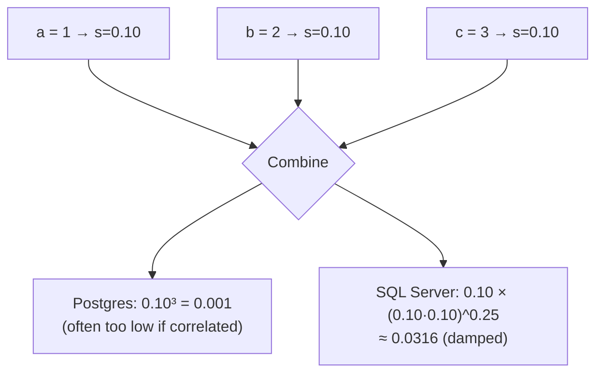
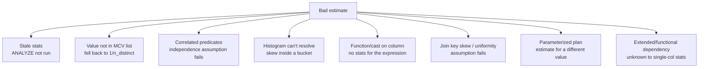

# Cardinality Estimation

> Cardinality estimation is the optimizer's crystal ball: before running a single row through the
> executor, it predicts how many rows every operation will produce. Every downstream decision —
> nested loop or hash join, which side to build, how much `work_mem` to grant, in what order to join
> — flows from those predictions. When the predictions are right, the plans are excellent. When they
> are wrong — and they are wrong constantly, because they rest on a handful of tiny samples and a
> few independence assumptions — you get nested loops over millions of rows, hash joins that spill
> to disk, and memory grants sized for a thousand rows when a million arrive. This chapter teaches
> how estimates are actually computed: selectivity arithmetic, the three kinds of statistics
> (histograms, MCV lists, `n_distinct`), the independence (and correlation) assumptions, the
> exponential-backoff rule for multiple predicates, the specific ways each assumption breaks, and how
> to fix the estimates at the source — fresh statistics, finer targets, extended (multivariate)
> statistics — rather than papering over them with hints.

This is the "why" behind every estimate error you spotted in
[Chapter 04](./04-reading-an-execution-plan.md) and every wrong algorithm choice in
[Chapter 05](./05-join-algorithms.md).

---

## TL;DR

- **Estimate = input rows × selectivity**, iterated through the plan tree. Get any selectivity wrong
  and the error compounds downstream.
- **Three statistics drive equality selectivity:** a **MCV list** (most-common values, with
  exact frequencies), a **histogram** (~100 equal-frequency buckets) for the rest, and **`n_distinct`**
  for the column. Range predicates use the histogram; equality on a common value uses the MCV list.
- **Default equality selectivity = `1 / n_distinct`.** So a column the planner thinks has 10 distinct
  values gets `0.1` per value — brutally wrong for a skewed column (a country value that is really
  60 % of rows) if it is not in the MCV list.
- **The independence assumption is the deepest flaw.** For `WHERE a = 1 AND b = 2`, the planner
  multiplies selectivities: `s(a) × s(b)`, *assuming a and b are independent*. When they are
  correlated (city ↔ country, currency ↔ country_code), it underestimates by orders of magnitude.
- **Multiple predicates "exponential backoff":** some systems (SQL Server's CE) *dampen* the product
  of selectivities toward the most selective single predicate as the number of predicates grows, to
  avoid catastrophic underestimates. Others (Postgres) multiply flatly. The difference changes plans.
- **PostgreSQL's `n_distinct` scales with sample size**: a small `default_statistics_target` can report
  `n_distinct` as a fraction of rows; `n_distinct = -0.5` means "half as many distinct values as rows".
- **Correlations are invisible to single-column statistics.** Fix with **`CREATE STATISTICS`**
  (`dependencies`, `ndistinct`, `mcv`) in PostgreSQL 10+, "multi-column statistics"/increased target
  in SQL Server, "column group statistics" in Oracle, or column-group stats in MySQL 8 histograms.
- **Bad estimates cause the two worst physical failures:** (1) a nested loop chosen because the outer
  side was estimated at tens of rows when it really has millions *and* (2) a hash join whose memory
  grant was sized from the underestimate, so the build spills (`Batches > 1`).
- **The fix order is: (1) `ANALYZE`/refresh statistics, (2) raise the statistics target on the
  problem column, (3) create extended statistics for correlated columns, (4) rewrite the predicate
  to be model-friendly, (5) only then consider `SET LOCAL` GUCs or a hint.**
- **You can read the inputs.** `pg_stats` (Postgres), `DBCC SHOW_STATISTICS` (SQL Server),
  `information_schema.column_statistics` (MySQL histograms), `DBA_TAB_COL_STATISTICS` /
  `DBMS_STATS` (Oracle) all show the histogram, MCV list, and `n_distinct` the planner is using.
  When an estimate is absurd, look at the statistic — the plan is faithfully reporting a bad belief.

---

## 1. Definitions and core concepts

| Term | Definition |
|---|---|
| **Selectivity (`s`)** | Fraction of input rows surviving a predicate, in `[0,1]`. `est_rows = input_rows × s`. Lower = more selective. |
| **Cardinality** | The number of rows an operator produces. The estimate that drives planning. |
| **MCV list** | Most-Common Values: the top-N values by frequency with exact frequencies. `pg_stats.most_common_vals` / `most_common_freqs`. |
| **Histogram** | `histogram_bounds`: bucket boundaries dividing the *non-MCV* values into roughly equal-frequency ranges. Range predicates estimate via bucket interpolation. |
| **`n_distinct`** | Number of distinct values. Postgres stores it as a positive count, or negative = proportion of rows (e.g. `-0.5` = half the rows are distinct). Governs the default `1/n_distinct` equality selectivity. |
| **Correlation (`pg_stats.correlation`)** | How well a column's index order matches heap order (`[-1,1]`). Affects *cost* (index scan price), not row count. |
| **Physical correlation** | Real-world dependency between two columns' values (`country_code` determines `currency`) that the planner cannot see without extended statistics. |
| **Independence assumption** | The assumption that `P(a ∧ b) = P(a)·P(b)`, used to combine predicate selectivities. |
| **Exponential backoff** | A damping factor applied to the product of selectivities as the predicate count grows (SQL Server CE), preventing absurd underestimates. |
| **Extended statistics (Postgres)** | `CREATE STATISTICS` objects with kinds `dependencies` (functional dependency), `ndistinct` (multi-column distinct count), `mcv` (multi-column MCV). |
| **Statistics target** | Postgres `default_statistics_target` (default 100) or per-column `ALTER … SET STATISTICS n`. Larger = more buckets/MCVs = better estimates on skewed data, at more `ANALYZE` cost. |
| **Sample size** | `ANALYZE` samples `300 × target` rows (Postgres). Small sample → noisy `n_distinct` and MCVs. |
| **Stale statistics** | Stats not refreshed after large DML. `pg_stat_all_tables.last_analyze`; SQL Server `sys.dm_db_stats_properties`. |
| **Estimate error** | `|est − actual| / actual`, or the ratio `est/actual`. Underestimates are more damaging than overestimates. |
| **Join selectivity** | For `A ⋈_k B`: `est(A⋈B) = |A| × |B| / max(ndistinct(A.k), ndistinct(B.k))` (uniformity assumption). |
| **Uniformity assumption** | The assumption that rows distribute evenly across join keys — breaks under skew. |
| **CE (Cardinality Estimation)** | SQL Server's term for the whole estimation subsystem (`CE 70`, `CE 120`, `CE 140/160`). |

> **Senior note:** in PostgreSQL, `EXPLAIN` shows the estimate but not its inputs. `pg_stats` shows
> the inputs but not which one the planner used. When an estimate is far off, read *both*: the plan's
> `rows=` and the column's `most_common_vals`, `histogram_bounds`, and `n_distinct`. The answer is
> almost always "the value is not in the MCV list, so the planner fell back to `1/n_distinct`" or
> "two correlated columns were multiplied."

### 1.1 Schema and dataset

```sql
-- customers(customer_id, email, full_name, country_code, signup_date, loyalty_tier, is_active)
-- categories(category_id, name, parent_id)
-- products(product_id, sku, name, category_id, unit_price, cost, is_active, attributes, created_at)
-- orders(order_id, customer_id, status, order_ts, country_code, total_amount, currency)
-- order_items(order_item_id, order_id, product_id, quantity, unit_price, discount)
-- events(event_id, session_id, customer_id, event_type, occurred_at, payload)
```

Volumes: `customers` 2 M, `products` 500 K, `orders` 50 M, `order_items` 150 M, `events` 2 B.
Cluster: PostgreSQL 16, `default_statistics_target = 100`, `work_mem = 64MB`, `random_page_cost = 4.0`.

---

## 2. Why it matters / what problem it solves

### 2.1 One wrong estimate, ten wrong decisions

The planner's decisions are downstream of estimates. A single bad cardinality can corrupt all of:

| Decision | Depends on the estimate of |
|---|---|
| Index scan vs seq scan | rows matching the predicate |
| Nested loop vs hash join | outer input rows (drives loop count) |
| Which side to hash (build) | relative size of both inputs |
| Join order | intermediate result sizes at each candidate order |
| Memory grant / `work_mem` behavior | build-side rows and width |
| Parallelism (`Gather`) | total rows and cost |
| Sort strategy | sorted set size vs `work_mem` |

So a 1,000× underestimate doesn't produce "a slightly suboptimal plan" — it produces a *nested loop
over a million rows with a 4 KB memory grant for the hash join it didn't pick*.

### 2.2 Estimates are usually good, and that's the trap

For uniformly-distributed data, single-column statistics are excellent and estimates are within a
few percent. The failures cluster on **skew** and **correlation**:

- **Skew:** 90 % of `orders.status = 'delivered'`, 0.5 % = 'cancelled'. If 'cancelled' is a rare MCV
  or outside the top-N, its selectivity is `1/n_distinct` (~1/6 = 0.17), not the true 0.005 — a 34×
  overestimate (or the reverse if the rare value is under-represented).
- **Correlation:** `country_code = 'DE' AND currency = 'EUR'`. Each is ~5 %; multiplied = `0.0025`
  (0.25 %). If currency is *determined* by country, the true selectivity is 5 %, an **20×
  underestimate.** Multiply a few such pairs in a 6-table report and you get 1,000× errors.

### 2.3 The business cost

Bad estimates are the #1 cause of "the query used to be fast" incidents. They manifest as:
- Sudden plan flips after a data change (stats crossed a threshold).
- Nightly ETL that regresses when a new value appears in a column.
- Dashboards that time out after a marketing spike adds a new `country_code`.
- One tenant (a skewed key) whose queries are 100× slower than everyone else's.

Fixing estimates is usually a one-line `ANALYZE` or `CREATE STATISTICS` — orders of magnitude cheaper
than the incident it prevents.

---

## 3. How it works internally

### 3.1 The estimation pipeline

```
predicate  →  selectivity s  →  est_rows = input_rows × s
                                    │
join       →  est(A⋈B) = |A|·|B| / max(ndistinct_k)          -- uniform fit
                                    │
aggregate  →  est_groups ≈ min(ndistinct of group keys, input_rows)
                                    │
sort/limit →  est = input_rows (sort) or ≤ limit (top-N)
                                    ↓
                             cost model  →  chosen plan
```

Every node's estimate feeds the next. The plan is a *chain of multiplications*; an error anywhere
propagates.

### 3.2 Equality selectivity: MCV list then `1/n_distinct`

For `col = 'value'`, PostgreSQL:

1. If `'value'` is in the **MCV list**, use its exact frequency (`most_common_freqs[i]`). Good.
2. Else if there is a histogram, use the average mass *not* covered by the MCVs spread over
   `n_distinct − |MCV|` distinct values:
   ```
   s ≈ (1 − Σ MCV_freqs) / max(1, n_distinct − |MCV|)
   ```
3. Else fall back to `1 / n_distinct` (or a default when `n_distinct` is unknown).

```text
pg_stats for orders.status (example):
  most_common_vals  = {delivered, shipped, paid, returned, cancelled, pending}
  most_common_freqs = {0.62, 0.14, 0.11, 0.06, 0.05, 0.02}       n_distinct = 6

  est(status='delivered') = 0.62 × 50,000,000 = 31,000,000       -- MCV hit, accurate
  est(status='cancelled') = 0.05 × 50,000,000 =  2,500,000       -- MCV hit, accurate
```

Now imagine `status` had **40** distinct values and only the top 10 fit in the MCV list. A rare value
outside the list gets `(1 − Σ MCV) / (40 − 10)` — a flat share that ignores its true rarity. If the
true share is 0.1 % but the flat share is 2 %, the estimate is **20× too high** and the planner
avoids an index it should have used.

> **Senior note:** increasing `default_statistics_target` widens the MCV list and the histogram, so
> more values are described exactly. On a skewed dimension, `SET STATISTICS 1000` on that column (then
> `ANALYZE`) can turn a 1,000× error into a 2× error with no query change.

### 3.3 Range selectivity: the histogram

For `col >= a AND col < b`, PostgreSQL interpolates within `histogram_bounds` (an array of bucket
boundaries where each bucket holds ~`1/target` of the non-MCV rows). For an indexed column, the
histogram is used for the estimate; the *actual* index range scan uses the real B-tree. Skew inside a
histogram bucket (a spike the histogram can't resolve) causes the classic "estimated 27 K, actual 3 M"
error.

### 3.4 Combining predicates: independence and backoff

For multiple predicates on the *same relation*, the planner combines selectivities. Two conventions:

**PostgreSQL — flat multiplication (independence):**
```
s(a=1 AND b=2) = s(a=1) × s(b=2)         -- ignores correlation
```

**SQL Server — exponential backoff:** as the number of predicates grows, SQL Server dampens the
product so it does not collapse toward zero. Simplified (see Microsoft's CE paper for the exact
formula):
```
combined ≈ s_most_selective × (s_2 × s_3 × … × s_n) ^ (1/4)     -- for predicates beyond the first
```
This is why SQL Server and PostgreSQL often produce *different plans for the same query* — different
models for the same philosophy.



### 3.5 Join selectivity

For `A ⋈_k B` (equi-join), the textbook formula:
```
est(A ⋈ B) = |A| × |B| / max( ndistinct(A.k), ndistinct(B.k) )
```
This assumes **uniform** key distribution and **no skew**. Two failures:
- **Referential/cardinality skew:** one `customer_id` owns 1 % of `orders`. The average-based estimate
  is fine for the whole join but wrong for a filter on that customer.
- **Functional dependency not seen:** `orders.customer_id → customers.customer_id` — if the planner
  underestimates `|customers|` after a filter, the join estimate is off.

### 3.6 The sample is small

`ANALYZE` reads `300 × statistics_target` rows (default: 30,000 rows). On a 50 M-row table that is
0.06 % of the data. Consequences:
- The MCV list may miss a value that occurs at 0.1 % (50,000 rows) — sometimes present, sometimes not.
- `n_distinct` is estimated from the sample and can be off by tens of percent.
- Re-running `ANALYZE` can produce *different* estimates on the same data (sampling noise).

This is not a bug; it is a deliberate cost/precision trade-off. You can pay more:
`ALTER TABLE … ALTER COLUMN … SET STATISTICS 1000` samples ~300,000 rows for that column.

### 3.7 Where estimates go wrong (the taxonomy)



| Root cause | Signature | Fix |
|---|---|---|
| Stale statistics | `last_analyze` old; `n_mod_since_analyze` large; estimate drifts over time | `ANALYZE`; tune `autovacuum_analyze_*` |
| Value outside MCV list | estimate ≈ `rows / n_distinct` for a skewed value | Raise `STATISTICS` target on the column |
| Correlated predicates | estimate 10–1000× too low for `a=? AND b=?` | `CREATE STATISTICS` (dependencies/mcv) |
| Histogram bucket skew | range estimate off by a lot | Raise target; partition; partial index |
| Function/cast on column | `rows=1` or default estimate | Expression index; sargable rewrite |
| Join skew | whole-join estimate OK, per-key wrong | Extended stats; rewrite; salt |
| Parameterized plan | fast with literals, slow with binds | `plan_cache_mode`, `OPTION (RECOMPILE)`, `OPTIMIZE FOR` |

---

## 4. How to diagnose it

### 4.1 PostgreSQL

```sql
-- 1. Find the divergence in the plan.
EXPLAIN (ANALYZE, BUFFERS, VERBOSE) SELECT …;   -- compare rows= vs actual rows=

-- 2. Read the inputs the planner used.
SELECT attname, n_distinct,
       most_common_vals, most_common_freqs,
       array_length(histogram_bounds,1) AS hist_buckets,
       correlation
FROM pg_stats
WHERE schemaname='public' AND tablename='orders'
ORDER BY attname;

-- 3. Statistics freshness.
SELECT relname, last_analyze, last_autoanalyze, n_mod_since_analyze, n_live_tup
FROM pg_stat_user_tables
WHERE relname IN ('orders','order_items','customers','products')
ORDER BY n_mod_since_analyze DESC;

-- 4. Extended statistics that exist.
SELECT stxname, stxkeys, stxkind FROM pg_statistic_ext;
-- Inspect the actual dependency/ndistinct/mcv values:
SELECT * FROM pg_stats_ext WHERE statistics_name = 'stx_orders_geo';

-- 5. Fan-out of a join key (the uniformity check).
SELECT customer_id, count(*) FROM orders GROUP BY 1 ORDER BY 2 DESC LIMIT 10;
```

**Diagnostic recipe:** when a node's estimate is off by > 10×, do (in order):
1. Is the *input* estimate to that node also off? If yes, recurse down — the error enters lower.
2. For a filter node, check whether the `=` value is in `most_common_vals`.
   - Not listed → the `1/n_distinct` fallback explains it → raise `STATISTICS`.
3. For a filter with multiple predicates, check whether the columns are correlated
   (`country_code` & `currency`; `loyalty_tier` & `country_code`).
   - Correlated → `CREATE STATISTICS … (dependencies, mcv)`.
4. For a join node, check the join key's `n_distinct` and a `GROUP BY` fan-out for skew.

### 4.2 SQL Server

```sql
DBCC SHOW_STATISTICS('orders', 'idx_orders_status_ts');   -- histogram, density, steps
DBCC SHOW_STATISTICS('orders', 'idx_orders_status_ts') WITH HISTOGRAM;

-- Freshness and sample:
SELECT sp.* FROM sys.dm_db_stats_properties(OBJECT_ID('orders'), 1) sp;

-- Row estimates with the CE model:
SELECT * FROM orders WHERE status='cancelled' OPTION (RECOMPILE);   -- forces re-estimation
-- Try a different CE model:
SELECT * FROM orders WHERE status='cancelled' OPTION (USE HINT('FORCE_LEGACY_CARDINALITY_ESTIMATION'));
```

SQL Server stores a **density** vector (average selectivity per column combination) and a histogram.
`DBCC SHOW_STATISTICS` shows `All Density`, `Average Length`, and the histogram `RANGE_HI_KEY`/`EQ_ROWS`
/`RANGE_ROWS`/`DISTINCT_RANGE_ROWS`. Cross-column correlation is captured by multi-column statistics
(`CREATE STATISTICS … ON (a, b)`), and CE 120+ adds containment and other assumptions.

### 4.3 MySQL

```sql
-- Histograms (8.0+):
ANALYZE TABLE orders UPDATE HISTOGRAM ON status, country_code WITH 100 BUCKETS;
SELECT * FROM information_schema.COLUMN_STATISTICS
WHERE TABLE_NAME = 'orders'\G
-- Shows histogram-type (equi-height), number-of-buckets, and the sampled values.
```

MySQL 8 has *histograms* for non-indexed columns; for indexed columns it relies on the index's
cardinality (`information_schema.STATISTICS.CARDINALITY`) and the optimizer's `filtered` estimate.
`EXPLAIN FORMAT=JSON` shows `rows_examined_per_scan` and `filtered`, and `optimizer_trace` shows the
selectivity math.

### 4.4 Oracle

```sql
-- Column statistics:
SELECT column_name, num_distinct, density, num_buckets, histogram
FROM dba_tab_col_statistics WHERE table_name = 'ORDERS';

-- Histogram buckets:
SELECT * FROM dba_tab_histograms WHERE table_name='ORDERS' AND column_name='STATUS';

-- Extended (column-group) statistics:
EXEC DBMS_STATS.CREATE_EXTENDED_STATS('SH','ORDERS','(country_code, currency)');
```

Oracle stores `num_distinct`, `density`, and an optional **histogram** (`HEIGHT BALANCED` or
`FREQUENCY`). `DBMS_STATS.GATHER_TABLE_STATS(..., method_opt => 'FOR COLUMNS SIZE AUTO ...')`
controls histogram creation. Real-Time SQL Monitoring shows `E-Rows` vs `A-Rows` per line.

### 4.5 Snowflake / BigQuery / Spark

- **Snowflake**: statistics are maintained automatically; you cannot usually see the histogram, but
  Query Profile shows `E-Rows`-style estimates vs actual (rows *out* per node). The lever is not
  statistics but **clustering** and **pruning**.
- **BigQuery**: no user-tunable statistics; the optimizer estimates from table/partition metadata
  and column value counts. Misestimates usually show as a stage reading far more rows than it emits.
- **Spark**: `spark.sql.cbo.enabled=true` + `ANALYZE TABLE … COMPUTE STATISTICS` enables
  cost-based join reordering using table/column stats; without it, Spark uses size heuristics.
  `ANALYZE TABLE t COMPUTE STATISTICS FOR COLUMNS a, b` adds column-level stats. AQE fixes many
  runtime misestimates by re-optimizing after the shuffle.

---

## 5. Worked examples (slow query → plan → diagnosis → fix)

### Example 1 — Correlated predicates destroy the estimate

**The report:** "the EU revenue report takes 3 minutes."

```sql
SELECT date_trunc('day', o.order_ts) AS d, sum(o.total_amount) AS revenue
FROM orders o
JOIN customers c ON c.customer_id = o.customer_id
WHERE c.country_code = 'DE'
  AND o.currency   = 'EUR'
GROUP BY 1
ORDER BY 1;
```

```text
GroupAggregate  (cost=233001.10..233021.44 rows=98 width=48) (actual time=181200.0..181240.0 rows=365 loops=1)
  ->  Sort  (cost=233001.10..233001.34 rows=98 width=48) (...)
        ->  Hash Join  (cost=21000.00..232996.10 rows=98 width=48) (actual time=42.0..181000.0 rows=2450000 loops=1)
              Hash Cond: (o.customer_id = c.customer_id)
              ->  Seq Scan on orders o  (... rows=50000000 width=24) (actual rows=2450000 loops=1)
                    Filter: (currency = 'EUR'::bpchar)
                    Rows Removed by Filter: 47550000
              ->  Hash  (cost=21000.00..21000.00 rows=2000 width=8) (actual rows=98000 loops=1)
                    ->  Seq Scan on customers c  (... rows=2000 width=8) (actual rows=98000 loops=1)
                          Filter: (country_code = 'DE'::bpchar)
Planning Time: 1.2 ms
Execution Time: 181240.5 ms
```

**Diagnosis.**
- `customers` `country_code='DE'`: estimated `rows=2000`, actual `rows=98,000` — a **~49×
  underestimate**. `country_code` has ≤ ~200 distinct values, so `1/n_distinct` ≈ 1/200 = 0.005 →
  2,000 rows. But 'DE' is one of the largest countries (4.9 %), and it is apparently *not* in the
  MCV list (or the list is too short) — so the planner used the flat `1/n_distinct` share.
- `orders` `currency='EUR'`: actual 2.45 M. Likewise estimated by `1/n_distinct` on `currency`
  (a 3-value column would be accurate at `1/3`, so this column probably has many stale/no stats).
- The **correlation** between `country_code='DE'` and `currency='EUR'` is total: every German order
  is in euros. The planner multiplied two independent selectivities and got ~98 rows, instead of
  ~2.45 M. The join node estimate `rows=98` vs `rows=2,450,000` is a **25,000× error** — which is
  exactly why the downstream `Sort` and memory were sized for a trivial result.

**Fix 1 — fresh statistics and a finer target:**

```sql
ALTER TABLE customers ALTER COLUMN country_code SET STATISTICS 1000;
ALTER TABLE orders    ALTER COLUMN currency     SET STATISTICS 500;
ANALYZE customers; ANALYZE orders;
```

**Fix 2 — extended statistics for the correlated pair (the real fix):**

```sql
-- In PostgreSQL, the correlation is *within* a table, so create it on the table that has both:
-- (here the two columns live in different tables; the cross-table part is handled by the
--  join estimate, but the intra-table analogues below show the mechanism.)
CREATE STATISTICS stx_orders_geo (dependencies, mcv) ON country_code, currency FROM orders;
ANALYZE orders;

-- Then the planner knows currency is functionally dependent on country_code:
SELECT stxname, stxkind FROM pg_statistic_ext;
SELECT dependencies FROM pg_stats_ext WHERE statistics_name = 'stx_orders_geo';
--   -> "{2 => 1}": currency (col 2) is determined by country_code (col 1)
```

With the dependency known, `WHERE country_code='DE' AND currency='EUR'` uses ~the selectivity of the
stronger single predicate (they cannot both be "independent"), so the estimate rises toward 2.45 M.

**Result:** the join estimate becomes ~2.4 M, and the plan becomes a hash join with an honest memory
grant:

```text
GroupAggregate  (cost=... rows=365 width=48) (actual time=... rows=365 loops=1)
  ->  Sort  (... rows=365 ...)
        Sort Method: quicksort  Memory: 41kB
        ->  Hash Join  (... rows=2450000 width=48) (actual time=... rows=2450000 loops=1)
              Hash Cond: (o.customer_id = c.customer_id)
              ->  Seq Scan on orders o  (... )
              ->  Hash  (... rows=98000 ...)
```

**181 s → ~4 s**, no hint, no index — the estimate is now honest and the plan is appropriate.

> **Senior note:** the *symptom* (`rows=98`) looked like a tiny query, which is why the plan was
> "reasonable." The error was invisible until you compared to `actual rows=2,450,000`. Extended
> statistics exist precisely to teach the planner about functional dependencies like
> country → currency, city → postal code, sku → category.

---

### Example 2 — A rare value outside the MCV list → nested loop

**The report:** "orders for our biggest product are slow."

```sql
SELECT o.order_id, o.order_ts
FROM order_items oi
JOIN orders o ON o.order_id = oi.order_id
WHERE oi.product_id = 9090909
ORDER BY o.order_ts DESC
LIMIT 20;
```

```text
Limit  (actual time=41288.9..41288.9 rows=20 loops=1)
  ->  Nested Loop  (actual time=0.101..41288.9 rows=3 loops=1)
        ->  Bitmap Heap Scan on order_items oi  (actual time=0.043..11.4 rows=41211 loops=1)
              Recheck Cond: (product_id = 9090909)
              ->  Bitmap Index Scan on idx_order_items_product  (actual rows=41211 loops=1)
        ->  Index Scan using orders_pkey on orders o  (actual rows=1 loops=41211)
```

**Diagnosis.** The outer estimate (`rows=20`) is ~2,000× too low. `product_id` has ~500 K distinct
values, and a popular product (`9090909`) has 41 K items — a *head* value that is nonetheless not in
the MCV list (the list captures the overall most-common values, and this product may sit just below
the cutoff, or `n_distinct` is large enough that the flat share is tiny).

**Verify:**

```sql
SELECT n_distinct, most_common_vals[1:5] AS top5
FROM pg_stats WHERE tablename='order_items' AND attname='product_id';
-- n_distinct ≈ 500000, and the top-5 MCVs very likely do NOT include 9090909

SELECT count(*) FROM order_items WHERE product_id = 9090909;   -- 41,211  (head, but not top 10)
```

**Fix:**

```sql
ALTER TABLE order_items ALTER COLUMN product_id SET STATISTICS 1000;  -- captures more MCVs
ANALYZE order_items;
-- or add the value to the histogram resolution via a larger target
```

With a larger MCV list, `9090909` is captured (or the histogram resolves the head), the outer
estimate rises to ~41 K, and the planner switches to a **hash join** — linear, in memory:

```text
Limit  (actual time=88.5..88.5 rows=3 loops=1)
  ->  Sort  (Sort Method: top-N heapsort  Memory: 27kB)
        ->  Hash Join  (actual time=15.0..63.1 rows=41211 loops=1)
              Hash Cond: (o.order_id = oi.order_id)
              ->  Seq Scan on orders o
              ->  Hash  (actual rows=41211 loops=1)
                    ->  Bitmap Heap Scan on order_items oi
                          Recheck Cond: (product_id = 9090909)
```

**41,289 ms → 88 ms.**

> **Senior note:** "add an index on the filter column" would not have helped here — the index *was*
> used, and it was correct per-probe. The failure was the *cardinality*, which made the nested loop
> look free. This is the signature of an MCV-list gap, and the fix is statistics, not schema.

---

### Example 3 — Bad estimate sizes a hash join into spill

**The report:** "the join spills to disk and the disk fills up."

```sql
SELECT c.country_code, count(*)
FROM orders o JOIN customers c ON c.customer_id = o.customer_id
WHERE o.status = 'cancelled'
GROUP BY 1;
```

```text
HashAggregate  (cost=... ) (actual time=... rows=180 loops=1)
  ->  Hash Join  (cost=... rows=8200 width=16) (actual time=... rows=2600000 loops=1)
        Hash Cond: (o.customer_id = c.customer_id)
        ->  Seq Scan on orders o  (... ) (actual rows=2600000 loops=1)
              Filter: (status = 'cancelled'::text)      -- estimated 8,333, actually 2.6M
        ->  Hash  (cost=... rows=2000000 width=8) (...)
              Buckets: 2097152  Batches: 4  Memory Usage: 65536kB
              ->  Seq Scan on customers c
```

**Diagnosis.** Two coupled errors:
1. `status = 'cancelled'`: estimated `rows≈8,333` (the `1/n_distinct` fallback with `n_distinct=6`
   would be 8.3 M — so this column likely has *no* stats at all or a stale `n_distinct`), actual
   2.6 M. Wait — the estimate shown is the *scan's* output; the `Hash Join` estimate of 8,200 rows is
   the join estimate. In any case the join was estimated far below reality.
2. Because the estimate was low, the planner granted the `Hash` a small `work_mem`, so the **2 M-row
   build side spilled into `Batches: 4`.**

**Fix:** refresh/raise statistics on `orders.status` so the estimate reflects the true distribution.

```sql
ALTER TABLE orders ALTER COLUMN status SET STATISTICS 500;
ANALYZE orders;
```

Now the join estimate is ~2.6 M, the memory grant is proportional, and the `Hash` shows
`Batches: 1` (in memory):

```text
        ->  Hash  (... rows=2000000 width=8) (...)
              Buckets: 2097152  Batches: 1  Memory Usage: 81280kB
```

**Lesson:** an estimate error and a spill are the *same bug* seen twice. Fix the estimate and the
spill often disappears without touching `work_mem`.

> **Senior note:** the reverse also happens — a huge *overestimate* grants a huge memory block that
> starves concurrency. Watch `sys.dm_exec_query_memory_grants` (SQL Server) or `pg_stat_activity` for
> oversized grants on low-row queries.

---

### Example 4 — Stale statistics after a bulk load

**The report:** "the report was fine until last night's load; now it's 100× slower."

```sql
SELECT count(*) FROM orders WHERE order_ts >= '2025-12-01';
```

```text
Aggregate  (cost=... ) (actual time=... )
  ->  Seq Scan on orders o  (cost=0.00..1792998.00 rows=14000 width=0)   -- estimated 14,000
                            (actual time=0.014..48000.0 rows=3200000 loops=1)   -- actual 3.2M
        Filter: (order_ts >= '2025-12-01 00:00:00+00')
        Rows Removed by Filter: 46800000
```

**Diagnosis.** `histogram_bounds` for `order_ts` was collected *before* the bulk load; its upper
bound is old, so the histogram places all the new December rows in the last bucket and predicts only
14 K beyond `2025-12-01`. Actual: 3.2 M — a 228× underestimate.

**Verify:**

```sql
SELECT relname, last_analyze, last_autoanalyze, n_mod_since_analyze
FROM pg_stat_user_tables WHERE relname='orders';
-- last_autoanalyze 7 hours ago; n_mod_since_analyze = 40,000,000  -> stale

SELECT max(histogram_bounds)  -- or the top of the array
FROM pg_stats WHERE tablename='orders' AND attname='order_ts';
-- shows an old upper bound, well below '2025-12-31'
```

**Fix:**

```sql
ANALYZE orders;
-- and prevent recurrence: make autovacuum analyze sooner after large loads
ALTER TABLE orders SET (autovacuum_analyze_scale_factor = 0.02,
                        autovacuum_analyze_threshold    = 5000);
-- or trigger ANALYZE explicitly at the end of the load job
```

Now the histogram's upper bound covers December, the estimate is ~3.2 M, and the plan is honest.

> **Senior note:** `n_mod_since_analyze` is your early-warning metric. Ingest pipelines should
> `ANALYZE` the loaded table as a final step — the failure mode is *silent* until a query flips its
> plan, usually at the worst possible time.

---

### Example 5 — Parameter sniffing / generic plan (estimate for the wrong value)

**The report:** "the same query is fast for small customers, slow for the whale."

```sql
PREPARE get_orders (bigint) AS
SELECT order_id, order_ts FROM orders WHERE customer_id = $1 ORDER BY order_ts DESC LIMIT 20;

EXECUTE get_orders(1);        -- fast (customer has 30 orders)
EXECUTE get_orders(2);
EXECUTE get_orders(3);
EXECUTE get_orders(4);
EXECUTE get_orders(5);
EXECUTE get_orders(6);        -- after 5 executions Postgres may switch to a GENERIC plan
```

```text
-- Generic plan (freshly compiled): the planner does not know $1
Limit  (cost=... rows=20 width=32) (actual time=... )
  ->  Gather Merge  (...)
        ->  Sort  (Sort Key: order_ts DESC)
              ->  Parallel Seq Scan on orders o  (... rows=2900 width=32)
                    Filter: (customer_id = $1)
                    Rows Removed by Filter: 4166667     -- per worker
```

**Diagnosis.** The generic plan is planned *without* the parameter value, so it falls back to
`1/n_distinct` on `customer_id` — the *average* customer. For the whale (customer with millions of
orders) or for a customer the planner had no MCV for, the estimate is wrong for this execution, and
the plan is built for the average. The tell: `EXPLAIN EXECUTE` shows a `Filter` where a custom plan
would show an `Index Cond`, and `plan_cache_mode` decides which you get.

**Fix:**

```sql
-- Force a custom plan (re-planned with the actual value) for this statement:
SET plan_cache_mode = force_custom_plan;
```

Then every execution is planned with its real `$1`, so the estimate matches and the plan uses
`idx_orders_customer_ts`.

**Related SQL Server fix:** `OPTION (RECOMPILE)` (re-plans per execution), `OPTION (OPTIMIZE FOR
(@id = 12345))` (plan for a representative value), or Query Store forcing a known-good plan.

> **Senior note:** parameter sniffing and generic plans are *estimation* problems in disguise: the
> estimate is correct for the value the planner saw, and wrong for the value you're passing. The fix
> is to align the plan with the value — not to add an index.

---

## 6. Real-world use cases and applications

| Scenario | Estimation failure | Fix |
|---|---|---|
| **Multi-tenant SaaS** | Skewed `tenant_id`; one tenant's queries flip plans | Extended stats; per-tenant partial index; parameterized isolation |
| **Marketing adds a new country/currency** | A new MCV changes selectivities overnight → plan flips | Monitoring + `ANALYZE` on the dimension; hysteresis via plan guides |
| **Black Friday traffic spike** | `status` distribution shifts; estimates lag | Frequent `ANALYZE`; tune autovacuum |
| **Bulk nightly load** | Histograms stale until the next `ANALYZE` | `ANALYZE` at the end of the load |
| **Star-schema BI with correlated dims** | `country`+`currency`, `category`+`supplier` multiplied | `CREATE STATISTICS (dependencies)` / column-group stats |
| **ORM with bind parameters** | Generic plans for skewed values | `force_custom_plan` / `OPTIMIZE FOR` / `RECOMPILE` |
| **Data-science ad-hoc queries** | Function-wrapped columns have no stats | Expression indexes; sargable rewrites |
| **Spark cost-based joins** | No CBO stats → size heuristics | `ANALYZE TABLE … COMPUTE STATISTICS FOR COLUMNS`; AQE |

---

## 7. Patterns and anti-patterns

**Patterns:**
- `ANALYZE` after every significant load; make it part of the pipeline, not an afterthought.
- For skewed columns you filter on, raise `SET STATISTICS` (Postgres) / create histograms (MySQL) /
  gather with `SIZE` (Oracle).
- For **correlated** columns, create extended statistics (`dependencies`, `ndistinct`, `mcv`) — the
  single highest-leverage fix for multi-predicate underestimates.
- Keep joins on well-known unique keys so `n_distinct` is exact (via `PRIMARY KEY`/`UNIQUE`).
- Use `OPTION (RECOMPILE)` / `force_custom_plan` where parameters are skewed and the query is rare.
- Watch `n_mod_since_analyze`, `rows= vs actual rows=`, and the *ratio*, with alerting.
- Prefer designs where the estimate is *stable* across values (equality on a uniformly-distributed,
  unique key) over designs where it is value-dependent.

**Anti-patterns:**
- **Never `ANALYZE`** after bulk loads or on volatile tables.
- **Wrapping filter columns in functions** (`lower(email) = …`) so the column has no usable stats.
- **Assuming statistics are precise** on huge tables with the default sample.
- **Fixing estimates with hints** (`/*+ cardinality */`, `OPTION (HASH JOIN)`) before touching the
  statistics that produced the wrong plan.
- **Ignoring correlation** and then being surprised by 1,000× underestimates.
- **Comparing estimates across engines** as if the models were identical (Postgres multiplies;
  SQL Server damps).
- **Relying on `n_distinct` from a tiny sample** for a highly-skewed column.

**Decoder: which statistic is wrong?**

| Estimate behavior | Likely statistic at fault |
|---|---|
| `rows` ≈ `table_rows / n_distinct` for a skewed value | MCV list too short → raise target |
| Multi-predicate underestimate, predicates on correlated cols | Missing extended statistics (dependencies) |
| Range underestimate past the histogram's old upper bound | Stale statistics (`ANALYZE` needed) |
| Join estimate wildly wrong, keys skewed | Uniformity assumption → extended stats / rewrite |
| `rows=1` on an expression predicate | No stats for the expression → expression index |
| Fast with literals, slow with binds | Generic/parameterized plan → custom plan / `RECOMPILE` |

---

## 8. Cross-engine differences

| Aspect | PostgreSQL | MySQL 8.0 | SQL Server | Oracle | Snowflake | BigQuery | Spark SQL |
|---|---|---|---|---|---|---|---|
| Statistics source | `pg_statistic` (sample) | Index cardinality + optional histograms | Auto/manual stats, histograms, density | `DBMS_STATS`, histograms (`FREQUENCY`/`HEIGHT BALANCED`) | Automatic (hidden) | Table/partition metadata | Optional CBO stats (`ANALYZE TABLE`) |
| MCV list | Yes (`most_common_vals/freqs`) | No (histograms instead) | Yes (`DBCC SHOW_STATISTICS`) | Yes (frequency/histo) | n/a (visible only as estimates) | n/a | Column stats (min/max, ndv) |
| Histograms | Yes (`histogram_bounds`) | Yes (8.0+, `ANALYZE … UPDATE HISTOGRAM`) | Yes (up to 200 steps) | Yes | n/a | n/a | min/max + sketch (with CBO) |
| `n_distinct` | Positive count or negative fraction | `CARDINALITY` (per index) | `Density` vector | `NUM_DISTINCT`, `DENSITY` | internal | approx. distinct per column | `ndv` |
| Multi-predicate logic | Flat product (independence) | Product (independence) | **Exponential backoff** (CE) | Product + column groups | internal | internal | Product |
| Correlation handling | Extended stats (10+) | Limited (functional dep. detection) | Multi-column stats, CE 120+ | Column-group (extended) stats | clustering instead | n/a | Column stats + AQE |
| Freshness control | `ANALYZE`, autovacuum | `ANALYZE TABLE`, persistent stats | `UPDATE STATISTICS`, auto-update | `DBMS_STATS.GATHER_*`, `AUTO_TASK` | automatic | automatic | manual `ANALYZE TABLE` |
| Statistics target | `default_statistics_target`, `SET STATISTICS` | `WITH n BUCKETS` | `SAMPLE`/`FULLSCAN`, steps | `method_opt SIZE` | n/a | n/a | n/a |
| Parameterization fix | `plan_cache_mode = force_custom_plan` | `PREPARE` re-plan behavior | `OPTION (RECOMPILE / OPTIMIZE FOR)` | bind peeking + ACS | n/a | n/a | AQE re-optimizes |
| Read the inputs | `pg_stats`, `pg_stats_ext` | `COLUMN_STATISTICS`, `optimizer_trace` | `DBCC SHOW_STATISTICS` | `DBA_TAB_COL_STATISTICS`, `DBA_TAB_HISTOGRAMS` | — | — | `DESCRIBE EXTENDED` |

Notes worth knowing:

- **SQL Server's exponential backoff** is the reason the same multi-predicate query can get a hash
  join on SQL Server and a nested loop on PostgreSQL from *identical* data. It is not a bug in either.
- **MySQL has no MCV list** — it uses histograms (8.0+) for non-indexed columns and index cardinality
  otherwise. Skewed equality on an indexed column can be estimated poorly.
- **Oracle's `DENSITY`** is `1/num_distinct` for uniform columns and derived from the histogram
  otherwise; `column group` statistics are the extended-stats analogue.
- **Snowflake/BigQuery** hide the statistics but let you *change the pruning/clustering*, which is
  their version of "fixing the estimate."
- **Spark's CBO** is opt-in (`spark.sql.cbo.enabled`); most Spark jobs run on size heuristics plus
  AQE, which corrects *runtime* misestimates by re-planning after shuffles.

---

## 9. Exercises — Intermediate (hints only)

1. **Compute a selectivity.** `orders` has 50 M rows, `status` has `n_distinct = 6` and
   `most_common_freqs = {delivered:0.62, shipped:0.14, paid:0.11, returned:0.06, cancelled:0.05,
   pending:0.02}`. Estimate `status='paid'` and `status='void'` (a value not in the list, and
   `n_distinct` is really 7). *Hint:* MCV hit vs `1/n_distinct`.

2. **Spot the correlation.** For `WHERE country_code='DE' AND currency='EUR'`, compute the product
   under independence assuming each is 5 %, then the true selectivity if currency is determined by
   country. What is the error factor? *Hint:* `0.05 × 0.05 = 0.0025` vs `0.05`.

3. **Join selectivity.** `orders` = 50 M, `customers` = 2 M, `orders.customer_id` references
   `customers.customer_id` (unique). Estimate `orders ⋈ customers` on `customer_id`. *Hint:*
   `|A|·|B| / max(nd)` = 50 M (each order matches exactly one customer).

4. **Read `pg_stats`.** Given `n_distinct = -0.5` on a column of 2 M rows, how many distinct values
   does the planner assume? *Hint:* negative = fraction → `0.5 × 2,000,000`.

5. **Stale histogram.** A histogram's upper bound is `2025-11-15` and you filter `>= '2025-12-01'`.
   Why does the estimate collapse? *Hint:* all values beyond the last bucket are extrapolated.

6. **Which fix?** An estimate is ~`rows / n_distinct` for a skewed value. Do you raise the statistics
   target or create extended statistics? *Hint:* single-column skew → target; multi-column
   correlation → extended.

7. **Backoff vs flat.** Two engines estimate `a=1 AND b=2 AND c=3` with each `s=0.1`. Postgres gives
   `0.001`; SQL Server damps it. Which plan does each tend to pick, and which is riskier?
   *Hint:* lower estimate → nested loop.

8. **Expression stats.** `WHERE lower(email) = 'a@b.com'` estimates 1 row. Why, and what makes a good
   estimate possible? *Hint:* no stats for the expression; expression index.

9. **Generic plan.** `EXPLAIN EXECUTE` shows a `Seq Scan` with a `Filter`, but the literal query uses
   an `Index Scan`. What changed? *Hint:* generic vs custom plan.

10. **Autovacuum timing.** A table gets 40 M inserts nightly. Why might `autovacuum` not have
    `ANALYZE`d by morning, and what do you set? *Hint:* `scale_factor`/`threshold`; or run `ANALYZE`
    in the pipeline.

---

## 10. Exercises — Advanced (hints / expected approach, no full inline answers)

**10.1 Given this plan, what is wrong and how do you fix it?**

```text
GroupAggregate  (cost=233001.10..233021.44 rows=98 width=48) (actual time=181200.0..181240.0 rows=365 loops=1)
  ->  Sort  (cost=233001.10..233001.34 rows=98 width=48) (...)
        ->  Hash Join  (cost=21000.00..232996.10 rows=98 width=48) (actual time=42.0..181000.0 rows=2450000 loops=1)
              Hash Cond: (o.customer_id = c.customer_id)
              ->  Seq Scan on orders o  (... rows=50000000 width=24) (actual rows=2450000 loops=1)
                    Filter: (currency = 'EUR'::bpchar)
              ->  Hash  (... rows=2000 width=8) (actual rows=98000 loops=1)
                    ->  Seq Scan on customers c  (... rows=2000 width=8) (actual rows=98000 loops=1)
                          Filter: (country_code = 'DE'::bpchar)
```

*Expected approach:* two independent estimate failures — `country_code='DE'` estimated 2,000 vs
actual 98,000 (~49×) because the flat `1/n_distinct` share was used instead of an MCV (raise the
statistics target), and the join estimate collapsed to 98 because the two filters were multiplied
under independence even though `currency` is determined by `country_code`. Verify by reading
`pg_stats` for `n_distinct`/`most_common_vals` and by `group by` cross-tabs. Fixes: `SET STATISTICS`
+ `ANALYZE`, then `CREATE STATISTICS (dependencies, mcv)` on the correlated pair. Predict the plan
change (hash join with an honest grant) and quantify the improvement.

**10.2 Given this plan, what is wrong and how do you fix it?**

```text
HashAggregate  (actual time=... rows=180 loops=1)
  ->  Hash Join  (cost=... rows=8200 width=16) (actual time=... rows=2600000 loops=1)
        Hash Cond: (o.customer_id = c.customer_id)
        ->  Seq Scan on orders o (... ) (actual rows=2600000 loops=1)
              Filter: (status = 'cancelled'::text)
        ->  Hash  (... rows=2000000 width=8) (...)
              Buckets: 2097152  Batches: 4  Memory Usage: 65536kB
```

*Expected approach:* identify the dual failure — (a) the `status='cancelled'` filter estimate is far
below reality (MCV gap / stale stats), and (b) that underestimate *sized* the hash grant, producing
`Batches: 4` spill. Show that (a) causes (b): fix the estimate and the spill often vanishes without
touching `work_mem`. Discuss the reverse failure (overestimate → oversized grant → concurrency
starvation) and how to monitor grants.

**10.3** A multi-tenant table has 10,000 tenants; one tenant ("acme") owns 40 % of rows. Every query
is parameterized by `tenant_id`. Explain why the generic plan is fine for 9,999 tenants and terrible
for acme, and propose three fixes with trade-offs. *Expected approach:* the generic estimate uses the
*average* tenant cardinality; acme's true cardinality is orders of magnitude higher, so the generic
plan (built for small counts — a nested loop/index) is catastrophic for acme. Fixes: (i)
`force_custom_plan` so each execution is planned with its value; (ii) per-tenant `OPTIMIZE FOR`/plan
guides; (iii) physically isolate acme (partition/sub-partition or a separate table) so its plan
estimate is computed on a smaller, uniform set. Discuss the cost of custom plans for 9,999 cheap
queries and how to bound re-planning overhead. *Hint:* statistic histograms on `tenant_id` plus the
MCV list may or may not include acme.

**10.4** A star-schema report multiplies five extended predicates and underestimates by 10,000×.
Design the extended-statistics set you would create, in what order, and how you would measure that
each one helped. *Expected approach:* identify the correlated pairs/triples (e.g. `country_code` &
`currency`; `loyalty_tier` & `country_code`; `category_id` & `supplier_id`), create `dependencies`
first (cheapest, catches functional deps), then `mcv` for the pairs whose joint distribution is
complex, and `ndistinct` for the join-key cases. Measure by comparing `rows=` vs `actual rows=` at
the join nodes before/after (not the total runtime, which is noisy). Discuss the `ANALYZE` cost of
each statistics object.

**10.5** A nightly load makes one report slow every morning but it recovers after `ANALYZE`. Propose
a durable fix and a monitoring alarm that would have caught the regression within the hour.
*Expected approach:* run `ANALYZE` (or a targeted `ANALYZE table (col1, col2)`) as the final step of
the load; optionally lower `autovacuum_analyze_scale_factor` on the volatile table; alarm on
`n_mod_since_analyze` exceeding a threshold *and* on estimate/actual ratio > 10× for the top-N
statements (`auto_explain` sampled). Discuss why `auto_explain` with `log_analyze` has overhead and
how to sample it.

**10.6** You see the same query estimate `1 row` regardless of the filter value on an *expression*
column (`WHERE (properties->>'utm') = 'x'` on a `jsonb` column). Explain the mechanism and design a
fix that gives the planner statistics without storing a redundant column (if possible).
*Expected approach:* `jsonb` expression predicates have no statistics unless an expression index
exists; the planner uses a hard-coded default selectivity. Fixes: a `GIN` index on `jsonb` (for
containment), or a **generated/expression index** (`CREATE INDEX … ((properties->>'utm'))`) which
creates statistics for the expression and makes it sargable. Discuss the maintenance cost and whether
a materialized/`STORED` generated column is cleaner. *Hint:* compare `EXPLAIN` before/after: the
`rows=` should change once an expression index + `ANALYZE` exist.

---

## References

- PostgreSQL: **Statistics Used by the Planner** — https://www.postgresql.org/docs/current/planner-stats.html
- PostgreSQL: **Row Estimation Examples** — https://www.postgresql.org/docs/current/row-estimation-examples.html
- PostgreSQL: **CREATE STATISTICS** (dependencies, ndistinct, mcv) — https://www.postgresql.org/docs/current/sql-createstatistics.html
- PostgreSQL: **`pg_stats`** — https://www.postgresql.org/docs/current/view-pg-stats.html
- PostgreSQL: **`pg_stats_ext`** — https://www.postgresql.org/docs/current/view-pg-stats-ext.html
- PostgreSQL: **ANALYZE** — https://www.postgresql.org/docs/current/sql-analyze.html
- PostgreSQL: **Autovacuum** — https://www.postgresql.org/docs/current/routine-vacuuming.html
- PostgreSQL: **Prepared statements & `plan_cache_mode`** — https://www.postgresql.org/docs/current/sql-prepare.html
- pganalyze: **Why are Postgres estimates wrong?** — https://pganalyze.com/blog/5mins-postgres-how-are-postgres-statistics-sampled
- pgMustard: **Understanding estimated vs actual rows** — https://www.pgmustard.com/docs/explain
- Microsoft: **Cardinality Estimation (SQL Server)** — https://learn.microsoft.com/en-us/sql/relational-databases/performance/cardinality-estimation-sql-server
- Microsoft: **Cardinality Estimation Feedback** — https://learn.microsoft.com/en-us/sql/relational-databases/performance/intelligent-query-processing-cardinality-estimation-feedback
- Microsoft: **DBCC SHOW_STATISTICS** — https://learn.microsoft.com/en-us/sql/t-sql/database-console-commands/dbcc-show-statistics-transact-sql
- Microsoft: **Statistics** — https://learn.microsoft.com/en-us/sql/relational-databases/statistics/statistics
- MySQL: **Optimizer Statistics and Histograms** — https://dev.mysql.com/doc/refman/8.0/en/optimizer-statistics.html
- MySQL: **ANALYZE TABLE** — https://dev.mysql.com/doc/refman/8.0/en/analyze-table.html
- Oracle: **Optimizer Statistics Concepts** — https://docs.oracle.com/en/database/oracle/oracle-database/19/tgsql/optimizer-statistics-concepts.html
- Oracle: **Managing Extended Statistics** — https://docs.oracle.com/en/database/oracle/oracle-database/19/tgsql/optimizer-statistics-concepts.html
- Apache Spark: **Cost-Based Optimizer (`ANALYZE TABLE … COMPUTE STATISTICS`)** — https://spark.apache.org/docs/latest/sql-performance-tuning.html
- Databricks: **Cost-based optimizer / statistics** — https://docs.databricks.com/aws/en/optimizations/spark-ui-guide
- Snowflake: **Optimizing query performance** — https://docs.snowflake.com/en/user-guide/performance-query-options
- BigQuery: **Query plan and execution details** — https://cloud.google.com/bigquery/docs/query-plan-explanation
- Thomas Neumann / Guido Moerkotte, **"Analysis of two existing and one new dynamic programming algorithm for the generation of optimal bushy join trees"** (background on join enumeration) — https://dl.acm.org/doi/10.1145/1142473.1142520
