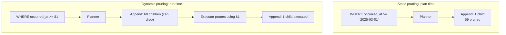
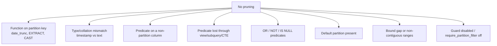

# Partition Pruning

> Partitioning splits one big table into many smaller physical tables that the database *knows* are
> disjoint. The entire payoff of partitioning rests on a single promise: a query that filters on the
> partition key reads **only the partitions it needs** and skips the rest. That skip is *partition
> pruning* (also called partition elimination), and it is the highest-leverage optimization in
> analytics: it turns a 570 GB scan into a 4 GB scan without an index, a materialized view, or a
> rewrite of the business logic. But pruning is *fragile*. Wrap the partition key in a function, cast
> it to another type, filter on a different column, forget to carry the predicate across a join, or
> query through a view that drops it — and pruning silently stops. There is no error; the query just
> gets 100× slower. This chapter teaches static vs dynamic pruning, partition elimination, partition-
> wise joins and aggregates, the exact expressions that block pruning, how the major engines differ,
> and how to prove, from the plan, whether pruning happened at all.

This chapter is where [predicate pushdown](./06-predicate-pushdown.md) meets the physical storage
layout, and it depends on [reading plans](./04-reading-an-execution-plan.md) to verify itself.

---

## TL;DR

- **Partition pruning = skipping whole partitions whose bounds cannot satisfy the predicate.** It is
  applied when the query filters on the **partition key** with a predicate the optimizer can evaluate
  against the partition's declared bounds.
- **Two flavors.** *Static (plan-time)* pruning: the predicate is a constant (`occurred_at >=
  '2025-03-01'`), so the plan literally omits the other partitions (`Subplans Removed: 59`). *Dynamic
  (run-time)* pruning: the predicate is a parameter or a value from another table, so the planner
  emits an `Append` that can drop partitions during execution (`Subplans Removed` appears with
  `loops`, or a `Dynamic`/`SubPlan` node appears).
- **A partition key predicate is prunable only if it is sargable on the key itself.** `WHERE
  occurred_at >= '2025-03-01' AND occurred_at < '2025-04-01'` prunes; `WHERE
  date_trunc('month', occurred_at) = '2025-03-01'`, `WHERE occurred_at::date = '2025-03-01'`, or
  `WHERE EXTRACT(year FROM occurred_at) = 2025` may prune only partially or not at all (newer
  Postgres can sometimes extract a range for a `date_trunc` on the partition key, but do not count on it).
- **The cast trap.** Partition by a `timestamptz` (or `date`) and compare against a `text`/`varchar`
  literal → the planner may not derive the partition range, so pruning fails. Keep the types identical
  end-to-end.
- **Pruning is lost the moment the predicate does not reach the partitioned scan.** A predicate in a
  subquery that was not flattened, or a filter above a `LIMIT`/`DISTINCT`, or a predicate on a
  *different* column, cannot prune.
- **Partition-wise joins/aggregates** partition the *work*: if two tables are partitioned on the same
  key and the join includes that key, the join runs partition-pair-by-partition-pair (no global
  shuffle/sort). PostgreSQL: `enable_partitionwise_join`, `enable_partitionwise_aggregate`.
- **In warehouses, pruning is metadata-driven.** Snowflake prunes micro-partitions by per-column
  `min`/`max`; BigQuery prunes partitions and columnar blocks; both report **partitions scanned**
  (Snowflake) or **bytes/records read** (BigQuery), which is your evidence.
- **In Spark/Parquet, pruning has three layers:** *partition pruning* (directory-based), *row-group
  pruning* (Parquet footer `min`/`max`), and **dynamic partition pruning (DPP)** (Spark 3.0+: the
  filter value from a broadcast dimension prunes the fact's partitions at runtime).
- **Why pruning silently fails, ranked:** a function/cast on the partition key; a predicate on a
  non-partition column; a predicate that does not traverse a view/CTE/subquery; a type mismatch that
  defeats bound comparison; a partition bound gap (a range with no partition ⇒ error or all
  partitions); and a "pruning guard" (BigQuery `require_partition_filter`) that you disabled.

---

## 1. Definitions and core concepts

| Term | Definition |
|---|---|
| **Partition** | A physical child table holding a disjoint subset of rows, defined by a **partition bound**. |
| **Partition key** | The column(s) whose value selects which partition a row belongs to. |
| **Partition bound / constraint** | The predicate that defines a partition (`FOR VALUES FROM … TO …` in Postgres, `VALUES LESS THAN` in MySQL/Oracle). |
| **Partition pruning / elimination** | Excluding partitions from the query's access plan because their bounds cannot satisfy the query predicate. |
| **Static pruning** | Pruning at plan time (predicate is a constant). Visible as omitted subplans / reduced `Append` children. |
| **Dynamic pruning** | Pruning at execution time (predicate is a parameter or subquery result). The `Append` starts with all children and drops them per execution. |
| **`constraint_exclusion`** | PostgreSQL's mechanism for using table constraints (including partition bounds) to exclude tables; `on`/`partition`(default)/`off`. Legacy for inheritance; declarative partitions use the planner's pruning directly. |
| **`enable_partition_pruning`** | PostgreSQL GUC (default `on`) controlling both plan-time and run-time pruning. |
| **Partition-wise join** | Joining two tables partitioned on the same key partition-by-partition. |
| **Partition-wise aggregate** | Aggregating each partition independently, then combining (partial → final). |
| **Sub-partitioning** | Partitioning a partition (e.g. range by month, then hash by tenant). |
| **Micro-partition (Snowflake)** | An immutable storage block (~50–500 MB) with per-column `min`/`max` metadata used for pruning. |
| **Clustering key (Snowflake)** | Columns you declare so that new micro-partitions group similar values, improving pruning. |
| **Row group (Parquet)** | A horizontal chunk of a Parquet file with per-column `min`/`max` statistics used for pruning. |
| **Dynamic partition pruning (DPP)** | Spark 3.0+ runtime pruning of the fact side using filter values discovered from the dimension side. |
| **Partition filter guard** | A warehouse setting that *requires* a partition predicate (BigQuery `require_partition_filter`) to prevent accidental full scans. |
| **Default partition** | A catch-all partition for rows matching no declared bound. It always blocks pruning for those rows and must itself be scanned when in doubt. |

> **Senior note:** a partition *bound* is a *constraint*, and pruning is constraint-based
> reasoning. Anything that prevents the planner from relating your predicate to the constraint —
> a function, a cast, a collation difference, a missing bound — disables pruning for that predicate.

### 1.1 Schema, indexes, and dataset

```sql
-- customers(customer_id, email, full_name, country_code, signup_date, loyalty_tier, is_active)
-- categories(category_id, name, parent_id)
-- products(product_id, sku, name, category_id, unit_price, cost, is_active, attributes, created_at)
-- orders(order_id, customer_id, status, order_ts, country_code, total_amount, currency)
-- order_items(order_item_id, order_id, product_id, quantity, unit_price, discount)
-- events(event_id, session_id, customer_id, event_type, occurred_at, payload)
--        PARTITION BY RANGE (occurred_at)          -- monthly partitions
```

The `events` table is the canonical partitioning example for this book:

```sql
-- Illustrative declarative partitioning (PostgreSQL) for the events table.
CREATE TABLE events (
    event_id    bigserial,
    session_id  uuid        NOT NULL,
    customer_id bigint,                     -- NULL for anonymous traffic
    event_type  text        NOT NULL,       -- page_view|add_to_cart|checkout|purchase
    occurred_at timestamptz NOT NULL,
    payload     jsonb,
    PRIMARY KEY (event_id, occurred_at)
) PARTITION BY RANGE (occurred_at);

-- One partition per month; the bound is the constraint that pruning reasons about.
CREATE TABLE events_2025_01 PARTITION OF events
    FOR VALUES FROM ('2025-01-01') TO ('2025-02-01');
CREATE TABLE events_2025_02 PARTITION OF events
    FOR VALUES FROM ('2025-02-01') TO ('2025-03-01');
CREATE TABLE events_2025_03 PARTITION OF events
    FOR VALUES FROM ('2025-03-01') TO ('2025-04-01');
-- … 57 more, one per month …
CREATE INDEX idx_events_session ON events (session_id, occurred_at DESC);
```

Volumes: `events` = 2,000,000,000 rows, ~570 GB, 60 monthly partitions (~9.5 GB each).
Cluster: PostgreSQL 16, `enable_partition_pruning = on`, `enable_partitionwise_join = off` (default),
`constraint_exclusion = partition` (default).

---

## 2. Why it matters / what problem it solves

### 2.1 60× fewer partitions = 60× less I/O

Query: "purchase events in March 2025."

```sql
SELECT count(*) FROM events
WHERE event_type = 'purchase'
  AND occurred_at >= '2025-03-01' AND occurred_at < '2025-04-01';
```

| Scenario | Partitions read | Rows read | Time (approx.) |
|---|---:|---:|---:|
| Pruning works | 1 of 60 | ~33 M | ~2 s |
| Pruning fails | 60 of 60 | 2,000 M | ~120 s |

The SQL is identical. Pruning is a 60× multiplier on this query and it costs nothing when it works.

### 2.2 Partitioning also makes maintenance, not just queries, cheaper

Partitioning is not only for reads:

- **Deleting old data** = `DROP TABLE events_2023_01` (instant metadata op) instead of
  `DELETE FROM events WHERE occurred_at < …` (millions of row versions, VACUUM, bloat).
- **Loading** = swap in a partition (`ATTACH`/`ALTER TABLE … DETACH`, or `EXCHANGE PARTITION`).
- **Vacuum/analyze** = per partition, so a hot month can be maintained without touching cold months.
- **Bulk-dropping a slice** = detach + drop.

These benefits are available even when pruning is imperfect, but pruning is the reason to filter on
the partition key.

### 2.3 Pruning is the anchor of the analytics cost model

In distributed warehouses, "how many partitions/blocks will I scan" *is* the cost model — there is no
B-tree to save you. Snowflake charges by bytes scanned; BigQuery bills by bytes scanned. A missing
partition filter on a 5 TB table is a 5 TB bill. This is why pruning (and its guard rails like
`require_partition_filter`) is the first thing a warehouse tuning guide teaches.

---

## 3. How it works internally

### 3.1 Partition bounds are constraints

Each partition carries a constraint derived from its bound. `events_2025_03` implicitly carries:

```
occurred_at >= '2025-03-01' AND occurred_at < '2025-04-01'
```

Pruning is theorem-proving: does the query predicate *contradict* the partition constraint?

```
query predicate:  occurred_at >= '2025-03-15' AND occurred_at < '2025-03-20'
partition bound:  occurred_at >= '2025-03-01' AND occurred_at < '2025-04-01'
contradiction?    no  → keep
```

versus for `events_2025_04`:

```
partition bound:  occurred_at >= '2025-04-01' AND occurred_at < '2025-05-01'
query predicate contradicts bound?  yes  → prune
```

The planner walks the list of partitions, tests each bound, and keeps only the survivors. With
partition-wise statistics, it can also estimate per-partition row counts.

### 3.2 Static pruning (plan time)

When the predicate is constant, pruning happens while planning, and the plan *omits* the pruned
partitions entirely:

```text
Aggregate  (cost=3412288.10..3412288.11 rows=1 width=8) (actual time=1901.2..1901.2 rows=1 loops=1)
  ->  Append  (cost=0.00..3395120.00 rows=33100000 width=0) (actual time=0.021..1802.0 rows=33100000 loops=1)
        Subplans Removed: 59
        ->  Seq Scan on events_2025_03  (cost=0.00..58000.00 rows=33100000 width=0) (...)
              Filter: (event_type = 'purchase'::text)
Planning Time: 3.412 ms
Execution Time: 1905.4 ms
```

`Subplans Removed: 59` is the receipt: 60 partitions, 59 eliminated at plan time.

### 3.3 Dynamic pruning (run time)

When the predicate is a **parameter** (`$1`, a prepared statement bind) or a **subquery** value that
is not known until execution, the planner cannot prune at plan time. Instead it produces an `Append`
that *can* drop children during execution — the `Subplans Removed` line then appears in
`EXPLAIN ANALYZE` (with loops) and is driven by the runtime value.

```sql
PREPARE ev (timestamptz, timestamptz) AS
SELECT count(*) FROM events WHERE occurred_at >= $1 AND occurred_at < $2;
EXECUTE ev('2025-03-01', '2025-04-01');
```

```text
Aggregate  (actual time=1901.2..1901.2 rows=1 loops=1)
  ->  Append  (actual time=0.015..1802.0 rows=33100000 loops=1)
        Subplans Removed: 59            <-- dropped at execution using the bound values
        ->  Seq Scan on events_2025_03  (...)
```



**A subtlety:** dynamic pruning adds a (small) planning cost and a run-time step, but it is essential
for prepared statements and parameterized BI tools. It is why "don't wrap the parameter in a function"
matters even more for dynamic pruning than for static.

### 3.4 Partition-wise joins and aggregates

When two tables are partitioned on the **same key** and the join predicate includes that key, the
join can be performed per partition pair. PostgreSQL requires opting in:

```sql
SET enable_partitionwise_join = on;
SET enable_partitionwise_aggregate = on;
```

```text
Append  (loops=1)
  ->  Hash Join  (...)      -- events_2025_01 ⋈ (something partitioned by month)
  ->  Hash Join  (...)      -- events_2025_02 ⋈ …
  ->  …                     -- one join per partition pair
```

Without partition-wise execution, the join may have to read all partitions on both sides and hash
across them — much more memory and no locality. Partition-wise aggregates similarly compute partial
aggregates per partition and combine.

**Distributed analog:** in Spark/Snowflake, co-partitioning both sides on the join key (Spark's
`bucketBy`, or a repartition on the key) lets the join run without a global shuffle — the network is
usually the dominant cost, so this is the biggest single win.

### 3.5 Sub-partitioning and bound gaps

You can partition hierarchically (range by month → hash by `customer_id`), which lets pruning apply
at the month level *and* parallelism apply at the hash level.

**Bound gaps** are the silent killer: if partitions cover January and March but not February, a query
for February either fails ("no partition for row") or — worse — has no partition to prune to and may
behave unexpectedly. **Overlapping or missing default partitions** similarly defeat pruning (the
default partition must always be considered unless the planner can prove the predicate excludes it).

### 3.6 Why pruning silently fails (the taxonomy)



| Cause | Example | Fix |
|---|---|---|
| Function on the key | `date_trunc('month', occurred_at) = '2025-03-01'` | Sargable half-open range |
| Cast on the key | `occurred_at::date = '2025-03-01'` | Compare as `timestamptz` range |
| Type mismatch | `occurred_at = '2025-03-01'` where column is `text`-typed key | Match types |
| Non-partition column | `WHERE session_id = …` (partitioned by time) | Sub-partition on the column, or accept scan |
| Lost through a layer | outer filter over a subquery with `DISTINCT`/`LIMIT` | Push the predicate into the scan |
| `OR`/`NOT` | `WHERE occurred_at >= X OR status = 'x'` | Rewrite as `UNION ALL` of prunable branches |
| Default partition | Rows for 2026 in the default partition | Add the partition; drop/replace the default |
| Boundary gap | No slot for February | `CREATE` the missing partition; validate |
| Guard off | BigQuery table without `require_partition_filter` | Turn the guard on |

> **Senior note:** pruning failures are *silent by design* — the query returns correct results, just
> slowly. The only reliable defense is to read the plan's partition count (`Subplans Removed`,
> Snowflake `Partitions scanned`, BigQuery `partitions scanned`, Spark `PartitionFilters`). Add that
> check to your review process for any query against a large partitioned table.

---

## 4. How to diagnose it

### 4.1 PostgreSQL

```sql
-- Static pruning: Subplans Removed appears without ANALYZE too (plan-time).
EXPLAIN (COSTS, VERBOSE) SELECT … FROM events WHERE occurred_at >= '2025-03-01' AND occurred_at < '2025-04-01';

-- Dynamic pruning: needs ANALYZE to show the run-time removal, or run EXPLAIN EXECUTE for a prepared stmt.
EXPLAIN (ANALYZE, BUFFERS) SELECT … FROM events WHERE occurred_at >= $1 AND occurred_at < $2;

-- Which partitions exist and their bounds:
SELECT child.relname, pg_get_expr(child.relpartbound, child.oid) AS bound
FROM pg_inherits i
JOIN pg_class parent ON parent.oid = i.inhparent
JOIN pg_class child  ON child.oid  = i.inhrelid
WHERE parent.relname = 'events'
ORDER BY child.relname;

-- Pruning knobs:
SHOW enable_partition_pruning;      -- must be on
SHOW enable_partitionwise_join;     -- off by default; on for partition-wise joins
SHOW enable_partitionwise_aggregate;
SHOW constraint_exclusion;          -- 'partition' default for declarative partitioning
```

**Prove-or-disprove checklist:**

- `Append` with `Subplans Removed: N` → pruning happened (N partitions dropped).
- `Append` with *every* partition listed and no `Subplans Removed` → pruning failed.
- `Filter: (date_trunc(...))` on each partition's scan → a function on the key blocked pruning.
- `Filter: ((occurred_at)::date = ...)` → a cast blocked pruning.
- `Filter: ((occurred_at)::text = '2025-03-01')` → a type mismatch blocked pruning.
- `Bitmap Heap Scan` inside `Append` vs `Seq Scan` → pruning worked; the access method per partition
  is separate.

### 4.2 MySQL

```sql
EXPLAIN SELECT … FROM orders WHERE order_ts >= '2025-03-01' AND order_ts < '2025-04-01';
-- In the "partitions" column of EXPLAIN, you see exactly which partitions are read:
--   partitions | p2025_01,p2025_02,p2025_03   -> pruning worked for the chosen range
```

- MySQL's `EXPLAIN` has a literal **`partitions`** column: pruned partitions are simply absent.
- `SHOW WARNINGS` may note "unable to use partition pruning" style limitations.
- `SHOW CREATE TABLE` shows the `PARTITION BY RANGE … VALUES LESS THAN` bounds.
- Pruning requires the partition-expression to be sargable; `PARTITION BY RANGE (TO_DAYS(ts))` adds
  an expression to the key, and predicates must be written to match it.

### 4.3 SQL Server

Partitioning is a property of an index (a *partition scheme*), and SQL Server does **partition
elimination** at plan time. The plan shows the "Actual Partition Count" / "Actual Partitions
Accessed" in the properties pane, and `sys.dm_db_partition_stats` gives per-partition rows. A
`Table Scan`/`Index Scan` over a partitioned index shows the number of partitions it touched; if
that equals the total, elimination failed. `SET STATISTICS IO` shows the pages read (proportional to
partitions accessed).

### 4.4 Oracle

`DBMS_XPLAN` prints a **`Pstart`/`Pstop`** pair per operation: the first and last partition numbers
accessed. `Pstart=Pstop=3` means exactly one partition (number 3). If `Pstart`/`Pstop` span all
partitions, pruning failed. Use:

```sql
SELECT * FROM TABLE(DBMS_XPLAN.DISPLAY_CURSOR(format => 'TYPICAL +PARTITION'));
```

`PARTITION RANGE ALL` means *all* partitions; `PARTITION RANGE SINGLE`/`ITERATOR` means pruning
worked. Partition bounds: `SELECT * FROM USER_TAB_PARTITIONS`.

### 4.5 Snowflake / BigQuery / Spark

- **Snowflake**: the Query Profile shows **`Partitions scanned` vs `Partitions total`** per table
  scan, plus `Bytes scanned`. If scanned == total, pruning failed — often because the filter is on an
  unclustered column. Fix with a **clustering key** on the filtered column.
- **BigQuery**: the query plan/execution details show `Number of partitions scanned` and
  `Bytes read`; a partition-pruned query reads a fraction of the table. `require_partition_filter=true`
  prevents the missing-filter case entirely.
- **Spark**: `df.explain("formatted")` → `PartitionFilters` (directory-level), `PushedFilters`
  (row-group level), and `DynamicPruningExpression` (DPP). Also confirm with
  `spark.sql.sources.partitionColumnTypeInference.enabled` and by counting files read in the UI.

---

## 5. Worked examples (slow query → plan → diagnosis → fix)

### Example 1 — A function on the partition key silently disables pruning

**The report:** "the monthly funnel report takes two minutes; it should be seconds."

```sql
-- SLOW
SELECT date_trunc('day', occurred_at) AS d, count(*) AS purchases
FROM events
WHERE event_type = 'purchase'
  AND date_trunc('month', occurred_at) = DATE '2025-03-01'
GROUP BY 1;
```

```text
GroupAggregate  (cost=68255120.10..68300000.00 rows=31 width=16) (actual time=118900.4..119200.0 rows=31 loops=1)
  ->  Sort  (cost=68255120.10..68255430.00 rows=123000 width=16) (...)
        Sort Method: external merge  Disk: 2124000kB
        ->  Append  (cost=0.00..68001120.00 rows=123000000 width=16) (actual time=... rows=123000000 loops=1)
              ->  Seq Scan on events_2025_01  (... Filter: (date_trunc('month', occurred_at) = '2025-03-01'))
              ->  Seq Scan on events_2025_02  (... Filter: (date_trunc('month', occurred_at) = '2025-03-01'))
              ->  Seq Scan on events_2025_03  (... Filter: (date_trunc('month', occurred_at) = '2025-03-01'))
              ->  …  (57 more partitions, all scanned)
Planning Time: 8.9 ms
Execution Time: 119204.1 ms
```

**Diagnosis.**
- The `Append` has **no `Subplans Removed`** and lists every partition. Pruning failed.
- The evidence is in each partition's `Filter: (date_trunc('month', occurred_at) = '2025-03-01')`:
  the predicate is a **function of the partition key**, not the partition key itself. The planner
  cannot relate `date_trunc('month', occurred_at) = X` to the bound `occurred_at ∈ [2025-03-01,
  2025-04-01)` — at least not reliably across versions.
- Result: all 60 partitions scanned (`~2 B rows`), a **2 GB disk sort**, and 119 s.

**Fix — rewrite as a sargable half-open range on the key:**

```sql
SELECT date_trunc('day', occurred_at) AS d, count(*) AS purchases
FROM events
WHERE event_type = 'purchase'
  AND occurred_at >= DATE '2025-03-01'
  AND occurred_at <  DATE '2025-04-01'      -- half-open interval on the partition key
GROUP BY 1;
```

```text
GroupAggregate  (cost=3412288.10..3412291.20 rows=31 width=16) (actual time=1801.2..1803.0 rows=31 loops=1)
  ->  Sort  (cost=3412288.10..3412288.90 rows=3200 width=16) (actual time=1801.0..1801.1 rows=31 loops=1)
        Sort Method: quicksort  Memory: 27kB
        ->  Append  (cost=0.00..3410000.00 rows=123000000 width=16) (actual time=0.02..1770.0 rows=33000000 loops=1)
              Subplans Removed: 59
              ->  Seq Scan on events_2025_03  (... Filter: (event_type = 'purchase'))
Planning Time: 4.1 ms
Execution Time: 1805.6 ms
```

**119,204 ms → 1,806 ms (~66×).** `Subplans Removed: 59` proves pruning now works; the sort is a
27 kB quicksort instead of a 2 GB spill.

> **Senior note:** the fix is the same "sargable" rewrite as in [Chapter 03](./03-why-an-index-is-ignored.md),
> but here the cost is *partition-count*-sized, not index-page-sized. On a table partitioned by day
> instead of month, the same bug is a 365× I/O multiplier.

---

### Example 2 — Cast and type mismatch defeat pruning

**The report:** "the daily order count query is slow; the partition filter 'looks right'."

```sql
-- SLOW: order_ts is timestamptz; the literal is text and gets cast
SELECT count(*) FROM orders
WHERE order_ts::date = DATE '2025-03-15';
```

```text
Aggregate  (cost=… ) (actual time=… )
  ->  Append  (…)                        -- no Subplans Removed: every month scanned
        ->  Seq Scan on orders_2025_01  (... Filter: ((order_ts)::date = '2025-03-15'))
        ->  Seq Scan on orders_2025_02  (... Filter: ((order_ts)::date = '2025-03-15'))
        ->  …  (10 more months)
```

**Diagnosis.** `order_ts::date = '2025-03-15'` casts the **column** to `date`. The planner would have
to *invert* the cast to derive the partition range `[2025-03-15 00:00, 2025-03-16 00:00)`, which it
does not do. So it scans all 12 monthly partitions and filters each.

**Fix — a half-open range on the raw column:**

```sql
SELECT count(*) FROM orders
WHERE order_ts >= TIMESTAMPTZ '2025-03-15 00:00:00+00'
  AND order_ts <  TIMESTAMPTZ '2025-03-16 00:00:00+00';
```

```text
Aggregate  (actual time=120.4..120.4 rows=1 loops=1)
  ->  Append  (actual time=0.015..118.0 rows=1.36e6 loops=1)
        Subplans Removed: 11
        ->  Index Only Scan using idx_orders_ts on orders_2025_03  (...)
              Index Cond: (order_ts >= '2025-03-15' AND order_ts < '2025-03-16')
```

`Subplans Removed: 11` = 11 of 12 months pruned. This is also a **type lesson**: compare
`timestamptz` to `timestamptz`, never to `text`.

> **Senior note:** the general rule is "do not apply a function or cast to the partition key; apply
> the transformation to the constant instead." `date_trunc('month', order_ts) >= x` → rewrite to
> `order_ts >= date_trunc('month', x)`. Always move the function to the *right* side.

---

### Example 3 — Pruning lost through a subquery / CTE barrier

**The report:** "the per-country engagement report is slow, but the filter is on the partition key."

```sql
-- SLOW: DISTINCT in the subquery is a pushdown barrier; the partition predicate cannot reach the scan
SELECT count(*)
FROM (
    SELECT DISTINCT session_id, occurred_at FROM events
) e
WHERE e.occurred_at >= '2025-03-01' AND e.occurred_at < '2025-04-01';
```

```text
Aggregate  (actual time=… )
  ->  HashAggregate  (...)
        ->  Append  (...)                    -- no Subplans Removed: all partitions read
              ->  Seq Scan on events_2025_01
              ->  Seq Scan on events_2025_02
              ->  …
```

**Diagnosis.** The `DISTINCT` (HashAggregate) is a **pushdown barrier**: the outer `occurred_at`
filter cannot cross it to reach the partitioned scan, so the `Append` reads every partition and
deduplicates across all of them before filtering. This is [Chapter 06](./06-predicate-pushdown.md)'s
lesson applied to partitions.

**Fix — push the partition predicate inside the subquery:**

```sql
SELECT count(*)
FROM (
    SELECT DISTINCT session_id, occurred_at FROM events
    WHERE occurred_at >= '2025-03-01' AND occurred_at < '2025-04-01'   -- push it down
) e;
```

```text
Aggregate  (actual time=2100.0..2100.0 rows=1 loops=1)
  ->  HashAggregate  (... ) (actual rows=42000000 loops=1)
        ->  Append  (...)
              Subplans Removed: 59
              ->  Seq Scan on events_2025_03  (...)
```

**Fix (better) — remove the barrier with a semi join / `EXISTS`** if all you need is existence.

> **Senior note:** the partition predicate must *reach the partitioned relation*. Any barrier between
> the filter and the scan (a `DISTINCT`, `GROUP BY`, `LIMIT`, window, `MATERIALIZED` CTE, or outer
> join's preserved side) blocks both pushdown and pruning. Push the predicate down, or remove the
> barrier.

---

### Example 4 — Dynamic pruning with a prepared statement

**The report:** "our Java app uses a prepared statement and the query is always slow."

```sql
-- The app binds $1/$2 at execution; the planner sees placeholders, not values.
SELECT count(*), event_type
FROM events
WHERE occurred_at >= $1 AND occurred_at < $2
GROUP BY event_type;
```

```text
GroupAggregate  (cost=… rows=24 width=24) (actual time=1901.2..1903.0 rows=4 loops=1)
  ->  Append  (cost=0.00..3395120.00 rows=33100000 width=24) (actual time=0.021..1802.0 rows=33100000 loops=1)
        Subplans Removed: 59            <-- dynamic pruning fired at execution
        ->  Seq Scan on events_2025_03  (...)
Planning Time: 4.4 ms
Execution Time: 1907.0 ms
```

**Diagnosis.** Dynamic pruning *is* working (`Subplans Removed: 59` appears once `ANALYZE` runs,
because the executor knows `$1`/`$2`). If it were *not*, the plan would list all 60 partitions and
`Execution Time` would be ~60× higher.

**What breaks dynamic pruning:**

- The parameter wrapped in a function (`date_trunc('month', occurred_at) >= $1`) — no bound derivation.
- A prepared statement that was planned with a *generic* plan whose `Append` cannot drop children.
- `enable_partition_pruning = off`.

**Verify by comparing:**

```sql
-- Static vs dynamic must agree on which partitions are read.
EXPLAIN (ANALYZE) SELECT count(*) FROM events WHERE occurred_at >= '2025-03-01' AND occurred_at < '2025-04-01';
EXPLAIN (ANALYZE) EXECUTE ev('2025-03-01', '2025-04-01');
```

> **Senior note:** prepared statements do not inherently block pruning — modern PostgreSQL does
> *runtime* pruning. But they do block the *static* uint that produces per-partition statistics, so
> the estimate may be less precise. If the query is high-value, a custom plan
> (`plan_cache_mode = force_custom_plan`) can restore static pruning.

---

### Example 5 — Snowflake: pruning needs clustering, not just partitioning

**The report:** "our `orders` snowflake table is filtered by `order_date` but queries scan everything."

```sql
SELECT count(*)
FROM orders_sf
WHERE order_date >= '2025-03-01' AND order_date < '2025-04-01';
```

In Query Profile, if the table is loaded in arrival order (and not clustered by `order_date`), the
date range is spread across *all* micro-partitions, so **`Partitions scanned ≈ Partitions total`**.

**Diagnosis.** Snowflake has no declarative partitions; pruning uses **min/max metadata per
micro-partition**. If data arrives unsorted, a value range spans many micro-partitions, and min/max
cannot skip them.

**Fix — declare a clustering key on the filter column:**

```sql
ALTER TABLE orders_sf CLUSTER BY (order_date);
```

Snowflake then organizes new micro-partitions so `order_date` values are grouped, and min/max pruning
can skip most of them. Re-verify `Partitions scanned` in Query Profile.

**Lesson:** "pruning" in Snowflake/BigQuery is about **physical co-location** of the filtered values
(clustering / ingestion order), not a declared range partition. The predicate is the same; the
mechanism differs.

---

### Example 6 — Spark: partition pruning, row-group pruning, and DPP

```python
# Directory-partitioned Parquet: /events/year=2025/month=03/part-*.parquet
df = spark.read.parquet("s3://lake/events")
df.createOrReplaceTempView("events")

spark.sql("""
  SELECT count(*)
  FROM events
  WHERE year = 2025 AND month = 3 AND event_type = 'purchase'
""").explain("formatted")
```

```text
== Physical Plan ==
*(2) HashAggregate(...)
+- Exchange SinglePartition
   +- *(1) HashAggregate(...)
      +- *(1) Project
         +- *(1) Filter (isnotnull(event_type) AND (event_type = purchase))
            +- *(1) ColumnarToRow
               +- FileScan parquet events[…]
                    PartitionFilters: [isnotnull(year), (year = 2025), isnotnull(month), (month = 3)]
                    PushedFilters:   [IsNotNull(event_type), EqualTo(event_type,purchase)]
                    DataFilters:     []
```

**Diagnosis and the three layers of pruning:**

1. **`PartitionFilters`** = directory-level pruning: only `year=2025/month=3/` directories are read.
   This is Spark's version of classic partition pruning.
2. **`PushedFilters`** = Parquet **row-group** pruning using per-column `min`/`max` in the file
   footer. If `event_type` appeared in `DataFilters` (not `PushedFilters`), the reader could not
   evaluate it and it was applied after the scan.
3. **DPP** appears when a *join* supplies the filter value:

```sql
-- Fact partitioned by date_key; dimension filtered by year. Spark prunes fact partitions at runtime.
SELECT f.*
FROM fact_sales f
JOIN dim_date   d ON f.date_key = d.date_key
WHERE d.year = 2025;
```

```text
+- BroadcastHashJoin [date_key], [date_key]
   :- FileScan parquet fact_sales[…]
        PartitionFilters: [DynamicPruningExpression(date_key IN ...)]
   +- BroadcastExchange …
      +- Filter (year = 2025) … dim_date
```

`DynamicPruningExpression` means Spark will broadcast the 2025 `date_key` set and read only the
matching fact partitions.

**Why DPP fails:** the join is not a broadcast join (dimension too big), `spark.sql.optimizer
.dynamicPartitionPruning.enabled=false`, the fact is not partitioned on the join key, or the filter
is on a column the dimension cannot project. When DPP is unavailable, **filter the fact directly** —
the always-safe fallback.

---

## 6. Real-world use cases and applications

| Scenario | Partitioning + pruning pattern |
|---|---|
| **Event analytics (clickstream)** | Range by month/day on `occurred_at`; prune by time window |
| **Financial ledger** | Range by `posting_date`; drop old partitions for retention |
| **Multi-tenant SaaS** | Hash (or list) by `tenant_id`; sub-partition by date |
| **IoT telemetry** | Range by day; sub-partition by device hash |
| **Data lake (Parquet/Hive)** | Directory partitions by `dt`; row-group min/max pushdown |
| **Snowflake/BigQuery fact tables** | Clustering key (Snowflake) / partition column (BigQuery) |
| **Spark joins fact ⋈ dim** | DPP prunes the fact via the dimension's filter |
| **Retention / archival** | `DETACH`/`DROP PARTITION` instead of `DELETE` |
| **Cost control in the cloud** | Partition filters cap bytes-scanned (the billing metric) |
| **CDC ingestion** | Partition by event date; swap in the new day's partition |

---

## 7. Patterns and anti-patterns

**Patterns:**
- Choose the partition key to match your **dominant filter**: time for event data, `tenant_id` for
  multi-tenant, region for geo.
- Always filter with a **sargable, half-open range** on the partition key: `key >= lo AND key < hi`.
- Keep **dates as dates** end-to-end; never compare a key to a `text` literal.
- Push the partition predicate **into** any subquery/CTE/view that would otherwise act as a barrier.
- Enable **partition-wise joins/aggregates** when you join co-partitioned tables.
- In warehouses, **cluster** on the filtered column and verify `Partitions scanned`.
- In Spark, rely on `PartitionFilters` + `PushedFilters` + DPP; keep the DPP-enabled settings on.
- Use `DETACH`/`DROP PARTITION` for retention — never `DELETE` millions of rows.
- Turn on **partition-filter guards** (BigQuery `require_partition_filter`) where available.

**Anti-patterns:**
- Function or cast **on** the partition key in the predicate.
- Filtering a partitioned table by a **non-key column** and expecting pruning.
- Comparing a `timestamptz`/`date` key to `text`.
- Losing the predicate across a `DISTINCT`/`LIMIT`/`GROUP BY` barrier.
- `OR` between a prunable and a non-prunable condition (rewrite as `UNION ALL`).
- Relying on the **default partition** for current data (it always blocks pruning for that range).
- Leaving **gaps** between partitions.
- Over-partitioning (thousands of tiny partitions) → planner overhead and small-file problems.
- Assuming a partition key filters everything — sub-partition or index the other predicates.

**Decoder: why didn't it prune?**

| Symptom | Cause | Fix |
|---|---|---|
| `Append` with no `Subplans Removed`, all partitions listed | Function/cast on key, or predicate didn't reach the scan | Sargable rewrite / push predicate down |
| `Filter: (date_trunc(...))` per partition | Function on the key | Half-open range on the key |
| `Filter: ((key)::text = ...)` | Type mismatch | Compare as the key's type |
| Pruning works for constants but not parameters | Dynamic pruning disabled/blocked | Check `enable_partition_pruning`; avoid functions on the parameter |
| Snowflake `Partitions scanned == total` | No clustering on the filtered column | `ALTER TABLE … CLUSTER BY` |
| BigQuery scanning the whole table | No partition filter | Add it; set `require_partition_filter` |
| Spark no `PartitionFilters` | Filter on a non-partition column, or a type mismatch | Partition/cluster on the column |
| Oracle `PARTITION RANGE ALL` | Predicate not prunable | Rewrite / check bounds and casts |

---

## 8. Cross-engine differences

| Aspect | PostgreSQL | MySQL 8.0 | SQL Server | Oracle | Snowflake | BigQuery | Spark SQL |
|---|---|---|---|---|---|---|---|
| Declarative partitioning | Yes (`PARTITION BY RANGE/LIST/HASH`) | Yes (RANGE/LIST/HASH/KEY) | Partition scheme on indexes | Yes (RANGE/LIST/HASH, composite) | No (micro-partitions) | Yes (time/int range, ingestion-time) | Directory/manifest partitions |
| Pruning mechanism | Bounds as constraints | Partition pruning | Partition elimination | Partition pruning (`Pstart`/`Pstop`) | Micro-partition `min`/`max` | Partition + block pruning | PartitionFilters + PushedFilters + DPP |
| Static pruning evidence | `Subplans Removed` | `EXPLAIN` `partitions` column | "Partitions Accessed" in plan | `Pstart`/`Pstop` numbers | `Partitions scanned / total` | `partitions scanned` | `PartitionFilters` |
| Dynamic pruning | Yes (run-time `Subplans Removed`) | Yes (pruning with params) | Yes (with parameters) | Yes (bind-aware) | N/A (metadata) | N/A (metadata) | **DPP** (3.0+) |
| Function-on-key behavior | Usually blocks (some `date_trunc` cases improved) | Blocks unless partition expr matches | Blocks | Blocks unless virtual column | Clustering decides | Partition expr must match | Blocks row-group pruning |
| Partition-wise joins | Opt-in (`enable_partitionwise_join`) | Limited | Yes (aligned partitions) | Yes (partition-wise join) | Co-clustering | N/A | Co-partitioned/bucketed joins |
| Partition-wise aggregates | Opt-in (`enable_partitionwise_aggregate`) | Yes (per partition) | Yes | Yes | Automatic | Automatic | Per-partition aggregation |
| Gap handling | Insert fails without a matching partition | Insert fails | Partition scheme must cover | Fails / `MAXVALUE` | N/A | N/A | N/A |
| Retention by `DROP PARTITION` | `DETACH` + `DROP` | `DROP PARTITION` | Switch out / truncate partition | `DROP PARTITION` | `DELETE`/Time Travel/`DROP` | `DROP PARTITION`/`DELETE` | Delete directories / `DROP PARTITION` |
| Guard rails | — | — | — | — | — | `require_partition_filter` | — |
| Overhead if over-partitioned | Planner time, many `Append` children | Many partitions | Many partitions | Many partitions | small-file/churn | small-file limits | **small-file problem** |

Notes worth knowing:

- **PostgreSQL** can, in some cases, derive a range for `date_trunc`/equality on the partition key
  (improvements landed across versions), but this is not guaranteed for arbitrary functions — always
  prefer the explicit range.
- **MySQL** literally prints which partitions it read in the `partitions` column of `EXPLAIN` — the
  easiest pruning-evidence of any engine.
- **Oracle** uses partition *numbers* (`Pstart`/`Pstop`); learning to read them is the fastest way to
  confirm or deny pruning in a huge warehouse.
- **Snowflake/BigQuery** do not have "partitions" in the declarative sense for Snowflake; pruning is
  metadata-based and clustering-driven, so the lever is `CLUSTER BY`, not partition bounds.
- **Spark** has the richest pruning story (three layers + DPP) and the worst failure mode
  (small files from over-partitioning). Aim for ~100 MB–1 GB files per partition.

---

## 9. Exercises — Intermediate (hints only)

1. **Prune or not?** For `occured_at >= '2025-03-01' AND occurred_at < '2025-04-01'` on monthly
   partitions, how many partitions are read? Rewrite `date_trunc('month', occurred_at) = '2025-03-01'`
   into a prunable form. *Hint:* half-open range; `Subplans Removed`.

2. **Read the plan.** Given `Append` with `Subplans Removed: 59` for a 60-partition table, how many
   partitions were read, and was pruning static or dynamic? *Hint:* 1; dynamic requires `ANALYZE`.

3. **Cast trap.** Why does `order_ts::date = '2025-03-15'` fail to prune? Rewrite it. *Hint:* cast on
   the column; compare `timestamptz`.

4. **Type trap.** `occurred_at = '2025-03-01'` where `occurred_at` is `timestamptz` — does it prune?
   Does it even match the right rows? *Hint:* the literal is cast, not the column — but midnight vs
   the whole day is a different bug.

5. **MySQL evidence.** Which `EXPLAIN` column tells you exactly which partitions were read?
   *Hint:* `partitions`.

6. **Snowflake.** A query scans all micro-partitions despite a `WHERE` on `order_date`. What single
   DDL change improves pruning? *Hint:* `CLUSTER BY`.

7. **Spark layers.** Name the plan line for (a) directory pruning, (b) row-group pruning, (c) DPP.
   *Hint:* `PartitionFilters`, `PushedFilters`, `DynamicPruningExpression`.

8. **Barrier.** A partition predicate sits above a `LIMIT` subquery and does not prune. Why, and how
   do you push it down? *Hint:* `LIMIT` is a barrier; filter inside.

9. **Default partition.** Why does having a `DEFAULT` partition prevent pruning for the "current"
   range? *Hint:* the planner must scan it unless it can prove exclusion.

10. **Retention.** Replace `DELETE FROM events WHERE occurred_at < '2024-01-01'` (400 M rows) with a
    cheap partition operation. *Hint:* `DETACH` + `DROP`.

---

## 10. Exercises — Advanced (hints / expected approach, no full inline answers)

**10.1 Given this plan, what is wrong and how do you fix it?**

```text
GroupAggregate  (cost=68255120.10..68300000.00 rows=31 width=16) (actual time=118900.4..119200.0 rows=31 loops=1)
  ->  Sort  (…) (Sort Method: external merge  Disk: 2124000kB)
        ->  Append  (cost=0.00..68001120.00 rows=123000000 width=16) (... )
              ->  Seq Scan on events_2025_01  (... Filter: (date_trunc('month', occurred_at) = '2025-03-01'))
              ->  Seq Scan on events_2025_02  (... Filter: (date_trunc('month', occurred_at) = '2025-03-01'))
              ->  Seq Scan on events_2025_03  (... Filter: (date_trunc('month', occurred_at) = '2025-03-01'))
              ->  …  (57 more)
```

*Expected approach:* the `Append` has no `Subplans Removed`, and every partition carries the same
`Filter` — a function on the partition key blocked pruning, so all 60 partitions are scanned and the
result is sorted with a 2 GB spill. Fix by rewriting the predicate as a half-open range on
`occurred_at` (the function moves to the constant side). Predict the plan change
(`Subplans Removed: 59`, quicksort instead of external merge) and quantify. Discuss why the
generic-`date_trunc`-pruning improvement in PostgreSQL is not something to rely on.

**10.2 Given this plan, what is wrong and how do you fix it?**

```text
Aggregate  (actual time=… )
  ->  HashAggregate  (…)
        ->  Append  (…)                    -- no Subplans Removed; all partitions read
              ->  Seq Scan on events_2025_01
              ->  Seq Scan on events_2025_02
              ->  …
```

The SQL was `SELECT count(*) FROM (SELECT DISTINCT session_id, occurred_at FROM events) e WHERE e.occurred_at >= '2025-03-01' AND e.occurred_at < '2025-04-01'`.

*Expected approach:* the `DISTINCT` (HashAggregate) is a pushdown barrier; the outer predicate cannot
reach the partitioned scan, so all partitions are read and deduplicated before filtering. Fix by
pushing the predicate *inside* the subquery (and, if possible, replacing `DISTINCT` with `EXISTS`/a
semi join to remove the barrier entirely). Explain why the barrier exists and how `MATERIALIZED` CTEs
would make it worse. *Hint:* pruning needs the predicate to *traverse* to the partitioned relation.

**10.3** A multi-tenant table is partitioned by month and queried by `tenant_id` and a date range.
Design the partitioning (including sub-partitioning) that maximizes pruning for the dominant queries,
and identify the queries that still cannot prune. *Expected approach:* composite partitioning — range
by month (prunes the date range), then hash/list by `tenant_id` (prunes/parallelizes by tenant). Then
enumerate which queries prune: those filtering the month (all tenants) or a single tenant+month;
which cannot: a query filtering only `tenant_id` across all time (must touch every month's tenant
partition) — fix by indexing or by a tenant-first layout. Discuss trade-offs (number of partitions,
planner overhead, small partitions). *Hint:* composite partition → `Subplans Removed` can drop both
levels.

**10.4** Snowflake: a 5 TB fact table filtered by `order_date` scans the whole table. Explain why,
and design a clustering strategy that fixes it for the top-k query patterns (including a second
common filter, `region`). *Expected approach:* pruning uses micro-partition min/max; without
clustering, a date range spans all micro-partitions. Cluster by `(order_date, region)` (order matters:
the leading column is the primary pruning dimension) or `(region, order_date)` depending on which
filter is more selective/dominant. Discuss clustering cost, automatic clustering, and how to verify
with `Partitions scanned`. *Hint:* clustering is *physical co-location*, the warehouse analogue of a
range partition.

**10.5** Spark: a fact–dimension join does NOT get DPP even though the dimension is small and
filtered. Enumerate every reason and how you would verify/fix each. *Expected approach:* (i) the join
is not a broadcast join (dimension above the 10 MB `autoBroadcastJoinThreshold` or a hint forced a
merge join) → broadcast it; (ii) `spark.sql.optimizer.dynamicPartitionPruning.enabled=false` →
enable; (iii) the fact is not partitioned on the join key → repartition/bucket; (iv) the join key and
partition column mismatch; (v) the AQE setting or a skewed join rule disabled it. Verify in
`df.explain`/the SQL UI. *Hint:* the fallback is always to filter the fact directly.

**10.6** A pipeline over-partitions an event table by `(year, month, day, hour, tenant)` producing
millions of tiny files. Explain the resulting failure (small-file problem, planner overhead, poor
pruning per file), and redesign the layout. *Expected approach:* too many partitions → (a) metadata
and listing overhead, (b) tiny files with poor compression and high per-file overhead, (c) pruning
that skips files but still pays huge listing costs, (d) Snowflake/Spark small-file penalties. Redesign:
partition by day (or month) only, cluster/sort within partitions (Parquet row groups, Z-order/`OPTIMIZE`),
use bucketing for tenant, and target ~100 MB–1 GB files. Discuss `OPTIMIZE`/compaction and `bucketBy`.
*Hint:* more partitions is not more pruning when the pruning dimension is rarely filtered.

---

## References

- PostgreSQL: **Table Partitioning (incl. Partition Pruning, partition-wise join)** — https://www.postgresql.org/docs/current/ddl-partitioning.html
- PostgreSQL: **Planner method config (`enable_partition_pruning`, `enable_partitionwise_join`, `constraint_exclusion`)** — https://www.postgresql.org/docs/current/runtime-config-query.html
- PostgreSQL: **Query Planning (pruning overview)** — https://www.postgresql.org/docs/current/runtime-config-query.html
- PostgreSQL: **`pg_inherits` / `pg_class` (partition catalog)** — https://www.postgresql.org/docs/current/catalog-pg-inherits.html
- MySQL: **Partitioning (RANGE/LIST/HASH/KEY, pruning)** — https://dev.mysql.com/doc/refman/8.0/en/partitioning.html
- MySQL: **Partition pruning** — https://dev.mysql.com/doc/refman/8.0/en/partitioning-pruning.html
- Microsoft: **Partitioned tables and indexes / partition elimination** — https://learn.microsoft.com/en-us/sql/relational-databases/partitions/partitioned-tables-and-indexes
- Oracle: **Partition Pruning** — https://docs.oracle.com/en/database/oracle/oracle-database/19/vldbg/partition-pruning.html
- Oracle: **Partitioning for Availability, Manageability, and Performance** — https://docs.oracle.com/en/database/oracle/oracle-database/23/vldbg/partition-pruning.html
- Snowflake: **Micro-partitions & Data Clustering** — https://docs.snowflake.com/en/user-guide/tables-clustering-micropartitions
- Snowflake: **Optimizing query performance (pruning, search optimization)** — https://docs.snowflake.com/en/user-guide/performance-query-options
- Snowflake: **Query Profile** — https://docs.snowflake.com/en/user-guide/ui-query-profile
- BigQuery: **Query partitioned tables (pruning, `require_partition_filter`)** — https://cloud.google.com/bigquery/docs/querying-partitioned-tables
- BigQuery: **Introduction to partitioned tables** — https://cloud.google.com/bigquery/docs/partitioned-tables
- BigQuery: **Optimize query computation** — https://cloud.google.com/bigquery/docs/best-practices-performance-compute
- Apache Spark: **Performance Tuning (partition pruning, bucketing, AQE)** — https://spark.apache.org/docs/latest/sql-performance-tuning.html
- Databricks: **Dynamic partition pruning** — https://docs.databricks.com/aws/en/optimizations/dynamic-file-pruning
- Databricks: **Liquid clustering / OPTIMIZE** — https://docs.databricks.com/aws/en/tables/liquid-clustering
- Trino: **Partitioning and pruning** — https://trino.io/docs/current/connector/hive.html
- AWS: **Pruning dynamic partitions in Spark** — https://docs.aws.amazon.com/prescriptive-guidance/latest/spark-tuning-glue-emr/pruning-dynamic-partitions.html
