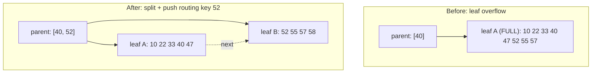
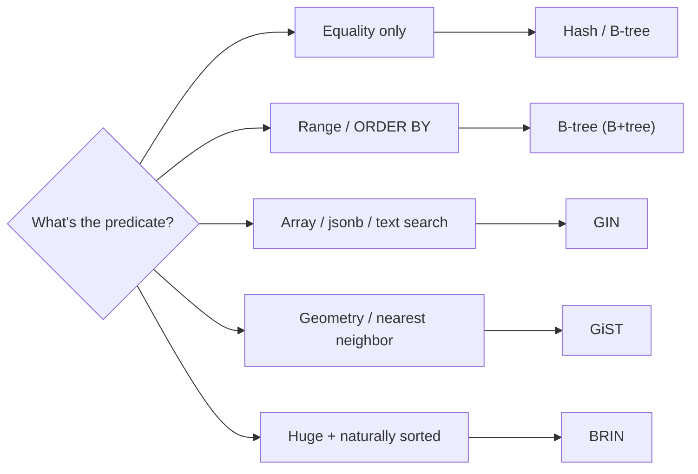

# B-Tree Indexes — From the Ground Up

> Almost every index you have ever used is a B-tree — or a B+tree, to be precise — and almost
> every performance mystery you will ever debug reduces to four numbers: **page size, key size,
> fanout, and height**. This chapter builds the whole structure from nothing: a sorted array, then
> binary search, then the balanced binary search tree (why it dies on disk), then the B-tree (why
> it survives), then the on-disk page and slot layout, node capacity, search/insert/delete, page
> splits and merges, the linked leaf level that makes range scans cheap, and finally the practical
> consequences (index size, tree height, and why a low-cardinality leading column poisons a
> composite index). By the end you should be able to compute, on the back of an envelope, how many
> page reads a lookup costs on a 1-billion-row table — and explain why the answer is usually 3.

## TL;DR

- A sorted array gives O(log n) **comparisons** but O(n) **inserts** — and on disk, a "comparison"
  is a page read.
- A balanced BST has O(log₂ n) height (≈ 27 for 100M nodes); each node is one random page read →
  ~27 I/Os per lookup. Catastrophic on spinning disk, and cache-hostile on SSD.
- A **B-tree** is a *multi-way* search tree: each node is one **page** and holds hundreds of
  keys, so fanout is 100s–1000s and height collapses to **3–4 levels for hundreds of millions of
  rows**.
- A **B+tree** (what all four engines actually implement) stores data **only in the leaves** and
  links leaves into a doubly linked list → cheap ordered range scans and sequential prefetch.
- Nodes **split** on insert when full and **merge/redistribute** on delete when underfull; the tree
  stays balanced by construction.
- **Cost of a lookup** ≈ `height × (1 page read)` + matching leaf rows + (heap fetches if not
  covering). With everything cached, a point lookup is microseconds; cold, it is ~3–5 random I/Os.
- **Fanout** = `⌊page_size / (key_size + pointer_size)⌋`. Wider keys ⇒ lower fanout ⇒ taller tree,
  and (worse) fatter leaves ⇒ more I/O per scan.
- **B-tree vs B+tree:** a textbook B-tree stores data in internal nodes too; a B+tree does not, which
  is why databases use B+tree. "B \* -tree" (Knuth's variant, split 2→3) further improves *density*.
- Alternatives each solve a different problem: **hash** (equality only), **GIN** (composites/arrays/
  full-text), **GiST** (geometry/ranges), **BRIN** (huge, naturally-ordered tables), **bitmap**
  (Oracle low-cardinality analytics).

---

## 1. Definitions and core concepts (from first principles)

### 1.1 Step 1 — a sorted array

The simplest index is a sorted array of keys with pointers to rows:

```
keys:   [ 3, 7, 12, 19, 25, 33, 41, 58, 60, 74, 88, ... ]
rows:   [ r3, r7, r12, r19, ... ]           (parallel array of row locations)
```

Binary search finds any key in ⌈log₂ n⌉ comparisons: 100 million keys → 27 comparisons. Excellent.
But an **insert** into the middle shifts everything after it: O(n). On disk that is a write
amplification disaster. And a *range* query (keys 19..60) that returns 1–3 keys still touches its
neighbors cheaply — good. The killer is maintenance.

### 1.2 Step 2 — a binary search tree

Replace the array with a linked tree so inserts never shift:

```
                    (25)
                   /    \
                (12)     (41)
               /   \     /   \
             (7)  (19) (33)  (58)
```

Search is O(height). Insert is O(height). But a *naive* BST degenerates into a linked list if you
insert sorted keys in order (which databases do all the time!):

```
(3)─(7)─(12)─(19)─(25)─(33)─...   ← height = n
```

### 1.3 Step 3 — a *balanced* BST (AVL / red-black)

Rotations keep the height O(log₂ n): ⌈log₂ 100M⌉ ≈ 27.

```
        (41)
       /    \
     (19)     (60)
     /  \     /  \
   (7)  (25)(58) (88)
```

Better — but two fatal problems on disk:

1. **Pointer chasing.** Each node is a *separate* heap allocation. In memory, following 27 pointers
   is fine (nanoseconds, mostly L1/L2 cache). On disk, a node is a different page → **27 random
   page reads per lookup**.
2. **Low fanout.** A binary node has ≤ 2 children, so height grows logarithmically with a *big*
   base-2 constant. To store 10⁹ keys you need 10⁹ nodes; even in RAM that is enormous.

> **Senior note:** The B-tree does not exist to be asymptotically better than a balanced BST — both
> are O(log n). It exists because it **matches the memory hierarchy**: on disk, the unit of transfer
> is a *page* (8–16 KiB), so you want a node that consumes exactly one page and holds hundreds of
> keys. You are trading "more comparisons per node" for "fewer node *hops*," and hops are what cost
> I/O. This is the single most important idea in the chapter.

### 1.4 Step 4 — the B-tree / B+tree

Make a node = one disk page; let it hold many keys and many children.

```
                          ┌───────────────┐          ← root (level 2)
                          │  [ 33 | 67 ]  │
                          └──┬────┬────┬──┘
             ┌───────────────┘    │    └───────────────┐
       ┌─────▼─────┐        ┌─────▼─────┐        ┌──────▼────┐    ← internal (level 1)
       │[10|22|33] │        │[40|55|67] │        │[70|85|99] │
       └─┬──┬──┬──┬┘        └─┬──┬──┬──┬─┘        └─┬───┬───┬─┘
        …  …  …  …           …  …  …  …             …   …   …
       ┌────────────────────────────────────────────────────────────┐
       │ LEAVES (level 0):  [10]→[22]→[33]→[40]→[55]→[67]→[70]→ ... │  ← doubly linked
       └────────────────────────────────────────────────────────────┘
          each leaf entry: (key, row-locator) — and in a B+tree the row locator may
          even BE the row (clustered index, see chapter 01).
```

Key properties (B+tree, the production variant):

| Property | Meaning |
|---|---|
| **Order m / fanout f** | max children per node, typically hundreds–thousands |
| **Balanced** | all leaves at the same depth by construction |
| **Multi-way** | m ∈ [⌈m/2⌉, m] children per internal node (between ½ and full) |
| **Data in leaves only** | internal nodes are pure *guides* (routing keys) |
| **Linked leaves** | adjacent leaves form a doubly linked list → range scans |
| **Split on overflow** | a full node is divided; the median/routing key is pushed up |
| **Merge/redistribute on underflow** | after deletes a node may borrow or merge |

### 1.5 B-tree vs B+tree (and B\*-tree)

| | B-tree (Bayer–McCreight) | **B+tree** (used by all major engines) | B\*-tree |
|---|---|---|---|
| Data records | in *every* node | **only in leaves** | only in leaves |
| Keys in internal nodes | key + data | routing keys only | routing keys |
| Range scan | requires in-order traversal (up/down) | **follow the leaf links** | leaf links |
| Leaf occupancy | lower (data wastes internal space) | higher (internal nodes are dense) | 2/3 minimum via 2→3 split |
| Search | may terminate early (data in internal node) | always reaches a leaf | always reaches a leaf |

Databases say "B-tree index" but implement a **B+tree**. PostgreSQL's docs even say so; SQL Server
notes "the Database Engine implements a B+ tree."

---

## 2. Why it matters / what problem it solves

Every point lookup, every range scan, every join that starts from an index, every `ORDER BY` that
avoids a sort, and every uniqueness constraint is served by a B+tree. Its cost model *is* the
database's cost model. Understanding it lets you answer, quickly and correctly:

- "Will this index fit in RAM?" (Count pages × page size.)
- "How deep is this index?" (From fanout and row count.)
- "Why did the plan switch from index scan to seq scan?" (Cost per fetched row crossed the
  sequential-scan threshold.)
- "Why is my composite `(status, created_at)` index useless?" (Low-cardinality leading column →
  the search degenerates to a half-index scan.)

---

## 3. How it works internally

### 3.1 The on-disk page layout

A B-tree node is a **page**: typically 8 KiB (PostgreSQL, SQL Server) or 16 KiB (InnoDB;
configurable 4/8/16/32/64 KiB). Oracle's default block is 8 KiB.

#### 3.1.1 PostgreSQL index page (8 KiB)

```
 0                   24                                        ┌─ special (16B) ─┐
 ┌───────────────┬──────────────────────────────────────────┬───────────────┬──────┐
 │ PageHeaderData│            item pointers (4B each)         │   free space  │ BTPg │
 │  24 bytes     │  (line pointer → tuple offset in page)    │   (hole)      │ 16 B │
 └───────────────┴──────────────────────────────────────────┴───────────────┴──────┘
        ▲                                                                       ▲
        │  the item-pointer array grows from the front…                        │
        └────────────────── tuple data (IndexTuple) grows from the back ◀──────┘

  IndexTuple:  ┌────────┬───────────────┬──────────────────────────┐
               │ t_header│ key value(s) │ (optional) tuple data     │
               │  8 bytes│  e.g. int8 8B│  ctid 6B / included cols  │
               └────────┴───────────────┴──────────────────────────┘

  Internal (non-leaf) index pages store, as the tuple "data", a 6-byte downlink
  (the child block number) plus a "minus infinity" routing convention.
```

- The **item pointer array** (called "line pointers" in Postgres) enables **slotted pages** —
  see §3.2. Slot order is the *key order*, so binary search over slot numbers works.
- The **BTPg opaque area** at the end holds B-tree-specific metadata (level, previous/next sibling
  for leaf pages).

#### 3.1.2 InnoDB index page (16 KiB)

```
 ┌──────────────────────────────────────────────────────────────────────────────┐
 │ FIL header (38 B):  page number, LSN, type, prev/next (clustered = 6B each)   │
 ├──────────────────────────────────────────────────────────────────────────────┤
 │ Page header (56 B): n_heap (records), level, index id, free list pointers     │
 ├──────────────────────────────────────────────────────────────────────────────┤
 │ Infimum (supremum) system records;  slot array (page directory)               │
 ├──────────────────────────────────────────────────────────────────────────────┤
 │ User records, in key order, chained by "next record" offsets (a singly        │
 │ linked list per page — NOT physically sorted)                                 │
 ├──────────────────────────────────────────────────────────────────────────────┤
 │ Free space;  then page directory (sparse slots for binary search)             │
 └──────────────────────────────────────────────────────────────────────────────┘
```

InnoDB's page directory is a **sparse** array of slots (one per ~6 records); a binary search over
the directory then a short linear walk within a record group.

#### 3.1.3 SQL Server index page (8 KiB)

```
 │ page header (96 B) │ data rows (in key order) │ ... free space ... │ slot array (2 B/slot) │
                        ▲                                              ▲
                        └── rows placed from the start; slots from the end
```

### 3.2 Slotted pages (how variable-length keys live in a page)

A page must hold variable-length keys but also allow binary search. The classic solution is the
**slotted page**: a fixed-position header, a growing array of fixed-size *slot* (item pointer)
descriptors, and variable-length records packed from the other end. Slots are kept in key order;
records move freely without the slot index changing. Deletion frees the record space and either
leaves the slot empty (line-pointer recycling) or marks it dead.

```
 ┌─── header ───┬── slots (sorted by key) ──┬──── free ────┬── records (any order) ──┐
 │  …            │ [s0][s1][s2][s3][  ]      │              │   rec2  rec0  rec3  rec1 │
 └───────────────┴───────────────────────────┴──────────────┴─────────────────────────┘
     slot s1 → length + offset of rec1, etc.
```

### 3.3 Node capacity and fanout (the numbers that matter)

**Fanout (internal node)** ≈ `⌊ usable_page_bytes / (key_bytes + child_pointer_bytes) ⌋`.
**Leaf capacity** ≈ `⌊ usable_page_bytes / (key_bytes + row_locator_bytes) ⌋`.
**Height** ≈ `⌈ log_fanout(rows / leaf_capacity) ⌉ + 1`.

Worked numbers for PostgreSQL (8 KiB page, int4/int8 keys, `ctid` 6 B, ~8 B per-tuple overhead,
4 B per item pointer):

| Index | Bytes/leaf-entry | Leaf entries/page | Leaf pages for 100M rows | Internal entry | Internal fanout |
|---|---|---|---|---|---|
| `int4` PK | 4+6+8+4 ≈ 22 | ≈ 370 | ≈ 270,000 | 4+6+8+4 ≈ 22 | ≈ 370 |
| `int8` PK | 8+6+8+4 ≈ 26 | ≈ 315 | ≈ 317,000 | ≈ 26 | ≈ 315 |
| `uuid` unique | 16+6+8+4 ≈ 34 | ≈ 240 | ≈ 416,000 | ≈ 34 | ≈ 240 |
| `text` email (32 B) | 32+6+8+4 ≈ 50 | ≈ 160 | ≈ 625,000 | ≈ 50 | ≈ 160 |

Height of an `int8` PK index for N rows:

| Rows | Leaf pages | Height (root+internal+leaf) | Point lookup page reads (cold) |
|---|---|---|---|
| 1,000 | 4 | 2 | 2 |
| 100,000 | 318 | 3 | 3 |
| 10,000,000 | 31,700 | 3 (root→internal→leaf) | 3 |
| 100,000,000 | 317,000 | 4 | 4 |
| 1,000,000,000 | 3.17M | 5 | 5 |

For InnoDB (16 KiB page, `bigint` clustered key, ~4 B record header + 6 B page pointer in internal
nodes ⇒ internal fanout ≈ 16 KiB / 14 B ≈ **1,170**):

| Rows | Height (InnoDB, bigint PK) |
|---|---|
| 10,000,000 | 3 |
| 1,000,000,000 | 4 |

**The headline:** on a billion rows, a primary-key lookup is a **handful of page reads**, not tens or
hundreds or thousands. This is *why* B-trees won.

> **Senior note:** A *secondary* index that is not covering doubles or worse this cost: 1 descent per
> row becomes 2 descents (secondary + clustered) plus eviction pressure. Wide secondary indexes are
> not just big — they are *hot*, because every query walks them.

### 3.4 Search

Point lookup of key `k` in a B+tree, top-down:

```
1. Read the root page (often pinned in memory — it is read by every query).
2. In the page, binary-search the sorted slots for the largest key ≤ k.
3. If internal: follow the child pointer (the "downlink") to the next page; repeat at step 2.
4. If leaf: binary-search the leaf slots; return the matching entry (or entries).
5. Range query? continue walking the leaf's `next` pointer until key > upper bound.
```

Pseudo-code:

```
def search(node, k):
    if node.is_leaf():
        return binary_search(node.slots, k)
    i = upper_bound(node.keys, k)          # largest key <= k
    return search(read_page(node.child[i]), k)
```

Correctness relies on the routing rule: the leftmost key of each child is the "lower bound" of that
child's key range (Postgres uses a `-inf` key in the first routing tuple).

### 3.5 Insert and the page split

Insert key `k`:

```
1. Descend to the leaf that should contain k.          ← same descent as search
2. Insert into the first free slot at the correct sorted position.
3. If the leaf has room → done (O(1) after the descent).
4. If the leaf is FULL → SPLIT:
     a. Allocate a new sibling page.
     b. Move the upper half of the entries to the new page.
     c. Push the first key of the new page UP into the parent as a routing key.
     d. If the parent is itself full → split the parent too (propagates to the root).
     e. If the ROOT splits → create a new root; tree height grows by 1.
```

ASCII of a leaf split:

```
BEFORE (leaf is full, inserting key 58):

  parent:  [ ... | 40 | ... ]
                 │
                 ▼
  leaf A (full): [10 22 33 40 47 52 55 57]      ← no room for 58

AFTER (split A into A + B, push routing key 52 up):

  parent:  [ ... | 40 | 52 | ... ]
                 │     │
                 ▼     ▼
  leaf A: [10 22 33 40 47]  ◀──▶  leaf B: [52 55 57 58]
```

Mermaid version (leaf split with routing-key push-up and possible parent split):



The classic heuristic splits a full page **50/50**, but sequential inserts (monotonic keys) waste
half of every page; PostgreSQL and InnoDB detect "insert into the rightmost page" and split **9:1**
instead, keeping the new page ~empty for future appends. This is *the* mechanical reason sequential
keys outperform random keys (see [chapter 01](./01-clustered-vs-nonclustered-indexes.md)).

```
Sequential insert, 9:1 right split        Random insert, 50:50 split
 leaf A: [ ... 50 entries ]               leaf A: [ 25 entries ]  leaf B: [ 25 entries ]
 leaf B: [ ... 5 entries  ]  (room!)      (both halves half-full → wasted space, more pages)
```

### 3.6 Delete, merge, and redistribute

Underflow (a node drops below ⌈m/2⌉ entries):

```
1. Try to BORROW from a sibling with > ⌈m/2⌉ entries (redistribute + update parent routing key).
2. Otherwise MERGE with a sibling and DELETE the routing key from the parent.
3. Merging can underflow the parent → propagate upward; shrinking the root reduces height.
```

In practice, most engines do **not** merge eagerly (merging is expensive and churny). Instead they
leave sparse pages and let reuse happen over time; PostgreSQL leaf pages are reused via the index's
free-space management, and InnoDB can free a page only when it is completely empty. This is why a
table with heavy insert/delete churn grows an index far larger than its live row count — **index
bloat**.

### 3.7 The linked leaf level and range scans

Because leaves are doubly linked, a range scan is: *one* descent to the lower bound, then a linear
walk of the leaf chain.

```
        descend          ┌───────┬───────┬───────┬───────┬───────┐
  WHERE a BETWEEN 100   │ leaf  │ leaf  │ leaf  │ leaf  │ leaf  │
      AND 250      ──▶  │[..100]│[..150]│[..200]│[..250]│[..300]│
                        └───┬───┴───┬───┴───┬───┴───┬───┴───┬───┘
                            └───────┴───────┴───────┴───────┘
                              walk `next` pointers linearly  ▶
```

This is why an index range scan is *sequential* I/O (fast, prefetchable) while a set of random point
lookups is not. It is also why "index scan + heap fetch per row" (Postgres) or "index seek + key
lookup per row" (SQL Server) is so much worse than an index-only/covering scan — the leaf walk is
sequential; the row fetches are random.

### 3.8 Cost model (the arithmetic you should internalize)

```
cost_point_lookup(rows) ≈ height × cost_random_page
height ≈ ceil(log_fanout(rows / leaf_capacity)) + 1
cost_range_scan(rows)   ≈ height + (matching_leaf_pages) × cost_seq_page
                        + (matching_rows) × cost_heap_fetch (if not covering)
```

Concrete: on NVMe, a random 8 KiB read ≈ 80–150 µs; a cached page ≈ 100 ns; a sequential 8 KiB
read ≈ 15–30 µs. So a cold 4-level lookup ≈ 0.4 ms; once the top 3 levels are cached (they always
are), a point lookup ≈ one random read ≈ 0.1 ms. **This** is the number OLTP SLOs are built on.

### 3.9 Practical consequence #1 — index size

Index size = `leaf_pages × page_size` ≈ `rows × bytes_per_entry × (1 + fillfactor slack)`. For
100M rows: an `int8` PK needs ≈ 317,000 leaf pages × 8 KiB ≈ **2.5 GB**, plus internal levels and
free-space slack ⇒ **~3 GB**. A 32-byte-text key (≈ 50 B/entry, ≈ 625,000 leaf pages) ⇒ **~5 GB**.
A wide composite covering index easily exceeds the table itself. Always confirm with
`pg_relation_size` rather than guessing.

### 3.10 Practical consequence #2 — why low-cardinality leading columns hurt

A B+tree orders by the full key **left to right**. A composite index `(status, created_at)` with only
three distinct `status` values (say `pending` = 60 % of rows) is effectively split into three huge
contiguous ranges; a query `WHERE status = 'pending' AND created_at > now() - interval '1 day'`
descends to the start of the `pending` region and then **walks ~60 % of the whole index** to find the
last day's rows, because `created_at` only sorts *within* each status range.

```
 index (status, created_at):
 ┌─────────────── cancelled (5%) ──────────────┬──── shipped (35%) ────┬──────── pending (60%) ────────────┐
 │ created_at asc within each status block     │                       │  ◀──── query must scan all of this
 └─────────────────────────────────────────────┴───────────────────────┴───────────────────────────────────┘
```

If the query also doesn't filter on the leading column at all (`WHERE created_at > …`), the index is
**unusable** for the range: the "leftmost prefix rule" means a B+tree can only use a contiguous key
prefix. Reverse the order to `(created_at, status)` or use two indexes; or, for analytics, look at an
**index skip scan** (Oracle 12c+ / MySQL 8.0.13+ can sometimes virtually skip low-cardinality leading
columns — but never rely on it).

> **Senior note:** "Column order in a composite index" is not a style question — it is a *physical
> ordering* question. The leading column defines the outermost sort; every later column is only a
> tie-breaker *within* equal leading values. Get the leading column wrong and the index is a very
> expensive sorted copy that helps almost nothing.

### 3.11 Alternatives (and when they beat a B-tree)

| Structure | Postgres | Best for | Not for |
|---|---|---|---|
| **Hash** | `USING hash` | equality only, very long keys | ranges, ordering, `LIKE` prefixes |
| **GIN** | `USING gin` | arrays, `jsonb`, full-text, `tsvector` | ordered ranges, frequent updates |
| **GiST** | `USING gist` | geometry, ranges, nearest-neighbor | exact equality on many distinct keys |
| **SP-GiST** | `USING spgist` | non-balanced structures (quadtree, radix) | general-purpose |
| **BRIN** | `USING brin` | huge tables *physically ordered* by the column ("range index per block group") | random/unsorted columns |
| **Bitmap** | (Oracle only) | low-cardinality analytics, composite `AND/OR` of many predicates | OLTP (whole-index locks) |
| **Adaptive Hash Index** | (InnoDB) | hot PK lookups, automatic | wide/random workloads |

BRIN is the underrated one: for a 1-billion-row append-only `events` table, a BRIN index on
`occurred_at` can be **1000× smaller** than a B-tree and still prune almost all pages, because the
table is naturally time-ordered.



---

## 4. How to observe / inspect it

### 4.1 PostgreSQL

```sql
CREATE EXTENSION IF NOT EXISTS pgstattuple;

-- Height, page counts, leaf density, fragmentation of an index
SELECT version, tree_level, level, index_size, root_block_no,
       internal_pages, leaf_pages, empty_pages, deleted_pages,
       avg_leaf_density, leaf_fragmentation
FROM   pgstatindex('orders_pkey');

-- Size in bytes and pretty form
SELECT pg_size_pretty(pg_relation_size('orders_pkey'));

-- Index usage counters (per index)
SELECT indexrelname, idx_scan, idx_tup_read, idx_tup_fetch
FROM   pg_stat_user_indexes WHERE relname = 'orders';

-- Raw page inspection (pageinspect)
CREATE EXTENSION IF NOT EXISTS pageinspect;
SELECT * FROM bt_metap('orders_pkey');         -- magic, version, root, level, fastlevel
SELECT * FROM bt_page_stats('orders_pkey', 1);  -- type=l/i, level, nbtpage
SELECT * FROM bt_page_items('orders_pkey', 1) LIMIT 10;  -- the actual slots

-- Force a plan comparison (cost) without running
SET enable_seqscan = off;
EXPLAIN (ANALYZE, BUFFERS, COSTS) SELECT * FROM orders WHERE order_id = 12345;
RESET enable_seqscan;
```

### 4.2 MySQL InnoDB

```sql
-- Index cardinality / selectivity estimates
SHOW INDEX FROM orders;                -- Cardinality column

-- InnoDB runtime metrics about page splits and merges
SELECT NAME, COUNT FROM INFORMATION_SCHEMA.INNODB_METRICS
WHERE NAME IN ('index_page_splits','index_page_merge_attempts',
               'index_page_merge_successful','index_page_reorg_attempts');

-- Auto-generated index statistics
SELECT * FROM mysql.innodb_index_stats WHERE table_name = 'orders';

-- Analyze and read the plan
ANALYZE TABLE orders;
EXPLAIN ANALYZE SELECT * FROM orders WHERE order_id = 12345;

-- Page-level dump (requires innodb_ruby / innodb_space external tools;
-- also OPTIMIZE TABLE = rebuild, which compacts pages)
OPTIMIZE TABLE orders;
```

### 4.3 SQL Server

```sql
-- Index depth (levels), page counts, fragmentation
SELECT i.name, i.type_desc, ps.index_level, ps.page_count, ps.avg_page_space_used_in_percent
FROM   sys.dm_db_index_physical_stats(DB_ID(), OBJECT_ID('orders'), NULL, NULL, 'DETAILED') ps
JOIN   sys.indexes i ON i.object_id = ps.object_id AND i.index_id = ps.index_id;

-- Index usage (seeks/scans/lookups/updates) — find unused indexes
SELECT i.name, s.user_seeks, s.user_scans, s.user_lookups, s.user_updates
FROM   sys.dm_db_index_usage_stats s
JOIN   sys.indexes i ON i.object_id = s.object_id AND i.index_id = s.index_id
WHERE  s.database_id = DB_ID() AND s.object_id = OBJECT_ID('orders');

-- DBCC to inspect index structure at page level
DBCC IND('shop', 'orders', 1);
DBCC PAGE('shop', 1, <pageid>, 3);
```

### 4.4 Oracle

```sql
SELECT index_name, blevel, leaf_blocks, distinct_keys, clustering_factor, num_rows
FROM   user_indexes WHERE table_name = 'ORDERS';

-- 10053 trace / EXPLAIN shows the access path chosen
EXPLAIN PLAN FOR SELECT * FROM orders WHERE order_id = 12345;
SELECT * FROM TABLE(DBMS_XPLAN.DISPLAY);
```

---

## 5. Worked examples and demos on the shared sample schema

Using the e-commerce schema from [chapter 01](./01-clustered-vs-nonclustered-indexes.md)
(`customers`, `orders`, `order_items`, `products`, `categories`).

### 5.1 Build, index, and measure

```sql
-- Generate 5M orders for a realistic demo
INSERT INTO customers (email, full_name, country_code)
SELECT 'user'||g||'@example.com', 'User '||g, (ARRAY['US','DE','BR','IN','JP'])[1+g%5]
FROM generate_series(1, 200000) g;

INSERT INTO orders (customer_id, status, created_at, total_cents)
SELECT 1+(random()*199999)::int,
       (ARRAY['pending','paid','shipped','cancelled'])[1+(random()*4)::int],
       now() - (random()*interval '365 days'),
       (random()*100000)::int
FROM generate_series(1, 5000000) g;

CREATE INDEX ix_orders_customer ON orders (customer_id);
CREATE INDEX ix_orders_created  ON orders (created_at);
ANALYZE orders;
```

Inspect the index we just built:

```sql
SELECT pg_size_pretty(pg_relation_size('ix_orders_customer')) AS idx_size;
-- e.g. 107 MB  (≈ 13,700 leaf pages for an int4+ctid entry ⇒ height 3)

SELECT tree_level, avg_leaf_density, leaf_fragmentation
FROM   pgstatindex('ix_orders_customer');
-- tree_level = 3   → root + 1 internal + leaf levels
```

### 5.2 Point lookup vs. range scan (the two shapes)

```sql
EXPLAIN (ANALYZE, BUFFERS)
SELECT * FROM orders WHERE order_id = 4200000;
-- Index Scan using orders_pkey  → Buffers: hit=3  (root+internal+leaf all cached)

EXPLAIN (ANALYZE, BUFFERS)
SELECT * FROM orders
WHERE  created_at >= now() - interval '1 day';
-- Index Scan using ix_orders_created → descends once, walks the leaf chain,
-- then one random heap fetch per matching row (Buffers.read >> index pages).
```

### 5.3 Observe the tree height explicitly

```sql
SELECT * FROM bt_metap('orders_pkey');
--  magic | version | root | level | fastroot | fastlevel
--   340322|    4    | 412  |   2   |   412    |    2
-- level=2 means root is level 2 → total height 3.

SELECT * FROM bt_page_stats('orders_pkey', 412);   -- the root page
SELECT * FROM bt_page_items('orders_pkey', 3) LIMIT 5;  -- a leaf page's slots
```

### 5.4 Low-cardinality leading column: prove the disaster

```sql
CREATE INDEX ix_orders_status_created ON orders (status, created_at);
ANALYZE orders;

EXPLAIN (ANALYZE, BUFFERS)
SELECT * FROM orders
WHERE  status = 'pending'
AND    created_at >= now() - interval '1 day';
-- "Index Scan using ix_orders_status_created" but Rows Removed by Filter shows
-- it read ~60% of the index (all pending rows across a year), then filtered.

-- The fix: put the selective, range column first.
DROP INDEX ix_orders_status_created;
CREATE INDEX ix_orders_created_status ON orders (created_at, status);
-- Now the range on created_at descends once and reads only ~1 day of entries.
```

### 5.5 InnoDB: sequential vs random key page splits

```sql
-- Sequential key
CREATE TABLE t_seq (id BIGINT AUTO_INCREMENT PRIMARY KEY, v VARBINARY(100));
-- Random key
CREATE TABLE t_rnd (id CHAR(36) PRIMARY KEY, v VARBINARY(100));

-- Insert 1M rows each, then compare:
SELECT NAME, COUNT FROM INFORMATION_SCHEMA.INNODB_METRICS
WHERE NAME = 'index_page_splits';   -- expect t_rnd to register far more splits
```

### 5.6 BRIN vs B-tree on an append-only table

```sql
CREATE TABLE events (
    event_id   bigserial,
    customer_id bigint,
    event_type text NOT NULL,
    occurred_at timestamptz NOT NULL,
    payload    jsonb
);

-- Insert 50M rows with monotonically increasing occurred_at
INSERT INTO events (customer_id, event_type, occurred_at, payload)
SELECT (random()*200000)::int, 'view', now() - (g || ' seconds')::interval, '{}'::jsonb
FROM generate_series(1, 50000000) g;

CREATE INDEX ix_events_btree ON events (occurred_at);
CREATE INDEX ix_events_brin  ON events USING brin (occurred_at);

SELECT indexrelname, pg_size_pretty(pg_relation_size(indexrelid)) AS size
FROM   pg_stat_user_indexes WHERE relname = 'events';
-- ix_events_btree ≈ 1.2 GB ;  ix_events_brin ≈ 120 KB  (≈ 10,000× smaller)
-- Both prune a 1-day range well, because the heap is naturally time-ordered.
```

> **Senior note:** Exercise: `EXPLAIN (ANALYZE, BUFFERS)` the same range on both indexes. The B-tree
> is a little faster per query; the BRIN is ~10,000× smaller, so it survives in cache and costs
> almost nothing to maintain. BRIN only works when the physical order matches the logical order.

---

## 6. Real-world use cases and applications

### 6.1 The "index suddenly 10× its logical size" incident (B-tree bloat)

A high-churn table (sessions, job queues, notifications) deletes/updates millions of rows; B-trees
never reclaim pages until they are completely empty, so the index grows monotonically. On PostgreSQL
the fix is `REINDEX CONCURRENTLY` (12+) or `pg_repack`; the cause is autovacuum not keeping up. The
alarming part: queries slow down even though the tree is balanced, because **the index no longer
fits in RAM** — the bottom level spills to disk.

### 6.2 The "index height silently grew" incident

Adding 10× more rows can push height from 3 to 4, adding one extra random I/O to *every* lookup. If
your top-of-funnel latency budget is 100 µs, that is a regression, even though the plan text is
identical. Monitoring `pgstatindex.tree_level` (or `blevel` in Oracle) over time is how mature teams
catch this before users do.

### 6.3 B+tree write amplification on SSD

Each insert touches leaf + parent(s) + the WAL/redo. On write-heavy workloads, index maintenance can
be 5–10× the data write. This is why InnoDB uses a **change buffer** (buffering secondary-index
inserts for non-unique indexes in memory) and why engines batch, and why "drop indexes before bulk
load, recreate after" is a real technique.

### 6.4 Composite key order in production APIs

A frequent API is "list my orders, newest first, optionally filtered by status": the correct index is
`(customer_id, created_at DESC)` (or `(customer_id, created_at)` walked backwards), *not*
`(customer_id, status, created_at)`, unless the status filter is highly selective and the API always
supplies it. B+tree leaf ordering makes this decision physical, not cosmetic.

### 6.5 Case: dropping an "unused" index

`sys.dm_db_index_usage_stats` / `pg_stat_user_indexes` often show indexes with zero seeks after a
restart — but they may still be used for `ORDER BY ... LIMIT`, uniqueness enforcement, or by a
monthly report that runs once a quarter. Never drop on cold counters alone; observe over a full
business cycle.

---

## 7. Patterns and anti-patterns

### Patterns

| Pattern | Why |
|---|---|
| Leading key = most selective column used in equality; range column second | keeps leaf walks short |
| Monotonic keys for append-only tables | right-edge splits (9:1), dense pages |
| `INCLUDE` payload columns instead of widening the key | leaf-only, no fanout penalty |
| `fillfactor` < 100 on update-heavy indexes | leaves room, avoids splits |
| BRIN for huge, naturally-ordered tables | tiny, prune-heavy |
| Partial indexes for "hot subset" queries | a small index that stays cached |

### Anti-patterns

| Anti-pattern | Symptom |
|---|---|
| Low-cardinality leading column | huge leaf walks; "index used but slow" |
| Index on every column | write amplification; planner confusion; RAM pressure |
| `LIKE '%foo'` predicates | B-tree cannot use the prefix → seq scan |
| Functions on the indexed column (`WHERE date(created_at)=…`) | no index use unless you add an expression index |
| Composite index in the wrong column order | index sits unused for the actual query shape |
| Never reindexing high-churn tables | bloat, height growth, cache misses |

---

## 8. Cross-engine differences

| Aspect | PostgreSQL | MySQL InnoDB | SQL Server | Oracle |
|---|---|---|---|---|
| Page/block size | 8 KiB (fixed) | 16 KiB default (4–64 KiB) | 8 KiB | 8 KiB default (2–32 KiB) |
| B+tree? | yes (docs: "B-tree") | yes | yes ("implemented as B+ tree") | yes |
| Leaf entries (clustered) | n/a (heap) | key + full row | key + full row | key + full row (IOT) |
| Descending index | ✅ (`DESC`) native | ✅ (8.0) | ✅ | ✅ |
| Column prefix on `text` | ❌ (use `substr` expression) | ✅ (`key_part(10)`) | ✅ | ✅ |
| `INCLUDE` (non-key cols) | ✅ (11+) | ❌ | ✅ | ❌ |
| `skip scan` (low-card leading col) | ❌ | ✅ (8.0.13+, limited) | ❌ | ✅ (12c+, index skip scan) |
| Index-only scan name | Index Only Scan | covering scan (no heap fetch) | covering index (no Key Lookup) | index fast full scan |
| Rebuild/defrag | `REINDEX`, `pg_repack` | `OPTIMIZE TABLE` | `ALTER INDEX … REBUILD` | `ALTER INDEX … REBUILD` |
| Height inspectors | `pgstatindex`, `bt_metap` | `innodb_space` (external) | `sys.dm_db_index_physical_stats` | `user_indexes.blevel` |
| Unique-index CIP | `CREATE INDEX CONCURRENTLY` | Online DDL (`ALGORITHM=INPLACE`) | `WITH (ONLINE=ON)` | `ONLINE` |

---

## 9. Exercises — Intermediate (hints only)

1. **Compute the height.** For an `int8` primary key on 200 million rows in PostgreSQL, compute the
   leaf page count and the tree height. *Hint: leaf entries/page ≈ 315; internal fanout ≈ 315.*

2. **Fanout from first principles.** Derive the fanout formula and apply it to a 16 KiB InnoDB page
   with an 8-byte key and a 6-byte page pointer. *Hint: `floor(page / (key+ptr))`.*

3. **Leftmost prefix.** Given `CREATE INDEX ON orders (customer_id, status, created_at)`, list which
   of these predicates can use the index efficiently: `(a) customer_id=?`, `(b) customer_id=? AND
   status=?`, `(c) status=?`, `(d) customer_id=? AND created_at>?`. *Hint: contiguous prefix rule.*

4. **Leaf-link scan.** Explain why `WHERE created_at BETWEEN x AND y ORDER BY created_at LIMIT 100`
   is cheap with an index on `created_at` but expensive without one. *Hint: leaf chain + early stop.*

5. **Ordering of the fix.** For `(status, created_at)` with `status` 3-valued, propose two different
   fixes and say when each applies. *Hint: reverse order vs. partial index.*

---

## 10. Exercises — Advanced (hints / expected approach)

1. **Model a page split's effect on I/O.** Simulate (or reason about) inserting 1M monotonically
   increasing keys vs 1M random keys into an empty B+tree of fanout 300 and leaf capacity 300.
   Expected approach: count splits, total pages, average leaf density, and compare the resulting
   height. Relate to 9:1 vs 50:50 splits.

2. **Design an index that is *smaller on disk* than the PK it duplicates.** Expected approach: use a
   partial index (`WHERE status <> 'cancelled'`) or a covering index with `INCLUDE` so the tree is
   leaf-dense; quantify with `pgstatindex` before/after.

3. **Prove the index is not being used because of a function.** Show `WHERE created_at::date = '2026-01-01'`
   avoiding a plain index, then make it fast with an expression index or a range predicate. Expected:
   discuss `immutable` requirements for expression indexes.

4. **BRIN vs B-tree decision framework.** For a 2-billion-row append-only `events` table with
   background backfills that occasionally write old timestamps, argue whether BRIN is still safe.
   Expected: discuss physical correlation loss and BRIN's `pages_per_range`, and the `pg_stats.correlation`
   metric.

5. **Reason about height vs cache.** Suppose an index grows from height 3 to 4. Quantify the latency
   change for a workload with 10k lookups/s and a 99th-percentile SLO of 1 ms. Expected: model the
   extra random read, hit-rate of the root/internal levels, and whether a covering index changes the
   math.

---

## References

- PostgreSQL: [B-Tree Indexes](https://www.postgresql.org/docs/current/btree.html)
- PostgreSQL: [Index-Only Scans and Covering Indexes](https://www.postgresql.org/docs/current/indexes-index-only-scans.html)
- PostgreSQL: [Database Page Layout](https://www.postgresql.org/docs/current/storage-page-layout.html)
- PostgreSQL: [`pageinspect` module](https://www.postgresql.org/docs/current/pageinspect.html)
- PostgreSQL: [`pgstattuple` module](https://www.postgresql.org/docs/current/pgstattuple.html)
- PostgreSQL: [Index Types (GIN, GiST, BRIN, hash)](https://www.postgresql.org/docs/current/indexes-types.html)
- MySQL: [The Physical Structure of an InnoDB Index](https://dev.mysql.com/doc/refman/8.4/en/innodb-physical-structure.html)
- Microsoft: [SQL Server Index Architecture and Design Guide](https://learn.microsoft.com/en-us/sql/relational-databases/sql-server-index-design-guide)
- Microsoft: [sys.dm_db_index_physical_stats](https://learn.microsoft.com/en-us/sql/relational-databases/system-dynamic-management-views/sys-dm-db-index-physical-stats-transact-sql)
- Oracle: [Indexes and Index-Organized Tables](https://docs.oracle.com/en/database/oracle/oracle-database/19/cncpt/indexes-and-index-organized-tables.html)
- Markus Winand: [Use The Index, Luke! — Anatomy of an Index](https://use-the-index-luke.com/sql/anatomy)
- Bayer & McCreight, *Organization and Maintenance of Large Ordered Indices* (1972): https://dl.acm.org/doi/10.1145/1734663.1734671
- Douglas Comer, *The Ubiquitous B-Tree* (ACM Computing Surveys, 1979): https://dl.acm.org/doi/10.1145/356770.356776
- Hironobu Suzuki, *The Internals of PostgreSQL* — B-tree indexes: https://www.interdb.jp/pg/pgsql01.html
- Egor Rogov, *PostgreSQL 14 Internals*: https://postgrespro.com/community/books/internals
