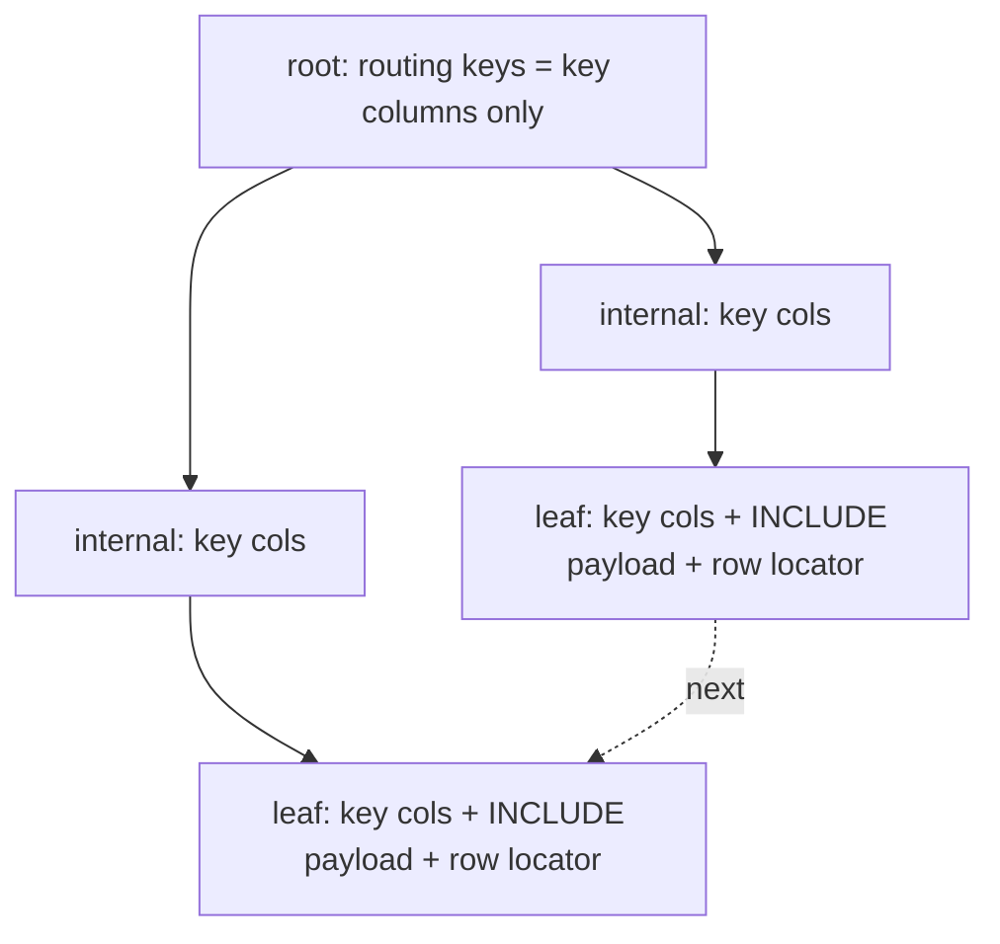

# Covering Indexes

> A covering index is the single cheapest way to make a slow read fast without touching the schema:
> you add the columns the query *returns* to the columns the query *filters and sorts on*, so the
> engine never has to visit the row at all. The catch is that "never visiting the row" is a
> *physical* promise — it depends on index-only scans, the **visibility map**, and whether your
> engine even lets you append columns that are not part of the key. This chapter builds the concept
> from the ground up: what "covering" means physically, why `INCLUDE` columns are cheaper than key
> columns, why MySQL InnoDB has no `INCLUDE` at all, and exactly when a wide covering index is a
> blessing versus when it quietly becomes your biggest, hottest, most-written object.

## TL;DR

- A **covering index** contains *every column a query needs* (filter + join + sort + output), so the
  engine can answer from the index alone — no heap/table fetch.
- The operator has a name in every engine: PostgreSQL **Index Only Scan**, SQL Server **covering
  index (no Key Lookup)**, InnoDB **covering index (no clustered-index fetch)**, Oracle **index fast
  full scan / index-only access**.
- Two kinds of columns inside an index:
  - **Key columns** — participate in ordering, searching, uniquenes. Wider key ⇒ lower fanout ⇒
    taller tree (see [B-tree indexes](./02-b-tree-indexes.md)).
  - **`INCLUDE` / payload columns** — stored **only in leaf pages**, never in internal nodes, never
    used for search or ordering. Cheaper on the tree, identical in leaf width.
- PostgreSQL (`INCLUDE`, since 11) and SQL Server (`INCLUDE`, since 2005) support payload columns.
  **MySQL InnoDB and Oracle do not** — you must add the column to the key (InnoDB) or accept the
  heap/table access (Oracle).
- PostgreSQL index-only scans require the page to be marked **all-visible** in the **visibility
  map**; if not, it silently falls back to a heap fetch (`EXPLAIN`'s `Heap Fetches`). This is why
  aggressive `VACUUM` is a *performance* feature, not just a space feature.
- The cost of a covering index is **write amplification + storage + write-hotness**: every DML on
  the table must update the index, and a wide index cannot stay cached.
- The senior rule: **cover the query, not the table.** One wide index that covers 80 % of a hot
  endpoint beats "index everything for everything."

---

## 1. Definitions and core concepts

### 1.1 Build the idea from a pointer

Recall from [chapter 01](./01-clustered-vs-nonclustered-indexes.md) that a non-clustered index leaf
entry is `(key…) → row locator`, and that when the query needs a column the index lacks, the engine
does a **bookmark lookup** (one extra page read per matching row). "Covering" just answers the
question: *can I eliminate that per-row fetch?*

```
  NOT COVERED                                     COVERED
  query: SELECT status,total WHERE customer_id=?  query: SELECT status,total WHERE customer_id=?

  index (customer_id)                             index (customer_id) INCLUDE (status, total_cents)
  ┌────────────────────┐                          ┌────────────────────────────────────────────┐
  │ 7 → (blk,slot)     │──┐                       │ 7 │ status │ total_cents │ (row locator kept  │
  │ 7 → (blk,slot)     │  │  N heap fetches       │ 7 │ status │ total_cents │  for visibility/   │
  │ 7 → (blk,slot)     │  │  (random I/O!)        │ 7 │ status │ total_cents │  HOT bookkeeping)   │
  └────────────────────┘  │                       └────────────────────────────────────────────┘
                          ▼                          all output columns already here → 0 fetches
  heap: read status,total per row
```

### 1.2 Vocabulary

| Term | Meaning |
|---|---|
| **Covering index** | An index containing all columns a given query needs. |
| **Index-only scan** | The physical operator that reads only the index, no heap/table. |
| **Index fast full scan** | Oracle's term for scanning an index instead of the table. |
| **Key column** | A column part of the index key: searchable, sortable, participates in fanout. |
| **Included / payload column** | Appended leaf-only column: not searchable, not sorted, no fanout cost. |
| **Bookmark / Key Lookup** | SQL Server's row fetch by clustered key after a non-clustered seek. |
| **Heap Fetches** | PostgreSQL counter of rows the index-only scan had to verify in the heap. |
| **Visibility map** | PostgreSQL per-page 2-bit map tracking all-visible / all-frozen pages. |
| **Halloween problem** | Plan where an index is scanned and the same index is updated (avoided by materializing). |

### 1.3 The mental model: index = "a second copy of a slice of the table"

A covering index is literally a **materialized projection**: a sorted copy of a subset of columns.
If the slice is small, it is a cache. If it is large, it is another table — with all the write costs
of a table.

---

## 2. Why it matters / what problem it solves

The bookmark lookup is *the* dominant cost in index-based OLTP reads. Recall the arithmetic from
chapter 01: a non-clustered seek + `N` key lookups is `1 index descent + N random page reads`,
whereas a covering scan is `1 index descent + sequential leaf pages`.

| Rows matched | Not covered (heap fetch each) | Covered (index only) | Ratio |
|---|---|---|---|
| 5 | 5 random reads | 1 leaf page | ~5× |
| 100 | 100 random reads | 1–2 leaf pages | ~50× |
| 10,000 | 10,000 random reads | ~28 leaf pages | ~350× |
| 1,000,000 | planner usually abandons the index | ~2,700 sequential leaf pages | — |

Notice the crossover: past a few thousand rows, the *planner itself* gives up on the non-covering
index and does a sequential scan, because the random fetches cost more than reading the whole table.
A covering index removes that crossover entirely — the plan stays an index scan at *any* selectivity.

The three things covering buys:
1. **Latency** — fewer buffers, fewer random I/Os.
2. **Throughput** — the index is smaller than the table, so more of it stays in the buffer pool.
3. **Plan stability** — the plan shape stops flipping between index scan and seq scan as row counts
   change (a common cause of "it was fast yesterday" incidents).

---

## 3. How it works internally

### 3.1 Where `INCLUDE` columns physically live

In PostgreSQL's slotted B+tree page ([chapter 02](./02-b-tree-indexes.md)), an `INCLUDE` column is
appended to the `IndexTuple` *data* region. Internal pages do **not** carry it; only leaf tuples do.

```
 INDEX (customer_id) INCLUDE (status, total_cents)

 root/internal page (8 KiB):        ┌───────────────────────────────────────┐
 routing keys = customer_id only    │ [ -inf → blk1 | 500 → blk2 | 1000 → …] │   ← compact, high fanout
                                    └───────────────────────────────────────┘

 leaf page (8 KiB):                 ┌────────────────────────────────────────────────────────┐
                                    │ (7,  'paid',    1299)                                   │
                                    │ (7,  'pending',  480)   ← INCLUDE cols stored per leaf  │
                                    │ (8,  'shipped', 9900)      tuple, NOT in internal nodes │
                                    └────────────────────────────────────────────────────────┘
```

Because internal nodes stay narrow, the **tree height does not grow** when you add `INCLUDE`
columns — only the leaves fatten. This is the crucial difference between `INCLUDE (a)` and putting
`a` in the key.



### 3.2 PostgreSQL: index-only scans and the visibility map

MVCC (see [MVCC](./07-mvcc.md)) means a row version can exist in the index but be **dead** to your
snapshot. If the engine answered purely from the index, it could return a deleted/updated row. So
PostgreSQL requires the **visibility map** to certify that *every* tuple on a heap page is visible to
*all* transactions. Only then can an index-only scan skip the heap.

```
 VACUUM sets the ALL_VISIBLE bit per heap page in the visibility map
 ┌──────────────────────────────────────────────────────────────────────┐
 │ visibility map (1 byte per 8 pages):  1 = all-visible, 2 = all-frozen │
 └──────────────────────────────────────────────────────────────────────┘
   index-only scan: for each candidate tuple →
        page all-visible? ── yes ─▶ return from index (0 heap fetches)
                        └─ no  ─▶ fetch heap, check visibility (1 heap fetch)
```

The consequence is a subtle one: **the same query and the same plan can be fast or slow depending on
how recently the table was vacuumed.**

```sql
EXPLAIN (ANALYZE, BUFFERS)
SELECT customer_id, status, total_cents FROM orders WHERE customer_id = 42;
-- Index Only Scan using ix_orders_cov on orders
--   Heap Fetches: 0      ← visibility map says all-visible → zero heap access
--   Buffers: shared hit=3
```

```sql
-- After heavy churn, the same plan shows:
--   Heap Fetches: 8123   ← the returns are now random heap reads again
VACUUM orders;            -- restores all-visible bits → Heap Fetches → ~0
```

### 3.3 SQL Server: covering non-clustered indexes

SQL Server has supported `INCLUDE` since 2005. Included columns:
- Are stored at the leaf level only, not counted against the 900-byte (1,700 for nonclustered in
  2016+) key limit.
- Cannot be used in `WHERE`/`ORDER BY`/`GROUP BY` (they are not key-ordered).
- Are hashed for null-bitmap/versioning bookkeeping, but do not change seek behavior.

```sql
CREATE NONCLUSTERED INDEX ix_orders_cov
    ON orders (customer_id)
    INCLUDE (status, total_cents, created_at);
```

Plan text changes from `Index Seek + Key Lookup` to `Index Seek` (reader sees no Key Lookup node —
that absence *is* the covering).

### 3.4 MySQL InnoDB: no `INCLUDE`, only the key

InnoDB has no payload columns; the only way to cover a query is to make all needed columns **key
columns**. Because InnoDB's secondary index leaf already appends the clustered key (usually
`order_id`), some queries are "accidentally covered":

```sql
-- ix on (customer_id) physically stores (customer_id, order_id)
-- → this is covered for free:
SELECT order_id FROM orders WHERE customer_id = 42;

-- → this needs the clustered index (order_id → full row):
SELECT total_cents FROM orders WHERE customer_id = 42;

-- To cover it, widen the key (and pay fanout):
CREATE INDEX ix_covering ON orders (customer_id, created_at, status, total_cents);
```

> **Senior note:** In InnoDB every secondary index implicitly ends with the primary key, so *any*
> query that needs only the secondary key plus the PK is already covering. This is why "add the PK to
> the SELECT list" can turn a slow query fast on MySQL with no new index at all. On PostgreSQL this
> trick does not exist (the locator is a `ctid`, not the PK).

### 3.5 Oracle: index-organized IOTs and "covering" without INCLUDE

Oracle has no `INCLUDE`. A non-unique secondary index on a heap table stores `(key, ROWID)`; covering
a query means adding output columns to the key (a composite index) or, for IOTs, leveraging the fact
that the leaf *is* the row. Oracle's optimizer also considers **index fast full scan** (scan the
index because it is smaller than the table) and **index skip scan**.

### 3.6 Key columns vs. included columns — the decision table

| | Key column | `INCLUDE` column |
|---|---|---|
| Used for search (`WHERE`) | ✅ | ❌ |
| Used for ordering (`ORDER BY`) | ✅ | ❌ |
| Contributes to uniqueness | ✅ | ❌ |
| Stored in internal nodes | ✅ | ❌ |
| Reduces fanout / raises height | ✅ | ❌ |
| Widens leaf pages | ✅ | ✅ |
| Cost to maintain | full index | full index (still written on every DML) |
| Supported | all | PostgreSQL 11+, SQL Server 2005+ |

Rule: **put filter/sort columns in the key, output-only columns in `INCLUDE`.**

### 3.7 The cost of a wide covering index

A covering index is not free. Every `INSERT`/`UPDATE`/`DELETE` must maintain it:

| Cost | Effect |
|---|---|
| **Write amplification** | each row write → one WAL/redo record per index touched |
| **Storage** | duplicates the covered columns; can exceed the table |
| **Buffer/working-set pressure** | wide leaves mean fewer entries per page → less in cache |
| **Vacuum/undo pressure** | more pages to vacuum (PostgreSQL) / more undo (InnoDB) |
| **Hot-page contention** | fewer entries/page ⇒ more concurrent inserts on the same page |
| **Fill-factor churn** | wide leaf entries make splits more frequent |

Rule of thumb: an index pays for itself if it is read many more times than written and covers a
*repeating* query shape. An index on a write-heavy, read-once column is a pure tax.

---

## 4. How to observe / inspect it

### 4.1 PostgreSQL

```sql
-- Does the plan say "Index Only Scan" and are Heap Fetches ~0?
EXPLAIN (ANALYZE, BUFFERS)
SELECT customer_id, status, total_cents FROM orders WHERE customer_id = 42;

-- Visibility-map effectiveness (percent of pages all-visible)
SELECT relname, n_live_tup,
       last_vacuum, last_autovacuum
FROM   pg_stat_user_tables WHERE relname = 'orders';

-- Physical size of the index vs the table
SELECT pg_size_pretty(pg_relation_size('orders'))                    AS tbl,
       pg_size_pretty(pg_relation_size('ix_orders_cov'))             AS idx;

-- Are included columns actually in the leaf tuple?
SELECT * FROM bt_page_items('ix_orders_cov', 1) LIMIT 5;  -- pageinspect
```

### 4.2 MySQL InnoDB

```sql
-- Does the plan avoid touching the clustered index? Look for "Using index"
EXPLAIN ANALYZE SELECT customer_id, order_id FROM orders WHERE customer_id = 42;
-- Extra: "Using index"  → covered (leaf only)
EXPLAIN ANALYZE SELECT customer_id, total_cents FROM orders WHERE customer_id = 42;
-- Extra: (no "Using index") → clustered-index fetch per row

-- Confirm a secondary index implicitly contains the PK
SHOW INDEX FROM orders;   -- check which columns a secondary key really holds
```

### 4.3 SQL Server

```sql
-- Is an index covering for this query? Look for the ABSENCE of "Key Lookup"
SET SHOWPLAN_ALL ON;
SELECT status, total_cents FROM orders WHERE customer_id = 42;

-- Which indexes exist and which are covered
SELECT i.name, ic.is_included_column, c.name AS column_name
FROM   sys.indexes i
JOIN   sys.index_columns ic ON ic.object_id=i.object_id AND ic.index_id=i.index_id
JOIN   sys.columns c ON c.object_id=ic.object_id AND c.column_id=ic.column_id
WHERE  i.object_id = OBJECT_ID('orders')
ORDER BY i.name, ic.is_included_column, ic.index_column_id;

-- Missing-index DMV: SQL Server demands or suggests covering indexes
SELECT * FROM sys.dm_db_missing_index_details;
SELECT * FROM sys.dm_db_missing_index_groups;
SELECT * FROM sys.dm_db_missing_index_group_stats;
```

### 4.4 Oracle

```sql
-- Did the optimizer use an index-only path?
EXPLAIN PLAN FOR
SELECT /*+ INDEX(orders ix_orders_cov) */ customer_id, status
FROM orders WHERE customer_id = 42;
SELECT * FROM TABLE(DBMS_XPLAN.DISPLAY);
-- Look for "TABLE ACCESS BY INDEX ROWID" (=> NOT covered) vs pure "INDEX RANGE SCAN"
```

---

## 5. Worked examples and demos on the shared sample schema

Using the e-commerce schema from [chapter 01](./01-clustered-vs-nonclustered-indexes.md).

### 5.1 The motivating query

```sql
-- "Show a customer's recent orders for the account page."
SELECT order_id, created_at, status, total_cents
FROM   orders
WHERE  customer_id = 42
ORDER BY created_at DESC
LIMIT  20;
```

With only `ix_orders_customer (customer_id)`:

```
 Limit
   └─ Sort  (order by created_at DESC)
        └─ Index Scan using ix_orders_customer on orders
             Index Cond: (customer_id = 42)
             Buffers: shared hit=9 read=214   ← 200+ heap pages fetched
```

### 5.2 Make it covering *and* ordering-correct

```sql
CREATE INDEX ix_orders_cov
    ON orders (customer_id, created_at DESC)
    INCLUDE (status, total_cents);

ANALYZE orders;

EXPLAIN (ANALYZE, BUFFERS)
SELECT order_id, created_at, status, total_cents
FROM   orders
WHERE  customer_id = 42
ORDER BY created_at DESC
LIMIT  20;
```

```
 Limit  (cost=0.42..12.10 rows=20)
   └─ Index Only Scan using ix_orders_cov on orders
        Index Cond: (customer_id = 42)
        Heap Fetches: 0
        Buffers: shared hit=4           ← index pages only; NO Sort, NO heap
```

Three wins at once: no heap fetch, no sort (`created_at DESC` is the key order), and fewer buffers.

### 5.3 Show the visibility-map dependency

```sql
-- Churn the rows this index covers
UPDATE orders SET status = 'shipped' WHERE customer_id = 42;

EXPLAIN (ANALYZE, BUFFERS)
SELECT order_id, created_at, status, total_cents
FROM   orders WHERE customer_id = 42 ORDER BY created_at DESC LIMIT 20;
-- Heap Fetches: 200     ← the update dirtied the pages; visibility map is stale

VACUUM orders;

EXPLAIN (ANALYZE, BUFFERS)
SELECT order_id, created_at, status, total_cents
FROM   orders WHERE customer_id = 42 ORDER BY created_at DESC LIMIT 20;
-- Heap Fetches: 0       ← vacuum restored all-visible
```

> **Senior note:** This is the demo that convinces teams autovacuum tuning is a *read performance*
> project. Slow index-only scans are often a vacuum-lag problem, not an indexing problem.

### 5.4 Compare key vs included width

```sql
-- A) both columns in the key
CREATE INDEX ix_a ON orders (customer_id, status, total_cents);
-- B) ordering column in the key, payload in INCLUDE
CREATE INDEX ix_b ON orders (customer_id, created_at) INCLUDE (status, total_cents);

SELECT 'A' AS variant, pg_size_pretty(pg_relation_size('ix_a')) AS size,
       (SELECT tree_level FROM pgstatindex('ix_a')) AS height
UNION ALL
SELECT 'B', pg_size_pretty(pg_relation_size('ix_b')),
       (SELECT tree_level FROM pgstatindex('ix_b'));
-- A: wider key ⇒ fewer entries/page, more leaf pages, possibly taller tree
-- B: same leaf width but narrower internal nodes ⇒ fewer internal pages, flatter tree
```

### 5.5 InnoDB: covering for free via the implicit PK

```sql
-- InnoDB secondary index physically = (customer_id, order_id)
EXPLAIN ANALYZE SELECT order_id FROM orders WHERE customer_id = 42;   -- "Using index" ✅
EXPLAIN ANALYZE SELECT total_cents FROM orders WHERE customer_id = 42; -- clustered fetch ❌
```

### 5.6 SQL Server: Key Lookup → covering

```sql
-- Before: Index Seek + Key Lookup
SELECT status, total_cents FROM orders WHERE customer_id = 42;

CREATE NONCLUSTERED INDEX ix_orders_cov
    ON orders (customer_id) INCLUDE (status, total_cents);
-- After: Index Seek only (Key Lookup gone) → massive logical-read drop
```

### 5.7 Measure the write cost

```sql
-- How much does the covering index cost per write?
EXPLAIN (ANALYZE, BUFFERS)
UPDATE orders SET total_cents = total_cents + 1 WHERE order_id = 4200000;
-- each UPDATE emits one WAL record per index touched → more indexes = more WAL.
SELECT pg_size_pretty(pg_current_wal_insert_lsn()::numeric) ;  -- illustrative on busy systems
```

A controlled benchmark (e.g., `pgbench` with N indexes) shows inserts/s dropping roughly linearly
with the number of indexes — a useful number to carry in your head.

---

## 6. Real-world use cases and applications

### 6.1 The account page / API list endpoint

Almost every read-heavy API has a "list by owner, ordered by recency, page through it" endpoint.
The covering index `(owner_id, created_at DESC) INCLUDE (…display columns…)` is the canonical
solution and removes both the sort and the fetch for the hottest endpoint in the app.

### 6.2 "Index-only scan regression" incident

A team rejoices that their new covering index gives `Heap Fetches: 0`. Weeks later the endpoint
slows down again, and `Heap Fetches` is enormous. Root cause: a background job updates a covered
column, invalidating the visibility map, and autovacuum is throttled on the large table. Fix:
increase autovacuum aggressiveness / partition the table, not "drop the index."

### 6.3 Analytics on OLTP (a reporting query that must not melt the primary)

Previously covered reports push read replicas. A dedicated covering index lets the report run from
the index alone (a miniature column store) without a full scan — the "poor man's materialized view."

### 6.4 Covering vs. a materialized view

When a query's covering index would need 15 columns (i.e., it *is* the table), the right answer is
usually a **materialized view** or a separate read model (star schema / warehouse), not a wide index.
Covering indexes shine at 2–6 extra columns; past that, write cost dominates.

### 6.5 Escape hatch for `SELECT *` endpoints, use extreme care

`SELECT *` can never be covered (the column set is the table). Either change the API to select
explicit columns, or accept the fetches. This is a genuinely common cause of "we added an index and
nothing changed."

---

## 7. Patterns and anti-patterns

### Patterns

| Pattern | Why |
|---|---|
| `(equality_cols, range/order_col) INCLUDE (output_cols)` | exact shape of list endpoints |
| Keep key narrow, push output to `INCLUDE` | preserves fanout/height |
| Cover only the top few query shapes (from `pg_stat_statements`) | ROI where it matters |
| Verify `Heap Fetches ≈ 0` after `VACUUM` | confirms the covering actually works |
| Add the PK to the select list on InnoDB | free coverage via implicit PK |
| Watch write ratio before adding | a covering index on a write-hot table is a tax |

### Anti-patterns

| Anti-pattern | Symptom |
|---|---|
| `SELECT *` with a covering index | index can never cover; fetches remain |
| Covering column that is frequently updated | visibility map invalidated → heap fetches return |
| 20-column covering index | bigger than the table; write throughput collapse |
| Assuming index-only scan on Postgres without checking `Heap Fetches` | phantom heap reads |
| Adding output columns to the *key* instead of `INCLUDE` | fanout drops, tree grows |
| Relying on covering on MySQL without checking the implicit PK | wrong `EXPLAIN` reading |

---

## 8. Cross-engine differences

| Aspect | PostgreSQL | MySQL InnoDB | SQL Server | Oracle |
|---|---|---|---|---|
| Non-key `INCLUDE` columns | ✅ since 11 | ❌ | ✅ since 2005 | ❌ |
| Index-only scan exists | ✅ (`Index Only Scan`) | ✅ (leaf-only access) | ✅ (no Key Lookup) | ✅ (index fast full scan) |
| Requires visibility mechanism | ✅ **visibility map** | ✅ undo/read view (no VM) | ❌ (row versioning via tempdb for RCSI) | ❌ (undo-based) |
| Implicit extra leaf column | `ctid` (locator) | **clustered key (PK)** | clustering key / RID | `ROWID` |
| Covered "for free" benefit | only if you fetch only key cols | ✅ secondary key + PK | ✅ if PK covered | limited |
| Included column byte limit | none practical (page-bound) | key-size bound to page | 1,700 B nonclustered key (2016+) | page-bound |
| Inspect heap fetches | `EXPLAIN ... Heap Fetches` | `EXPLAIN` "Using index" | absence of Key Lookup | `TABLE ACCESS BY INDEX ROWID` |
| Mechanism to restore coverage | `VACUUM` | — | — | — |

---

## 9. Exercises — Intermediate (hints only)

1. **Cover the account page.** Given `SELECT order_id, created_at, status, total_cents FROM orders
   WHERE customer_id=? ORDER BY created_at DESC LIMIT 20`, write the covering index for PostgreSQL.
   *Hint: equality col first, ordering col second, output cols in `INCLUDE`.*

2. **Read the counter.** Run an index-only scan before and after an `UPDATE` on a covered column.
   What changed in `Heap Fetches`, and why? *Hint: visibility map.*

3. **MySQL free lunch.** Which of these is covered by an InnoDB index on `(customer_id)`:
   `SELECT order_id ...`, `SELECT total_cents ...`? *Hint: implicit clustered key.*

4. **Key vs INCLUDE size.** Build two indexes (key vs `INCLUDE`) covering the same query and compare
   `pgstatindex.tree_level` and index size. *Hint: internal node width.*

5. **Crossover.** At roughly how many matching rows does a non-covering index stop being chosen? Build
   the experiment. *Hint: `enable_seqscan` off then on; watch costs.*

---

## 10. Exercises — Advanced (hints / expected approach)

1. **Design the covering set for a real API.** Given three list endpoints (by customer, by status, by
   date range) and their display columns, choose the *minimum* set of covering indexes and justify
   each against write cost. Expected approach: use `pg_stat_statements` frequency × row count to rank
   ROI; reject indexes that cover fewer than, say, 5 % of read time.

2. **Prove the visibility-map effect quantitatively.** Measure `Heap Fetches` vs. the fraction of
   dead tuples (`pg_stat_user_tables.n_dead_tup / n_live_tup`) across several `VACUUM` cycles.
   Expected: correlation between bloat and heap-fetch rate.

3. **Cost model of a wide covering index.** Model insert throughput vs. number of covering indexes
   (linear-ish) and cache residency (sub-linear once the working set exceeds `shared_buffers`).
   Expected: identify the knee and relate it to `shared_buffers` and table size.

4. **When covering beats a materialized view.** For a reporting query needing 15 columns, argue when
   a covering index is preferable to a materialized view / aggregation table. Expected: freshness,
   write cost, refresh complexity, storage.

5. **Reason about Oracle.** Without `INCLUDE`, design the closest equivalent to a Postgres covering
   index for the account-page query and explain the trade-off versus an IOT. Expected: composite
   index vs IOT vs index fast full scan.

---

## References

- PostgreSQL: [Index-Only Scans and Covering Indexes](https://www.postgresql.org/docs/current/indexes-index-only-scans.html)
- PostgreSQL: [`CREATE INDEX` (INCLUDE clause)](https://www.postgresql.org/docs/current/sql-createindex.html)
- PostgreSQL: [Routine Vacuuming — visibility map](https://www.postgresql.org/docs/current/routine-vacuuming.html)
- PostgreSQL: [`pageinspect` module](https://www.postgresql.org/docs/current/pageinspect.html)
- MySQL: [Clustered and Secondary Indexes](https://dev.mysql.com/doc/refman/8.4/en/innodb-index-types.html)
- MySQL: [`EXPLAIN` output — "Using index"](https://dev.mysql.com/doc/refman/8.4/en/explain-output.html)
- Microsoft: [Create Indexes with Included Columns](https://learn.microsoft.com/en-us/sql/relational-databases/indexes/create-indexes-with-included-columns)
- Microsoft: [Index Architecture and Design Guide](https://learn.microsoft.com/en-us/sql/relational-databases/sql-server-index-design-guide)
- Microsoft: [sys.dm_db_missing_index_details](https://learn.microsoft.com/en-us/sql/relational-databases/system-dynamic-management-views/sys-dm-db-missing-index-details-transact-sql)
- Oracle: [Indexes and Index-Organized Tables](https://docs.oracle.com/en/database/oracle/oracle-database/19/cncpt/indexes-and-index-organized-tables.html)
- Markus Winand: [Use The Index, Luke! — Covering Indexes](https://use-the-index-luke.com/sql/glossary/covering-index)
- Egor Rogov, *PostgreSQL 14 Internals* — index-only scans and the visibility map: https://postgrespro.com/community/books/internals
