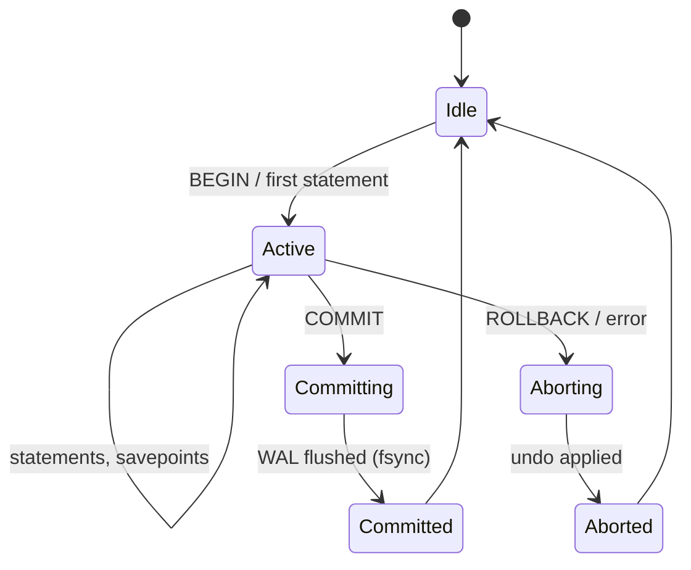

# Transactions

> A transaction is the database's promise that a group of statements is a single, indivisible act:
> it happens completely or not at all, it is invisible to others until it completes, and once the
> engine says "committed," it survives a power cut. Everything behind that promise is machinery —
> a write-ahead log that must hit disk *before* the data pages do, an undo mechanism that can
> erase a half-finished change, and a commit protocol that turns many concurrent writers into
> durable records without `fsync`-ing a disk per transaction. This chapter goes from
> `BEGIN`/`COMMIT` down to the `fsync()` call and back up to the application design question that
> actually bites teams in production: *how long should a transaction be open, and what does a
> long one cost?*

## TL;DR

- A **transaction** is a unit of *atomicity, isolation, and durability*. `BEGIN` starts one (or the
  engine's implicit **autocommit** wraps each statement in one); `COMMIT` makes it permanent;
  `ROLLBACK` discards it.
- **Atomicity** is implemented by **undo** (erase partial changes) + a **write-ahead log** (record
  what you intend so you can finish on crash).
- **Durability** is implemented by the **WAL / redo log**: the commit record is flushed (fsync) and
  only *then* is the commit acknowledged. Data pages may lag the log indefinitely (that is the whole
  point).
- **`fsync` is the ground truth of durability.** `synchronous_commit = off` (PostgreSQL),
  `innodb_flush_log_at_trx_commit = 2` (MySQL), and delayed durability (SQL Server) trade durability
  for latency — the trade is *exactly* "how many recent commits can I lose on a crash?"
- **Group commit** amortizes fsync across many concurrent transactions: one disk flush per batch,
  not one per commit. This is why throughput scales with concurrency even when durability is on.
- **Savepoints** implement partial rollback inside a transaction: `SAVEPOINT`, `ROLLBACK TO
  SAVEPOINT`, `RELEASE`. They also have a hidden cost (subtransaction overflow in PostgreSQL).
- **Long-running transactions are the #1 self-inflicted database wound.** They hold locks, freeze the
  MVCC horizon, block `VACUUM` (PostgreSQL) / stall purge (InnoDB/Oracle), inflate undo, and trigger
  bloat and even wraparound risk.
- Application rule: **transactions must be short, must not span user think-time or network calls, and
  must have a retry policy** because serializable (and sometimes snapshot) isolation requires
  retries.

---

## 1. Definitions and core concepts

### 1.1 What a transaction is (and is not)

A transaction is a **sequence of statements treated as one**. It is *not* a "connection," not a
"session," and not a "unit of effort." A single connection can run many transactions sequentially; a
single transaction can be one statement.

```
 BEGIN ──▶ [ S1, S2, S3, ... ] ──▶ COMMIT   (durable, visible)
                             └──▶ ROLLBACK (erased, never visible)
```

### 1.2 Vocabulary

| Term | Meaning |
|---|---|
| **Txn / transaction** | Atomic unit of work. |
| **Commit** | Make the unit permanent and visible. |
| **Rollback / abort** | Discard the unit as if it never ran. |
| **Savepoint** | A named point inside a txn to which you can partially roll back. |
| **Autocommit** | Engine wraps each statement in its own txn when you don't say `BEGIN`. |
| **Durability** | Surviving a crash after the ack. |
| **WAL / redo log** | Append-only log of "how to redo" changes; the durability backbone. |
| **Undo log / rollback segment** | Records "how to undo" changes; MVCC + rollback backbone. |
| **Group commit** | Batching fsyncs across concurrent transactions. |
| **Two-phase commit (2PC)** | Distributed commit with a prepare phase (`PREPARE TRANSACTION`, XA). |
| **Subtransaction** | A savepoint/exception block; PostgreSQL impl has a hard limit (64). |
| **MVCC horizon** | The oldest snapshot that must remain readable; long txns hold it back. |

### 1.3 The lifecycle



In every engine there are really **two phases**: a *logical* commit (the decision) and a *physical*
commit (the durable log record). Durability lives entirely in the second.

---

## 2. Why it matters / what problem it solves

Without transactions, a crash in the middle of "debit A, credit B" leaves the system inconsistent,
and concurrent readers see torn states. Transactions give the application a *mental model* it can
reason about locally, so business logic does not have to be written defensively against crashes and
concurrency. The cost is that the engine must (a) log before it writes, (b) coordinate visibility,
and (c) flush to disk at commit. Those three requirements are the source of *every* durability and
latency trade-off you will ever tune.

---

## 3. How it works internally

### 3.1 BEGIN / COMMIT / ROLLBACK — what the engine records

The SQL is thin; the machinery is not.

**PostgreSQL**

```
BEGIN;                       -- allocate an XID (lazily, on first write), take a snapshot
UPDATE orders SET ...;       -- writes a WAL record; changes tuple, sets xmin = my XID
INSERT INTO ...;             -- more WAL
COMMIT;                      -- write commit record to WAL, flush (fsync) WAL up to commit LSN,
                             -- then mark the txn committed in the (async) commit log
```

**MySQL InnoDB**

```
START TRANSACTION;           -- take a read view (on first read), assign a txn id (on first write)
UPDATE ...;                  -- writes redo log (in the log buffer) + undo log, modifies pages
COMMIT;                      -- flush redo to disk (innodb_flush_log_at_trx_commit),
                             -- mark txn committed, release locks
```

**SQL Server** writes to the transaction log (WAL), and on commit flushes the log to the log file
(`Write-Ahead Logging`); if `delayed_durability` is on, the flush is deferred.

**Oracle** generates **redo** (in the redo log buffer → log files) and **undo** (in undo segments),
and writes on commit with the `COMMIT`'s `WRITE`/`WAIT` options semantics.

### 3.2 The write-ahead rule (WAL) — the single most important invariant

> **WAL rule:** before a modified data page may be written to its permanent location, all log
> records describing that modification (including the commit record) must be on stable storage.

This gives **atomicity + durability** because the log is the source of truth for recovery:

```
 Time ─────────────────────────────────────────────────────────────────▶
 checkpoints make recovery faster by limiting how far back you replay.

 WAL stream:  [begin][update A][update B][commit]        [begin][update C]   ← crash! no commit
                │                                               │
                ▼                                               ▼
 Recovery:  redo A,B (committed)                          redo nothing for C (uncommitted)
            undo C if it was partially flushed
```

The crucial performance insight: because the log is sequential and the data pages are random, the
engine can **write the log synchronously and the pages lazily**. That is what makes a commit cost
one sequential append + one fsync instead of a random write.

```
 Commit latency ≈ (log_buffer_append) + fsync(WAL)         ← the fsync dominates
 Data page flush = async, batched by the checkpointer/background writer
```

### 3.3 Group commit — why concurrency helps durability

An `fsync` is ~0.1–10 ms depending on storage. If every commit fsynced separately, throughput would
be capped at `1 / fsync_latency` (e.g., ~200/s on a 5 ms disk). **Group commit** batches concurrent
commits into one flush:

```
 10 txns commit at nearly the same time:
   without group commit: 10 × fsync = 10 × 5 ms = 50 ms of flushing
   with group commit:    1 × fsync for all 10 = 5 ms
                         → up to ~10× throughput
```

- **PostgreSQL**: transactions arriving while a WAL flush is in flight join the same flush; also
  `commit_delay` / `commit_siblings` let a leader wait a hair to gather more.
- **InnoDB**: group commit with a binary-log group commit variant; `innodb_flush_log_at_trx_commit=1`
  still scales because of batching.
- **SQL Server**: similar batching of log flushes.
- **Oracle**: `COMMIT WRITE BATCH NOWAIT` / `IMMEDIATE`, `_log_parallelism`-style internal batching.

> **Senior note:** This is why "increase concurrency" often improves commit throughput with durability
> *unchanged*. Group commit does not weaken durability; it just uses one fsync for many transactions.

### 3.4 Durability mechanics (the physical layer)

Durability = "the ack is not sent until the bytes are recoverable." That requires several things to
be true, and each is a place teams get burned:

| Layer | What it does | Failure it prevents / introduces |
|---|---|---|
| OS page cache write | buffers writes in RAM | NOT durable — a power loss loses it |
| `fsync()` / `fdatasync()` | forces to the device | durable, but slow |
| Device write cache (volatile) | speeds up writes | **lie**: "fsync done" while data is in the drive's RAM |
| Battery/Flash-backed cache (BBWC/FBWC) | safe to ack after RAM | durable + fast (the real enterprise answer) |
| `fdatasync` vs `fsync` | metadata vs data | mismatch can lose a file's length (the 2018 "fsyncgate") |
| Filesystem (ext4 `data=ordered`) | ordering guarantees | wrong modes → reordering/lost writes |

**Tunable knobs and exactly what you lose:**

| Setting | Value | Crash loss window |
|---|---|---|
| PostgreSQL `synchronous_commit` | `on` (default) | 0 (commit acked only after local fsync) |
| | `off` | up to ~3 × `wal_writer_delay` (default 600 ms) of recent commits; DB stays consistent |
| | `local` | 0 locally; replicas may lag |
| | `remote_write` | 0 until the standby has the WAL in its OS |
| | `remote_apply` | 0 until the standby has *applied* it |
| MySQL `innodb_flush_log_at_trx_commit` | `1` (default) | 0 |
| | `2` | up to 1 s (flushed to OS cache, fsync ~1/s) |
| | `0` | up to 1 s (log buffer → log file, no fsync) |
| SQL Server `DELAYED_DURABILITY` | `OFF`/`ON`/`FORCED` | with `ON`: loses recent committed txns on crash (log still consistent) |
| Oracle `COMMIT` | default `WAIT` | 0 (LGWR wrote redo) |

```
  Durability ladder (fastest, weakest → slowest, strongest)

  flush_log_at_trx_commit=0   ─▶   =2   ─▶   =1 / synchronous_commit=on
   ~1 s loss window               ~1 s       0 loss
                                         ─▶   synchronous_commit=remote_apply
                                              0 loss + standby applied (highest latency)
```

### 3.5 Rollback and undo

`ROLLBACK` must erase work. Two mechanisms:

1. **Undo / rollback segments** (InnoDB, Oracle): each change records its inverse; rolling back
   applies the inverses. The same undo also serves MVCC (readers reconstruct old versions).
2. **MVCC + visibility + vacuum** (PostgreSQL): the "change" is a new tuple version; rollback just
   marks the tuple's XID as aborted, so the version is never visible and later vacuum reclaims it.
   There is no classic undo log for user data; WAL provides redo, not undo.

```
 PostgreSQL rollback: mark txn XID as aborted → all tuples it wrote become invisible → VACUUM reclaims
 InnoDB/Oracle rollback: read undo log → apply inverse changes to pages → pages restored in place
```

This difference is *why* PostgreSQL needs `VACUUM` and why InnoDB/Oracle need undo tablespaces that
can grow (the "history list length" / undo bloat problem).

### 3.6 Savepoints (subtransactions)

```sql
BEGIN;
  INSERT INTO orders (...) VALUES (...);           -- order #1
  SAVEPOINT sp1;
    INSERT INTO order_items (order_id, line_no, ...) VALUES (..., 2, ...);  -- may violate PK?
    -- suppose it fails
  ROLLBACK TO SAVEPOINT sp1;                       -- only the second insert is undone
  INSERT INTO order_items (order_id, line_no, ...) VALUES (..., 3, ...);
COMMIT;                                            -- order #1 + line 3 commit; line 2 discarded
```

Semantics: `ROLLBACK TO SAVEPOINT` undoes work *after* the savepoint but keeps the transaction alive
and releases locks taken after it. `RELEASE SAVEPOINT` forgets the savepoint (does **not** commit).

> **Senior note (PostgreSQL subtransaction overflow):** every savepoint and every `BEGIN ... EXCEPTION`
> block in PL/pgSQL creates a **subtransaction**, and a transaction can have at most **64**
> subtransactions live at once (the rest are packed into a SUBTRANS overflow file). A loop with a
> `BEGIN/EXCEPTION` per iteration can blow past this and make `pg_subtrans` huge, hurting performance
> and contributing to wraparound pressure. GitLab wrote the canonical post-mortem on this:
> *"Why we spent the last month eliminating PostgreSQL subtransactions."*

```sql
-- Detect subtransaction pressure (PostgreSQL)
SELECT pg_stat_get_xact_num_subtrans() ;   -- count in the current transaction
SELECT max(age(relfrozenxid)) FROM pg_class;   -- wraparound distance
```

### 3.7 Autocommit and implicit transactions

```sql
-- Autocommit ON (the default in psql, JDBC, etc.): each statement is its own transaction
UPDATE orders SET status='paid' WHERE order_id=1;   -- committed immediately
UPDATE orders SET status='paid' WHERE order_id=2;   -- a SEPARATE transaction

-- Turn it off to make multiple statements atomic
BEGIN;
UPDATE orders SET status='paid' WHERE order_id=1;
UPDATE orders SET status='paid' WHERE order_id=2;
COMMIT;
```

Driver conventions differ and this trips people constantly:

| Environment | Default | Gotcha |
|---|---|---|
| `psql` | autocommit on | as above |
| JDBC (PostgreSQL) | autocommit **on** | must `setAutoCommit(false)` |
| SQLAlchemy Core | "autobegin" on first statement | wrap in `engine.begin()` for atomicity |
| Hibernate | txn per session/flush | flush ≠ commit |
| MySQL CLI | autocommit on | DDL causes implicit commit! |
| SQL Server (default) | autocommit on | `SET IMPLICIT_TRANSACTIONS ON` changes it |
| Oracle | autocommit **off** (every DML starts a txn) | you *must* `COMMIT`/`ROLLBACK` |

### 3.8 Two-phase commit and distributed transactions

When a transaction spans two databases (or a DB + a message broker), you need distributed commit:

```
 Phase 1: PREPARE  → each participant writes a prepared record durably, ready to commit or abort
 Phase 2: COMMIT   → coordinator tells everyone to commit (or abort)
```

PostgreSQL: `PREPARE TRANSACTION 'x'; COMMIT PREPARED 'x';` (requires `max_prepared_transactions > 0`,
and prepared transactions are also a **vacuum-horizon hazard** — a forgotten prepared txn can block
cleanup indefinitely). This is the basis of XA. **Prefer idempotency + sagas/outbox over 2PC** for
most modern systems.

---

## 4. How to observe / inspect it

### 4.1 PostgreSQL

```sql
-- Who is in a transaction, and for how long?
SELECT pid, state, xact_start, now()-xact_start AS txn_age, query
FROM   pg_stat_activity
WHERE  state <> 'idle'
ORDER BY xact_start
LIMIT 20;

-- Idle-in-transaction sessions (the dangerous ones: they hold the horizon)
SELECT pid, state, state_change, now()-state_change AS idle_age, query
FROM   pg_stat_activity
WHERE  state = 'idle in transaction'
ORDER BY idle_age DESC;

-- Oldest transaction (the MVCC horizon / vacuum blocker)
SELECT pid, xact_start, backend_xid
FROM   pg_stat_activity
ORDER BY xact_start NULLS LAST LIMIT 1;

-- Durability + WAL config
SHOW synchronous_commit;
SHOW wal_sync_method;
SELECT * FROM pg_stat_wal;          -- wal_records, wal_fpi, wal_bytes, wal_sync, wal_sync_time
```

### 4.2 MySQL InnoDB

```sql
SELECT trx_id, trx_state, trx_started, trx_mysql_thread_id, trx_query
FROM   information_schema.innodb_trx
ORDER BY trx_started;

SHOW ENGINE INNODB STATUS\G     -- "TRANSACTIONS" section: history list length = undo backlog
SHOW VARIABLES LIKE 'innodb_flush_log_at_trx_commit';
SHOW VARIABLES LIKE 'autocommit';
SELECT @@transaction_isolation;
```

### 4.3 SQL Server

```sql
-- Open transactions and what they hold
SELECT s.session_id, at.transaction_begin_time, s.status, s.open_transaction_count,
       r.blocking_session_id, t.text
FROM   sys.dm_exec_sessions s
LEFT   JOIN sys.dm_tran_active_transactions at ON at.transaction_id = s.transaction_id
LEFT   JOIN sys.dm_exec_requests r ON r.session_id = s.session_id
OUTER APPLY sys.dm_exec_sql_text(r.sql_handle) t
WHERE  s.is_user_process = 1 AND s.open_transaction_count > 0;

SELECT * FROM sys.dm_tran_database_transactions;
DBCC OPENTRAN;                          -- oldest open transaction in the current DB
SELECT name, delayed_durability_desc FROM sys.databases;
```

### 4.4 Oracle

```sql
SELECT s.sid, s.serial#, s.status, t.start_time, s.sql_id
FROM   v$transaction t JOIN v$session s ON s.taddr = t.addr;

-- Undo usage / retention
SELECT begin_time, undoblks, maxquerylen, tuned_undoretention FROM v$undostat;

-- Log sync waits (durability latency)
SELECT name, value FROM v$sysstat WHERE name LIKE 'redo sync%';
```

---

## 5. Worked examples and demos on the shared sample schema

Using the e-commerce schema from [chapter 01](./01-clustered-vs-nonclustered-indexes.md).

### 5.1 A correct checkout transaction

```sql
BEGIN;

-- 1) Verify stock and lock the rows we are about to decrement
SELECT product_id, stock_qty
FROM   products
WHERE  product_id IN (101, 102)
FOR UPDATE;                          -- row locks; blocks concurrent checkouts of same products

-- 2) Create the order
INSERT INTO orders (customer_id, status, created_at, total_cents)
VALUES (42, 'pending', now(), 0)
RETURNING order_id;                  -- e.g. 900123

-- 3) Insert line items
INSERT INTO order_items (order_id, line_no, product_id, quantity, unit_price_cents)
VALUES (900123, 1, 101, 2, 2599),
       (900123, 2, 102, 1, 1499);

-- 4) Decrement stock
UPDATE products SET stock_qty = stock_qty - 2 WHERE product_id = 101;
UPDATE products SET stock_qty = stock_qty - 1 WHERE product_id = 102;

-- 5) Set the total
UPDATE orders SET total_cents = 6697, status = 'paid' WHERE order_id = 900123;

COMMIT;                              -- one fsync; all-or-nothing
```

This is a *short* transaction: no network calls, no user interaction. That is the design goal.

### 5.2 The same flow with savepoints for a batch import

```sql
BEGIN;
  FOR batch IN (...) LOOP
     SAVEPOINT batch_sp;
     BEGIN
        INSERT INTO order_items (...) VALUES (...);   -- may conflict
     EXCEPTION WHEN unique_violation THEN
        ROLLBACK TO SAVEPOINT batch_sp;               -- skip just this row
     END;
  END LOOP;
COMMIT;
```

> **Senior note:** This pattern is convenient but creates one subtransaction per iteration — see the
> 64-subtransaction note in §3.6. For large batches prefer `INSERT ... ON CONFLICT DO NOTHING`.

### 5.3 Observe the durability trade-off

```sql
-- Baseline: durable commits
\timing on
BEGIN; INSERT INTO orders (customer_id, status) VALUES (42,'pending') RETURNING order_id; COMMIT;

-- Repeat 1,000 times in a shell loop; measure commits/sec.
-- Then:
SET synchronous_commit = off;
-- Repeat: typically 2–5× higher commits/sec on fsync-bound storage, at the cost of
-- losing the last ≤ 3×wal_writer_delay ms of commits on a crash.
```

```bash
# Rough benchmark harness (pgbench)
pgbench -c 16 -j 4 -T 30 -f commit_only.sql shop     # baseline
PGOPTIONS='-c synchronous_commit=off' pgbench -c 16 -j 4 -T 30 -f commit_only.sql shop
```

### 5.4 Demonstrate the long-transaction damage (PostgreSQL)

Terminal A:

```sql
BEGIN;
SELECT * FROM orders WHERE order_id = 1;   -- takes a snapshot, does not commit
-- leaves the transaction OPEN
```

Terminal B:

```sql
-- This OLD transaction is now the MVCC horizon. Watch the effects:
SELECT pid, xact_start, now()-xact_start AS age
FROM   pg_stat_activity WHERE state='idle in transaction';

-- Autovacuum cannot clean anything newer than that horizon:
SELECT relname, n_dead_tup, last_autovacuum FROM pg_stat_user_tables WHERE relname='orders';

-- Generate churn in another session, then:
VACUUM (VERBOSE) orders;
-- Notice "removable cutoff" does not advance past the idle transaction.
```

The idle transaction is now a **vacuum horizon blocker**: the table accumulates dead tuples no matter
how hard autovacuum works.

### 5.5 Show undo / history-list growth (InnoDB)

```sql
-- Terminal A: START TRANSACTION; SELECT ...;  (leave it open)
-- Terminal B: run heavy updates, then:
SHOW ENGINE INNODB STATUS\G
-- "History list length  <grows>"
-- Undo tablespace files grow; purge threads cannot advance past the oldest read view.
```

### 5.6 Group commit effect

```bash
# Same total work, different concurrency: commits/sec rises with -c because of group commit
pgbench -c 1  -j 1 -T 20 -f commit_only.sql shop
pgbench -c 8  -j 4 -T 20 -f commit_only.sql shop
pgbench -c 64 -j 8 -T 20 -f commit_only.sql shop
```

---

## 6. Real-world use cases and applications

### 6.1 Checkout / payment flows

Payments need the full ACID package: decrement stock, insert order + items, and record the payment
attempt atomically and durably. Any relaxation (`synchronous_commit=off`) must be a *conscious*
business decision, not a default.

### 6.2 "Idle in transaction" incident (the most common one)

An app opens a transaction, calls an external HTTP API (a payment gateway, a geocoder), and only then
commits. The HTTP call takes 1–30 s. During that time: row locks held, MVCC horizon frozen, autovacuum
blocked, connection pool exhausted. On PostgreSQL the outcome is a **bloat explosion**; on InnoDB the
outcome is a **growing undo/history list** and stalls. Fix: never do I/O inside a transaction.

### 6.3 Batch ETL into an OLTP table

Large bulk loads wrapped in one transaction can generate gigabytes of WAL and hold locks. Better:
chunk the load, commit every N rows, and use `COPY`/direct-path load for the bulk phase.

### 6.4 Prepared transactions left behind

A crashed 2PC coordinator leaves a `PREPARE TRANSACTION` record that nobody commits or rolls back. In
PostgreSQL it holds back the vacuum horizon forever (it appears in `pg_prepared_xacts`). Monitoring
and a `max_prepared_transactions` budget close this hole.

### 6.5 Durability-vs-latency in high-write services

A metrics/telemetry ingest service may genuinely prefer throughput over losing the last second of
data: `synchronous_commit=off` or `innodb_flush_log_at_trx_commit=2` is the right call. A ledger is
the opposite. The senior skill is knowing **which** of your tables belongs in which bucket.

### 6.6 Auto-commit surprise in MySQL DDL

`ALTER TABLE`, `CREATE INDEX`, and other DDL in MySQL cause an **implicit commit** of any open
transaction, silently breaking atomicity assumptions in migration scripts. Oracle DDL is
transactional; PostgreSQL DDL is transactional (but takes stronger locks). This cross-engine
inconsistency causes real migrations to fail in odd ways.

---

## 7. Patterns and anti-patterns

### Patterns

| Pattern | Why |
|---|---|
| Keep transactions short: begin → work → commit, no I/O | avoids lock/horizon damage |
| Acquire locks in a consistent order | prevents deadlocks |
| Use `FOR UPDATE SKIP LOCKED` for queues | non-blocking workers |
| Retry on serialization/deadlock errors with jittered backoff | required at SERIALIZABLE |
| Use savepoint only for genuine partial rollback | avoid subtransaction overflow |
| Bound batch size, commit every N rows | limits WAL, locks, undo |
| Monitor longest transaction age as an SLO | catches the #1 incident early |

### Anti-patterns

| Anti-pattern | Damage |
|---|---|
| Network/user I/O inside a transaction | locks held for seconds; bloat; pool exhaustion |
| Long-running reporting query on the OLTP primary in a txn | horizon blocker; autovacuum starves |
| Forgetting `COMMIT` (Oracle) or `setAutoCommit(false)` off | "uncommitted" leaks silently |
| Assuming DDL is transactional on MySQL | implicit commit breaks atomicity |
| Leaving prepared transactions | permanent vacuum horizon block |
| `synchronous_commit=off` everywhere | silent data loss on power cut |
| One giant transaction for a bulk load | huge WAL, long recovery, lock pileups |

---

## 8. Cross-engine differences

| Aspect | PostgreSQL | MySQL InnoDB | SQL Server | Oracle |
|---|---|---|---|---|
| Start a txn | `BEGIN`/`START TRANSACTION` | `START TRANSACTION`/`BEGIN` | `BEGIN TRAN` | implicit (no `BEGIN` needed) |
| Autocommit default | on | on | on | **off** (implicit) |
| Durability knob | `synchronous_commit` | `innodb_flush_log_at_trx_commit` | `DELAYED_DURABILITY` | `COMMIT WRITE [WAIT|NOWAIT]` |
| Redo mechanism | WAL (`.pg_wal`) | InnoDB redo log | transaction log | redo log files |
| Undo mechanism | MVCC tuple + `VACUUM` | undo log (rollback segments) | row versions in `tempdb` (RCSI) | undo tablespace |
| Savepoints | ✅ | ✅ | ✅ | ✅ |
| Implicit commit on DDL | ❌ (transactional DDL) | ✅ (implicit commit) | ✅/partially | ❌ |
| Prepared / 2PC | `PREPARE TRANSACTION` | XA `PREPARE` | MSDTC / `sp_getbindtoken` | `PREPARE … COMMIT PREPARED` |
| Row-level version store | heap (MVCC) | undo | tempdb (if RCSI on) | undo |
| Long-txn harm | blocks `VACUUM`; bloat; wraparound | history list/undo growth; purge lag | log growth; tempdb version store growth | undo growth; `ORA-01555` |
| Group commit | ✅ | ✅ | ✅ | ✅ |
| Session timeout helpers | `idle_in_transaction_session_timeout` | `wait_timeout`, `max_execution_time` | `LOCK_TIMEOUT` | `SESSION` resource limits |

---

## 9. Exercises — Intermediate (hints only)

1. **Make it atomic.** Rewrite the checkout flow so that the order, its items, and the stock
   decrement are one transaction. *Hint: `BEGIN … COMMIT`, order of operations, `FOR UPDATE`.*

2. **Identify the horizon blocker.** Two sessions: one open read txn, one doing updates. Which one
   stops autovacuum and why? *Hint: the oldest snapshot defines the removable cutoff.*

3. **Autocommit gotcha.** Explain why `setAutoCommit(false)` is mandatory in JDBC for a multi-statement
   unit. *Hint: what is committed between two `executeUpdate` calls?*

4. **Savepoint semantics.** After `ROLLBACK TO SAVEPOINT sp`, which locks acquired after `sp` are
   released, and does the transaction stay open? *Hint: read the engine docs carefully — behaviour is
   defined per engine.*

5. **Durability dial.** For a telemetry table and a payments table in the same database, would you use
   different `synchronous_commit` settings? *Hint: per-transaction `SET LOCAL synchronous_commit`.*

---

## 10. Exercises — Advanced (hints / expected approach)

1. **Quantify the group-commit curve.** Benchmark commits/sec as a function of concurrency (1→128)
   with `synchronous_commit=on` on fsync-bound storage. Expected approach: plot throughput vs.
   concurrency; identify the plateau caused by fsync latency and the batch size; compare to
   `synchronous_commit=off`.

2. **Design a crash-safe, idempotent payment write.** You must write to a local DB and call an external
   payment API exactly once. Expected approach: discuss the outbox pattern + idempotency keys + 2PC
   trade-offs; explain why doing the API call inside the transaction is unacceptable.

3. **Model the cost of a long transaction.** Given a table written at 5,000 rows/s with updates, model
   how many dead tuples accumulate if one idle transaction survives for 10 minutes. Expected: relate
   the accumulation to the removable cutoff and the autovacuum threshold.

4. **Subtransaction flood.** Construct a PL/pgSQL loop with `BEGIN/EXCEPTION` per iteration and observe
   `pg_subtrans` growth and the 64-live-subtransaction constraint. Expected approach: measure
   `age(relfrozenxid)` and the query runtime before/after replacing it with `ON CONFLICT DO NOTHING`.

5. **Recovery reasoning.** Given a WAL with an uncommitted `UPDATE` whose data page *was* flushed by a
   checkpoint, explain what recovery does with it in PostgreSQL (undo via visibility) vs. InnoDB
   (undo log). Expected: distinguish redo-then-undo recovery from redo-only + visibility.

---

## References

- PostgreSQL: [Transactions](https://www.postgresql.org/docs/current/tutorial-transactions.html)
- PostgreSQL: [Write-Ahead Logging (WAL)](https://www.postgresql.org/docs/current/wal-intro.html)
- PostgreSQL: [`SET TRANSACTION` / `synchronous_commit`](https://www.postgresql.org/docs/current/runtime-config-wal.html)
- PostgreSQL: [`SAVEPOINT`](https://www.postgresql.org/docs/current/sql-savepoint.html)
- PostgreSQL: [`PREPARE TRANSACTION`](https://www.postgresql.org/docs/current/sql-prepare-transaction.html)
- MySQL: [InnoDB Redo Log](https://dev.mysql.com/doc/refman/8.4/en/innodb-redo-log.html)
- MySQL: [InnoDB Undo Logs](https://dev.mysql.com/doc/refman/8.4/en/innodb-undo-logs.html)
- MySQL: [Server Configuration — `innodb_flush_log_at_trx_commit`](https://dev.mysql.com/doc/refman/8.4/en/innodb-parameters.html)
- Microsoft: [Transaction Log Architecture and Management Guide](https://learn.microsoft.com/en-us/sql/relational-databases/sql-server-transaction-log-architecture-and-management-guide)
- Microsoft: [Control Transaction Durability (delayed durability)](https://learn.microsoft.com/en-us/sql/relational-databases/logs/control-transaction-durability)
- Oracle: [Transactions](https://docs.oracle.com/en/database/oracle/oracle-database/19/cncpt/transactions.html)
- GitLab: [Why we spent the last month eliminating PostgreSQL subtransactions](https://about.gitlab.com/blog/2021/09/29/why-we-spent-the-last-month-eliminating-postgresql-subtransactions/)
- PostgreSQL wiki: [PostgreSQL 9.6.0 fsync() gate](https://wiki.postgresql.org/wiki/Fsync_Errors)
- Hironobu Suzuki, *The Internals of PostgreSQL* — WAL: https://www.interdb.jp/pg/pgsql09.html
