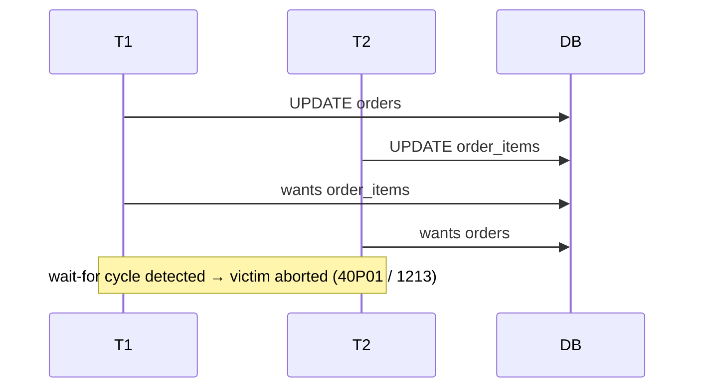

# Locks

> Locks are how a database turns a set of racy, interleaved operations into a correct serial order.
> They are also the single most common source of production outages that are *self-inflicted*: a
> missing index turns a row lock into a table scan; an `ALTER TABLE` queues behind a long query and
> then blocks every subsequent reader; two transactions acquire the same two rows in opposite orders
> and deadlock under load. This chapter covers lock modes and their compatibility, granularity from
> row to table, intent locks and escalation, deadlocks (detection and prevention), lock waits and
> timeouts, the `NOWAIT`/`SKIP LOCKED` patterns that make correct queues, and the exact queries you
> run at 3 a.m. to find out who is blocking whom.

## TL;DR

- **Modes:** **Shared (S)** = readers, mutually compatible; **Exclusive (X)** = writers, compatible
  with nothing; **Update (U)** = "I read with intent to write" (SQL Server) to avoid conversion
  deadlocks; **Intent (IS/IX/SIX)** at coarse granularity to signal fine-grained locks.
- **Granularity:** row → page → partition → table. Smaller = more concurrency, more overhead;
  **lock escalation** (SQL Server ~5,000 locks; InnoDB doesn't escalate; Oracle doesn't escalate)
  trades concurrency for memory.
- **Readers don't lock under MVCC** (PostgreSQL, InnoDB consistent reads, Oracle) — but *writers do*,
  and readers can still block against DDL.
- **Deadlock** = a cycle in the wait-for graph. Engines detect it (PostgreSQL after
  `deadlock_timeout`, InnoDB continuously, SQL Server's deadlock monitor, Oracle on-wait) and abort a
  victim (`40001`/`40P01`, `1213`, `1205`, `ORA-00060`). **Deadlocks are normal; the bug is not
  retrying.**
- **Prevent deadlocks** by (a) consistent lock ordering, (b) short transactions, (c) the right index
  so you lock the rows you mean to lock, (d) `SKIP LOCKED` for queues, (e) comparing-and-swapping in
  one statement instead of read-then-write.
- **`SELECT ... FOR UPDATE SKIP LOCKED`** is the modern, correct job-queue pattern — workers claim
  disjoint rows instead of convoying on one.
- **`lock_timeout` / `LOCK_TIMEOUT` / `NOWAIT`** turn "hang" into a fast, retryable error.

---

## 1. Definitions and core concepts (from the ground up)

### 1.1 Why locks exist

Two transactions writing the same row can interleave destructively (see [Isolation
levels](./05-isolation-levels.md)). Locks enforce **mutual exclusion** at the unit the engine
chooses. Everything else — modes, granularity, intent, escalation — is an optimization to keep the
*minimum* set of things locked.

### 1.2 Lock modes

| Mode | Symbol | Meaning | Compatible with |
|---|---|---|---|
| Shared | **S** | "I'm reading; don't change it." | other S |
| Exclusive | **X** | "I'm changing it." | nothing |
| Update | **U** | "I read, intend to update." (SQL Server) | other U on same resource? no (serialized) |
| Intent Shared | **IS** | "I hold/lock S at a finer granularity below." | IS, IX, S |
| Intent Exclusive | **IX** | "I hold/lock X below." | IS, IX |
| Shared + Intent Exclusive | **SIX** | "read all, write some." | IS |
| Schema Stability | **Sch-S** | "I'm compiling/using this object." | all but Sch-M |
| Schema Modification | **Sch-M** | "I'm changing this object's structure." | nothing |

**Compatibility matrix (S/X/U):**

| Requested ↓ / Held → | S | U | X |
|---|---|---|---|
| **S** | ✅ | ✅ | ❌ |
| **U** | ✅ | ❌ | ❌ |
| **X** | ❌ | ❌ | ❌ |

The **U lock** exists specifically to avoid **conversion deadlocks**: two transactions that each hold
an S lock and both want to upgrade to X would deadlock; taking U first lets only one proceed.

### 1.3 Row-level lock modes (per engine)

**PostgreSQL** (row locks are tuple flags, not lock-manager entries):

| Clause | Effect |
|---|---|
| `FOR UPDATE` | X lock on rows — no other writer/`FOR UPDATE` |
| `FOR NO KEY UPDATE` | weaker: does not block FK `FOR KEY SHARE` (used by `UPDATE` on non-key cols) |
| `FOR SHARE` | S lock on rows |
| `FOR KEY SHARE` | weakest: blocks key updates only (what FK checks take) |

**InnoDB**:

| Lock | Meaning |
|---|---|
| **Record lock** | S or X on one index record |
| **Gap lock** | locks the *gap between* records (no insert into the range) — prevents phantoms under RR |
| **Next-key lock** | record + preceding gap (the default under RR) |
| **Insert intention lock** | taken by `INSERT` before inserting into a gap |
| **Auto-inc lock** | serializes auto-increment allocation (`innodb_autoinc_lock_mode`) |

**SQL Server**: key/row, page, table, plus `RID` locks on heaps; **range locks** (`RangeS-S`,
`RangeS-U`, `RangeX-X`) under SERIALIZABLE; **U locks** via `UPDLOCK`, `HOLDLOCK` (= SERIALIZABLE),
`READPAST`, `TABLOCKX`.

**Oracle**: **TX** (row-level transaction enqueue) and **TM** (table-level intention) locks, plus DDL
locks. Plain `SELECT` takes **no locks** (pure MVCC), so Oracle has no S locks on rows.

---

## 2. Why it matters / what problem it solves

Locks are where isolation meets concurrency engineering:

- The **missing index** that turns an update into a table scan is a lock problem: it holds table-wide
  locks and blocks the world.
- The **`ALTER TABLE` that froze the app** is a lock-queue problem.
- The **deadlock spike after a deploy** is (usually) a lock-ordering problem.
- The **duplicate job execution** is a missing-lock problem.
- The **worker convoy on one queue row** is solved by `SKIP LOCKED`.

---

## 3. How it works internally

### 3.1 Granularity, intent locks, and escalation

```
  Intent locks: locking a row implies a table-level "intent" so that a table lock can
  check a single bit instead of inspecting a million rows.

  TABLE (IX)───────────────────────────┐
     │  intent-exclusive says "someone below me holds X"
     ▼
  PAGE (IX)────────────────┐
     │                     │
     ▼                     ▼
  ROW (X)  order_id=42   ROW (X) order_id=57
```

If a session wants an `ACCESS EXCLUSIVE` table lock, it only has to check for *any* conflicting
table-level lock (including intent locks) — one lookup instead of scanning all rows.

**Escalation:** when a single transaction takes too many fine-grained locks, the engine may promote
them to one coarse lock.

| Engine | Escalates? | Trigger | Effect |
|---|---|---|---|
| SQL Server | ✅ | ~5,000 locks on one object/statement (configurable) | table X lock; blocks everyone |
| InnoDB | ❌ (some bitmaps→table locks) | — | stays fine-grained |
| PostgreSQL | ❌ | — | stays fine-grained (memory cost) |
| Oracle | ❌ | — | stays fine-grained |

SQL Server escalation is a frequent cause of "the app froze" spikes in busy OLTP; common mitigations
are partitioning the table, `LOCK_ESCALATION = DISABLE`, or splitting the transaction.

### 3.2 Lock waits and the wait-for graph

A waiter records *what it waits on* (transaction id, or a lock object). The set of waiters forms a
directed graph; a cycle is a **deadlock**.

```
 wait-for graph:
   T1 ──waits for──▶ T2 ──waits for──▶ T3 ──waits for──▶ T1     ← cycle ⇒ deadlock
```

### 3.3 Deadlock detection

Each engine has a different strategy:

| Engine | Strategy | Timing | Victim selection | Error |
|---|---|---|---|---|
| PostgreSQL | Build & scan the wait-for graph | after `deadlock_timeout` (1 s) | the transaction that *detects* it (usually younger) | `40P01` |
| InnoDB | Continuous cycle detection | immediate | the txn that **modified fewer rows** (cheaper to roll back) | `1213` |
| SQL Server | Deadlock monitor thread | ~every 5 s | cost-based; `SET DEADLOCK_PRIORITY` | `1205` |
| Oracle | Detect on wait | when a wait forms | the statement that would close the cycle | `ORA-00060` |

Both `40P01` (deadlock) and `40001` (serialization failure) are **retryable by design**.

### 3.4 The classic deadlock — and its ASCII

Two sessions, opposite order:

```sql
-- T1
BEGIN;
UPDATE orders   SET total_cents = total_cents + 100 WHERE order_id = 1;
UPDATE order_items SET quantity = quantity + 1 WHERE order_id = 1 AND line_no = 1;

-- T2 (runs concurrently)
BEGIN;
UPDATE order_items SET quantity = quantity + 1 WHERE order_id = 1 AND line_no = 1;
UPDATE orders   SET total_cents = total_cents + 100 WHERE order_id = 1;
```

```
 T1 holds: orders#1
 T2 holds: order_items#1-1
 T1 wants: order_items#1-1   ← held by T2
 T2 wants: orders#1          ← held by T1
                             ⇒ deadlock; one is rolled back
```



**Prevention rule:** always acquire locks in a **globally consistent order** (e.g., parent before
child, or lowest id first). The same mechanism that makes two-phase locking correct also makes
ordering-based deadlock avoidance provable.

### 3.5 The lock queue and the DDL convoy

A lock request **queues** behind the currently granted lock and **blocks everything behind it**,
even requests that are compatible with the granted lock. This is why a paused DDL statement is
catastrophic:

```
  time ─▶
  long SELECT (ACCESS SHARE held)         ALTER TABLE (wants ACCESS EXCLUSIVE) queued
        │                                        │
        └──────────── finishes ──────────────────▶│
                                                 │ now ALTER runs (exclusive)
   Meanwhile every new SELECT queues behind ALTER → total freeze
```

The professional fix (PostgreSQL):

```sql
SET lock_timeout = '3s';              -- never queue behind a long query indefinitely
ALTER TABLE orders ADD COLUMN channel text;   -- if it times out, retry later
```

### 3.6 Advisory locks

Application-level locks that live entirely in the DB (not tied to rows):

```sql
-- PostgreSQL advisory locks
SELECT pg_advisory_lock(42);              -- session-level, blocking
SELECT pg_try_advisory_lock(42);          -- non-blocking, returns bool
SELECT pg_advisory_xact_lock(42);         -- released at txn end (best for short critical sections)

-- MySQL named locks
SELECT GET_LOCK('order-drain:42', 5);     -- 5s timeout
SELECT RELEASE_LOCK('order-drain:42');
```

Use them for singleton jobs ("only one cron instance may run the nightly rebuild"), migration
coordination, or serializing an operation that touches a set of rows no single row represents.

### 3.7 NOWAIT, SKIP LOCKED and the queue pattern

Three ways to handle "someone else holds the row":

```
 FOR UPDATE              → wait (block) until the lock is free
 FOR UPDATE NOWAIT       → fail immediately (55P03 / 3572) if locked
 FOR UPDATE SKIP LOCKED  → silently skip locked rows, return the next free ones
```

The queue pattern:

```sql
-- Worker: atomically claim one pending order for processing
WITH claimed AS (
    SELECT order_id
    FROM   orders
    WHERE  status = 'pending'
    ORDER BY order_id
    FOR UPDATE SKIP LOCKED      -- never block behind another worker
    LIMIT 1
)
UPDATE orders o
SET    status = 'processing', claimed_at = now(), worker_id = $1
FROM   claimed c
WHERE  o.order_id = c.order_id
RETURNING o.order_id;
```

```
  queue table (status='pending')
  ┌────┬────┬────┬────┬────┬────┐
  │ 1  │ 2  │ 3  │ 4  │ 5  │ 6  │
  └────┴────┴────┴────┴────┴────┘
   ▲         ▲         ▲
   W1 claims 2       W3 claims 6
             W2 claims 4        ← all three run in parallel, no waiting
```

Without `SKIP LOCKED`, all workers queue on row 1 → serial throughput and lock waits.

> **Senior note:** `SKIP LOCKED` gives **at-most-once-granted**, not exactly-once-processing. A worker
> that crashes after claiming leaves the row stuck in `processing`; you still need a visibility
> timeout / reaper. `SKIP LOCKED` solves *contention*, not *liveness*.

### 3.8 Lock timeouts

```sql
SET lock_timeout = '2s';        -- PostgreSQL: any statement waiting for a lock errors after 2s
SET LOCAL lock_timeout = '500ms';   -- just for this txn

SET innodb_lock_wait_timeout = 5;   -- MySQL: seconds
SET LOCK_TIMEOUT 2000;              -- SQL Server: milliseconds (per session)
-- Oracle: use FOR UPDATE NOWAIT / WAIT n, or an event-based timeout
```

A lock timeout converts an unbounded stall into a bounded, retryable failure — always preferable at
the application level.

---

## 4. How to observe / inspect it

### 4.1 PostgreSQL

```sql
-- Everything currently waiting on a lock + what is blocking it
SELECT w.pid         AS waiter_pid,
       w.wait_event_type, w.wait_event,
       a.pid         AS blocker_pid,
       a.state       AS blocker_state,
       now()-a.xact_start AS blocker_txn_age,
       w.query       AS waiting_query,
       a.query       AS blocking_query
FROM   pg_stat_activity w
JOIN   pg_locks  wl ON wl.pid = w.pid AND NOT wl.granted
JOIN   pg_locks  bl ON bl.locktype = wl.locktype
                   AND bl.relation IS NOT DISTINCT FROM wl.relation
                   AND bl.granted
JOIN   pg_stat_activity a ON a.pid = bl.pid
WHERE  w.wait_event_type = 'Lock';

-- All locks, by mode, on a table
SELECT l.locktype, l.mode, l.granted, count(*)
FROM   pg_locks l JOIN pg_class c ON c.oid = l.relation
WHERE  c.relname = 'orders'
GROUP BY 1,2,3 ORDER BY 3,2;

-- Who holds an ACCESS EXCLUSIVE lock (i.e., who is doing DDL)?
SELECT pid, mode, granted, query FROM pg_locks l JOIN pg_stat_activity a USING (pid)
WHERE l.mode = 'AccessExclusiveLock' AND l.granted;

-- is anybody waiting at all?
SELECT count(*) FROM pg_locks WHERE NOT granted;
```

### 4.2 MySQL InnoDB

```sql
-- Blocking relationships (MySQL 8.0)
SELECT * FROM performance_schema.data_lock_waits;
SELECT * FROM performance_schema.data_locks;         -- every held/waited lock
SELECT * FROM sys.innodb_lock_waits;                 -- friendly view: who blocks whom

-- The transaction history + last deadlock
SHOW ENGINE INNODB STATUS\G     -- "LATEST DETECTED DEADLOCK" section
SELECT * FROM performance_schema.events_errors_summary_global_by_error
WHERE error_name LIKE '%DEADLOCK%';

-- Longest-running transactions holding locks
SELECT trx_id, trx_state, trx_started, trx_rows_locked, trx_rows_modified
FROM   information_schema.innodb_trx ORDER BY trx_started;
```

### 4.3 SQL Server

```sql
-- Who is blocking whom, with the resource
SELECT r.session_id AS waiting, r.blocking_session_id AS blocking,
       r.wait_type, r.wait_time, r.wait_resource,
       t.text AS waiting_sql
FROM   sys.dm_exec_requests r
CROSS APPLY sys.dm_exec_sql_text(r.sql_handle) t
WHERE  r.blocking_session_id <> 0;

-- Locks held, by resource and mode
SELECT request_session_id, resource_type, request_mode, request_status, resource_description
FROM   sys.dm_tran_locks
WHERE  resource_database_id = DB_ID('shop');

-- Deadlock info: capture the graph with an Extended Events session
CREATE EVENT SESSION deadlocks ON SERVER
ADD EVENT sqlserver.xml_deadlock_report;   -- then read the .xel (system_health by default)
```

### 4.4 Oracle

```sql
-- Blocking tree
SELECT blocking_session, sid, serial#, wait_class, seconds_in_wait, event, sql_id
FROM   v$session
WHERE  blocking_session IS NOT NULL;

-- Locks
SELECT * FROM v$lock WHERE type IN ('TM','TX');
-- Deadlock detected files
SELECT * FROM v$deadlock_detected;   -- (or the alert log / trace files: ORA-00060)
```

---

## 5. Worked examples and demos on the shared sample schema

Using the e-commerce schema from [chapter 01](./01-clustered-vs-nonclustered-indexes.md).

### 5.1 Reproduce a deadlock and read the error

```sql
-- Session A
BEGIN;
UPDATE orders SET total_cents = total_cents + 1 WHERE order_id = 1;      -- holds X on orders#1
SELECT pg_sleep(2);
UPDATE order_items SET quantity = quantity + 1 WHERE order_id = 1 AND line_no = 1;
COMMIT;

-- Session B (2 seconds later)
BEGIN;
UPDATE order_items SET quantity = quantity + 1 WHERE order_id = 1 AND line_no = 1;  -- holds
SELECT pg_sleep(2);
UPDATE orders SET total_cents = total_cents + 1 WHERE order_id = 1;
COMMIT;

-- After ~2 s, one session returns:
-- ERROR:  deadlock detected
-- DETAIL: Process 12345 waits for ShareLock on transaction 678; blocked by process 6789.
--          Process 6789 waits for ShareLock on transaction 678; blocked by process 12345.
-- HINT:   See server log for query details.
-- SQLSTATE: 40P01
```

### 5.2 Prevent it with consistent lock ordering

```sql
-- Both sessions lock the parent first, then the child → deadlock impossible
BEGIN;
UPDATE orders       SET total_cents = total_cents + 1 WHERE order_id = 1;
UPDATE order_items  SET quantity     = quantity + 1     WHERE order_id = 1 AND line_no = 1;
COMMIT;
```

### 5.3 The missing-index lock amplification (the classic incident)

```sql
-- order_items has an FK on product_id but NO index. Now delete a product:
DELETE FROM products WHERE product_id = 500;

-- In another session, meanwhile:
UPDATE order_items SET quantity = 2 WHERE product_id = 501;
-- The DELETE must check the FK by scanning order_items, and the UPDATE must lock rows
-- → they block each other and the whole table serializes.
EXPLAIN (ANALYZE, BUFFERS)
SELECT 1 FROM order_items WHERE product_id = 500;   -- Seq Scan → the smoking gun

-- Fix
CREATE INDEX ix_order_items_product ON order_items (product_id);
```

### 5.4 A correct, contended-free order worker

```sql
-- Several workers run this concurrently; no lock waits, no duplicate claims.
WITH claimed AS (
    SELECT order_id
    FROM   orders
    WHERE  status = 'paid'
    ORDER BY order_id
    FOR UPDATE SKIP LOCKED
    LIMIT 10
)
UPDATE orders o
SET    status = 'fulfilling'
FROM   claimed c
WHERE  o.order_id = c.order_id
RETURNING o.order_id;
```

### 5.5 Watch the DDL convoy and defuse it

```sql
-- Session A: a long-running report
BEGIN;
SELECT count(*) FROM orders;   -- keeps ACCESS SHARE for a long time
SELECT pg_sleep(30);

-- Session B: add a column (wants ACCESS EXCLUSIVE)
SET lock_timeout = '2s';
ALTER TABLE orders ADD COLUMN channel text;
-- ERROR: canceling statement due to lock timeout  → retry later; app never froze
```

### 5.6 Advisory lock for a singleton job

```sql
DO $$
BEGIN
  IF pg_try_advisory_lock(hashtext('nightly-rollup')) THEN
     PERFORM refresh_daily_rollup();
     PERFORM pg_advisory_unlock(hashtext('nightly-rollup'));
  ELSE
     RAISE NOTICE 'rollup already running elsewhere';
  END IF;
END $$;
```

### 5.7 Observe the wait in `pg_stat_activity`

```sql
-- While sessions block each other, run:
SELECT pid, wait_event_type, wait_event, state, query
FROM   pg_stat_activity
WHERE  wait_event_type = 'Lock';
-- wait_event = 'transactionid' or 'tuple' or 'relation'
```

---

## 6. Real-world use cases and applications

### 6.1 Job queues and outbox relay

`FOR UPDATE SKIP LOCKED` (PostgreSQL/MySQL/SQL Server `READPAST`) is the standard way to build a
queue **inside** the transactional database. It guarantees each row is handed to at most one worker
per claim while letting N workers run in parallel. Pair it with a visibility timeout for crashed
workers.

### 6.2 The "ALTER TABLE took down production" incident

A routine migration adds a column with a `DEFAULT` (in old engines, a table rewrite under
`ACCESS EXCLUSIVE`). It waits behind a long query, and every subsequent query queues behind the
migration. Mitigations: `lock_timeout` + retry, concurrent/batched DDL, `NOT VALID` constraints,
and `pg_repack`-style online rewrites.

### 6.3 Fan-out locking in inventory

Reserving inventory across multiple warehouses: lock rows in a **global order** (`ORDER BY
warehouse_id`) so concurrent reservations cannot deadlock; where ordering is impossible, retry on
`40P01`/`1213`.

### 6.4 SQL Server lock escalation under batch load

A batch `UPDATE` touching 50,000 rows escalates to a table `X` lock, blocking all readers. Fixes:
batch in smaller chunks, partition, or set `LOCK_ESCALATION = DISABLE` on the table, or enable RCSI so
readers don't take shared locks at all.

### 6.5 Distributed coordination without a lock service

PostgreSQL advisory locks (`pg_advisory_xact_lock`) or MySQL `GET_LOCK` can replace a separate lock
service (Redis/ZooKeeper) for coarse singleton coordination, at the cost of tying the lock to a
connection's lifetime.

---

## 7. Patterns and anti-patterns

### Patterns

| Pattern | Why |
|---|---|
| Consistent global lock ordering | makes deadlock cycles impossible |
| `SET lock_timeout` on every DDL/migration | no indefinite queueing |
| `SKIP LOCKED` for work queues | parallel workers, no convoy |
| Atomic updates (`WHERE x >= n`) instead of read-then-write | fewer locks, no lost update |
| Take locks as late as possible, release ASAP (short txns) | less contention |
| Retry on `40001`/`40P01`/`1213`/`1205` | these are normal signals |
| Index every FK column | avoids scan-amplified locks |
| `FOR NO KEY UPDATE` / `FOR KEY SHARE` where appropriate | less FK blocking |

### Anti-patterns

| Anti-pattern | Symptom |
|---|---|
| Two-phase work with opposite lock order | deadlock storms |
| Unindexed FK | table-wide lock amplification on deletes |
| Long transaction holding row locks while doing I/O | cascading waits, timeouts |
| `FOR UPDATE` on a queue without `SKIP LOCKED` | serialized workers |
| Ignoring deadlock errors (no retry) | user-visible failures under load |
| DDL without `lock_timeout` | total freeze behind a long query |
| Assuming "SELECT never blocks" | true only under MVCC; DDL/`FOR UPDATE` do block |

---

## 8. Cross-engine differences

| Aspect | PostgreSQL | MySQL InnoDB | SQL Server | Oracle |
|---|---|---|---|---|
| Reader locks | none (MVCC) | none (consistent read) | S locks (unless RCSI) | none |
| Row lock storage | tuple flags in the row header | in-memory lock structs + bitmaps | lock manager (`sys.dm_tran_locks`) | TX enqueue (block-level ITL) |
| `SELECT ... FOR UPDATE` | ✅ + `NO KEY UPDATE`/`KEY SHARE` | ✅ (+ `LOCK IN SHARE MODE`) | ✅ + `UPDLOCK`/`XLOCK` hints | ✅ (+ `NOWAIT`/`WAIT n`/`SKIP LOCKED`) |
| `NOWAIT` | ✅ | ✅ | ✅ (`NOWAIT`) | ✅ |
| `SKIP LOCKED` | ✅ | ✅ | ✅ (`READPAST`) | ✅ (12c+) |
| Gap / range locking | no gap locks (SSI instead) | ✅ next-key locks (RR) | ✅ range locks (SERIALIZABLE, `HOLDLOCK`) | no gap locks |
| Update (U) mode | no | no | ✅ (`UPDLOCK`) | no |
| Intent locks | yes (table-level) | yes (IS/IX) | yes (IS/IX/SIX) | TM locks |
| Lock escalation | ❌ | ❌ | ✅ (~5,000, per-object) | ❌ |
| Advisory locks | ✅ `pg_advisory_*` | ✅ `GET_LOCK` | ✅ `sp_getapplock` | ✅ `DBMS_LOCK` |
| Timeout | `lock_timeout` | `innodb_lock_wait_timeout` | `LOCK_TIMEOUT` | `FOR UPDATE WAIT n` |
| Deadlock detection | wait-for graph, `deadlock_timeout` | continuous, cheap victim | monitor (~5 s), cost-based | on-wait, `deadlock_detected` |
| Monitor view | `pg_locks` + `pg_stat_activity` | `performance_schema.data_locks` | `sys.dm_tran_locks` | `v$lock` |

---

## 9. Exercises — Intermediate (hints only)

1. **Read the matrix.** Which combinations of S/U/X are compatible? Why does U exist? *Hint: lock
   conversion deadlocks.*

2. **Find the blocker.** Write the query that lists every waiting session and its blocker in
   PostgreSQL. *Hint: `pg_locks` self-join on `granted`.*

3. **Deadlock by hand.** Construct two statements orders that deadlock on `orders` and `order_items`,
   then fix them. *Hint: reverse the order in one transaction.*

4. **Queue claim.** Write a worker that claims one `pending` order without blocking on other workers.
   *Hint: `FOR UPDATE SKIP LOCKED`.*

5. **DDL safety.** Add `lock_timeout` to a migration and explain what happens when it fires. *Hint:
   retryable error vs. total freeze.*

---

## 10. Exercises — Advanced (hints / expected approach)

1. **Model deadlock rate.** Given two transaction types each touching the same two tables in random
   order, argue why the deadlock probability grows with concurrency and how a canonical order removes
   it. Expected approach: describe the wait-for graph and the number of possible orderings.

2. **Design an exactly-once queue.** Combine `SKIP LOCKED`, a visibility timeout, and an idempotency
   key. Expected approach: discuss crash-after-claim, reaper, and duplicate suppression.

3. **Diagnose lock escalation.** On SQL Server, a nightly batch blocks all reads. Expected approach:
   identify escalation via `sys.dm_tran_locks` + Extended Events, then propose batching, partitioning,
   `LOCK_ESCALATION = DISABLE`, or RCSI, with trade-offs.

4. **The DDL convoy, quantitatively.** Model how long a query queues when a long reader runs for
   `Tread` and a DDL waits; then how many readers pile up behind the DDL. Expected: relate to arrival
   rate and `lock_timeout`.

5. **Reason about InnoDB gap locks.** Explain why a range `FOR UPDATE` under `REPEATABLE READ` can
   deadlock with two inserts into the same gap, and how lowering to `READ COMMITTED` changes it.
   Expected approach: next-key lock mechanics and insert intention locks.

---

## References

- PostgreSQL: [Explicit Locking](https://www.postgresql.org/docs/current/explicit-locking.html)
- PostgreSQL: [The Locking — row-level lock modes](https://www.postgresql.org/docs/current/explicit-locking.html#LOCKING-ROWS)
- PostgreSQL: [`SELECT ... FOR UPDATE/FOR SHARE` (incl. `SKIP LOCKED`)](https://www.postgresql.org/docs/current/sql-select.html#SQL-FOR-UPDATE-SHARE)
- PostgreSQL: [Advisory Locks](https://www.postgresql.org/docs/current/explicit-locking.html#ADVISORY-LOCKS)
- MySQL: [InnoDB Locking](https://dev.mysql.com/doc/refman/8.4/en/innodb-locking.html)
- MySQL: [InnoDB Deadlocks](https://dev.mysql.com/doc/refman/8.4/en/innodb-deadlocks.html)
- MySQL: [Locking Reads](https://dev.mysql.com/doc/refman/8.4/en/innodb-locking-reads.html)
- Microsoft: [Transaction Locking and Row Versioning Guide](https://learn.microsoft.com/en-us/sql/relational-databases/sql-server-transaction-locking-and-row-versioning-guide)
- Microsoft: [sys.dm_tran_locks](https://learn.microsoft.com/en-us/sql/relational-databases/system-dynamic-management-views/sys-dm-tran-locks-transact-sql)
- Oracle: [Data Concurrency and Consistency — Locks](https://docs.oracle.com/en/database/oracle/oracle-database/19/cncpt/data-concurrency-and-consistency.html)
- Gray, Lorie, Putzolu, Traiger — *Granularity of Locks and Degrees of Consistency* (1976): https://dl.acm.org/doi/10.1145/1282480.1282482
