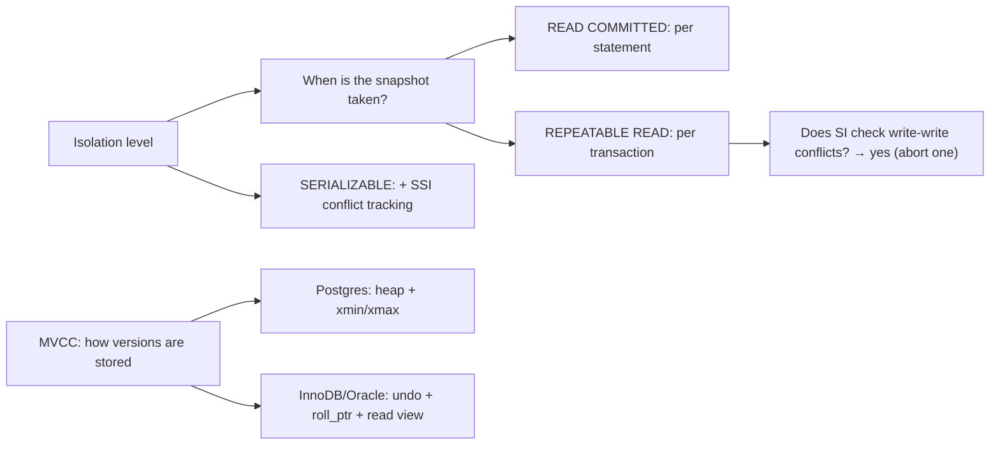

# MVCC — Multi-Version Concurrency Control

> Every production database you will meet uses MVCC, and every operational headache it causes —
> table bloat, `VACUUM`, undo tablespaces, "history list length," the legendary *transaction-ID
> wraparound* that took down Sentry's primary in 2015 and Mandrill's in 2019 — follows directly from
> one design choice: **instead of overwriting a row, write a new version of it and let each
> transaction see the version that existed when it started.** That single decision is what makes
> "readers don't block writers, writers don't block readers" true. But it also means the database
> accumulates garbage that must be cleaned up, and that cleanup is what most MVCC incidents are
> actually about. This chapter builds MVCC from a plain heap page upwards: tuple headers, `xmin`/
> `xmax`, version chains, read-view construction, snapshots, vacuum and freeze, and the wraparound
> cliff.

## TL;DR

- MVCC keeps **multiple versions** of a row so a reader can see a consistent snapshot without taking
  locks. The payoff: **readers never block writers or vice versa**. The cost: **garbage + cleanup**.
- **PostgreSQL** stores versions **in the heap**: each tuple has `xmin` (creating XID), `xmax`
  (deleting/updating XID), and the index points at the physical `ctid`. `UPDATE` = write a new tuple
  + set the old tuple's `xmax`. Dead tuples are reclaimed by **`VACUUM`**.
- **InnoDB / Oracle** store versions **out-of-line**: the row keeps a pointer (`DB_ROLL_PTR`) into an
  **undo log**, and old versions are reconstructed by walking a **version chain**. Cleanup is done by
  the **purge** thread / undo retention.
- A **snapshot / read view** is a set of rules describing which XIDs are visible. PostgreSQL: `xmin`,
  `xmax`, and the in-progress list. InnoDB: `m_ids`, `min_trx_id`, `max_trx_id`, `creator_trx_id`.
- Snapshots are exactly what isolation levels are *made of*: **statement-snapshot** = READ COMMITTED;
  **transaction-snapshot** = REPEATABLE READ / SNAPSHOT; **SSI** adds conflict tracking on top.
- **Blo**at is dead tuples/undo that cleanup has not reclaimed. Root causes: long-running
  transactions and abandoned replication slots (PostgreSQL), long read views (InnoDB/Oracle).
- **Wraparound:** PostgreSQL XIDs are 32-bit (~4.29 B), but a transaction is *in the past* relative to
  a 2³¹ window. Without freezing, the arithmetic inverts and the cluster **stops accepting writes** to
  avoid data loss. Sentinel: `age(datfrozenxid)` vs `autovacuum_freeze_max_age`.

---

## 1. Definitions and core concepts (from the ground up)

### 1.1 Start from an overwrite-in-place database

Imagine a database with **no** MVCC. It stores one copy of each row; a writer must **overwrite** it in
place. To keep a reader from seeing a half-updated state, the reader takes a **shared lock** and the
writer takes an **exclusive lock**. Readers and writers block each other.

```
  ROW id=1 total_cents=1000
  ┌──────────────────────────────────────┐
  │ reader holds S ──▶ writer with X waits │   ← blocking both ways
  └──────────────────────────────────────┘
```

Fine for light loads, terrible for a database with thousands of concurrent sessions.

### 1.2 The MVCC idea: never overwrite, always append a version

```
  Physical reality (a sequence of versions of the same logical row):

  version v1 (id=1, total=1000)   created by xact 500, deleted-by xact 612
  version v2 (id=1, total=1500)   created by xact 612                    ← current
  version v3 (id=1, total=900)    created by xact 700                    ← newer still

  A reader whose snapshot was taken at time T sees the version whose
  lifetime (created, deleted) brackets T. Different readers → different versions.
```

Now the reader takes **no lock at all**: it just asks "which version is visible to me?" The writer
takes no lock for the reader's sake: it writes a new version. Contention between reads and writes
disappears.

### 1.3 Vocabulary

| Term | Engine | Meaning |
|---|---|---|
| **Tuple / heap tuple** | PostgreSQL | One physical row version. |
| **`xmin`** | PostgreSQL | XID that created this version. |
| **`xmax`** | PostgreSQL | XID that deleted/superseded this version (0 if live). |
| **`ctid`** | PostgreSQL | Physical address `(page, slot)` of this version. |
| **`t_ctid`** | PostgreSQL | Points to the **next** version after an update (version chain). |
| **`infomask`** | PostgreSQL | Flags: has `xmax`, is committed/aborted, has nulls, HOT-updated, … |
| **HOT** | PostgreSQL | Heap-Only Tuple: update without touching any index (no indexed col changed). |
| **`DB_TRX_ID` / `DB_ROLL_PTR`** | InnoDB | Row's last-modifying txn and pointer to its undo record. |
| **Undo log / rollback segment** | InnoDB, Oracle | Records how to reconstruct old versions. |
| **Read view / snapshot** | all | Rules describing which XIDs are visible. |
| **`VACUUM` / autovacuum** | PostgreSQL | Reclaims dead tuples, freezes old XIDs, updates visibility map/stats. |
| **History list length** | InnoDB | Amount of undo the purge threads have not yet cleaned. |
| **Freeze / frozen tuple** | PostgreSQL | A tuple marked as visible to everyone (no XID needed). |
| **Wraparound** | PostgreSQL | The 2³¹ XID age limit that forces freezing. |

---

## 2. Why it matters / what problem it solves

MVCC is the reason a database can serve a 5-second analytical read and thousands of point writes at
the same time without one blocking the other. It is also the reason your disk fills up with a table
that "has 10 million rows but is 200 GB." And it is the reason a **forgotten long transaction** can
take down a database hours later. In other words, MVCC is not a detail — it is the operating model you
monitor, tune, and design around.

---

## 3. How it works internally

### 3.1 The PostgreSQL heap page and tuple header (on-disk layout)

A PostgreSQL heap page is 8 KiB of **slotted** storage:

```
 ┌──────────────────────────── POSTGRES HEAP PAGE (8 KiB) ─────────────────────────────┐
 │ PageHeaderData (24 B): pd_lsn, pd_checksum, pd_flags, pd_lower, pd_upper, pd_special  │
 ├──────────────────────────────────────────────────────────────────────────────────────┤
 │ ItemIdData[]  (line pointers, 4 B each)  →  slot 1, slot 2, slot 3 ...               │
 │      ▲ grows right                                                                   │
 ├──────────────────────────────────────────────────────────────────────────────────────┤
 │                              FREE SPACE (the hole)                                   │
 ├──────────────────────────────────────────────────────────────────────────────────────┤
 │                              tuple data  ◀ grows left from the end                    │
 │  (varlena, null bitmap, then HeapTupleHeaderData)                                     │
 ├──────────────────────────────────────────────────────────────────────────────────────┤
 │ Special space (may be empty for heap pages)                                          │
 └──────────────────────────────────────────────────────────────────────────────────────┘
```

Each tuple's **23-byte header** is the heart of MVCC:

```
 struct HeapTupleHeaderData {
   uint32  t_xmin;      -- creating transaction id          (4 B)
   uint32  t_xmax;      -- deleting/locking transaction id  (4 B)   (0 = live)
   uint32  t_cid;       -- command id within the txn        (4 B)
   ItemPointerData t_ctid; -- (block, offset) of THIS or the NEXT version (6 B)
   uint16  t_infomask2; -- #attrs, HOT flags                 (2 B)
   uint16  t_infomask;  -- HAS_NULLS, XMAX_IS_MULTI, ...     (2 B)
   uint8   t_hoff;      -- header offset                    (1 B)
 };                                                         = 23 B (+ null bitmap)
```

Interpretation:

- `xmin` committed and `xmax = 0` → **live**.
- `xmin` committed and `xmax` committed → **dead** (a newer version exists, or it was deleted).
- `xmin` aborted → **never existed** (rolled back; still occupying space until vacuum).

### 3.2 An `UPDATE` in PostgreSQL — version chain, step by step

```sql
-- Starting point: one tuple in page 7, slot 3
UPDATE orders SET total_cents = 1500 WHERE order_id = 1;
```

```
 BEFORE (page 7)                                 AFTER (page 7 + page 9)
 ┌───────────────────────────────┐               ┌───────────────────────────────┐
 │ slot3: xmin=500 xmax=612      │               │ slot3: xmin=500 xmax=612      │  ← dead
 │        ctid=(7,3)→(7,4)       │               │        ctid=(7,3)→(9,2)  ─────┼─┐ version chain
 │        total=1000             │               │        total=1000             │ │
 ├───────────────────────────────┤               ├───────────────────────────────┤ │
 │ slot4: xmin=612 xmax=0        │               │ slot4: xmin=612 xmax=0        │ │
 │        total=1200             │               │        total=1200  (older)    │ │
 └───────────────────────────────┘               ├───────────────────────────────┤ │
                     write new version ─────────▶│ slot2(old): xmin=612 xmax=0 ◀─┘
                                                 │        ctid=(9,2), total=1500 │  ← NEW live
                                                 └───────────────────────────────┘
```

Key points:
1. The old tuple is **not** modified in place; a **new** tuple is written (page 9 here).
2. The old tuple's `xmax` is set to the updating XID, and its `t_ctid` points to the new tuple —
   this is the **version chain**.
3. The index still points at **`ctid = (7,3)`**, the *old* tuple. Readers walk the chain
   (`(7,3) → (9,2)`) to find the version visible to their snapshot. This is why a non-HOT update
   eventually requires new index entries — and why index bloat tracks table churn.
4. **HOT**: if the update changes **no indexed column** and the new version fits on the **same page**,
   the index does not need a new entry at all (`t_infomask` gets `HEAP_HOT_UPDATED`). This is the
   strongest argument for *not* over-indexing a hot table: fewer indexed columns ⇒ more HOT updates ⇒
   less index bloat.

```
 HOT update (same page, no indexed column changed):   index untouched ✅
 Non-HOT update (new page or indexed column changed): index gets a new entry ⚠️
```

### 3.3 Visibility: the rules a reader applies

A tuple is visible to a snapshot `S` iff:

```
 visible = xmin_is_committed(xmin)
        AND xmin_before_snapshot(xmin)        -- xmin < S.xmax and xmin not in S.xip
        AND ( xmax = 0                        -- never deleted
              OR xmax_is_aborted(xmax)        -- deleting txn rolled back
              OR xmax_after_snapshot(xmax) )  -- deleted after my snapshot
```

Snapshots are compared with **wraparound-aware** modular arithmetic (the module-2³¹ window) — which
is exactly why wraparound is dangerous.

### 3.4 Read-view / snapshot construction

**PostgreSQL** records, at snapshot time:
- `xmin` — the lowest still-running XID (anything below it is "finished").
- `xmax` — the first not-yet-assigned XID (`xmax - 1` is the newest possible committed XID).
- `xip_list` — the XIDs actually in progress at snapshot time.

```
  XID timeline at snapshot time:
   ... committed ... [xmin ......... xmax) ... not yet assigned ...
                       ↑ in-progress set (xip_list) decides the ambiguous middle
```

**InnoDB** records, at read-view time:
- `m_ids` — the list of active (uncommitted) read/write transactions.
- `min_trx_id` — smallest in `m_ids`.
- `max_trx_id` — next id to be assigned.
- `creator_trx_id` — my own txn (sees its own changes).

A row version with `DB_TRX_ID < min_trx_id` is visible; `≥ max_trx_id` is not; in between, visible if
not in `m_ids`. If not visible, follow `DB_ROLL_PTR` into the undo log and reconstruct the previous
version, repeating until a visible version is found.

```
  InnoDB row (clustered index leaf)
  ┌──────────────────────────────────────────────────────────────────┐
  │ DB_TRX_ID = 612 │ DB_ROLL_PTR ───────────────┐ │ id=1 │ total=1500 │
  └──────────────────────────────────────────────────┼───────────────┘
                                                     ▼
  undo chain (in undo tablespace):
   undo#2 (total=1200, trx 700, next →)   undo#1 (total=1000, trx 612, next → NULL)
      ▲ reader walks this chain until it finds a version visible in its read view
```

**Oracle** works the same way: a row in a block carries an ITL (interested transaction list) whose
entry points at the **undo segment**; a consistent read reconstructs the old image and can raise
`ORA-01555 snapshot too old` if the undo has already been reused/overwritten.

### 3.5 The two MVCC architectures side by side

```
 POSTGRESQL (heap stores versions)          INNODB / ORACLE (undo stores versions)

  heap:  [v1 dead][v2 dead][v3 live]        row:   [v3 live | trx=700, roll_ptr→]
  index: points at physical ctid              │
  cleanup: VACUUM scans heap, removes         ▼
           dead versions, updates          undo:  [v2 | trx=612, roll_ptr→] → [v1 | trx=500 → ∅]
           visibility map                  cleanup: purge thread / undo retention
  pros: reads never touch undo                pros: pages compact (updated in place)
  cons: bloat in the heap itself,            cons: reads may hit undo; undo can grow;
        every query must be vacuum-aware           "snapshot too old"
```

### 3.6 VACUUM (PostgreSQL) in detail

`VACUUM` (and autovacuum) does **four** jobs:

1. **Reclaim dead tuple space.** Marks dead tuples' line pointers as reusable; new tuples reuse the
   space. (Space is returned to *the table*, not usually to the OS — that needs `VACUUM FULL`.)
2. **Freeze old XIDs.** Replaces old `xmin`/`xmax` with "frozen" markers (since PG 9.4 via the
   `xmin`/`xmax` frozen bits + `pg_class.relfrozenxid`) so the XID cannot wrap.
3. **Update the visibility map.** Sets **all-visible** bits → enables **index-only scans** (see
   [Covering indexes](./03-covering-indexes.md)).
4. **Update statistics** (analyze part), which the planner depends on.

The **removable cutoff** is defined by the oldest `xmin` still needed:

```
 removable cutoff = min( running txns' xmin/xid, oldest replication slot xmin, ... )

 Everything newer than the cutoff is dead-but-not-removable → BLOAT.
```

Removable cutoffs come from:
- Any long-running transaction (`pg_stat_activity`).
- Any **idle-in-transaction** session.
- Any **abandoned or lagging replication slot** (`pg_replication_slots.xmin`).
- Any `pg_prepared_xacts` entry.

### 3.7 Bloat and its cost

Bloat is dead tuples the table carries. Concretely: a table with 1M live rows, each 200 bytes, that has
been updated 20 times per row, can hold ~21M tuple versions. If cleanup is behind, its size is ~20×
its logical size — and every sequential scan, index scan (for non-covering heap fetches), and backup
pays for it.

```
 ideal          bloated
 ██████         ██████████████████████████████████   ← dead tuples (unchanged bytes on disk)
 100 MB         2.3 GB                                ← same amount of *useful* data
```

Bloated indexes are worse: their internal pages and leaf pages are dense with removable entries, so
`Index Only Scan`/`Index Scan` reads far more pages than necessary, and the index may no longer fit in
RAM (which is the *real* performance cliff).

### 3.8 The transaction-ID wraparound problem

PostgreSQL XIDs are **32-bit**: ~4.29 billion values. But because snapshots compare XIDs mod 2³² and
"in the past" means "within 2³¹ of me," an XID that is **more than 2³¹ behind** the current one
suddenly looks *ahead*. If that happens, a tuple would appear to be from the future — data loss.

The defense is **freezing**: VACUUM marks sufficiently old tuples so they no longer depend on their
XID. Thresholds:

| Parameter | Default | Meaning |
|---|---|---|
| `vacuum_freeze_min_age` | 50,000,000 | don't bother freezing tuples younger than this |
| `vacuum_freeze_table_age` | 150,000,000 | do a full/aggressive freeze pass when age exceeds this |
| `autovacuum_freeze_max_age` | 200,000,000 | **force** autovacuum regardless of settings |
| `vacuum_failsafe_age` | 1,600,000,000 | emergency: ignore other limits, freeze at all costs |
| hard stop | ~2,000,000,000 | refuse writes to prevent data loss |

```
  XID age ───────────────────────────────────────────────────────────────▶
  0        50M          150M        200M                          1.6B    2.0B
  │         │            │           │                              │      │
  normal   freeze_min   table_age   FORCED autovacuum (freeze_max)  failsafe  WRITES REFUSED
```

The two queries every production PostgreSQL DBA runs:

```sql
-- Cluster-wide oldest XID age (useless if the DB is very busy but frozen OK)
SELECT datname, age(datfrozenxid) AS xid_age, pg_size_pretty(pg_database_size(datname))
FROM   pg_database ORDER BY xid_age DESC LIMIT 5;

-- Per-table age (find the table marching toward the cliff)
SELECT relname, age(relfrozenxid) AS xid_age, n_dead_tup, last_autovacuum
FROM   pg_class c JOIN pg_stat_user_tables s ON s.relid = c.oid
WHERE  relkind = 'r'
ORDER BY xid_age DESC LIMIT 10;
```

> **Senior note:** Both famous public outages were wraparound-adjacent. **Sentry (2015)** hit the
> cliff on a high-churn table and had to shut down writes for hours; **Mandrill (2019)** hit a
> similar wall (a big table plus a stuck vacuum). The failure mode is *not* "slow queries" — it is
> **writes stop**, and the fix (`VACUUM FREEZE` / `VACUUM (FREEZE)`) can take hours on a huge, bloated
> table, during which you also fight bloat. Prevention: monitor age, never run long transactions,
> alert at 50 % of `autovacuum_freeze_max_age`.

### 3.9 Cleanup in InnoDB / Oracle

InnoDB's equivalent of vacuum is the **purge** thread, which walks undo records and removes those no
longer needed by any read view. Its backlog is **`History list length`** (visible in `SHOW ENGINE
INNODB STATUS`). A very high value means read views are pinning a lot of undo → reads get slower
because they must walk longer version chains, and the undo tablespace grows.

Oracle uses the same idea with an **undo retention** policy; if a query needs an old version that has
been overwritten (because the undo tablespace recycled it), it fails with **`ORA-01555: snapshot too
old`** — the one MVCC failure that simply cannot happen in PostgreSQL (where the version lives in the
heap, not in a recyclable undo area).

```
 InnoDB: history list length 0–100 = healthy;  thousands+ = read views pinning undo
 Oracle: ORA-01555 = a consistent read needed a version the undo had already discarded
```

### 3.10 How snapshots map to isolation levels

| Isolation level | Snapshot scope | Cleanup impact |
|---|---|---|
| `READ COMMITTED` | **statement-level** snapshot (a fresh view per statement) | short-lived; minimal |
| `REPEATABLE READ` / `SNAPSHOT` | **transaction-level** snapshot | one long read view per txn → can pin undo/vacuum |
| `SERIALIZABLE` (PostgreSQL SSI) | transaction-level snapshot + conflict tracking | same as RR, plus predicate/`SIRead` locks |
| InnoDB locking reads | **current read** (latest committed + locks) | blocks purge behind the lock |

So the same underlying mechanism (`read view`) is *configured* by the isolation level. This is the
mechanism bridge to [Isolation levels](./05-isolation-levels.md): the level decides *when* the
snapshot is taken and *whether* writes check for conflicts; MVCC decides *how* the snapshot is
realized.



---

## 4. How to observe / inspect it

### 4.1 PostgreSQL: raw tuple inspection

```sql
CREATE EXTENSION IF NOT EXISTS pageinspect;

-- Which tuples are live/dead, and what do xmin/xmax say?
SELECT lp, t_xmin, t_xmax, t_field3 AS cid,
       t_ctid, t_infomask2, t_infomask,
       length(t_data) AS tuple_bytes
FROM   heap_page_items(get_raw_page('orders', 7));

-- Watch an UPDATE appear as a new tuple version (xmax set on the old one)
-- Run heap_page_items before, UPDATE, then after → the old tuple shows t_xmax != 0.

-- The full picture of xmin/xmax for a table (age)
SELECT xmin, xmax, count(*) FROM orders GROUP BY 1,2 LIMIT 10;
```

### 4.2 PostgreSQL: bloat and vacuum

```sql
CREATE EXTENSION IF NOT EXISTS pgstattuple;
SELECT table_len, tuple_count, tuple_len,
       dead_tuple_count, dead_tuple_len,
       free_space, free_percent
FROM   pgstattuple('orders');
-- dead_tuple_len / table_len ≈ the fraction of the table that is bloat
```

```sql
-- Tuned approximation of bloat without a full scan (e.g. pgstattuple_approx)
SELECT * FROM pgstattuple_approx('orders');

-- Vacuum behavior + why it stopped
VACUUM (VERBOSE, ANALYZE) orders;
-- Look for: "removable cutoff", "new relfrozenxid", "dead row versions cannot be removed yet"

-- Is anything blocking cleanup?
SELECT pid, state, xact_start, backend_xmin, query
FROM   pg_stat_activity
WHERE  backend_xmin IS NOT NULL OR state = 'idle in transaction';

SELECT slot_name, active, xmin, catalog_xmin
FROM   pg_replication_slots WHERE xmin IS NOT NULL;
```

### 4.3 PostgreSQL: wraparound

```sql
SELECT datname, age(datfrozenxid), current_setting('autovacuum_freeze_max_age')::bigint
FROM   pg_database ORDER BY age(datfrozenxid) DESC;

SELECT relname, age(relfrozenxid) FROM pg_class WHERE relkind='r'
ORDER BY age(relfrozenxid) DESC LIMIT 10;
```

### 4.4 InnoDB

```sql
SHOW ENGINE INNODB STATUS\G     -- "History list length", "Purge", "TRANSACTIONS"
SELECT COUNT, FREE FROM information_schema.innodb_metrics WHERE NAME = 'trx_rseg_history_len';

-- The oldest read views pinning undo
SELECT trx_id, trx_state, trx_started, trx_is_read_only, trx_rows_locked
FROM   information_schema.innodb_trx ORDER BY trx_started;

-- Undo tablespace size
SELECT name, space_type, file_size FROM information_schema.innodb_tablespaces
WHERE space_type = 'Undo';
```

### 4.5 Oracle

```sql
-- Undo usage and retention
SELECT begin_time, undoblks, maxquerylen, tuned_undoretention, ssolderrcnt FROM v$undostat;

-- Snapshot-too-old errors
SELECT * FROM v$sysstat WHERE name LIKE '%snapshot too old%';
```

---

## 5. Worked examples and demos on the shared sample schema

Using the e-commerce schema from [chapter 01](./01-clustered-vs-nonclustered-indexes.md).

### 5.1 Watch a version be created (PostgreSQL, pageinspect)

```sql
-- Pick a page that holds an order we are about to update
SELECT ctid, xmin, xmax, total_cents FROM orders WHERE order_id = 100;
--  ctid   | xmin   | xmax | total_cents
-- ---------+--------+------+-------------
--  (7,3)   | 500024 | 0    | 1000

SELECT lp, t_xmin, t_xmax, t_ctid
FROM   heap_page_items(get_raw_page('orders', 7))
WHERE  lp = 3;
-- lp | t_xmin | t_xmax | t_ctid
--  3 | 500024 |      0 | (7,3)

UPDATE orders SET total_cents = 1500 WHERE order_id = 100;

-- The old tuple now has t_xmax set and t_ctid pointing at the new version
SELECT ctid, xmin, xmax, total_cents FROM orders WHERE order_id = 100;
--  (9,2)   | 500099 | 0    | 1500      ← new live version

SELECT lp, t_xmin, t_xmax, t_ctid
FROM   heap_page_items(get_raw_page('orders', 7))
WHERE  lp = 3;
-- lp | t_xmin | t_xmax |  t_ctid
--  3 | 500024 | 500099 | (9,2)     ← dead; chain points to the replacement
```

### 5.2 Snapshot isolation vs. READ COMMITTED with the same data

```sql
-- Session A (REPEATABLE READ = SI, transaction snapshot)
BEGIN ISOLATION LEVEL REPEATABLE READ;
SELECT total_cents FROM orders WHERE order_id = 100;    -- 1500  (snapshot taken here)

-- Session B
UPDATE orders SET total_cents = 9999 WHERE order_id = 100;
COMMIT;

-- Session A (still open)
SELECT total_cents FROM orders WHERE order_id = 100;    -- still 1500  (old version)
COMMIT;

-- Same experiment under READ COMMITTED returns 9999 (new statement snapshot).
```

> **Senior note:** Note that Session A's *read* kept the old version alive: as long as it is open, the
> vacuum horizon cannot advance. This is the exact mechanism that causes bloat, and it is why a
> "harmless" long `REPEATABLE READ` transaction is a production hazard.

### 5.3 Demonstrate bloat, then reclaim it

```sql
-- Warm up, then churn
INSERT INTO orders (customer_id, status, created_at, total_cents)
SELECT 1+(random()*10000)::int, 'paid', now(), (random()*100000)::int
FROM generate_series(1, 1000000);

UPDATE orders SET total_cents = total_cents + 1;   -- every row gets a new version

SELECT pg_size_pretty(pg_relation_size('orders')) AS size;
SELECT dead_tuple_count, dead_tuple_len, free_percent FROM pgstattuple('orders');
-- e.g. size=520 MB, dead_tuple_count=1,000,000, free_percent ≈ 40%

VACUUM orders;                                     -- reclaims, keeps the file size
SELECT pg_size_pretty(pg_relation_size('orders')) AS size;    -- still ~520 MB (space reused)
SELECT dead_tuple_count, free_percent FROM pgstattuple('orders');   -- dead ≈ 0, free high

VACUUM FULL orders;                                -- returns space to the OS, ACCESS EXCLUSIVE lock
-- size drops to ~130 MB but the table was locked for the duration
```

And the **online** alternative (no exclusive lock):

```bash
pg_repack --table orders --no-order shop     # rebuilds online; needs a PK/unique index
```

### 5.4 Show the vacuum horizon being blocked

```sql
-- Session A: hold a snapshot open
BEGIN ISOLATION LEVEL REPEATABLE READ;
SELECT 1;   -- snapshot taken
-- (leave it open)

-- Session B: churn and vacuum
UPDATE orders SET total_cents = total_cents + 1;
VACUUM (VERBOSE) orders;
-- VERBOSE output: "dead row versions cannot be removed yet, oldest xmin: <Session A's xid>"
-- → bloat accumulates despite vacuum running.
```

```sql
-- Find who is holding the horizon
SELECT pid, state, backend_xmin, xact_start, now()-xact_start AS age, query
FROM   pg_stat_activity
WHERE  backend_xmin IS NOT NULL;
```

### 5.5 Track wraparound age under churn

```sql
-- Consume XIDs fast
DO $$ BEGIN FOR i IN 1..50000 LOOP
   INSERT INTO orders (customer_id, status) VALUES (1, 'pending');
END LOOP; END $$;

SELECT relname, age(relfrozenxid) AS xid_age
FROM   pg_class WHERE relname = 'orders';
-- xid_age climbs with every writing transaction; watch it against autovacuum_freeze_max_age.
```

### 5.6 InnoDB history list growth

```sql
-- Session A: START TRANSACTION; SELECT * FROM orders LIMIT 1;
-- Session B: run 200k updates, then:
SHOW ENGINE INNODB STATUS\G
--   History list length  <large>
-- → the read view in A pins undo; purge cannot advance; undo tablespace grows.
```

---

## 6. Real-world use cases and applications

### 6.1 The 2015 Sentry outage (wraparound)

Sentry's PostgreSQL primary hit transaction-ID wraparound on a high-write table; the cluster stopped
accepting writes and required an emergency freeze that took a long time on a bloated table. The
lesson repeated in Mandrill's 2019 incident: **wraparound is a scheduling problem**, not a data
corruption problem — you always have 2 billion transactions of runway, and the failure is that nobody
watched the gauge.

### 6.2 The replication-slot bloat incident

A logical replication consumer dies. Its slot keeps an `xmin`, which becomes the oldest thing in the
cluster, so **no vacuum can remove anything anywhere**. Within days the database has tripled in size
and performance collapses. Diagnosis is `pg_replication_slots.xmin`; the fix is to drop the slot
(after dealing with the consequence of losing its WAL).

### 6.3 High-churn tables (sessions, job queues, audit logs, Kafka-like staging)

These hit VACUUM hardest. The best fixes are structural: partition by time and drop partitions instead
of deleting rows; or use `TRUNCATE` for whole ranges; or keep the churn tables physically separate
from the long-lived OLTP data.

### 6.4 `ORA-01555` in a warehouse-shaped workload

A long-running Oracle query with an inconsistent read runs for 20 minutes; the undo tablespace cycles
under a heavy write load; the query needs an image that no longer exists → `ORA-01555 snapshot too
old`. Mitigations: longer undo retention, smaller batches, or a separate reporting copy.

### 6.5 Autovacuum tuning on write-heavy OLTP

The default autovacuum settings are tuned for modest tables; on a fast-growing table you must lower
`autovacuum_vacuum_scale_factor`, raise `autovacuum_vacuum_cost_limit`, and possibly increase
`autovacuum_max_workers`. Mature teams monitor `n_dead_tup`, `n_mod_since_analyze`,
`last_autovacuum`, and the oldest transaction age as first-class SLOs.

---

## 7. Patterns and anti-patterns

### Patterns

| Pattern | Why |
|---|---|
| Keep transactions short (no user/network I/O inside) | keeps the vacuum horizon close |
| Partition high-churn tables; `DROP PARTITION` instead of `DELETE` | avoids dead-tuple accumulation entirely |
| Monitor `age(relfrozenxid)` and oldest txn age | prevents wraparound and bloat surprises |
| Run `VACUUM (ANALYZE)` after bulk loads | restores visibility map + stats |
| `pg_repack` for online defragmentation | reclaims space without `ACCESS EXCLUSIVE` |
| Keep read views short in InnoDB/Oracle | keeps history list / undo small |
| Leave fillfactor < 100 on update-heavy tables | more HOT updates, less index churn |

### Anti-patterns

| Anti-pattern | Damage |
|---|---|
| Idle-in-transaction sessions | pin the horizon → bloat |
| Abandoned replication slots / prepared txns | block vacuum cluster-wide |
| `pg_sleep`/long report inside a write transaction | multi-hour horizon hold |
| `VACUUM FULL` casually on a big table | `ACCESS EXCLUSIVE` lock = downtime |
| Deleting millions of rows in one txn | massive dead-tuple spike |
| Ignoring `age(datfrozenxid)` | wraparound → writes stop |
| Assuming `VACUUM` shrinks the file | it reuses space; it rarely returns it to the OS |

---

## 8. Cross-engine differences

| Aspect | PostgreSQL | MySQL InnoDB | SQL Server (RCSI/SNAPSHOT) | Oracle |
|---|---|---|---|---|
| Version storage | in the **heap** (tuples) | **undo log** (+ cached old copies) | **`tempdb`** version store | **undo segments** |
| Row version pointer | `t_ctid` chain in heap | `DB_ROLL_PTR` → undo | version store pointer | ITL entry → undo |
| Transaction marker | `xmin`/`xmax` per tuple | `DB_TRX_ID` per row | versioned rows in tempdb | SCN (system change number) |
| Snapshot unit | `xmin`/`xmax`/`xip_list` | read view (`m_ids`, min/max_trx_id) | version store + txn sequence | SCN-based consistent read |
| Cleanup | `VACUUM` / autovacuum | purge threads | tempdb version store cleanup | undo retention / SMON |
| Bloat metric | dead tuples, `pgstat*`, table size | history list length, undo size | tempdb version store size | undo usage, `v$undostat` |
| Failure mode of stale cleanup | bloat; wraparound risk | long version chains; undo growth | tempdb growth | `ORA-01555 snapshot too old` |
| Wraparound problem | **yes** (32-bit XID, freeze) | no (64-bit trx ids) | no | no (SCN-based) |
| Reclaims space to OS | only `VACUUM FULL`/`pg_repack`/`CLUSTER` | `OPTIMIZE TABLE` | `ALTER INDEX REBUILD` | segment shrink / `ALTER TABLE MOVE` |
| In-place update | no (new tuple) | yes (undo holds the old) | yes (version store) | yes (undo holds the old) |

---

## 9. Exercises — Intermediate (hints only)

1. **Read a tuple header.** Given `xmin=500`, `xmax=612`, is the version live, and what created it?
   *Hint: `xmax != 0` means a deleting/updating XID.*

2. **The chain.** After an `UPDATE`, where does the index point, and how does a reader find the new
   version? *Hint: `t_ctid` version chain.*

3. **HOT vs non-HOT.** Which update can avoid touching the index, and why does column choice matter?
   *Hint: indexed column unchanged + same page.*

4. **Find the bloat.** Write the query that reports dead tuples for a table and the percent of the
   table that is dead. *Hint: `pgstattuple` / `pg_stat_user_tables.n_dead_tup`.*

5. **Find the horizon holder.** Which single query finds the session blocking vacuum? *Hint:
   `backend_xmin` and `idle in transaction`.*

---

## 10. Exercises — Advanced (hints / expected approach)

1. **Model bloat growth.** Given a table updated 10× per row per day and a vacuum that runs every
   hour but is blocked by a 12-hour snapshot, estimate dead-tuple accumulation and disk growth.
   Expected approach: relate growth rate to update rate and the gap between the removable cutoff and
   the current XID.

2. **Prove HOT's effect on index size.** Measure index size growth for two tables: one where the hot
   column is indexed, one where it is not. Expected: correlate HOT update counters
   (`pg_stat_user_tables.n_tup_hot_upd`) with index growth.

3. **Design a wraparound monitoring plan.** Specify alert thresholds, the exact queries, and the run
   book for a cluster approaching the cliff. Expected approach: alert at `age > 0.5 ×
   autovacuum_freeze_max_age`, distinguish "autovacuum cannot keep up" (throughput) from "something
   blocks it" (horizon holder), and pick the safe remediation (`VACUUM (FREEZE)`, drop slot, kill
   idle txn) with its cost.

4. **Compare architectures.** Construct a scenario where InnoDB's undo-based MVCC causes a problem
   PostgreSQL's heap-based MVCC cannot (`ORA-01555`/long version chains), and the reverse (bloat).
   Expected approach: undo recyclability vs heap version retention.

5. **Reason about an index-only scan under MVCC.** Why does an index-only scan need the visibility
   map, and how does that tie back to vacuum? Expected approach: dead versions can be present
   in the index even when not visible to the reader.

---

## References

- PostgreSQL: [Concurrency Control (MVCC)](https://www.postgresql.org/docs/current/mvcc.html)
- PostgreSQL: [Routine Vacuuming](https://www.postgresql.org/docs/current/routine-vacuuming.html)
- PostgreSQL: [`VACUUM`](https://www.postgresql.org/docs/current/sql-vacuum.html)
- PostgreSQL: [Database Page Layout](https://www.postgresql.org/docs/current/storage-page-layout.html)
- PostgreSQL: [Preventing Transaction ID Wraparound Failures](https://www.postgresql.org/docs/current/routine-vacuuming.html#VACUUM-FOR-WRAPAROUND)
- PostgreSQL: [`pageinspect` module](https://www.postgresql.org/docs/current/pageinspect.html)
- MySQL: [InnoDB Multi-Versioning](https://dev.mysql.com/doc/refman/8.4/en/innodb-multi-versioning.html)
- MySQL: [InnoDB Undo Logs / purge](https://dev.mysql.com/doc/refman/8.4/en/innodb-undo-logs.html)
- Oracle: [Data Concurrency and Consistency](https://docs.oracle.com/en/database/oracle/oracle-database/19/cncpt/data-concurrency-and-consistency.html)
- Sentry: [Transaction ID Wraparound in Postgres](https://blog.sentry.io/transaction-id-wraparound-in-postgres/)
- *pg_repack*: https://reorg.github.io/pg_repack/
- Egor Rogov, *PostgreSQL 14 Internals* (MVCC, vacuum, freezing): https://postgrespro.com/community/books/internals
- Hironobu Suzuki, *The Internals of PostgreSQL* — concurrency control: https://www.interdb.jp/pg/pgsql05.html
